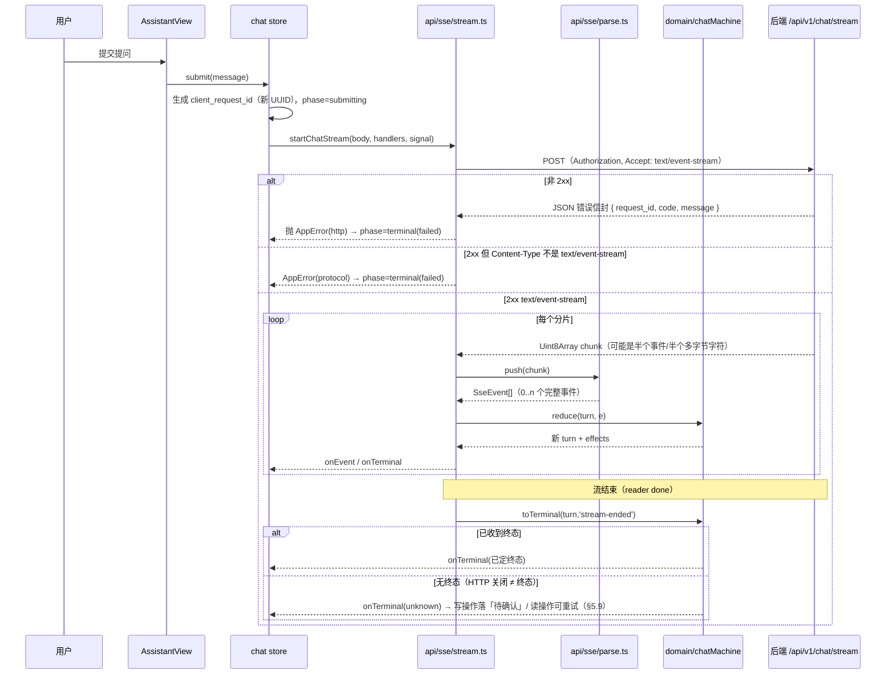

<!-- part: 20-sse-client; chapters: 5; owner: lead -->
## 5. 流式会话客户端

本章是前端最容易出错、也最难靠人工点测覆盖的部分：**分包、编码边界、去重、终态唯一、以及"HTTP 关闭不等于终态"**。
因此它的实现被刻意切成两层——**纯函数解析/状态机（`domain/` + `api/sse/parse.ts`）** 与 **I/O 驱动（`api/sse/stream.ts`）**，
前者可以用任意分片与任意事件序列做穷举单测（§15.2），后者只负责取流与派发。

### 5.1 为什么必须用 POST + `fetch` reader

HLD-D07 已定「POST + Fetch 流式读取 SSE，不以自动重连恢复执行」。这不是偏好，是被三条约束逼出来的：

| 约束 | 后果 |
| --- | --- |
| 需要携带 `Authorization` 头（HLD-D03 的不透明 Bearer） | 浏览器 `EventSource` **不能**设置自定义请求头，且不支持 POST |
| 请求体是 JSON（`client_request_id`/`conversation_id`/`message`/`history`，见 `API-REFERENCE.md`） | `EventSource` 只能 GET + query |
| 不以自动重连恢复执行（HLD-D07） | `EventSource` 的自动重连语义反而是负担：会在无 `Last-Event-ID` 语义的情况下重放请求 |

所以：`fetch(path, { method:'POST', headers:{...}, body, signal })` → 检查响应 → `response.body.getReader()`
→ 交给 §5.3 的解析器。**不使用 `EventSource`，也不引入任何 SSE 客户端库**（它们大多内建重连与
"自动解析 JSON"，会掩盖我们需要显式处理的协议违规）。

### 5.2 端到端时序



### 5.3 字节流解析器（`api/sse/parse.ts`）

**输入是字节，不是文本。** 中文与 emoji 会被切在分片边界上，所以必须在字节→文本这一段用
`TextDecoder` 的流式模式，而不是自己按字节拼字符串。

```ts
export function createSseParser(): SseParser {
  const dec = new TextDecoder('utf-8', { fatal: false })   // 不抛错：非法字节由 U+FFFD 表示并计数
  let buf = ''            // 已解码但未成行的文本
  let dataLines: string[] = []
  let eventName = ''
  let lastId = ''
  let sawBom = false
  // push(chunk) 内部：
  //   const text = dec.decode(chunk, { stream: true })      // 关键：stream:true 保留半个码点
  //   buf += (sawBom ? text : stripBom(text)); sawBom = true
  //   逐行切分并处理（见下表），遇空行 dispatch
}
```

解析规则（按 SSE 规范，逐条都要满足，且每条都有对应单测）：

| # | 规则 | 易错点 |
| --- | --- | --- |
| P1 | 行分隔符为 `CRLF`、`LF`、`CR` 三者之一 | 只按 `\n` 切会把 `CRLF` 留出多余空行，产生**幽灵 dispatch** |
| P2 | 以 `:` 开头的行是注释，忽略 | keep-alive 注释不能被当成事件 |
| P3 | `field: value`，冒号后的**第一个空格**被吃掉（仅一个） | 吃掉全部空格会破坏 `text_delta` 的前导空格 |
| P4 | 无冒号的行，整行视为字段名、值为空串 | — |
| P5 | 多个 `data:` 行以 `\n` 连接成一个 payload | 直接用最后一行的值会截断 |
| P6 | 空行触发 dispatch；若 `data` 缓冲为空则**不派发**事件（但 `id` 更新仍生效） | 把空 data 派发成空事件会导致状态机收到垃圾 |
| P7 | `event:` 决定事件名；缺省为 `message` | 我们只认 §5.5 的 6 个名字，其余记协议违规 |
| P8 | `id:` 更新 lastEventId；含 `\0` 时忽略 | 与 schema「id 与 data.seq 一致」互校 |
| P9 | `retry:` 被容忍但**不使用**（不重连） | 不得因此启用重连 |
| P10 | 流结束时（`end()`）：flush decoder（`dec.decode()` 无参）；若 `buf` 还有非空残留 → 记 `truncated-frame` 协议违规 | 忘记 flush 会丢掉最后一帧 |
| P11 | 首个分片可能带 UTF-8 BOM（U+FEFF），必须剥离 | 否则第一个字段名变成 `\uFEFFevent`，第一帧全丢 |
| P12 | 单事件 payload 上限与总缓冲上限（如 1 MiB）：超限即终止并记协议违规 | 防止服务端异常导致内存爆掉 |

**`id` 与 `data.seq` 不一致**时（schema 要求二者一致）不抛错，但记 `id-seq-mismatch` 协议违规并以 `data.seq` 为准——
因为它才是去重与顺序的判据。

**`data` 必须是 JSON**：解析失败即 `bad-event-json` 协议违规，**该事件被丢弃但不终止整轮**（
避免一个坏帧让用户丢失整段回答）。累计 3 次协议违规则终止并落 `failed`。

### 5.4 事件到状态的转换（权威口径）

状态与 `CONTRACT.md` §3.5 一致，这里是可直接实现的形状与转换表。

```ts
export interface ToolStep {
  toolCallId: string
  toolName: 'get_my_schedule' | 'search_course_docs' | 'save_study_plan'
  displayName: string
  status: 'running' | 'done' | 'failed'
  resultStatus?: 'ok' | 'empty' | 'created' | 'existing' | 'failed'
  code?: string
  planId?: string
  operationId?: string
}

export interface ChatTurn {
  clientRequestId: string        // 前端生成，body.client_request_id
  requestId?: string             // 服务端给的，来自响应或首个事件
  conversationId?: string        // ACCEPTED 事件必带
  phase: Phase                   // idle | submitting | streaming | terminal
  terminal?: TerminalState
  lastSeq: number                // 去重游标
  blocks: Array<{ answerBlockId: string; text: string }>   // 按 answer_block_id 分组
  steps: ToolStep[]              // 按 tool_call_id 归并
  citations: Reference[]         // 仅 done 事件提供
  issues: ProtocolIssue[]
}
```

| 事件 | 转换 | 必须做的事 | 不得做的事 |
| --- | --- | --- | --- |
| `status`(`ACCEPTED`) | `submitting → streaming` | 取 `conversation_id`（schema 强制必带）；把 `request_id` 存进 turn | 不得把它当终态 |
| `status`(其它 `code`) | 保持 `streaming` | 作为过程提示渲染（文案来自 content-spec，不得自造） | 不得据它判断成功/失败 |
| `tool_start` | `streaming` | 按 `tool_call_id` 新建 `running` 步骤；`tool_name` 只可能是三个白名单值，出现别的即协议违规 | 不得渲染"正在思考"一类表述（见 §5.5 的白名单） |
| `tool_end` | `streaming` | 按 `tool_call_id` 配对；`success=false ⇒ result_status='failed'` 且 `code` 必填；`created`/`existing` **均为成功**（后者是幂等命中，不是错误）；记 `plan_id`/`operation_id` | 不得把 `existing` 当失败或重复创建 |
| `token` | `streaming` | 追加 `text_delta` 到 `answer_block_id` 对应块（块可能首次出现） | 不得逐 token 触发一次渲染（§5.10 节流）；不得抢焦点 |
| `done` | `terminal` | `state='succeeded'\|'cancelled'`；`citations` 以此为准，替换过程中的临时引用 | 不得再接受后续事件 |
| `error` | `terminal failed` | 记 `code`；`AUTH_REQUIRED`/`SESSION_EXPIRED` 走 §4.3 的会话失效路径 | 不得期待它带 `plan_id`/`operation_id`（schema 禁止） |
| 第二个终态事件 | 忽略 | 记 `double-terminal` 协议违规 + 埋点 | 不得覆盖第一个终态 |

**工具步骤的收尾规则**：到终态时若仍有 `running` 的步骤，一律渲染为**未完成**（不是成功、也不是失败），
并在埋点里记 `unpaired-tool`。这直接对应用户可见的「过程区只能展示三类可核实工具动作」——
没有 `tool_end` 的动作不能显示成完成。

### 5.5 事件名与工具白名单

- 事件名只允许 `status`、`tool_start`、`tool_end`、`token`、`done`、`error`（`sse_events_v0.1.schema.json` 的六个 `const`）。
  出现别的名字 → 记 `unknown-event` 协议违规并丢弃该事件。
- `tool_name` 只允许 `get_my_schedule`、`search_course_docs`、`save_study_plan`（PRD §11.2、SRS IF-008）。
- 过程区的文案只能是这三个动作的可核实描述（如「正在读取课表」「正在检索课程资料」「正在确认是否保存」，
  逐字取自 `content-spec.md`）。**绝对不得出现「正在思考」「AI 推理中」「推理过程」「思考中」**——
  这条是硬规则，且已有自动化检查（§15.1）。

### 5.6 流内没有 HTTP 状态

SRS IF-010 明确：**同一错误在普通 API、SSE 和 MCP 中使用相同业务 `code`；HTTP 状态只适用于建立流前及普通接口，
流内通过 `error` 或 `tool_end` 的业务状态表达。**

因此实现上必须分成两段，且**不得混用**：

| 阶段 | 错误表达 | 前端路径 |
| --- | --- | --- |
| 建立流之前（连接、认证、限流、参数） | 非 2xx + JSON 错误信封 | §3.3 `kind='http'`，按 §3.4 表处理 |
| 建立流之后（执行期） | `error` 事件 / `tool_end.result_status='failed'` + `code` | 同样按 §3.4 表的 **code** 处理，**没有** `httpStatus` |

写代码时的具体禁令：**流内分支不得出现 `if (response.status === 200)` 这类判断**；
所有流内分支只看 `event.data.code` / `event.data.result_status`。

### 5.7 取消

三种取消来源，处理一致：

| 来源 | 触发 |
| --- | --- |
| 用户点「停止」 | 组件 → `chat.cancel()` |
| 路由离开 `/assistant` | 路由守卫（§7.2）；**只有进行中才提示** |
| 会话失效 | §4.3 |

动作顺序固定为：**先 `POST /api/v1/chat/requests/{request_id}/cancel`，再 `signal.abort()`**。
顺序反了会丢失服务端的取消机会。取消后：

- 本地立即把该轮标为 `cancelled`（**乐观**，用于即时反馈）；
- 但仍以服务端终态为准：若随后收到 `done(state='cancelled')` 或 `error`，以服务端为准并记埋点差异；
- 若已有写入意图（本轮出现过 `save_study_plan`），取消**不改变**写操作的核实义务（§5.9）。

### 5.8 超时

| 场景 | 超时 | 理由 |
| --- | --- | --- |
| 普通请求 | 15s（`client.ts` 默认） | NFR-PERF-001 的目标是 P95≤1s，15s 只用于兜底 |
| 建立流（首字节） | 10s | NFR-PERF-002 要求首状态事件端到端 P95≤1s |
| 流进行中「无事件间隔」 | 30s | 服务端有执行预算（SRS §8 的 504 `EXECUTION_TIMEOUT`）；30s 无任何事件即可判为异常 |
| 整轮总时长 | 不设本地上限 | 由服务端预算决定；本地设上限会与服务端不一致 |

「无事件间隔」超时**不等于**失败：按 §5.9 核实（服务端可能仍在执行）。这是最容易写错的地方——
很多实现会直接把"读超时"当失败，从而在服务端其实成功的情况下误报失败。

### 5.9 未知终态：核实而不是猜测

**HTTP 关闭 ≠ 终态。** 流结束而没有终态事件、或本地超时、或网络中断，都落到 `terminal='unknown'`。
处理原则：**读操作可以重试，写操作必须核实**。

| 本轮是否出现过写意图（`save_study_plan` / 保存草稿 / 保存计划） | `unknown` 时的处理 |
| --- | --- |
| 否（纯问答 / 查课表 / 检索） | 提示"未完成"，给「重试」；重试是**新** `client_request_id` 的新轮次 |
| 是 | 落**「待确认」**（不是失败，FR-CHAT-005 / 后端详细设计 §12.2），并按下面的核实流程处理 |

核实流程（有 `operation_id` 时优先用它，没有则用 `request_id`）：

1. **有 `operation_id`**（来自 `tool_end` 或 `error`）：`GET /api/v1/me/write-operations/{operation_id}` 轮询。
   **退避节奏以 §6.9 的唯一权威表为准**：`1s→2s→4s→8s→10s 封顶`、**无步数上限**、得到确定结果即停、页面不可见即暂停。
   若连续 5 次仍未决，则**停止轮询并保持「待确认」**，把出口交给用户（见下条第 3 点）——
   这是**终止条件**，不是另一套退避节奏（本处曾写成「间隔 1s/2s/3s/5s、最多 5 次」，与 §6.9 冲突，已按唯一权威表统一）。
2. **无 `operation_id` 但有 `request_id`**：`GET /api/v1/chat/requests/{request_id}` 查该请求的最终状态。
   注意 `CHAT_IN_PROGRESS` 表示仍在跑——此时**不要**另起新轮次（会产生重复创建，见 §3.4）。
3. **两者都拿不到结果**：保持「待确认」并给用户两个明确出口——「再查一次」与「去计划列表看看」。
   **不得**自动重发保存。这是 §3.4 中 429 行「不自动重放写操作」与 `REQUEST_ALREADY_EXISTS` 处理的同一条原则。

界面要求：待确认态的文案与「失败」**必须不同**（视觉与文字双重不同，NFR-UX-001 的状态三重表达）。

### 5.10 渲染节流与无障碍的接口

`token` 事件可能高频到达（schema 允许单次 `text_delta` 最大 4096 字符，但频率无上限）。
两条约束同时成立：**不能逐 token 触发一次渲染**，**不能让流式内容持续抢焦点**（NFR-UX-001）。

实现口径（机制细节与 `aria-live` 选择见 §12.3）：

| 项 | 口径 |
| --- | --- |
| 文本缓冲 | `token` 只写入 `blocks` 缓冲区，**不直接改 DOM** |
| 刷新 | 用 `requestAnimationFrame` 合并（同一帧内多次 `token` 只渲染一次），最长 100ms 强制 flush |
| 滚动 | 仅当用户已在底部附近（距底 < 48px）时自动跟随；用户上滑后停止跟随并显示"回到最新" |
| live region | 使用 `aria-live="polite"` 的独立节点，**按句/按 500ms 批量**提交；终态时一次性提交完整结论 |
| 焦点 | 流式过程中**绝不移动焦点**；焦点只在用户动作、终态提示、错误摘要出现时按 §12.2 的规则移动 |

### 5.11 可测性要求

`parse.ts` 与 `chatMachine.ts` 必须是纯的，且**不依赖网络**。单测必须能构造这些输入（§15.2 给出用例清单）：
按字节切在**多字节字符中间**、切在**事件中间**、切在 `CRLF` 中间；重复 `seq`；`seq` 回退；双终态；
`data` 非 JSON；空行无 `data`；BOM 开头；流在最后一帧中途结束；`tool_end` 无对应 `tool_start`。

**报告必须给出真实覆盖**：这些用例在 Windows CRLF 与 LF 两种服务端实现下都要通过。
