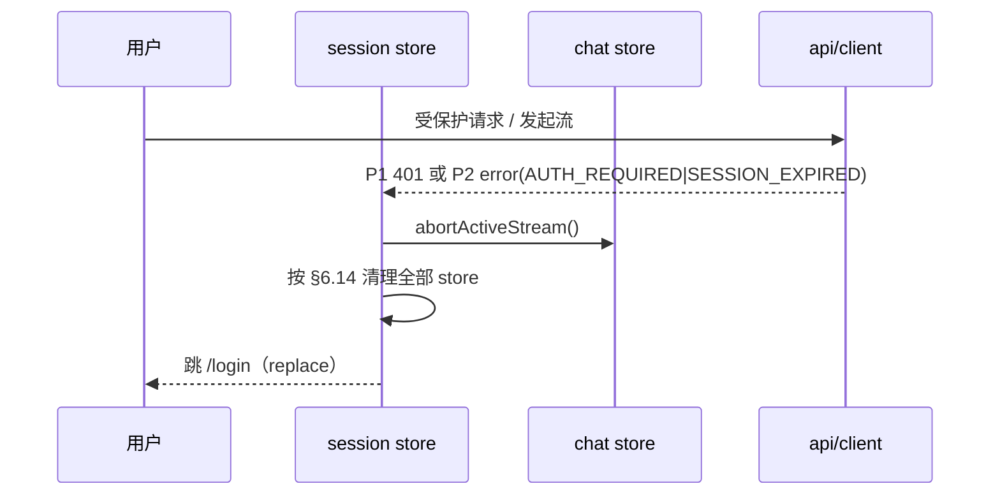
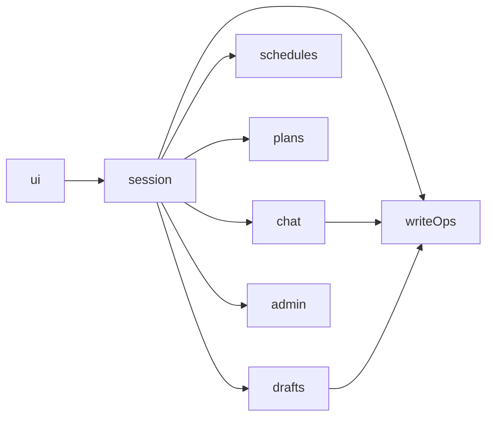

<!-- part: 30-session-and-state; chapters: 4,6; owner: sys-actions -->

## 4. 会话与鉴权

### 4.1 范围、依据与边界

本章定义**浏览器侧的会话生命周期**：令牌存放面、登录/登出、身份与角色、失效处理、多标签页后果。它不定义服务端校验算法（见后端详细设计 §6.1），也不定义路由表本身（见 §7）。

| 本章决策 | 上游依据 |
| --- | --- |
| 不透明 Bearer 会话，浏览器**仅内存**保存，刷新后重新登录，不提供自动续期 | HLD-D03、SRS FR-AUTH-001/002、SRS §3.2（登录会话有效期 2 小时；本期不自动续期） |
| 令牌只走 `Authorization: Bearer` 头 | SRS IF-001（「采用 Bearer 令牌时由 Authorization 头传递，不放入 URL」）、HLD §5.1 |
| 令牌不得出现在 URL／遥测／文件名／错误堆栈 | NFR-SEC-002、CONTRACT §3.7.4 |
| 401 与流内认证错误统一收敛为一个出口 | SRS §8（401 → 停止后续请求，重新登录）、HLD §5.4（失效后仅返回通用认证错误并结束） |
| 登出撤销当前会话并清除浏览器临时身份、问答与草稿引用 | SRS FR-AUTH-002、HLD §3.2 |
| 对话正文与临时上下文只驻留浏览器内存 | HLD-D11、SRS DEC-01、SRS FR-CHAT-002 |
| 管理入口按角色渲染，隐藏菜单不替代后端校验 | SRS FR-AUTH-004、HLD §5.2（「不以隐藏菜单替代后端校验」） |

**不在本章范围**：登录页视觉与逐字文案（见 §9 S01 与 `content-spec.md`）、SSE 字节流解析与状态机本体（见 §5）、路由守卫实现（见 §7）。需要时按 CONTRACT §3.8 用交叉引用，不重复。

### 4.2 会话模型：内存令牌

#### 4.2.1 唯一持有者与访问方式

令牌与身份只由 `session` store（§6.4）持有。请求层 `api/client.ts` **不 import 任何 store**，通过依赖倒置拿令牌，避免 `api → store → api` 环：

```ts
// api/client.ts —— 不依赖 store
type TokenProvider = () => string | null;
export function setAuthTokenProvider(p: TokenProvider): void;

// main.ts —— 唯一装配点
setAuthTokenProvider(() => useSessionStore().accessToken);
```

| 项 | 规定 | 依据 |
| --- | --- | --- |
| 存放位置 | `session` store 的私有 state（Pinia 内存态） | HLD-D03 |
| 传输方式 | `Authorization: Bearer <access_token>`（`token_type` 固定为 `Bearer`） | `openapi` `securitySchemes.UserSession`（`type: http, scheme: bearer`）、SRS IF-001 |
| 令牌来源 | 仅 `POST /api/v1/auth/login` 的响应 `data.access_token` | `openapi /api/v1/auth/login` |
| 生命期 | 到 `expires_at`、或收到 401、或主动登出，三者任一即作废 | SRS FR-AUTH-002、`openapi` `Login.expires_at` |
| 不在前端做续期 | 无 refresh token、无静默续期、无定时器重建会话 | HLD-D03、SRS §3.2 |
| 不在前端持久化 | 见 §4.2.2 与 §6.15 | NFR-SEC-002、HLD-D11 |

#### 4.2.2 NFR-SEC-002 泄漏面逐条否定

下表每行是一条**实现禁令 + 可检手段**，不是建议。判据来源：NFR-SEC-002（「令牌不可出现在 URL、遥测、文件名或错误堆栈中」）、CONTRACT §3.7.4、HLD-D03。

| # | 面 | 结论 | 强制实现措施 | 可检手段 |
| --- | --- | --- | --- | --- |
| L1 | URL（path／query／hash） | **禁止** | 令牌只进 `Authorization` 头；任何导航不得把令牌写入 `router.push` 的 path/query/hash；`/assistant` 等路由不带会话参数 | E2E 断言 `location.href` 不含令牌前缀；断言 `history` 条目无令牌 |
| L2 | `localStorage` | **禁止** | 不写、不读；不引入 `pinia-plugin-persistedstate` | E2E 遍历 `Object.keys(localStorage)` 断言为空 |
| L3 | `sessionStorage` | **禁止** | 同上；不得以「按标签隔离」为由放宽 | E2E 断言 `sessionStorage.length === 0` |
| L4 | `IndexedDB` 及任何浏览器数据库 | **禁止** | 不建库、不开事务 | E2E 断言 `indexedDB.databases()` 为空 |
| L5 | `Cache Storage` / Service Worker | **禁止** | 不注册 SW；不用 Cache API 缓存任何 `/api/v1/*` 响应（响应体含私有数据） | E2E 断言 `navigator.serviceWorker.controller === null`、`caches.keys()` 为空 |
| L6 | 遥测／埋点 | **禁止** | 只允许上报 `request_id`、错误 `code`、耗时；**禁止**上报 `Authorization` 头、`access_token`、响应体整体、草稿与计划正文 | 单测：埋点 payload 白名单校验；注入令牌后断言 payload 不含该串 |
| L7 | 文件名 | **禁止** | 下载／导出／Blob 的 `File`/`download` 名不得含令牌；上传文件名只来自用户选择的 `File.name`（NFR-SEC-003） | 单测覆盖导出路径；断言生成名只含业务字段 |
| L8 | 错误栈／异常对象 | **禁止** | `AppError` 只保留 `code`／`message`／`field_errors`／`details`（§3.3）；`fetch` 抛出的异常必须归一化，**不得**把请求头、URL 查询串或 `error.stack` 并入 message 或上报字段 | 单测：构造带 `Authorization` 的失败请求，断言归一化后对象与其 `JSON.stringify` 均不含令牌 |
| L9 | 控制台日志 | **禁止** | `console.*` 不得打印令牌或含令牌的对象；生产构建剥离调试日志 | 单测/A11y 冒烟：捕获 console 断言不含令牌 |
| L10 | 剪贴板／分享 | **禁止** | 不提供「复制会话链接」「分享对话」类入口（会话不可移植，且对话正文不入 URL） | 交互走查 |

> 令牌在这些面上「为 null」与「为空串」等价：不存在任何形式的副本。唯一的存储点就是 L1 通过的那个内存变量。

#### 4.2.3 2 小时不续期与「刷新即失效」

| 场景 | 行为 | 依据 |
| --- | --- | --- |
| 会话有效期 | 2 小时；**本期不自动续期** | SRS §3.2（登录会话有效期 2 小时；本期不自动续期） |
| 到期前 | 不发起任何续期请求；`expires_at` 只用于 UI 预判与页脚提示 | HLD-D03 |
| 到期后首次请求 | 服务端返回 401（`AUTH_REQUIRED`／`SESSION_EXPIRED`）→ 走 §4.6 | SRS §8 |
| 浏览器刷新（F5） | JS 上下文重建 → 内存令牌丢失 → 等价于未登录，**必须重新登录**；不做任何「恢复」尝试 | HLD-D03（刷新后需重新登录） |
| 关闭标签页后重开 | 同上 | HLD-D03 |
| 本地预判 | 若本地时钟已过 `session_expires_at`，可先清会话再跳登录页，省掉一次注定 401 的请求；**权威判定始终是服务端 401**，本地时钟不可信（判断项，见 §4.10-2） | 判断项 |
| 登录页提示 | 页脚「登录会话有效期 2 小时，到期后需要重新登录。」（逐字） | `content-spec.md` S01（页脚提示） |

**不做**：`setInterval` 续期、`silent renew`、`refresh_token`、跨标签恢复、「记住我」。四者都会把会话寿命或凭据副本推到 HLD-D03 之外。

#### 4.2.4 多标签页行为（令牌在内存的必然结果）

| # | 场景 | 结果 | 依据 |
| --- | --- | --- | --- |
| M1 | 在新标签页打开任一需会话路由 | 新标签是**全新 JS 上下文**，无令牌 → 路由守卫判定未登录 → 跳 `/login` | HLD-D03、CONTRACT §3.3（需会话守卫） |
| M2 | 同一账号在 N 个标签各自登录 | 产生 **N 个独立服务端会话**（每次登录建立一条 `AuthSession`） | SRS §5.2（AuthSession 表）、后端详细设计 §6.1 |
| M3 | 标签 A 登出 | 只撤销 A 的会话（「登出应撤销当前会话」），**B 仍然有效** | SRS FR-AUTH-002 |
| M4 | 管理员禁用某学生 | 服务端撤销该账号**全部**会话 → 各标签在下一次请求或流写出边界收到 401／`error` | SRS FR-AUTH-002、HLD §5.4 |
| M5 | 两个标签同时编辑同一计划 | 后提交者得 409 `VERSION_CONFLICT` → 文案「这份计划已被其他标签页修改，请重新加载后再提交；你未提交的编辑会保留。」（逐字） | `content-spec.md` S09（409 文案）、SRS DR-003 |
| M6 | 标签间共享令牌 | **禁止**用 `BroadcastChannel`／`storage` 事件传令牌。凭据离开单一 JS 上下文会扩大 NFR-SEC-002 的暴露面，且服务端会话模型未授权跨标签搬运（判断项，见 §4.10-3） | NFR-SEC-002 |
| M7 | 「清空对话」 | 只清当前标签的内存；不删除已保存计划；不跨标签广播 | `content-spec.md` S02（边界提示条逐字）、HLD §3.2 |
| M8 | 刷新后想找回未保存的草稿 | **不可能**：草稿正文只驻留内存，刷新即丢；服务端短期草稿需 `draft_id` 才能取回，而 `draft_id` 同样在内存（见 §6.8） | HLD-D11、SRS §5.3（退出或账号切换后浏览器不继续持有可展示的草稿正文） |

M1／M3／M8 必须写进产品说明与验收脚本：它们是「令牌只在内存」的直接后果，不是缺陷。M8 的处置口径见 §6.8。

### 4.3 登录 `POST /api/v1/auth/login`

| 项 | 内容 | 依据 |
| --- | --- | --- |
| 鉴权 | 无（`security: []`，唯一不需要会话的业务端点） | `openapi /api/v1/auth/login` |
| 请求体 | `account`（string，3–64）、`password`（string，1–1024），二者必填、`additionalProperties:false` | `LoginInput` |
| 成功响应 | `data.access_token`、`data.token_type`（`const "Bearer"`）、`data.expires_at`、`data.user` | `Login` |
| 成功后的落地 | `session.accessToken = data.access_token`；`session.user = data.user`；`session.expiresAt = data.expires_at`；随后按 `data.user.role` 决定是否渲染管理入口 | §6.4 |
| 信封 | 响应为 `{ request_id, data }`；`request_id` 记入 `session.lastRequestId` 供 NFR-OBS-001 关联 | `API-REFERENCE §0`、NFR-OBS-001 |
| 失败 | 见 §4.8；错误体为 `{ request_id, error: { code, message, field_errors?, details? } }` | `Error` |

**前端校验与提交规则**

1. `account` 先 `trim()` 再判长度 3–64（SRS §5.2：account「去首尾空白」）；不满则不提交，按 §11 的字段级错误就近展示。
2. `password` 不做 `trim`，1–1024。
3. 提交中禁用「登录」按钮并保留输入；响应到达前不接受第二次提交。
4. 401 → 保留 `account` 输入，清空 `password`，焦点回到密码框（`content-spec.md` S01 行为说明）。
5. 成功 → 立即离开登录页，目标为 `redirect` 指定的需会话路由，否则 `/assistant`（CONTRACT §3.3：登录后默认页）。

`POST /api/v1/auth/login` 的**失败响应不写入任何 store**：登录失败不建立会话，也不得因失败而写入令牌字段（SRS FR-AUTH-001：均不得建立会话）。

### 4.4 当前身份 `GET /api/v1/me`

| 字段 | 用途 | 依据 |
| --- | --- | --- |
| `data.user` | 身份与权限判定的唯一来源：`id`、`account`、`display_name`、`role`（`student`／`admin`）、`enabled`、`version` | `Me`、`User` |
| `data.session_expires_at` | 会话到期展示/预判；**不据此续期** | `Me` |
| `data.school_timezone` | 课表与日期展示的时区（默认 `Asia/Shanghai`，SRS §3.2） | `Me`、SRS DR-002 |
| `data.capabilities` | 服务端下发的菜单能力提示（`array<string>`） | `Me`、SRS IF-002（GET /me → 当前身份、菜单能力及学校时区） |

调用时机（其余时刻不重复调用，避免额外鉴权往返）：

| 时机 | 说明 |
| --- | --- |
| 登录成功后 | 可用登录响应的 `data.user` 先渲染，再并行拉 `/me` 补齐 `school_timezone` 与 `capabilities` |
| 刷新后的首次受保护导航 | 内存中无令牌时**不调用**（必然 401），直接跳登录页（§4.2.3） |
| 收到 403 `FORBIDDEN` 后 | 不再重试管理接口，改为回到可访问页面（SRS §8 403 行） |

**`capabilities` 的使用边界（判断项）**：`openapi` 把它定义为 `array<string>` 且**未枚举任何取值**，因此前端**禁止**对其内容做等值判断（如 `capabilities.includes('admin')`）。管理入口渲染以 `user.role === 'admin'` 为准（`User.role` 是唯一有 `enum` 的权限字段）。`capabilities` 只可用于展示性菜单排序/隐藏提示；若产品要求由它决定菜单，须先冻结取值集合。登记为 §4.10-1。

### 4.5 登出 `POST /api/v1/auth/logout`

| 项 | 内容 | 依据 |
| --- | --- | --- |
| 鉴权 | 需要当前会话（继承全局 `UserSession`） | `openapi`（global security） |
| 请求体 | 无 | `API-REFERENCE`（无请求体） |
| 成功响应 | `data.revoked`（`const true`） | `Logout` |
| 语义 | 撤销**当前**服务端会话 | SRS FR-AUTH-002 |

**登出序列（顺序固定，无论服务端结果如何，本地清理都必须完成）**

1. `chat.abortActiveStream()`：置 `AbortController.abort()`，停止接收后续事件（§4.6.3 同款动作）。
2. 调用 `POST /api/v1/auth/logout`；结果三态——200 `revoked:true`、401（会话已无效）、网络失败。
3. **不依赖第 2 步结果**：三种情况都继续执行 4–7。理由：登出的安全目标（A 标签不再持有可展示的私有状态与令牌）由本地清理达成；401 说明服务端已经撤销。
4. 按 §6.14 的顺序清空 `chat`／`drafts`／`plans`／`schedules`／`writeOps`／`admin`。
5. 清 `session`（令牌置 `null`、`user` 置 `null`）。
6. `router.replace('/login')`（用 `replace`，避免回退键回到已清理的私有页面）。
7. 若第 2 步为 401 或网络失败，仅在开发日志记录一次，不向用户展示错误——用户意图已达成。

**不做的动作**：登出**不**调用 `POST /api/v1/chat/requests/{request_id}/cancel`。取消接口需要有效会话；令牌已撤销时调用只会再收一次 401，且「客户端中止连接与取消接口是不同动作」（SRS IF-006），登出不是取消。

**不清除的内容**：已保存的计划（服务端对象）。`content-spec.md` S02 的边界提示条已向用户声明「已保存的计划不受影响」。

### 4.6 会话失效的统一处理（401 与 SSE `error`）

#### 4.6.1 两条触发路径、一个出口

失效有且只有两种到达方式，二者都调用同一个函数 `session.onAuthFailure(reason)`：

| 路径 | 触发点 | 载荷 | 依据 |
| --- | --- | --- | --- |
| P1 同步 401 | 任一 `fetch` 响应 `status === 401`，`error.code ∈ {AUTH_REQUIRED, SESSION_EXPIRED}` | `Error` 信封 | SRS §8（401 行）、`openapi` `Error.error.code` enum |
| P2 流内 error | SSE `event: error` 且 `data.code ∈ {AUTH_REQUIRED, SESSION_EXPIRED}` | `error.data` | CONTRACT §3.5（error 行）、`sse_events_v0.1.schema.json` |



**出口唯一的意义**：无论失效从哪条路径来，用户看到同一个结果、store 走同一条清理序列，不会出现「某个页面还留着上一个人的计划列表」。

#### 4.6.2 `AUTH_REQUIRED`／`SESSION_EXPIRED` 的 schema 约束与前端义务

`sse_events_v0.1.schema.json` 的 `error` 事件里有一段 `allOf`：当 `data.code ∈ {AUTH_REQUIRED, SESSION_EXPIRED}` 时，`then` 为 `not(anyOf[required plan_id, required operation_id])`。也就是**这两个码不得携带 `plan_id` 与 `operation_id`**。

| 前端义务 | 说明 | 依据 |
| --- | --- | --- |
| 不读取、不期待这两个字段 | 事件缺这两个字段是**规范行为**，不是数据缺失 | SSE schema `error.allOf` |
| 不据此推断写入结果 | 本轮的写操作是否落库**不由认证错误推断** | SRS INV-07（计划写入状态独立可核实）、FR-CHAT-005 |
| 该轮终态仍为 `failed` | CONTRACT §3.5 明确：`error` → terminal `failed` | CONTRACT §3.5 |
| 与「写操作待确认」并存 | 轮次 `failed` 与 `writeOps` 的 `pending` 可同时存在；前者不否定后者 | SRS INV-07、FR-CHAT-005 |
| 若已收到 `operation_id` | 只认两个来源：`tool_end.data.operation_id`、写端点 202 响应的 `data.operation_id`。会话有效期内用 §6.9 核实；失效清理会丢弃它（见 §4.6.3 第 4 步） | SSE schema `tool_end`、`openapi` `WriteOperation` |
| 不把私有标识写进提示 | 失效后的界面不得再展示上一身份的 `plan_id`／`operation_id`／引用 | HLD §5.4、SRS FR-AUTH-002 |

#### 4.6.3 清理序列（含活动流收尾）

顺序固定，前 3 步必须**先于**清令牌，否则收尾动作会再触发一次 401：

1. **停止接收**：`chat.abortActiveStream()` → `AbortController.abort()`；此后到达的事件一律丢弃（不再写入任何 store）。
2. **冻结该轮**：`chat.freezeActiveRound()` → 该轮 `phase = 'terminal'`、`terminal = 'unknown'`、`terminalReason = 'AUTH_FAILED'`。用 `unknown` 而不是 `failed`，与 CONTRACT §3.5「无终态 → unknown」一致：服务端可能已提交写入，前端没有证据判定失败。
3. **停止核实轮询**：`writeOps.freezeAll()` → 停止 `GET /api/v1/me/write-operations/{operation_id}` 的定时器；已登记的记录转 `frozen` 只读态。
4. **清业务态**：`chat.clear()`（含对话正文）、`drafts.clear()`（含草稿正文）、`plans.clear()`、`schedules.clear()`、`admin.clear()`、`writeOps.clear()`。清 `writeOps` 会丢弃未核实的 `operation_id`——这是 NFR-SEC-002/HLD-D03 的必然代价，见下。
5. **清会话**：`session.clear()`。
6. **导航**：`router.replace('/login')`。

**步骤 4 的用户后果（必须写进实现与用例）**：认证失效会丢失内存中的 `operation_id`。重新登录后**不存在**自动核实旧写操作的路径（`GET /api/v1/me/write-operations/{operation_id}` 需要该标识）。可用的补救路径是**列表核对**：用户在「我的计划」里查看是否已出现该计划（`GET /api/v1/me/plans`，按 `user_id` 限定）。这与 SRS FR-CHAT-005「当前用户可据此找到已保存计划」一致：核实入口是本人计划列表，不是会话内存。

**已显示的内容不撤回**：已经渲染到屏幕的正文不回滚（HLD §5.4「已写入网络或已显示的数据不能撤回」）。清理发生在导航之后的新页面，旧页面不保留。

### 4.7 角色与权限差异

| 项 | 学生（`role: "student"`） | 管理员（`role: "admin"`） | 依据 |
| --- | --- | --- | --- |
| 一级入口 | 助手／我的课表／我的计划 | 同上 + 管理中心（4 条 `/admin/*` 路由） | CONTRACT §3.3、SRS FR-AUTH-001（「获得限时会话及对应菜单」） |
| 管理入口渲染判定 | 不渲染 | `user.role === 'admin'` | `User.role` enum、SRS IF-002 |
| 私有数据范围 | 本人 `/me/*` | 本人 `/me/*`；**管理员无默认读取他人计划的接口** | SRS NFR-SEC-001、HLD §5.2 |
| 管理接口 | 不调用 | `/admin/*` | CONTRACT §3.3 守卫「需会话 + 管理员」 |
| 收到 403 `FORBIDDEN` | 回到可访问页面，**不重试** | 同左（角色不足也走同一条） | SRS §8（403 行） |
| 隐藏菜单的性质 | 隐藏入口**不是**安全边界：后端仍会 403 | 同左 | HLD §5.2（「不以隐藏菜单替代后端校验」） |

**实现规则**

1. 管理路由守卫：`session.isAuthenticated && session.user?.role === 'admin'`，否则 `router.replace('/assistant')`，**不展示 403 页面**（学生没有「越权页」可看）。管理员以外的 403 才按 §4.8 处理。
2. 顶栏/标签栏的管理入口使用同一判定函数 `session.canAdmin`，两处不得各写一份（避免出现「顶栏没有、标签栏有」）。
3. `enabled === false` 的用户不可能持有有效会话（服务端在登录与每次校验时拒绝），因此前端**不**需要 `enabled` 分支；若 `data.user.enabled === false` 出现在 `/me` 响应里（会话已失效的竞态），按 §4.6 处理。
4. 会话切换（登出后换账号登录）：必须先完成 §6.14 清理，再写入新身份，禁止新旧身份状态并存（HLD §3.2「退出、账号切换、认证失效时立即停止展示旧身份的私有状态」）。

### 4.8 本章错误处理

列格式遵循 CONTRACT §3.6（`码 | HTTP | 触发场景 | 前端行为 | 用户可见文案（来源） | 是否可重试`）。**完整码表见 §3.4**；下表只覆盖 §4 需要分支的码，未列出的码按 §3.4 处理。

| 码 | HTTP | 触发场景 | 前端行为 | 用户可见文案（来源） | 是否可重试 |
| --- | --- | --- | --- | --- | --- |
| `AUTH_REQUIRED` | 401 | 无有效会话 | `session.onAuthFailure('HTTP_401')` → §4.6.3 | 复用 SRS §8 原文（401 → 停止后续请求，重新登录）；登录页页脚用 `content-spec.md` S01「登录会话有效期 2 小时，到期后需要重新登录。」 | 否（需重新登录） |
| `SESSION_EXPIRED` | 401 | 会话过期或已撤销 | 同 `AUTH_REQUIRED` | 同左 | 否 |
| `FORBIDDEN` | 403 | 角色无权操作管理能力 | 不重试；管理路由守卫回 `/assistant`；隐藏入口已在渲染期生效 | 复用 SRS §8 原文（403 → 返回可访问页面，不重试） | 否 |
| `RESOURCE_NOT_FOUND` | 404 | 不存在或不属于当前用户 | 不区分「不存在」与「无权」，不提示目标是否存在 | 复用 SRS §8 原文（404 → 不显示目标是否真实存在） | 否 |
| `VALIDATION_FAILED` | 422 | 登录字段不合法（如 `account` 长度） | 按 `error.field_errors[]`（`field`／`reason`）就近展示，焦点移到首个错误字段 | 逐字段 `reason` 由服务端给出；字段级提示格式见 §11 | 是（修正输入后重提） |
| `INTERNAL_ERROR` | 500 | 未预期错误 | 展示安全文案 + 可复制的 `request_id` 供支持定位，不清会话 | 复用 SRS §8 原文（500 → 安全文案及 request_id） | 是 |

**禁止事项**：不得用 `error.message` 文本做分支判断（`message` 是服务端生成的用户文案，长度上限 500，会变）；分支一律基于 `error.code`。

### 4.9 与相邻章节的接口

| 对接方 | 接口 | 说明 |
| --- | --- | --- |
| §3 请求层 | `setAuthTokenProvider`、`AppError`、错误归一化 | 令牌注入见 §4.2.1；错误对象形状由 §3.3 定义，本章不新增字段 |
| §5 流式客户端 | P2 路径：`error` 事件的 `code` 冒泡到 `session.onAuthFailure` | 解析、去重、状态机本体归 §5；本章只规定失效分支 |
| §6 状态管理 | `session.clear()` 与各 store 的清理钩子 | 具体顺序见 §6.14；静态依赖方向见 §6.2 |
| §7 路由与守卫 | `requiresAuth`、`requiresAdmin` 判定函数 | 令牌存在性判定只来自 `session`；路由不带会话参数（CONTRACT §3.3） |
| §11 表单与写入确认 | 登录字段错误就近展示、`field_errors` 渲染 | 表单规范归 §11 |

### 4.10 判断项与待裁决

| # | 事项 | 现状 | 处置 |
| --- | --- | --- | --- |
| 1 | `capabilities` 取值未枚举 | `openapi Me.capabilities` 为 `array<string>`，无 `enum`；SRS 只说「菜单能力」 | 管理入口改用 `user.role`；若产品要由 `capabilities` 驱动，须先冻结取值集合 |
| 2 | 本地过期预判 | 无上游依据 | 仅作省流的 UI 优化，权威判定是服务端 401；关闭该优化不影响契约 |
| 3 | 跨标签令牌共享 | 上游未授权也未禁止 | 禁止（`BroadcastChannel`／`storage` 事件）；理由：扩大 NFR-SEC-002 暴露面 |
| 4 | 登录失败文案的二义 | `content-spec.md` S01 要求并排展示「账号或密码不正确，请重试。」与「当前账号不可用，请联系管理员。」；但 `openapi` 的 401 码集合只有 `AUTH_REQUIRED`／`SESSION_EXPIRED`，无法区分「账号禁用」；SRS FR-AUTH-001 又要求「对外使用统一认证失败文案」 | **待裁决**：若后端在登录失败时用 403 表示禁用，前端按 403 → 禁用文案分支；否则只保留统一文案。**禁止**前端解析 `message` 文本判定 |
| 5 | `DRAFT_EXPIRED` 与草稿保存版本不匹配 | SRS §8 把 410 `DRAFT_EXPIRED` 归为「临时内容失效」，`VERSION_CONFLICT` 归为「更新版本不匹配」；保存草稿时旧 `draft_version` 究竟回哪个码，`openapi` 未逐码绑定 | 两个码都实现分支（§6.8）；不预设单一码 |
| 6 | `deleted` 状态的用户文案 | `WriteOperation.state=deleted`（计划已删除的墓碑）无 `content-spec.md` 逐字句 | 不新增句子：关闭该记录并刷新列表；列表为空时用 `content-spec.md` S09「还没有学习计划。」 |
| 7 | `redirect` 参数 | CONTRACT §3.3 要求深链但未规定登录后回跳载体 | 允许 `/login?redirect=<§3.3 中的路由 name>`，只允许路由名/路径，禁止携带任何业务 query（对话正文不入 URL，SRS DEC-01／CHAT-03） |

---

## 6. 状态管理

### 6.1 范围与依据

本章定义 8 个 Pinia store 的**接口、状态形状、持久化与失效规则、依赖方向**，以及与 §3.5 流式状态机的消费接口。它不重定义状态机（§5）、不重定义类型与错误（§3）、不重定义组件（§8）。

| 决策 | 依据 |
| --- | --- |
| 用 Pinia；8 个 store 名称冻结为 `session`／`chat`／`schedules`／`plans`／`drafts`／`writeOps`／`admin`／`ui` | CONTRACT §3.1（状态：Pinia）、§3.4 |
| **默认零持久化**，对话正文、草稿正文、问答历史只驻留内存 | HLD-D11、CONTRACT §3.7 硬规则 4、SRS DEC-01 |
| 可编辑资源一律带版本字段提交 | SRS DR-003、IF-001（「更新和删除可编辑资源必须携带 expected_version」） |
| 读失败**不得**转成业务空结果 | SRS INV-05、FR-SCH-001（「数据源失败应返回错误而非空集合」） |
| 写操作结果未知时进入「待确认」并按 `operation_id` 核实 | SRS FR-CHAT-005、FR-PLAN-005、§3.5（无终态行） |

### 6.2 store 总览与依赖方向（禁止环形）



图中箭头是**静态 import 方向**（`A --> B` 表示 A 可以 import B），必须保持无环；实线只有这些。

| store | 职责（冻结） | 允许静态依赖 | 依据 |
| --- | --- | --- | --- |
| `ui` | 断点、live region 文案、全局提示 | 无 | CONTRACT §3.4 |
| `session` | 令牌（内存）、`/me` 身份、登录/登出、会话失效处理 | `ui` | CONTRACT §3.4 |
| `chat` | 当前对话轮次列表、进行中请求的流式状态、`request_id`、终态 | `session`、`ui`、`writeOps` | CONTRACT §3.4 |
| `schedules` | 我的课表；两种空态 | `session`、`ui` | CONTRACT §3.4 |
| `plans` | 计划列表与详情、`version`（并发控制） | `session`、`ui` | CONTRACT §3.4 |
| `drafts` | 草稿（未保存/已保存）、`draft_version` | `session`、`ui`、`writeOps` | CONTRACT §3.4 |
| `writeOps` | 写操作结果未知时的「待确认」态与 `operation_id` 核实轮询 | `session`、`ui` | CONTRACT §3.4 |
| `admin` | 课程/学生/课表维护、文档与批次 | `session`、`ui` | CONTRACT §3.4 |

**反向通知不用 import**：`session` 需要清空其它 store（§6.14），但不能 import 它们（会成环）。做法是**注册回调**：

```ts
// stores/session.ts
type SessionCleanup = () => void;
function registerCleanup(fn: SessionCleanup): void;   // 由各 store 在 setup 时注册
function onAuthFailure(reason: AuthFailureReason): void; // 内部按固定顺序调用已注册回调
```

各 store 在自身 `setup` 内调用 `useSessionStore().registerCleanup(() => store.clear())`，因此依赖方向仍是「子 → 父」。**禁止**用全局事件总线或 `window` 事件做同一件事（无法类型化清理顺序）。

### 6.3 通用约定

| 约定 | 规定 |
| --- | --- |
| 响应信封 | 所有响应为 `{ request_id, data }`；store 成功后把 `request_id` 记入自身 `lastRequestId`（NFR-OBS-001 贯通关联） |
| 嵌套字段的来源 | `API-REFERENCE.md` 只展开到响应 `data` 的**顶层**字段，嵌套对象渲染为 `object`／`array<object>`。本文用到的嵌套子字段以 `openapi_v0.1.json` 的 `components.schemas` 为准，共 5 个：`Document`（`original_name`／`file_type`／`byte_size`／`visibility`／`processing_state`／`uploaded_at`／`cleanup_state`／`batch_id`／`version`）、`Task`（`task_id`／`state`／`error_code`／`retryable`）、`Error.error`（`code`／`message`／`field_errors`／`details`）与 `FieldError`（`field`／`reason`）、`ErrorDetails`（`existing_request_id`／`operation_id`／`plan_id`／`state`／`overlaps`／`retryable`），以及 multipart 请求体 `Upload`（`files`／`allow_duplicate_names`，`API-REFERENCE` 未渲染上传请求体） |
| 错误表示 | 每个 store 有 `error: AppError \| null`；`AppError` 形状由 §3.3 定义。禁止把 `Error` 原始对象塞进 state（会把请求头带进 state，违反 §4.2.2 L8） |
| 加载态 | 统一三值 + 空态四分（见 §6.6）：`status: 'idle' \| 'loading' \| 'ready' \| 'error'`；**「空」不是独立 status**，而是 `ready && items.length === 0` 且 `error === null` |
| 码点计数 | 所有长度校验按 Unicode 码点：`[...s].length`（SRS DR-001「字符串上限按 Unicode 码点计数」） |
| 幂等键 | 仅 4 个端点接受 `Idempotency-Key` 头：`POST /me/plans`、`POST /me/drafts/{draft_id}/save`、`POST /admin/documents/{id}/rebuild`、`POST /admin/documents/{id}/cleanup-retry`（依据：`API-REFERENCE` 各端点参数/头）。**`POST /chat/stream` 没有该头**，其去重靠请求体 `client_request_id` |
| 幂等键取值 | 同一逻辑写入必须复用同一键（`IdempotencyKey` 描述：「同一逻辑写入必须复用」）；键值须匹配 `^[A-Za-z0-9._:-]+$`、≤96 |
| 状态机术语 | `phase`／`terminal` 四值（`succeeded`／`cancelled`／`failed`／`unknown`）严格照 §3.5，store 不新增终态 |
| 不持久化 | 见 §6.15：不引入任何持久化插件 |

### 6.4 `session` store

```ts
// stores/session.ts
type AuthFailureReason = 'HTTP_401' | 'SSE_ERROR';

interface SessionState {
  accessToken: string | null;        // 唯一存放点，见 §4.2.2
  tokenType: 'Bearer' | null;
  expiresAt: string | null;          // Login.expires_at / Me.session_expires_at
  user: User | null;                 // User: id/account/display_name/role/enabled/version
  schoolTimezone: string | null;     // Me.school_timezone
  capabilities: string[];            // Me.capabilities（仅展示，见 §4.4）
  status: 'anonymous' | 'authenticating' | 'authenticated' | 'expired';
  error: AppError | null;
  lastRequestId: string | null;
}

interface SessionStore {
  // getters
  readonly isAuthenticated: boolean;         // accessToken !== null && status === 'authenticated'
  readonly canAdmin: boolean;                // user?.role === 'admin'（§4.7）
  // actions
  login(input: LoginInput): Promise<void>;            // POST /api/v1/auth/login
  fetchMe(): Promise<void>;                           // GET  /api/v1/me
  logout(): Promise<void>;                            // POST /api/v1/auth/logout（§4.5 序列）
  onAuthFailure(reason: AuthFailureReason): void;      // §4.6，唯一失效出口
  registerCleanup(fn: () => void): void;              // 供各 store 注册清理钩子
  clear(): void;                                      // 清令牌与身份，不导航（导航由 onAuthFailure 负责）
}
```

| 规则 | 说明 | 依据 |
| --- | --- | --- |
| `login` 失败不改 state | 失败时只写 `error`，`accessToken` 保持 `null` | SRS FR-AUTH-001 |
| `fetchMe` 只填 `schoolTimezone`/`capabilities`/`user` | 不回写令牌（`/me` 响应不含令牌） | `openapi GET /api/v1/me` |
| `logout` 幂等 | 无论响应如何都完成 §4.5 的第 4–7 步 | SRS FR-AUTH-002 |
| `clear()` 不发请求 | 纯本地 | — |
| 令牌不进 URL/日志/埋点 | 见 §4.2.2 | NFR-SEC-002 |

### 6.5 `chat` store（消费 §3.5 状态机）

```ts
// stores/chat.ts
type StreamPhase = 'idle' | 'submitting' | 'streaming' | 'terminal';
type TerminalState = 'succeeded' | 'cancelled' | 'failed' | 'unknown';

interface ChatStepVM {                 // 由 tool_start / tool_end 配对而来
  toolCallId: string;
  toolName: 'get_my_schedule' | 'search_course_docs' | 'save_study_plan';
  displayName: string;                 // 逐字取自事件，前端不得改写
  status: 'running' | 'ok' | 'empty' | 'created' | 'existing' | 'failed';
  code?: string;                       // success=false 时必有
  planId?: string;                     // tool_end.plan_id
  operationId?: string;                // tool_end.operation_id → 移交 writeOps
}

interface ChatRound {
  clientRequestId: string;             // ChatInput.client_request_id
  requestId: string | null;            // 响应/首事件给出
  conversationId: string | null;       // status.data.conversation_id（ACCEPTED 必有）
  phase: StreamPhase;
  lastSeq: number;                     // 去重水位线
  seen: Set<string>;                   // `${request_id}:${seq}`
  blocks: Map<string, string>;         // answer_block_id → 正文
  steps: ChatStepVM[];
  terminal: TerminalState | null;
  terminalReason: string | null;
  citations: Reference[];              // 以 done.citations 为准
  planId: string | null;               // done.plan_id
  operationId: string | null;          // done.operation_id
  protocolViolations: string[];        // 第二个终态等
  transportClosed: boolean;
}

interface ChatStore {
  rounds: ChatRound[];
  activeIndex: number | null;
  status: 'idle' | 'loading' | 'ready' | 'error';
  error: AppError | null;
  lastRequestId: string | null;

  submit(message: string): Promise<void>;             // 发起一轮（§3.5「发起」行）
  applyEvent(ev: SseEvent): void;                     // 状态机唯一入口（下表）
  onTransportClosed(roundIndex: number): void;        // HTTP 关闭 ≠ 终态
  verifyByState(requestId: string): Promise<void>;    // GET /api/v1/chat/requests/{request_id}
  cancel(requestId: string): Promise<void>;           // POST .../cancel + AbortController.abort()
  abortActiveStream(): void;                          // 仅 abort，不调接口（§4.5/§4.6.3）
  freezeActiveRound(reason: 'AUTH_FAILED' | 'LOGOUT'): void;
  clear(): void;                                      // 清空全部轮次与正文（HLD-D11）
}
```

**`submit(message)` 规则**

1. `message` 去首尾空白后非空，且 `[...message].length <= 2000`；否则不发请求（SRS FR-CHAT-001、SRS §3.2）。空白时按钮保持禁用（`content-spec.md` S02）。
2. 生成 `client_request_id`：`crypto.randomUUID()`（36 字符、含 `-`，满足 `^[A-Za-z0-9_-]+$` 与 ≤64）。
3. `conversation_id` 取本会话内**最近一轮**的 `conversationId`；首轮不传该字段（`conversation_id` 非必填）。
4. `history` 由本地轮次构造，只含 `role ∈ {user, assistant}` 的完整问答对，`content` ≤20000，**最多 20 轮**（SRS §3.2 传入历史轮数 20）；**禁止**把工具结果、草稿标识或任何 `system` 内容放进 `history`（SRS FR-CHAT-002）。
5. **不带 `Idempotency-Key` 头**（`POST /api/v1/chat/stream` 无该头）；重复提交由 `client_request_id` 去重（SRS FR-CHAT-001）。
6. 置 `phase = 'submitting'`，`terminal = null`，`seen = new Set()`，`lastSeq = 0`。
7. 同一会话内已有一轮处于 `submitting`／`streaming` 时**不得**发起第二轮；若服务端返回 409 `CHAT_IN_PROGRESS`／`REQUEST_ALREADY_EXISTS`，用 `error.details.existing_request_id` 调 `verifyByState`（SRS §8 409 行「查询原请求状态」）。

**`applyEvent(ev)` 与 §3.5 的逐行对应（store 侧义务）**

| §3.5 事件 | store 实现 | 依据 |
| --- | --- | --- |
| 发起 | `phase='submitting'`；记录 `request_id`（响应或首事件） | §3.5 |
| `status` | `phase='streaming'`；`code==='ACCEPTED'` 时**必须**取到 `conversation_id`，取不到则记 `protocolViolations` 并按协议违约处理；`code` 属容量类（`CAPACITY_LIMITED`／`CALL_LIMIT_REACHED`）时给出可理解提示；**若带 `draft_id`/`draft_version` → 调 `drafts.bind()`**（§6.8） | §3.5、SSE schema `status` |
| `tool_start` | 按 `tool_call_id` 建步骤；`display_name` 原样存；`tool_name` 只可能是白名单三值 | §3.5、SSE schema `tool_name` enum |
| `tool_end` | 按 `tool_call_id` 配对；`success=false` ⇒ `status='failed'` 且 `code` 必填；`created`/`existing` **都算成功**（后者是幂等命中） | §3.5、SSE schema `tool_end.allOf` |
| `token` | 把 `text_delta` 追加到 `blocks.get(answer_block_id)`；**不得**触发焦点/滚动抢占（NFR-UX-001「流式内容不持续抢夺焦点」） | §3.5、NFR-UX-001 |
| `done` | `terminal = data.state`（`succeeded`／`cancelled`）；`citations = data.citations`；`planId`／`operationId` 按需记录 | §3.5、SSE schema `done` |
| `error` | `terminal='failed'`；`code` 冒泡（401 两码走 §4.6）；**不读** `plan_id`／`operation_id` | §3.5、SSE schema `error.allOf` |
| 第二个终态事件 | **忽略**并 push `protocol_violation`；一轮最多一个终态 | §3.5 |
| `seq` 重复／倒退 | 去重键 `k` = `request_id + ":" + seq`；`if (seen.has(k) \|\| ev.data.seq <= lastSeq) return;`；**不得用覆盖代替去重** | §3.5 |
| 流结束但无终态 | `terminal = 'unknown'`；**`transportClosed=true` 不等于终态** | §3.5 |
| 取消 | `cancel()`：`POST /api/v1/chat/requests/{request_id}/cancel` + `AbortController.abort()`；取消后仍以服务端终态为准 | §3.5、SRS IF-006 |
| 断线 | **不自动重连、不续传**；提示后允许用户重发（新 `client_request_id` → 新 `request_id`） | §3.5、HLD-D07／D11 |

**`onTransportClosed(roundIndex)`：HTTP 关闭 ≠ 终态**

1. 置 `transportClosed = true`。
2. 若 `terminal !== null`（已收到 `done`/`error`）→ 不动终态。**正常关闭就是成功路径**。
3. 若 `terminal === null` → `terminal = 'unknown'`，并调用 `verifyByState(request_id)` 用服务端权威状态核实（`GET /api/v1/chat/requests/{request_id}`）。
4. `ChatState.state` 映射（只读核实，不改服务端）：

| `ChatState.state` | 前端处置 | 依据 |
| --- | --- | --- |
| `accepted` / `running` | 仍是「结果待确认」；不判定失败，不判定未写入 | SRS FR-CHAT-005 |
| `succeeded` | 显示完成；`ChatState.plan_id`／`operation_id` 存在时移交 `writeOps` 核实 | `openapi ChatState` |
| `failed` | 显示失败；`terminal_reason` 可选展示 | `openapi ChatState` |
| `cancelled` | 显示已取消 | `openapi ChatState` |

5. 写操作部分：本轮出现过 `tool_end.operation_id` 或 `done.operation_id` → 调 `writeOps.track(operationId)`（§6.9）。读操作（`get_my_schedule`／`search_course_docs`）失败时只提示可重试（SRS FR-CHAT-005「只读失败可以用新请求重试」）。

**对话正文的边界**：`blocks` 只存在于内存；`clear()` 后不可恢复（HLD-D11）。UI 上必须向用户声明这一边界（`content-spec.md` S02 边界提示条逐字）。

### 6.6 `schedules` store

```ts
// stores/schedules.ts
interface SchedulesState {
  items: Schedule[];            // Schedule: id/student_id/course_id/course_name/class_date/start_time/end_time/location/version
  page: number; pageSize: number; total: number;
  fromDate: string | null; toDate: string | null;   // 回显服务端 from_date / to_date
  schoolTimezone: string | null;                    // SchedulePage.school_timezone
  status: 'idle' | 'loading' | 'ready' | 'error';
  error: AppError | null;
  lastRequestId: string | null;
}
interface SchedulesStore {
  fetchMine(p?: { page?: number; page_size?: number; from_date?: string; to_date?: string }): Promise<void>;
  clear(): void;
}
```

| 规则 | 说明 | 依据 |
| --- | --- | --- |
| 默认查询 | 不传日期即服务端当日（学校时区） | SRS FR-SCH-001（「默认查询学校时区的当日记录」） |
| 跨度 | 单次最多 31 个自然日，含起止（SRS §3.2）；前端在选择器上限制，不发送超限请求 | SRS §3.2、`content-spec.md` S07「单次最多查询 31 天」 |
| 只传一端 | 视为查询该单日 | SRS FR-SCH-001 |
| 时区 | 日期展示用 `schoolTimezone`，不用浏览器时区；时间不加时区偏移 | SRS DR-002、`content-spec.md` S07 页脚 |
| **两种空态必须分开** | `items.length === 0 && error === null` ⇒ 成功的空（`content-spec.md` S08①「2026-10-22（周四）没有课程安排。」）；`error !== null` ⇒ 服务异常（S08②「课表数据暂时无法读取，这不代表当天没有课。」）。**禁止**把错误转成空列表 | SRS FR-SCH-001（「数据源失败应返回错误而非空集合」）、SRS INV-05、`content-spec.md` S08 |
| 排序 | 直接用服务端返回顺序（服务端按日期、开始时间、ID 升序） | SRS FR-SCH-001 |
| 失效 | 登出/失效清理；切换查询日期即整表替换（不做增量合并，避免跨日期串行） | §6.14 |

### 6.7 `plans` store（`version`／`expected_version`）

```ts
// stores/plans.ts
interface PlansState {
  items: Plan[];               // Plan: id/title/goal/start_date/end_date/content/source/basis_types/references/version/created_at/updated_at
  page: number; pageSize: number; total: number;
  titleFilter: string;         // → query `title`
  detail: Plan | null;
  status: 'idle' | 'loading' | 'ready' | 'error';
  error: AppError | null;
  lastRequestId: string | null;
}
interface PlansStore {
  list(p?: { page?: number; page_size?: number; title?: string }): Promise<void>;
  get(id: string): Promise<void>;                                  // GET /me/plans/{id}
  create(input: PlanCreate, idempotencyKey: string): Promise<CreateOutcome>;
  patch(id: string, input: Omit<PlanPatch, 'expected_version'>): Promise<void>; // 自动带 detail.version
  remove(id: string, expectedVersion: number): Promise<void>;      // DELETE ?expected_version=
  clear(): void;
}
type CreateOutcome =
  | { kind: 'created';  operationId: string; planId: string }   // 201 SaveCreatedResult(status=created)
  | { kind: 'existing'; operationId: string; planId: string }   // 200 SaveReusedResult(status=existing) 幂等命中
  | { kind: 'deleted';  operationId: string; planId: string }   // 200 SaveReusedResult(status=deleted) 计划已被删除的墓碑
  | { kind: 'pending';  operationId: string };                  // 202 WriteOperation → §6.9
```

| 规则 | 说明 | 依据 |
| --- | --- | --- |
| 创建必须带 `Idempotency-Key` | 键匹配 `^[A-Za-z0-9._:-]+$`、≤96；同一逻辑创建复用同一键 | `openapi`（`IdempotencyKey` 参数）、SRS IF-001 |
| 创建成功不回填整份 Plan | 201/200 只返回 `status`/`operation_id`/`plan_id`，需再 `get(id)` 取完整计划 | `openapi` `SaveCreatedResult`／`SaveReusedResult` |
| `existing` 不是错误 | 幂等命中：直接复用既有 `plan_id` 并跳详情，**不显示为失败** | §3.5（「`created`/`existing` 都算成功」）、SRS FR-PLAN-004 |
| `deleted` | 计划已删除的墓碑：不可复活、不重新创建；提示后刷新列表 | SRS §5.3（操作墓碑）、SRS §7.3 |
| `pending`（202） | 立即进入 §6.9 待确认流程，**不**显示「保存成功」 | SRS FR-PLAN-005（「只有数据库确认提交后才显示“保存成功”，并提供 plan_id 和详情入口」） |
| 更新 | `PATCH /me/plans/{id}` 请求体必须含 `expected_version`（不是 `version`、不是 `expected_draft_version`） | `PlanPatch.required = [expected_version]` |
| 删除 | `DELETE /me/plans/{id}?expected_version=`（**query 参数**，不是 body） | `openapi DELETE /me/plans/{id}` |
| 409 冲突 | `VERSION_CONFLICT` → 保留用户未提交的编辑、重新加载详情，文案「这份计划已被其他标签页修改，请重新加载后再提交；你未提交的编辑会保留。」（逐字） | SRS §8 409 行、SRS DR-003、`content-spec.md` S09 |
| 空列表 | `items=[]` 且 `error===null` ⇒ `content-spec.md` S09「还没有学习计划。」+「手动新建」 | SRS DR-005（空列表 `items=[]`）、`content-spec.md` S09 |
| `source` 不可改 | 请求体**没有** `source` 字段，不得提交 | SRS IF-005（「手动创建不接受 source=assistant、user_id 或 save_grant」） |

### 6.8 `drafts` store（`draft_version`／`expected_draft_version`）

```ts
// stores/drafts.ts
interface DraftsState {
  draftId: string | null;
  draftVersion: number | null;      // Draft.draft_version
  operationId: string | null;       // Draft.operation_id（服务端预分配）
  fields: { title: string; goal: string | null; start_date: string | null; end_date: string | null; content: string };
  basisTypes: Array<'schedule' | 'documents' | 'general'>;
  references: Reference[];
  expiresAt: string | null;         // Draft.expires_at
  saved: boolean;                   // 已保存（planId 非空）→ 「已保存」而非「未保存」
  planId: string | null;
  dirty: boolean;                   // 本地有未提交编辑 → 重新触发保存入口
  status: 'idle' | 'loading' | 'ready' | 'error';
  error: AppError | null;
  lastRequestId: string | null;
}
interface DraftsStore {
  bind(draftId: string, draftVersion?: number): void;   // 由 chat 的 status 事件触发
  load(draftId: string): Promise<void>;                 // GET /me/drafts/{draft_id}
  revise(patch: Omit<DraftPatch, 'expected_draft_version'>): Promise<void>; // PATCH，自动带 draftVersion
  save(idempotencyKey: string): Promise<SaveOutcome>;   // POST /me/drafts/{draft_id}/save
  clear(): void;
}
type SaveOutcome =
  | { kind: 'created';  operationId: string; planId: string }
  | { kind: 'existing'; operationId: string; planId: string }
  | { kind: 'deleted';  operationId: string; planId: string }
  | { kind: 'pending';  operationId: string };
```

| 规则 | 说明 | 依据 |
| --- | --- | --- |
| 草稿来源 | `status` 事件携带 `draft_id`／`draft_version` 时 `bind()`；随后 `load()` 取全文 | SSE schema `status`（可选 `draft_id`/`draft_version`）、SRS IF-007 |
| 编辑产生新版本 | `PATCH` 必带 `expected_draft_version`；成功后用响应覆盖 `draftVersion` | `DraftPatch.required`、SRS IF-005 |
| 保存带 `draft_version` | `POST .../save` 请求体只有 `draft_version`（+ 头 `Idempotency-Key`）；**不得夹带正文改写** | `openapi` `DraftSave`、SRS IF-005 |
| 编辑后旧许可失效 | `dirty=true` 时禁止沿用旧版本的保存动作；须先 `revise()` 再 `save()` | SRS §7.3（旧版本许可不得继续消费）、FR-PLAN-005 |
| 过期 | 410 `DRAFT_EXPIRED`（草稿有效期 30 分钟，SRS §3.2）→ 清本地草稿并提示重新生成；**不得**用客户端 assistant 文本重建草稿 | SRS §3.2、SRS FR-PLAN-002 |
| 版本不匹配 | 两个码都要分支：410 `DRAFT_EXPIRED` 与 409 `VERSION_CONFLICT`（见 §4.10-5） | SRS §8 |
| 未保存标记 | 「未保存」= 有 `draftId` 且 `planId === null`；标记必须**文字 + 视觉**双重（`content-spec.md` S06） | `content-spec.md` S06 |
| 刷新即丢 | `draft_id` 只在内存；刷新后无法取回（§4.2.4 M8） | HLD-D11 |

### 6.9 `writeOps` store（写操作待确认与 `operation_id` 核实）

```ts
// stores/writeOps.ts
type WriteOpState = 'pending' | 'succeeded' | 'failed' | 'deleted';
type Resolution = 'confirmed' | 'recovering';

interface WriteOpRecord {
  operationId: string;
  state: WriteOpState;
  resolution: Resolution;
  planId?: string;            // state ∈ {succeeded, deleted} 时必有
  errorCode?: string;
  retryable: boolean;
  source: 'draft-save' | 'plan-create' | 'chat-tool' | 'chat-done';
  firstSeenAt: number; lastPolledAt: number | null; pollCount: number;
  frozen: boolean;            // 会话失效后冻结，不再轮询
  lastRequestId: string | null;
}

interface WriteOpsStore {
  records: Record<string, WriteOpRecord>;
  track(input: { operationId: string; source: WriteOpRecord['source'] }): void; // 进入待确认并开始核实
  verify(operationId: string): Promise<void>;   // GET /api/v1/me/write-operations/{operation_id}
  freezeAll(): void;                            // §4.6.3 第 3 步
  clear(): void;
}
```

**状态来源与判定（不新增状态）**

| `WriteOperation` 字段 | 判定 | 依据 |
| --- | --- | --- |
| `state = pending`、`resolution = confirmed` | 已确认受理、尚未确认结果 → 继续核实 | `openapi WriteOperation` |
| `state = pending`、`resolution = recovering` | 恢复中（提交异常导致结果未知）→ 继续核实；schema 强制 `recovering` 时 `state` 必为 `pending` | `WriteOperation.allOf` 第二段、SRS §7.3 |
| `state = succeeded` | 写入成功；`plan_id` **必有** → 显示「已保存 · 计划编号 plan_7Q2F9K」（逐字形态，实际编号取自 `plan_id`）并给详情入口 | `WriteOperation.allOf` 第一段、`content-spec.md` S06 |
| `state = failed` | 明确失败；按 `error_code`（合法码集合见 §3.4）与 `retryable` 决定是否给重试入口 | SRS FR-PLAN-005、SRS §8 |
| `state = deleted` | 曾成功、计划已被删除的墓碑：关闭记录，**不重新创建** | SRS §5.3、§7.3 |

**何时进入待确认（三个入口，来源必须记录）**

| 入口 | 触发 | 依据 |
| --- | --- | --- |
| `draft-save` | `POST /me/drafts/{id}/save` 返回 **202**（`data.operation_id`） | `openapi` 202 → `WriteOperation`、FR-PLAN-005 |
| `plan-create` | `POST /me/plans` 返回 **202**（`data.operation_id`） | `openapi` 202、SRS FR-PLAN-005 |
| `chat-tool` / `chat-done` | 流内 `tool_end.data.operation_id` 或 `done.data.operation_id`；或 §3.5「流结束但无终态」且本轮含写工具 | SSE schema `tool_end`/`done`、§3.5、FR-CHAT-005 |

**核实节奏（判断项，无上游数值依据）**

| 项 | 规定 |
| --- | --- |
| 首查 | `track()` 后立即调用一次 `verify()`（`GET /api/v1/me/write-operations/{operation_id}`） |
| 退避（**唯一权威表**） | 未决时按 1s → 2s → 4s → 8s → 上限 10s 的指数退避继续核实；**无步数上限**，得到确定结果即停，页面不可见即暂停。**全文档的 `operation_id` 核实节奏以本行为准**（§5.9 与 §9.0 均指向此处；管理端批次状态轮询是另一套间隔，见 §9.0 与 §16.5 T15） |
| 停止条件 | `state !== 'pending'`；或 `frozen`；或用户离开该草稿/计划上下文；或登出（§4.6.3） |
| 手动入口 | 页面提供次级按钮「查询写入状态」（`content-spec.md` S06 逐字）调用 `verify()` |
| 提示文案 | 「写入结果尚未确认，请勿重复创建；可稍后查询状态。」（逐字，`content-spec.md` S06） |
| 禁止 | 待确认期间**不得**再次提交同一逻辑保存（会撞 `IDEMPOTENCY_CONFLICT`／`SAVE_LIMIT_REACHED`；依据 SRS FR-PLAN-005、SRS §8 409 行） |

**与 chat 轮次的解耦**：`chat` 的 `terminal` 与 `writeOps` 的记录**互不推断**（SRS INV-07）。一轮 `failed` 可以有 `writeOps.state = succeeded`；一轮 `succeeded` 也可以没有写操作。UI 需要分别表达这两件事。

**不新增文案**：本 store 不产生新句子；`failed` 的文案按 `error_code` 取 §3.4 的对应项，缺项写「复用 SRS §8 原文」。

### 6.10 `admin` store

```ts
// stores/admin.ts
interface AdminState {
  courses: { items: Course[]; page: number; pageSize: number; total: number; query: string; enabled: boolean | null };
  students: { items: User[]; page: number; pageSize: number; total: number; query: string; enabled: boolean | null };
  schedules: { items: Schedule[]; page: number; pageSize: number; total: number; studentId: string | null; fromDate: string | null; toDate: string | null; schoolTimezone: string | null };
  documents: { items: Document[]; page: number; pageSize: number; total: number; name: string | null; state: string | null };
  batch: Batch | null;                       // Batch: batch_id/state/published/documents/tasks/error_code
  documentText: DocumentText | null;         // document_id/version_id/offset/next_offset/text
  overlap: Schedule[] | null;                // 409 SCHEDULE_OVERLAP 的 error.details.overlaps
  status: 'idle' | 'loading' | 'ready' | 'error';
  error: AppError | null;
  lastRequestId: string | null;
}
interface AdminStore {
  listCourses(p?: { page?: number; page_size?: number; query?: string; enabled?: boolean }): Promise<void>;
  createCourse(input: CourseCreate): Promise<Course>;
  patchCourse(id: string, input: Omit<CoursePatch, 'expected_version'>, expectedVersion: number): Promise<Course>;
  listStudents(p?: { page?: number; page_size?: number; query?: string; enabled?: boolean }): Promise<void>;
  createStudent(input: StudentCreate): Promise<User>;
  patchStudent(id: string, input: Omit<StudentPatch, 'expected_version'>, expectedVersion: number): Promise<User>;
  listAdminSchedules(p: { student_id: string; page?: number; page_size?: number; from_date?: string; to_date?: string }): Promise<void>;
  createSchedule(input: ScheduleCreate): Promise<Schedule>;
  patchSchedule(id: string, input: Omit<SchedulePatch, 'expected_version'>): Promise<Schedule>;
  deleteSchedule(id: string, expectedVersion: number): Promise<{ schedule_id: string; audit_id: string }>;
  uploadBatch(files: File[], opts?: { allow_duplicate_names?: boolean }): Promise<Batch>;   // multipart
  getBatch(batchId: string): Promise<Batch>;
  listDocuments(p?: { page?: number; page_size?: number; name?: string; state?: string }): Promise<void>;
  previewDocumentText(id: string, p?: { offset?: number; limit?: number }): Promise<DocumentText>;
  rebuildDocument(id: string, expectedVersion: number, idempotencyKey: string): Promise<DocumentMutation>;
  deleteDocument(id: string, expectedVersion: number): Promise<DocumentMutation>;
  retryCleanup(id: string, idempotencyKey: string): Promise<DocumentMutation>;
  clear(): void;
}
```

| 规则 | 说明 | 依据 |
| --- | --- | --- |
| 全部动作需管理员 | 路由守卫已拦；接口仍会 403，前端保留 `FORBIDDEN` 分支 | SRS FR-AUTH-004、HLD §5.2 |
| 课程代码不可改 | `CoursePatch` 无 `code` 字段；表单把代码渲染为只读并说明原因 | SRS FR-COURSE-001、`content-spec.md` S10 |
| 学生只改显示名/启用 | `StudentPatch` 只有 `display_name`／`enabled`／`expected_version` | `StudentPatch`、SRS IF-002 |
| 上传字段 | multipart 字段为 `files`（1–10 个）与可选 `allow_duplicate_names`；同名时先由服务端返回提示再按独立文档继续 | `Upload`（`files` minItems 1 / maxItems 10）、SRS FR-DOC-004 |
| 上传即异步 | 202 → 只拿到 `batch_id` 与状态；进度靠 `getBatch()` 轮询 | `openapi` 202、SRS FR-DOC-002 |
| 批次四种展示态 | `Batch.state`（`accepted`／`processing`／`published`／`compensating`／`failed`）+ `published`；整批回滚提示用 `content-spec.md` S11 逐字「本批 1 个文件失败，整批未发布；其他批次不受影响。」 | `Batch`、`content-spec.md` S11 |
| 文档状态映射（展示层） | `processing_state` → 展示：`available`+`visibility==='shared'` ⇒ 可检索；`processing`／`rebuilding` ⇒ 处理中；`failed` ⇒ 失败；`deleting` ⇒ 删除中；`delete_failed` ⇒ 删除失败；`deleted` ⇒ 不展示。S11 的 5 态展示由该映射驱动 | `Document.processing_state`／`visibility`、SRS §7.2（检索须同时满足批次发布、shared、active）、`content-spec.md` S11 |
| 文档变更并发 | `rebuild`／`delete`／`cleanup-retry` 返回 202 + `DocumentMutation`（含 `task`）；并行变更回 409 `DOCUMENT_BUSY`，等待或提示 | `DocumentMutation`、SRS §8 409 行 |
| 课表重叠 | 409 `SCHEDULE_OVERLAP` 时读 `error.details.overlaps`（`array<Schedule>`）渲染冲突摘要；覆盖提交须 `overlap_acknowledged: true` + 非空 `reason` | `ErrorDetails.overlaps`、`ScheduleCreate`／`SchedulePatch`、SRS §8、`content-spec.md` S12 |
| 精确重复 | 409 `DUPLICATE_SCHEDULE` **始终拒绝**，不因 `overlap_acknowledged` 放行 | SRS FR-SCH-004、`content-spec.md` S12 |
| 审计标识 | 删除课表返回 `audit_id`，仅用于回执，不拼进 URL | `ScheduleDelete` |
| 名单/课程列表空态 | `items=[]` 且无错误 ⇒ 空列表态 | SRS DR-005 |
| 失效 | 登出/失权即 `clear()` | §6.14 |

**`admin` 的 refresh 规则**：文档批次用**定时轮询** `getBatch()`（间隔属判断项，建议 3s，批次进入终态 `published`/`failed` 即停）；课程/学生/课表/文档列表**不轮询**，只在显式动作后失效重取（§6.12）。

### 6.11 `ui` store

```ts
// stores/ui.ts
type Breakpoint = 'base' | 'xs' | 'sm' | 'md' | 'lg' | 'xl';   // 0 / 480 / 768 / 1024 / 1200 / 1440

interface UiState {
  breakpoint: Breakpoint;      // 由 matchMedia 驱动，取值只用契约断点
  liveMessage: string;         // 供 a11y/live.ts 播报的当前消息（不重复播报）
  toasts: Array<{ id: string; code: string; level: 'info' | 'warn' | 'danger' | 'ok' }>;
  focusReturnTo: string | null; // 弹层/确认面板关闭后的焦点回收目标（selector 或 id）
}
interface UiStore {
  initBreakpoints(): void;     // 注册 6 档 matchMedia
  announce(message: string): void;   // 写入 liveMessage，由 a11y/live.ts 渲染
  pushToast(code: string, level: UiState['toasts'][number]['level']): void;
  dismissToast(id: string): void;
  setFocusReturn(target: string | null): void;
}
```

| 规则 | 说明 | 依据 |
| --- | --- | --- |
| 断点只用 6 档 | `base`/`xs 480`/`sm 768`/`md 1024`/`lg 1200`/`xl 1440`（`max-width` 向下写法为 `min-1`，即 479／767） | CONTRACT §3.7.8、`tokens.json` breakpoint 表 |
| live region 只播文案，不播令牌/标识 | 播报内容不得含 `access_token`；`plan_id`／`operation_id` 只在用户主动查看时出现 | NFR-SEC-002、§4.2.2 L6 |
| 提示不承载业务分支 | `toasts` 的 `code` 取自 §3.4 码表，文案由 §3.4 表给出；`ui` 不新增句子 | CONTRACT §3.6、§3.7.3 |
| 状态三重 | 任何提示同时给图标 + 文字 + 颜色（不是只给颜色） | NFR-UX-001、CONTRACT §3.7.7 |
| 不持久化 | 断点、toast 均为会话内状态 | HLD-D11 |

### 6.12 缓存与失效规则

| 数据 | 持有者 | 何时失效／重取 | 依据 |
| --- | --- | --- | --- |
| 令牌、身份、`school_timezone`、`capabilities` | `session` | 登录、`/me` 成功后刷新；登出/失效即清 | §4.2、§4.4 |
| 对话轮次、正文、步骤、引用 | `chat` | 每轮事件增量更新；「清空对话」清空；失效/登出清空 | HLD-D11、`content-spec.md` S02 |
| 我的课表 | `schedules` | 查询参数变化即整表替换；日期导航改 `from_date`/`to_date` 重取；不轮询 | SRS FR-SCH-001 |
| 计划列表 | `plans` | 创建/编辑/删除成功后重取当前页；`title` 变化重取第 1 页 | SRS FR-PLAN-001 |
| 计划详情 | `plans.detail` | `get(id)` 后持有；`patch` 成功用响应整体替换（含新 `version`） | SRS DR-003 |
| 草稿 | `drafts` | `status` 事件 `bind()` + `load()`；`revise` 成功后用响应替换；`save` 成功后置 `saved` | SRS FR-PLAN-002/005 |
| 写操作记录 | `writeOps` | `track()` 起轮询；`state` 落定即停；失效/登出清 | §6.9 |
| 课程/学生/课表（管理） | `admin` | 显式动作后重取；**不轮询** | — |
| 文档列表/批次 | `admin` | 批次轮询到终态即停；文档列表动作后重取 | SRS FR-DOC-002 |
| 引用正文 | 不缓存（由 §5 引用展开流程按需取 `GET /api/v1/citations/{reference_id}`） | 每次展开都重新请求；失效引用不得被缓存展示 | SRS FR-QA-002、`content-spec.md` S04 引用失效态 |

**统一原则**：不使用「缓存优先 + 后台刷新」。上述每个动作都是**请求-替换**语义，读写路径都以服务端响应为准，避免前端出现与后端不一致的私有快照（NFR-OBS-001 的可核对性依赖这一点）。

### 6.13 并发控制：版本字段对照（易错点）

| 资源 | 提交字段（**请求**） | 版本字段（**响应**） | 端点与位置 | 冲突码 |
| --- | --- | --- | --- | --- |
| 计划更新 | `expected_version`（body） | `version` | `PATCH /api/v1/me/plans/{id}` | 409 `VERSION_CONFLICT` |
| 计划删除 | `expected_version`（**query**） | `version`（`PlanDelete.version`） | `DELETE /api/v1/me/plans/{id}` | 409 `VERSION_CONFLICT` |
| 草稿编辑 | `expected_draft_version`（body） | `draft_version` | `PATCH /api/v1/me/drafts/{draft_id}` | 409／410（见 §4.10-5） |
| 草稿保存 | `draft_version`（body，作为保存目标版本） | `draft_version` | `POST /api/v1/me/drafts/{draft_id}/save` | 410 `DRAFT_EXPIRED`／409 |
| 课程更新 | `expected_version`（body） | `version` | `PATCH /api/v1/admin/courses/{id}` | 409 `VERSION_CONFLICT` |
| 学生更新 | `expected_version`（body） | `version` | `PATCH /api/v1/admin/students/{id}` | 409 `VERSION_CONFLICT` |
| 课表更新 | `expected_version`（body） | `version` | `PATCH /api/v1/admin/schedules/{id}` | 409 `VERSION_CONFLICT`／`SCHEDULE_OVERLAP` |
| 课表删除 | `expected_version`（**query**） | —（`ScheduleDelete` 无 version） | `DELETE /api/v1/admin/schedules/{id}` | 409 `VERSION_CONFLICT` |
| 文档重建 | `expected_version`（body） | `version` | `POST /api/v1/admin/documents/{id}/rebuild` | 409 `DOCUMENT_BUSY`／`VERSION_CONFLICT` |
| 文档删除 | `expected_version`（**query**） | `version` | `DELETE /api/v1/admin/documents/{id}` | 409 `DOCUMENT_BUSY`／`VERSION_CONFLICT` |
| 写操作核实 | 无版本字段，用 `operation_id` | `state`／`resolution` | `GET /api/v1/me/write-operations/{operation_id}` | — |

**三条硬规则**

1. `expected_draft_version` 只属于草稿 `PATCH`；计划一律 `expected_version`。写混即硬错（两个字段名都来自 `API-REFERENCE`）。
2. `expected_version` 在两个端点是 **query** 参数（计划删除、课表删除、文档删除），其余是 body。不得一律塞 body。
3. 版本值一律取**最近一次服务端响应**的字段，不取本地乐观递增。冲突后按 SRS §8「重新加载，保留未提交编辑供核对」处理。

### 6.14 会话失效时的 store 清理顺序

顺序是契约的一部分（§4.6.3 的实现细节）：先停流、再冻结轮次、再停轮询、再清业务态、最后清令牌。

| 序 | 动作 | 目的 |
| --- | --- | --- |
| 1 | `chat.abortActiveStream()` | 停止接收事件，避免清理期间又被写入 |
| 2 | `chat.freezeActiveRound('AUTH_FAILED')` | 该轮 → `terminal='unknown'`（不误报失败） |
| 3 | `writeOps.freezeAll()` | 停止 `GET /me/write-operations/{operation_id}` 轮询 |
| 4 | `chat.clear()` → `drafts.clear()` → `plans.clear()` → `schedules.clear()` → `admin.clear()` → `writeOps.clear()` | 清空全部私有正文与标识（含未核实的 `operation_id`） |
| 5 | `session.clear()` | 最后清令牌，保证第 1–3 步仍有可用认证时也无需再发请求 |
| 6 | `router.replace('/login')` | 唯一导航点 |

| 规则 | 说明 |
| --- | --- |
| 注册而非 import | 第 4 步的具体 store 清单由各 store 在 setup 时注册的清理回调决定；`session` 只按注册顺序执行（§6.2） |
| 顺序不得打乱 | 把 `session.clear()` 提前会让第 3 步的收尾请求带着已失效令牌再撞 401 |
| 清理必须完整 | 不允许「只清令牌、留着列表」：HLD §3.2 要求立即停止展示旧身份的私有状态 |
| 幂等 | 重复触发（多个并发 401）只执行一次：`if (this.status === 'expired') return;` |

### 6.15 持久化策略

| store | 持久化 | 说明 | 依据 |
| --- | --- | --- | --- |
| `session` | **无** | 令牌只在内存（NFR-SEC-002、HLD-D03） | §4.2.2 |
| `chat` | **无** | 对话正文只驻留浏览器内存；不承诺断线续传或跨设备恢复 | HLD-D11、SRS DEC-01 |
| `drafts` | **无** | 草稿正文不持久化；服务端短期草稿（30 分钟）需 `draft_id` 取回，而 `draft_id` 也在内存 | SRS §5.3、SRS §3.2 |
| `plans` | **无** | 列表/详情每次按需取 | — |
| `schedules` | **无** | 同上 | — |
| `writeOps` | **无** | `operation_id` 不落盘 | HLD-D11 |
| `admin` | **无** | 同上 | — |
| `ui` | **无** | 断点与提示都是会话内状态 | — |

**实现禁令**

1. 不安装、不引入 `pinia-plugin-persistedstate` 或任何等价插件。
2. 不直接调用 `localStorage`／`sessionStorage`／`indexedDB`／`caches`（与 §4.2.2 的 L2–L5 是同一禁令，只是从 store 侧再写一遍）。
3. 唯一允许出现在浏览器存储里的是**非正文、非凭据**的东西；本期没有任何这类需求，因此**零持久化**。若后续要保存 UI 偏好（如侧栏折叠），须登记 ADR 并证明不含正文与令牌，再改本节。

### 6.16 验收点与判断项

**验收点（可机械核对）**

| # | 断言 | 依据 |
| --- | --- | --- |
| 1 | 8 个 store 名称与 CONTRACT §3.4 完全一致，无增无减 | CONTRACT §3.4 |
| 2 | 静态 import 图无环（§6.2 表之外没有新的依赖边） | CONTRACT §3.4／§3.8 |
| 3 | 任一 store 动作请求的端点、参数名、body 字段都能在 `API-REFERENCE.md` 查到 | CONTRACT 真源表（API-REFERENCE） |
| 4 | `expected_draft_version` 只出现在草稿 PATCH；`expected_version` 不出现在草稿 | `API-REFERENCE` |
| 5 | `POST /chat/stream` 的调用不带 `Idempotency-Key` 头 | `API-REFERENCE` |
| 6 | 重复 `(request_id, seq)` 事件不改变 `blocks` 内容；一轮内 `terminal` 只被写一次 | §3.5 |
| 7 | `transportClosed` 单独发生时不置终态为 failure，且触发 `verifyByState` | §3.5 |
| 8 | 课表查询失败时 `items` 不写成 `[]`（错误与空结果互斥） | SRS INV-05、FR-SCH-001 |
| 9 | 全仓库检索 `localStorage`／`sessionStorage`／`indexedDB`／`caches.` 命中为 0 | §4.2.2 |
| 10 | 令牌字符串不出现在任何 `console`／埋点 payload／下载文件名／`AppError` 序列化结果中 | NFR-SEC-002 |

**判断项（无上游数值依据，需在实现前确认）**

| # | 事项 | 建议值 | 备注 |
| --- | --- | --- | --- |
| 1 | `writeOps` 轮询退避与上限 | 1s→2s→4s→8s→10s 封顶 | 无上游依据；不得据此写死为「契约」 |
| 2 | `admin` 批次轮询间隔 | 3s，终态即停 | 同上 |
| 3 | `capabilities` 是否参与菜单判定 | 不参与（用 `user.role`） | 见 §4.10-1 |
| 4 | 登录后回跳的 `redirect` 载体 | `/login?redirect=<路由路径>` | 见 §4.10-7 |
| 5 | 草稿保存版本不匹配的码归属 | 两码都实现 | 见 §4.10-5 |
