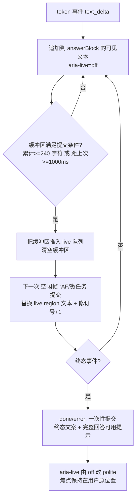

<!-- part: 50-design-system-and-a11y; chapters: 8,10,12; owner: sys-convo -->
## 8. 设计系统落地

本章把已冻结并独立验证的 **设计系统**（`design/system/`：519 个 token、27 个组件族规格、只消费 L3 的活样式手册）
落进 `web/` 工程。**本章不重新设计任何样式**；样式与 token 的唯一真源是 `design/system/`，
每个属性依据见 `design/system/components/*.md` 的行号锚点与 `rb.css`。

### 8.1 三层落地与唯一真源

| 层 | 真源（只读） | 运行期文件 | 生成 / 同步方式 | 是否可手改 |
| --- | --- | --- | --- | --- |
| L1 primitive `--p-*` | `design/system/tokens.json` → `primitive` | `web/src/styles/tokens.css` | `python design/system/generate.py` | **否**（生成物） |
| L2 semantic `--bg-*`/`--text-*`/… | 同上 → `semantic` | 同上 | 同上 | **否** |
| L3 component `--<组件>-<部位>-<属性>` | 同上 → `component`（27 组、337 个） | 同上 | 同上 | **否** |
| L0 compat `--c-*`/`--sp-*`/… | 同上 → `compat`（50 个，deprecated） | 同上 | 同上 | **否**（迁移完成后删除，见 §8.6） |
| 组件样式 | `design/system/components/01–04*.md` | `web/src/styles/base.css` + 各 `components/base/*.vue` 的 `<style>` | 手工按锚点抄写，**只能消费 L3** | 是（但受 §8.2 门禁） |

**硬约束**：`tokens.json` 是**单一真源**；`tokens.css` / `tokens.md` / `tokens.ts` / `tokens.flat.json` 都是**生成物**。

```powershell
:: 任何时候想改样式数值，唯一合法路径：
:: 1) 改 design/system/tokens.json  2) 重跑生成器  3) 同步 web/  4) 跑门禁
$env:PYTHONIOENCODING="utf-8"; python design\system\generate.py
$env:PYTHONIOENCODING="utf-8"; python design\system\verify-system.py   # 独立校验，J 项验「每个 token 在浏览器里真正生效」
```

| 禁止 | 依据 | 后果 |
| --- | --- | --- |
| 手改 `web/src/styles/tokens.css` | 它是生成物（`design/system/tokens.md` 文件头「请勿手改」） | 下次 `generate.py` 覆盖；且 `design/system/verify-system.py` 逐字节比对会 FAIL |
| 就地写死颜色/长度 | CONTRACT §3.7 第 5 条 | `stylelint` 门禁 FAIL（§8.2） |
| 在组件里 `var(--p-*)` / `var(--bg-*)` | `design/system/README.md` 纯度规则 4 | 跨层违规，同上 |

**同步机制与漂移检测**（`npm run tokens:check`，进 CI）：

| 步骤 | 命令 | 判据 |
| --- | --- | --- |
| 1 | `python design/system/generate.py --check` | `tokens.css`/`tokens.md`/`tokens.ts`/`tokens.flat.json` 与 `tokens.json` 一致；不一致以非 0 退出（生成器已具备该语义：任一项 FAIL 即不产出） |
| 2 | 逐字节比对 `design/system/tokens.css` ↔ `web/src/styles/tokens.css` | 必须完全相同（同步即整文件复制，不做任何人工修补） |
| 3 | `python design/system/verify-system.py` | token 一致性、规格↔token 覆盖、**J 项：注释感知剥离后每条规则 prelude 恰好 `:root`、519/519 token 可达** |
| 4 | `npx stylelint "src/**/*.{css,vue}"` | §8.2 的分层纯度门 |

> **为什么第 3 步不可省**：M1 缺陷（`generate.py` 文件头注释里的 `*/` 提前闭合注释）让品牌色 `:root`
> 与垃圾文本拼成一条永不匹配的规则，**30 个 token 运行时为空**、主按钮变成透明底白字。当时 29 项校验
> 全绿——因为「文本逐值比对」与「字节比对」都在文件内容层，**没有任何一项把 CSS 交给解析器**。
> J 项就是那条补上的「解析器层」证据（`design/system/README.md`「本轮的 M1」）。

### 8.2 组件只消费 L3：`stylelint` 自定义门禁

`web/.stylelintrc.cjs`（CONTRACT §3.2 已冻结该路径）。三类规则全部做成 **CI 非 0 退出**：

```js
// web/.stylelintrc.cjs （结构示意；规则实现见 web/stylelint-rules/layer-purity.cjs）
module.exports = {
  plugins: ['./stylelint-rules/layer-purity.cjs'],
  rules: {
    // ① 禁裸 hex / 命名色 / rgb()/rgba()/hsl()——颜色必须来自 var(--<l3>)
    'dsh/no-raw-color': true,
    // ② 禁带单位裸长度；白名单：0、100%（--bubble-max-w 已经是 token，此处只放结构性 0/auto/100%）
    'dsh/no-raw-length': [true, { allow: ['0', '0px', '1px', '100%', 'auto', 'none'] }],
    // ③ 层纯度：组件样式（src/components/**、src/styles/base.css）禁消费 L1/L2
    'dsh/layer-purity': [true, {
      scope: ['src/components/**/*.vue', 'src/styles/base.css'],
      forbidPrefixes: ['--p-', '--bg-', '--text-', '--accent', '--state-',
                       '--border', '--danger-border', '--pending', '--layout-',
                       '--shell-', '--elevation-', '--motion-', '--focus-ring-', '--size-'],
      allow: ['--root-', '--wrap-', '--card-', '--btn-', '--pill-', '--notice-', '--chat-', '--msg-',
              '--bubble-', '--steps-', '--step-', '--composer-', '--cite-', '--draft-', '--empty-',
              '--field-', '--control-', '--errorsummary-', '--table-', '--kv-', '--chip-', '--chips-',
              '--prose-', '--login-', '--stack-', '--row-', '--muted-', '--small-',
              '--appbar-', '--brand-', '--navlink-', '--tabbar-', '--skiplink-', '--sr-',
              '--focus-outline-'],
    }],
  },
};
```

| 规则 | 覆盖的违规 | 依据 |
| --- | --- | --- |
| ① 禁裸颜色 | `color:#14665B`、`background:rgba(28,25,23,.04)`、`border-color:white` | rb.css 的裸字面量迁移对照表已把每一处映射到 L1→L3（`tokens.md` §10） |
| ② 禁裸长度 | `padding:18px`、`border-radius:14px`、`min-height:44px` | 同上；**例外**必须写进 `allow` 并注明依据，不允许 inline `stylelint-disable` |
| ③ 层纯度 | `var(--p-space-3)`、`var(--bg-card)`、`var(--text-muted)`、`var(--pending)` 出现在组件样式里 | `design/system/README.md` 纯度规则 4；CONTRACT §3.7 第 5 条 |

- **`global.css` 与 `tokens.css` 豁免 ③**：`tokens.css` 本身就是声明层；`global.css` 是元素级全局规则（`html`/`body`/`h1`/`p`/`a`/`code`/`:focus-visible`），
  其中 `html{scroll-padding-top:var(--root-scroll-offset)}` 消费的是 L3 `root` 组，仍然合规。
- **`base.css` 的例外处理**：若某个组件族规则只能靠 `@media` 断点字面量表达（`480`/`767`/`768`/`1024`/`1200`/`1440`），
  走独立的 `dsh/breakpoint-whitelist` 规则（§8.3），不靠放宽 ② 的长度白名单。
- **禁止清单**（与 CONTRACT §3.7 第 6 条一致）：不得给组件补 `rb.css` 里不存在的状态（`:active`、`transition`）。
  设计系统已机械核过这一点（`design/system/README.md` 硬要求 4）；`stylelint` 追加一条 `dsh/no-unknown-state`，
  比对白名单（`:hover`、`:focus-visible`、`[disabled]`、`:checked`、`[aria-current="page"]`、`[readonly]`）。

### 8.3 断点、`reduced-motion`、`:focus-visible` 的全局约定

**断点只有 5 档 + base**，取值只允许 480 / 767 / 768 / 1024 / 1200 / 1440（CONTRACT §3.7 第 8 条）：

| 档 | `min-width` 写法 | `max-width` 写法 | 工程常量（`web/src/domain/breakpoints.ts`，由 `tokens.ts` 派生） |
| --- | --- | --- | --- |
| base | 无媒体查询（最窄按 **320px** 验收） | — | `BP.base = null` |
| xs | `@media (min-width:480px)` | `@media (max-width:479px)` | `BP.xs = { min: 480, max: 479 }` |
| sm | `@media (min-width:768px)` | `@media (max-width:767px)` | `BP.sm = { min: 768, max: 767 }` |
| md | `@media (min-width:1024px)` | `@media (max-width:1023px)` | `BP.md = { min: 1024, max: 1023 }` |
| lg | `@media (min-width:1200px)` | `@media (max-width:1199px)` | `BP.lg = { min: 1200, max: 1199 }` |
| xl | `@media (min-width:1440px)` | `@media (max-width:1439px)` | `BP.xl = { min: 1440, max: 1439 }` |

- **JS 侧**：`import { breakpoints } from '@/styles/tokens'`（`design/system/tokens.ts` 的生成物）驱动 `matchMedia`。
  只在 `ui` store 里维护「当前档位」一个值，组件不得各自 `addEventListener('resize')`。
- **`max-width` 档只允许写 `min-width 档 − 1`**（`767px` 而非 `768px`）：`design/system/README.md` 纯度规则 5。
- **不引入容器查询**（`@container`）：`b-responsive-spec.md` §8 明确否决，避免两套响应式模型。
- **`prefers-reduced-motion`**（全局唯一一处，`global.css`）：

```css
@media (prefers-reduced-motion: reduce) {
  *, *::before, *::after { transition: none !important; animation: none !important; }
}
```

  依据 rb.css:111 与本方向唯一动效「`.step--running .step__ico` 旋转」（rb.css:252–253，时长/缓动由
  `--step-running-spin-duration`/`-easing` 承载，`design/system/README.md` 裁决 9）。
  组件层**不得**再写第二处 `reduced-motion` 块；流式回答的「打字机」效果一律不做（无 token）。

- **`:focus-visible`**（全局唯一一处，`global.css`）：`outline:var(--focus-outline-w) solid var(--focus-outline-color); outline-offset:var(--focus-outline-offset); border-radius:var(--focus-outline-radius)`（= 3px / `#0F4A42` / 2px / 4px，rb.css:110）。
  组件**不得**覆盖 `outline`——唯一例外是 W2 的焦点补偿（§8.4），它加的是**兄弟元素**的环，不是替换。
- **触控目标**：`min-height:44px` 由 `.btn`/`.input`/`a.chip`/`.navlink` 各自的 L3 token 提供（rb.css:120）；组件不得写 `height:32px` 之类压缩。

### 8.4 6 个必修项 = 本设计文档的实现前置条件

以下 6 项在**冻结的设计系统里仍是缺陷**（`design/system/README.md` 裁决表 #1/#3/#6 与 W1–W3）。
它们是**开工前置条件**：不修完，§8.2 的门禁会通过、§10 的映射会照抄、§12 的无障碍声明会**不成立**。

| # | 必修项 | 现状（冻结产物） | **不修会怎样** | 修法（已验证 / 已裁决） | 验收判据 |
| --- | --- | --- | --- | --- | --- |
| **#1** | 「处理中」误用琥珀警告态 | `admin.html:1686`/`1756` 用 `pill--warn` 表示处理中（2 处橙色）；另「未保存」误用 `pill--warn`（视觉等价但语义标签错，应 `pill--pending`） | ① 语义污染：琥珀在本设计系统**专用于「未保存 / 待确认」**（`tokens.md` §3 `color.pending`「不得用于其他语义」），处理中混进来后，用户无法用颜色区分「在跑」与「没保存」；② 屏幕阅读器与自动化断言无法区分两类状态；③ `--pending*` 与 `--state-warning` 两条 token 通路被抹平 | 处理中 → `.pill--info`（`--pill-info-bg/fg`，`#E3EEF2`/`#164A5B`）；未保存 → `.pill--pending` | 全仓（含 `web/`）`pill--warn` 仅出现在：依据不足、待确认、需确认后继续三类；「处理中/进行中」0 处使用 `pill--warn` |
| **#3** | 危险胶囊自身缺图标 | `records.html:273` 的 `.pill--danger`「不可恢复」无 `<svg>`（其父卡片标题有 24×24 警告三角） | 违反「状态三重表达」（CONTRACT §3.7 第 7 条、NFR-UX-001）：删除确认这一**最危险**的状态只剩颜色 + 文字；色盲用户与灰度打印下与普通胶囊难分 | 按 `components/02-actions-status.md` §Pill 的规格补 24×24 内联 SVG（`stroke-width:1.75`、`fill:none`、`aria-hidden="true" focusable="false"`） | `web/src/components/base/Pill.vue` 在 `variant==='danger'` 时**必须有** icon slot 内容；单测断言「danger 无 icon 时警告/报错」 |
| **#6** | 密码显示/隐藏切换的文案从未冻结 | `content-spec.md:54` 要求密码字段「带显示/隐藏切换」，`parts/login.html:29–33` **未实现**，且该按钮文案、图标、`aria-pressed` 语义在任何上游文件里都没有 | ① 实现者只能自造文案 → 直接违反 CONTRACT §3.7 第 3 条「不得发明文案」；② 密码框无法在移动端核对输入，登录失败率上升；③ 若只给图标不给可访问名，读屏用户拿不到控件语义 | **先冻结再实现**：在 `content-spec.md` 补一组两态可访问名（明文态 / 密文态各一）+ `aria-pressed` 语义；在某 `tokens.json` 组补图标槽 token（如需）。**在此之前 `LoginView` 该槽位不得实现**（`components/01-shell-navigation.md:936` 已明写） | `content-spec.md` 出现该按钮的两条逐字文案且被 §15 追踪表引用；`LoginView` 切换按钮有 `aria-pressed` + `aria-controls` + 两态可访问名；`npm run docs:gate` 能检出「未冻结文案」用例 |
| **W1** | 缺 `scroll-padding-top`，锚点/skip-link 被顶栏遮挡 | 实测 `#v-S11` 跳转后目标 `top=0.3px`、sticky 顶栏底 `56.7px` → **遮挡 56.4px**；skip-link 到 `#main` 遮挡 **56.7px**；`rb.css`、`system.html`、token 层 `scroll-padding-*` **各 0 条** | ① 键盘/读屏用户点「跳到主要内容」后，**焦点与目标内容都藏在顶栏下**（WCAG 2.2 2.4.11 焦点不被遮挡）；② 所有页内锚点（S11 批次定位、错误摘要跳字段）全部偏上 56px | `html{scroll-padding-top:calc(var(--appbar-min-h) + var(--sp-1))}`（= 56 + 6 = **62px**）。**落到工程里**：在 `tokens.json` 的 `root` 组新增 `--root-scroll-offset`（指向 L1 求和，禁止组件硬编码），`global.css` 消费它 | Playwright：`page.keyboard.press('Tab')` 聚焦 skip-link → `Enter` → 断言**实测遮挡量** `occlusion = .appbar.getBoundingClientRect().bottom - 目标.getBoundingClientRect().top` **≤ 0.5px**，且 `document.activeElement === #main`；**必须覆盖 320 / 390 / 480 / 767 / 768 / 772 / 774 / 775 / 1024 / 1366**（768–774 是顶栏在修复前会因 navlink 换行升到 72.17px 的窄带） |
| **W2** | `.steps__toggle` 聚焦无任何可见焦点 | 它是 `.sr-only` 的 1×1 `clip:rect(0 0 0 0)` 元素（rb.css:113–114），聚焦后 `outline-style:none`，且**没有** `.steps__toggle:focus-visible ~ .steps__summary` 联动规则 | **WCAG 2.4.7 Focus Visible（AA）失败**：`<480` 折叠态下键盘用户 Tab 到该控件时，页面上没有任何焦点指示——他们无法知道当前焦点在过程区折叠开关上，也无法发现 Space 能展开过程 | 给**可见的摘要行**加补偿环（3 行，见 `design/system/verification.md` §6.1）：`.steps__toggle:focus-visible ~ .steps__summary{outline:var(--focus-outline-w) solid var(--focus-outline-color); outline-offset:var(--focus-outline-offset)}`；并在 `rb.css` 补 token | 键盘实测（真实 Tab，非 `.focus()`）：`<480` 下 Tab 到 toggle 时 `.steps__summary` 的 `outline-style !== 'none'` 且宽度 ≥3px；≥480 下摘要 `display:none`，改用 `.steps` 容器可见焦点（需一并裁定，见 §8.7 待裁决 3） |
| **W3** | 长串溢出，两条独立根因 | 注入 60 字符**无空格**串，320px 下页面级溢出：`.kv__v` **+523px**、`.cite__name` **+359px**、`.card__body` **+375px**、`.bubble` **+375px** | ① `.kv__row{grid-template-columns:8em 1fr}` 的 `1fr` = `minmax(auto,1fr)`，下限 **min-content**，第 2 轨实测被撑到 **657.9px** → 整页横向滚动；② **`overflow-wrap` 不影响 min-content，所以它救不了 `.kv__v`**；③ 其余三处是 `overflow-wrap:normal`（无空格串没有断点）。**注意**：两轮验证都放行是因为夹具里没有超长无空格串——「页面级溢出 = 0」是**内容相关**结论 | 两处分别修：① `.kv__row{grid-template-columns:var(--kv-row-key-col) minmax(0,1fr)}`；② `.cite__name`、`.card__body`、`.bubble` 及同类文本容器加 `overflow-wrap:anywhere`（**仅非表格容器**；表格单元格仍用 `break-word` + `min-width`，见 `b-responsive-spec.md` §5 与 content-spec §1） | 对四个容器各注入 60 字符无空格串：320px 下 `documentElement.scrollWidth - clientWidth === 0`；`.table--stack` 的 `<td>` 仍为 `break-word` + `min-width:180px`（不得改成 `anywhere`） |

**修哪一层、怎么改（唯一合法顺序，本节 = Lead 开工前要执行的三步）**：

1. 改 `design/responsive/rb.css`（#1 的两处 `pill--info` 在原型 markup 侧；W1/W2/W3 在 rb.css）——
   **哈希变化** → 上一阶段「六宽度页面级溢出 = 0」的验证失效，必须重跑。产物：新的 `rb.css` 哈希。
2. 在 `tokens.json` 补 W1 的 `--root-scroll-offset`、W2 的焦点补偿 token（如需要）；产物：518 → 519。
   > **阶段 A（实现期）已完成**：`root` 组已新增 `--root-scroll-offset`；W2 按 §8.7 裁决 J2 改为「`<480` 给摘要行加 `:focus-visible` 补偿环 + `≥480` 直接 `display:none`」，**不需要**新增 token。合计 **519**，`generate.py` 的 rb.css 逐值等价为 **75/75**。
3. `python design/system/generate.py` + `verify-system.py` → 生成物与独立校验全绿。
4. 同步 `web/src/styles/tokens.css`，重跑六宽度渲染验证与键盘走查 → 新的验收基线。

> 全部 6 项**一次改完再整体重跑**，不要零散打补丁——零散补会让「六宽度溢出为 0」这条已验证结论
> 一次次失效（`design/system/README.md` 文末建议）。

### 8.5 `web/src/styles/` 三个文件的分工

| 文件 | 内容 | 允许消费 | 锚点要求 | 依据 |
| --- | --- | --- | --- | --- |
| `tokens.css` | 从 `design/system/tokens.css` **整文件同步**（L1/L2/L3/L0 四层 `:root`，519 个 token） | — | — | CONTRACT §3.2 |
| `global.css` | `html`/`body`/`*`/`h1–h4`/`p`/`a`/`code`/`.sr-only`/`.skip-link`/`:focus-visible`/`reduced-motion`/`scroll-padding-top` | L3（`--root-*`、`--focus-outline-*`、`--skiplink-*`、`--sr-*`） | 每条规则注 `rb.css:行号` | rb.css:93–118、106–110 |
| `base.css` | 27 个组件族样式，**按族分块**；每块首行注释 `/* ==== 族名（design/system/components/0X-*.md §N；rb.css:A–B）==== */` | 只 L3，且只消费**本族** token | 同左 | `design/system/components/*.md` §5 |

- `base.css` 按族分块的**顺序**与 `design/system/components/01→04` 一致，便于机械比对：改族内样式只需对一行锚点。
- **不引入第二个样式真源**：不引 Tailwind、不自绘组件库、不用 CSS-in-JS（CONTRACT §3.1）。
- 组件 `<style scoped>` 里**只允许**放该组件的布局胶水（`display`/`position`/`gap` 方向等**结构属性**——
  它们被设计系统刻意判定为「结构性、不 token 化」，见 `README.md` 收口段末），**不放颜色、不放尺度**。
#### 8.5.1 字段名与端点的唯一来源

`base.css` 只管**类名与 token**，不定义字段名；但 `Field`/`Control`/`Table` 三族在**绑定与文案**上会写字段名，
它们**不得自拟**，唯一来源是 [`API-REFERENCE.md`](API-REFERENCE.md) §1（由 `openapi_v0.1.json` 机械生成）：

| 场景 | 端点（`API-REFERENCE.md` §1） | 字段名（逐字，不得增删改） |
| --- | --- | --- |
| 登录表单 | `POST /api/v1/auth/login` | `account`、`password` |
| 计划新建/编辑（S09） | `POST /api/v1/me/plans`、`PATCH /api/v1/me/plans/{id}` | `title`、`goal`、`start_date`、`end_date`、`content`、`expected_version`（新建无此项） |
| 草稿继续修改（S06→S09） | `PATCH /api/v1/me/drafts/{draft_id}` | `title`、`goal`、`start_date`、`end_date`、`content`、`expected_draft_version` |
| 课程新建/编辑（S10） | `POST /api/v1/admin/courses`、`PATCH /api/v1/admin/courses/{id}` | `code`、`name`、`description`、`enabled`、`expected_version`（创建时 `code` 必填且**创建后不可修改** → `readonly`） |
| 课表维护（S12） | `POST /api/v1/admin/schedules`、`PATCH /api/v1/admin/schedules/{id}` | `student_id`、`course_id`、`class_date`、`start_time`、`end_time`、`location`、`overlap_acknowledged`、`reason`、`expected_version` |
| 学生（管理） | `POST /api/v1/admin/students`、`PATCH /api/v1/admin/students/{id}` | `account`、`display_name`、`initial_password`、`enabled`、`expected_version` |
| 只读字段「来源」（S09） | `GET /api/v1/me/plans/{id}` → `source` | `source`：`enum(manual\|assistant)` → 只读控件（`.input[readonly]`） |

**三条硬规则**：① 请求体字段名与这里逐字一致（`snake_case`，**不用** camelCase）；
② `expected_version`／`expected_draft_version` 是**并发控制字段**，必须随请求发送，缺它就丢掉 409 分支；
③ 表单**可见 `<label>` 的文案**来自 `content-spec.md`，与字段名解耦（字段名是 `title`，label 是「标题」）。
违反任一条都会与 §11（表单·校验·写入确认）冲突。

- **`prose` 组的特殊警告**：`--prose-*` 有 6 个描述的是**全局元素规则**（`p`/`h1–h4`/`a`/`code`，rb.css:106–109），
  `rb.css` 里并不存在 `.prose p` 这类选择器。**这些规则必须留在 `global.css`**；若搬进 `Prose.vue` 的 `scoped` 样式，
  `.prose` 内的段落节奏、标题字重、链接色、行内代码字体会**静默丢失**（`components/03-conversation.md` §Prose 第 5 节「诚实说明」）。

### 8.6 L0 兼容层与 `rb.css` 的退役时机

| 阶段 | `rb.css` | L0（`--c-*`/`--sp-*`/`--fs-*`…50 个） | 判据 |
| --- | --- | --- | --- |
| **当前（本轮）** | 冻结、只读、哈希不变（`94DF48EDFFC1DC33858A545C3574048F`） | 保留 | 原型零改动继续工作 |
| **阶段 A（实现期）已完成** | **已改**：6 个必修项修完（+ W1-b 顶栏窄带治本），新哈希 `0749FA7A47BC155F52A12406123DF6CC`；产物 `b-responsive.html = 5B73454136F261AC13E9A0203C0C6D73` | 保留（`generate.py` 已逐值比对新的 `rb.css`，**75/75**） | §8.4 验收判据全绿（遮挡实测 0px，13 个宽度）；独立验证见 `design/reviews/rb-verify-report.md` |
| **M0 前置修复** | 6 个必修项改完 + 重跑六宽度验证 | 保留（`generate.py` 重新逐值比对新的 `rb.css`） | §8.4 验收判据全绿 |
| **M1 迁移** | 仍保留作对照 | 保留 | `web/` 的 `base.css` 覆盖全部 27 族，`a11y` 与断点走 token |
| **M2 退役** | **删除 `rb.css` 与 `b-responsive.html` 在 `web/` 的引用** | **删除 L0 段** | ① `web/` 全仓 0 处引用 `--c-`/`--sp-`/`--fs-`/`--r-card`/`--w-*`/`--h-*`/`--tap`/`--font-*`；② 计算样式等价性复测通过；③ `generate.py` 去掉 `compat` 段后仍全绿 |

- L0 是**兼容声明**，不是第二套设计：它逐值等价（74/74，`tokens.md` §9），删掉不改变任何解析值。
- **删除顺序不可颠倒**：先删 L0 再删 `rb.css` 会让冻结原型的视觉基线失去参照，等价性证明无从复核。
- 迁移期**新代码禁止引用 L0**（`design/system/tokens.md` §6 表头「新代码不得引用」），由 §8.2 规则 ③ 的
  `forbidPrefixes` 扩一项即可（`--c-`、`--sp-`、`--fs-`、`--lh-`、`--r-`、`--shadow-hair`、`--w-`、`--h-`、`--tap`、`--font-`）。

### 8.7 本章登记的实现期待裁决项

| # | 待裁决 | 影响 | 建议 |
| --- | --- | --- | --- |
| 1 | W1 的 token 名（`--root-scroll-offset` / `--appbar-scroll-offset`）与归属组 | 命名一旦定下就被 `global.css` 与 E2E 断言引用 | 建议 `root` 组 `--root-scroll-offset`（`--root-*` 已是「全局根」组，与 `--root-tabbar-reserve` 同类）；**判断项** |
| 2 | `--root-scroll-offset` 的值是否等于 `calc(--appbar-min-h + --sp-1)`（62px）还是含 `env(safe-area-inset-top)` | iOS 横屏/刘海下顶栏实际高度 > 56px | 先按 62px 落地并在真机复测；**判断项** |
| 3 | W2 在 `≥480` 的等价处理：摘要行 `display:none`（rb.css:263），焦点补偿无处可加 | 键盘用户在大屏同样看不到 toggle 焦点 | 建议 `≥480` 让 `.steps__body` 常显、toggle 与摘要一并 `display:none`（不可聚焦即无该问题）；需 Lead 确认后写入 rb.css |
| 4 | #1 涉及的原型 markup（`parts/admin.html`）是否随 rb.css 一起改 | 冻结产物哈希 | 建议同批改并重跑全套渲染验证（§8.4 顺序表第 1 步） |

---

## 10. 组件 Vue 映射

### 10.1 映射总则（class 驱动 vs props 驱动）

| 维度 | **class 驱动**（样式层） | **props 驱动**（语义层） |
| --- | --- | --- |
| 承载 | `rb.css`／`base.css` 里已存在的 class 与修饰类 | 组件 `props` → 计算 class、`aria-*`、文案 |
| 真源 | `design/system/components/*.md` §3 API 表 | 本设计文档 + `content-spec.md` |
| 硬规则 | **class 名必须与 `rb.css` 逐字一致**，不得改名、不得新增变体 | 状态**只允许映射到已存在的 class**；不存在对应 class 时用 props 组合表达（例：「待确认」= `.draft` + `.notice--warn`） |
| 为什么 | 计算样式等价性（`system.html` ↔ `b-responsive.html`，SAME 64/68、28 差异全归因）**依赖共同 class**，改名即失去这条可核验通路（`design/system/verification.md` 第 1 项） | 防止「按 props 自造状态」（CONTRACT §3.7 第 6 条） |

**props ↔ class 的映射规则**：

1. `variant` → 修饰类后缀（`pill` + `variant:'info'` ⇒ `class="pill pill--info"`）；**没有对应修饰类就不渲染**，不静默降级。
2. `size` → 只允许 `sm`（`.btn--sm`、`.table--compact`）；其余尺寸不存在（rb.css 无 `.btn--lg`）。
3. 布尔态 → 类或原生属性：`disabled` ⇒ `[disabled]`（rb.css:205/326）；`invalid` ⇒ `.field--invalid`（视觉）+ `aria-invalid="true"`（语义）。
4. **状态永远三重**（图标 + 文字 + 颜色）：props 只决定 `variant`，图标与文字由**具名 slot 或必填 prop** 提供，组件在缺项时抛开发期警告（CONTRACT §3.7 第 7 条）。

### 10.2 27 个组件族的映射表

`components/base/` 与 `design/system/components/*.md` 的 27 个 `owns` 组一一对应。
「规格」列是 §8 引用的锚点位置（**不复制 token 表**）；「锚点」列是 `rb.css` 行号。

| # | 族 | 组件（`components/base/`） | 根 class | 关键 props | emits | slots | 必需属性（缺一即缺陷） | 规格 | 锚点 |
| --- | --- | --- | --- | --- | --- | --- | --- | --- | --- |
| 1 | root | `GlobalRoot.vue`（`App.vue` 内联） | —（`html`/`body`） | — | — | `default` | `lang="zh-CN"`；`html` 上 `scroll-padding-top`（W1） | 01 §1 | rb.css:95–104 |
| 2 | focus | `（全局样式，无组件）` | `:focus-visible` | — | — | — | 不得被组件覆盖 `outline` | 01 §1 | rb.css:110 |
| 3 | skiplink | `SkipLink.vue` | `.skip-link` | `target`（默认 `#main`） | — | — | `href` 指向真实存在的 `id`；是页面**第一个**可聚焦元素 | 01 §7 | rb.css:115–118 |
| 4 | sr | `SrOnly.vue` | `.sr-only` | `as`（默认 `span`） | — | `default` | 只放短标签；不用 `display:none` 代替 | 01 §8 | rb.css:113–114 |
| 5 | appbar | `AppBar.vue` | `.appbar`/`__inner`/`__brand`/`__mark`/`__nav`/`__user` | `brand`、`userLabel` | — | `brand`,`nav`,`user` | `<header>`；`nav` 里当前项 `aria-current="page"` | 01 §2 | rb.css:121–137 |
| 6 | brand | `BrandMark.vue` | `.appbar__brand`/`.appbar__mark`/`.login__mark`/`.login__name` | `size:'sm'\|'lg'`、`name` | — | `mark` | 标记 SVG `aria-hidden="true" focusable="false"`；`white-space:nowrap` 保证 320px 不折行 | 01 §3 | rb.css:132–134 |
| 7 | navlink | `NavLink.vue` | `.navlink` | `to`、`current` | — | `default` | `<a>` + `aria-current="page"`；≥44px | 01 §4 | rb.css:138–144 |
| 8 | tabbar | `TabBar.vue` | `.tabbar`/`.tabbar__item` | `items`（4 项） | — | — | `<nav>`；列数 = `--tabbar-cols`（4）；`<768` 才渲染 | 01 §5/§6 | rb.css:149–161 |
| 9 | wrap | `Wrap.vue` | `.wrap`、`.wrap--assistant` | `assistant?: boolean` | — | `default` | 每页至少一层；嵌套时内层**只清左右内边距**、**保留 720px** | 01 §9 | rb.css:164–169 |
| 10 | login | `LoginForm.vue` | `.login`/`__brand`/`__mark`/`__name`/`__sub`/`__foot` | `pending` | `submit` | `default`,`foot` | 可见 `<label for>`；错误就近 + `role="alert"`；密码切换见 #6（**未冻结文案前不实现**） | 01 §10 | rb.css:405–411 |
| 11 | btn | `Btn.vue` | `.btn`、`.btn--primary`/`--danger`/`--ghost`/`--sm`/`--block` | `variant`、`size:'md'\|'sm'`、`block`、`disabled`、`type` | `click` | `default`（文字）、`icon` | 原生 `<button type>`；≥44px；禁用用 `[disabled]` 不用 `aria-disabled` | 02 §Button | rb.css:193–206 |
| 12 | chip | `Chip.vue`/`Chips.vue` | `a.chip`、`.chips` | `to`/`href`、`current` | — | `default`（label）、`icon` | `.chips` 是纯布局容器**不加 `role`**；`.chip` 无 `:active`/`[disabled]`/`[aria-current]` | 02 §Chip | rb.css:392–396 |
| 13 | pill | `Pill.vue` | `.pill` + `--ok`/`--warn`/`--pending`/`--danger`/`--info`/`--evidence`/`--advice` | `variant`（7 值） | — | `icon`（**必需**）、`default`（文字） | 图标 `aria-hidden` + 独立文字；不进 live region；文字 ≤14 汉字 | 02 §Pill | rb.css:209–220 |
| 14 | notice | `Notice.vue` | `.notice` + `--info`/`--warn`/`--danger`/`--ok`/`--evidence`、`.notice__ico` | `variant`、`role`（`note`/`status`/`alert`） | — | `icon`,`default`,`actions` | `role` 按变体：静态 `note`、成功 `status`、失败/警告 `alert`；`alert` 内容必须自解释 | 02 §Notice | rb.css:223–231 |
| 15 | steps | `Steps.vue`/`Step.vue` | `.steps`/`.steps__summary`/`.steps__toggle`/`.steps__body`/`.step` + `--running`/`--done`/`--failed`、`.step__ico/__title/__sub` | `summary`、`modelValue`（展开）、`steps[]`、`state` | `update:modelValue` | `summary`,`default` | `<ol>` 语义保留；toggle 是 `.sr-only` checkbox 且**前序兄弟**；失败项**不得**出完成勾 | 02 §Steps | rb.css:245–263 |
| 16 | empty | `EmptyState.vue` | `.empty`、`.empty--error`、`.empty__art/__title/__hint` | `variant:'empty'\|'error'`、`title`、`hint` | — | `art`,`default`,`actions` | 两态**绝不合并**；`.empty--error` 必须 `role="alert"`；插画 `aria-hidden` | 02 §Empty | rb.css:301–308 |
| 17 | card | `Card.vue`/`CardRow.vue` | `.card`/`__head`/`__body`/`__foot`、`.card-row`、`.card-row--2` | `title`、`columns?:1\|2` | — | `head`,`default`,`foot` | `.card` 不得内嵌 `.card`；`.card-row--2` **≥sm 才生效**；卡片自身不设 `tabindex` | 03 §Card | rb.css:181–190 |
| 18 | chat | `ChatStream.vue`（product）→ `Msg.vue`/`Bubble.vue` | `.chat`/`.msg`/`.msg--user`/`.msg__who`/`.bubble` | `who`、`user?: boolean` | — | `default` | `.chat` 上 live region 策略（§12.2）；`.msg--user` 必须同时有可见说话人文字；**无 `:hover`/`:active`/`transition`** | 03 §Chat | rb.css:234–242 |
| 19 | composer | `Composer.vue` | `.composer`/`__row`/`__count` | `modelValue`、`maxlength`（2000）、`disabled`、`pending` | `update:modelValue`,`submit`,`stop` | `default`,`actions` | `<form>` + **可见 `<label for>`** + `aria-describedby` 指上限说明；**不得承载任何路由/深链语义**（§12.4） | 03 §Composer | rb.css:266–273 |
| 20 | cite | `CitationCard.vue`/`CiteMark.vue` | `.cite`/`__head`/`__name`/`__loc`/`__body`、`.cite--invalid`、`.cite-mark--pending` | `citation`（`Reference`）、`expanded`、`invalid` | `update:expanded` | `body` | 已验证=4px 实心主色左条；未验证=琥珀虚下划线 + `aria-label`；失效=危险色 + **文字说明**；折叠按钮 `aria-expanded`/`aria-controls` | 03 §Citation | rb.css:276–288 |
| 21 | draft | `DraftCard.vue`（product）→ `Draft.vue` | `.draft`/`.draft--saved`/`__head`/`__kv` | `state:'unsaved'\|'saved'\|'unconfirmed'`、`planId` | `save`,`edit`,`queryStatus` | `head`,`default`,`actions` | 未保存=虚线琥珀边 + 文字；已保存=`plan_id` + 对勾 + 文字；**未知=保持未保存外观 + `.notice--warn role="status"`** | 03 §Draft | rb.css:291–298 |
| 22 | kv | `KVList.vue` | `.kv`/`.kv__row`/`.kv__k`/`.kv__v` | `items:[{k,v}]` | — | `default` | 必须 `dl`/`dt`/`dd`；`.kv__row` 是 `.kv` 直接子元素；W3 的 `minmax(0,1fr)` 修完前不得宣称零溢出 | 03 §KVList | rb.css:381–384 |
| 23 | prose | `Prose.vue` | `.prose` | `html`（已净化） | — | `default` | 只允许白名单元素；**`--prose-*` 的全局规则留在 `global.css`**（§8.5）；不得套在助手气泡内 | 03 §Prose | rb.css:170, 106–110 |
| 24 | field | `Field.vue` | `.field`、`.field--invalid`、`.field--wide`、`.field__label/__req/__hint/__error` | `label`、`for`、`required`、`hint`、`error` | — | `default`（控件）、`label-extra` | 可见 `<label for>`；必填标「必填」；错误就近 + `aria-describedby`；**不得发明 `.field--valid/--warning/--loading`** | 04 §一 | rb.css:314–318 |
| 25 | control | `Control.vue`（`Input`/`Select`/`Textarea` 三态） | `.input`/`.select`/`.textarea` | `modelValue`、`readonly`、`disabled`、`invalid`、`rows` | `update:modelValue`,`blur` | — | 原生控件；`aria-invalid`；`[readonly]` 与 `[disabled]` 视觉可分；`.textarea{min-height:120px}` | 04 §二 | rb.css:319–328 |
| 26 | table | `TableWrap.vue`/`DataTable.vue` | `.table-wrap`、`.table-wrap--stackable`、`.table`、`.table--compact`、`.table--stack`、`.cell-name`、`.num`、`.r` | `columns`、`rows`、`stack`（默认 true）、`compact`、`caption` | — | `caption`,`default` | 每个 `<td>` **必须有非空 `data-label`**；`<caption>` + `th[scope="col"]`；`<768` 卡片化；表格单元格 `break-word` + `min-width` | 04 §五/§六 | rb.css:334–378 |
| 27 | utility | `Stack.vue`/`Row.vue`/`Spacer.vue`/`MutedText.vue`/`SmallText.vue` | `.stack`/`.row`/`.spacer`/`.muted`/`.small` | `as`、`gap` | — | `default` | 纯布局/排版容器，不承载语义与焦点 | 04 §八 | rb.css:387–391 |

**跨组件的共用件**（不属于 27 族，但被多族引用）：

| 件 | 归属 | 说明 |
| --- | --- | --- |
| `.form-grid`/`.form-grid--2` | 04 §三（`FormGrid.vue`） | 表单列容器；`.field--wide` 仅 ≥sm 且父级带 `--2` 时跨列（rb.css:312–313） |
| `.error-summary` | 04 §四（`ErrorSummary.vue`） | `role="alert"` + `tabindex="-1"`（脚本焦点落点）；错误项是 `<a href="#字段id">`，锚点必须存在；无错时**不渲染 DOM**，不用 `display:none` 切换 |
| `.mono` | rb.css:109 | 等宽文本工具类，随 `code` 一起由 `global.css` 提供 |

### 10.3 `components/base/*` 与 `components/product/*` 的边界

| | `components/base/*` | `components/product/*` |
| --- | --- | --- |
| 数量 | **27**，与 `design/system/components/*.md` 的 `owns` 组一一对应 | 组合件，**不新增 class** |
| 依赖 | 只依赖 props/slots；**不依赖 store、不依赖 router** | 依赖 store（`chat`/`drafts`/`plans`…）与 `router` |
| 样式 | 消费本族的 L3 token；结构属性可放 `scoped` | 自身**零样式**（只组合 base 件 + `class` 透传） |
| 契约文件里点名的组合件 | — | `ChatStream`、`CitationList`、`DraftCard`、`ScheduleTable`、`BatchPanel`（CONTRACT §3.2） |
| 判据 | 能被 `design/system/components/*.md` 的 §4 状态矩阵逐条对映 | 只负责把数据喂给 base 件；**状态语义必须在 base 件的 props 上落地**，不在 product 里发明 |

**product 件允许做的事**：数据取值、`v-for` 迭代、把 SSE 事件映射为 base 件 props、错误码 → 文案映射。
**product 件禁止做的事**：写颜色/尺度、写 `var(--*)`、给 base 件传 `class` 之外的状态开关（不得有 `class="btn--primary"` 以外的自造修饰）、
把「待确认」「未保存」等状态用本地布尔量自己实现一遍。

**组合示例（`DraftCard.vue`，状态全部落在 base 件已存在的类上）**：

```vue
<!-- components/product/DraftCard.vue：不新增任何 class -->
<Draft :state="draft.state" :plan-id="draft.planId"
       @save="save" @edit="edit" @query-status="queryWriteStatus">
  <template #head>
    <Pill :variant="draft.state === 'saved' ? 'ok' : 'pending'">
      <template #icon><IconCheck v-if="draft.state === 'saved'" /><IconClock v-else /></template>
      {{ draft.state === 'saved' ? `已保存 · 计划编号 ${draft.planId}` : '未保存' }}
    </Pill>
  </template>
  <KVList :items="draft.rows" />
  <Notice v-if="draft.state === 'unconfirmed'" variant="warn" role="status">
    <p>正在确认是否保存…</p>
    <p>写入结果尚未确认，请勿重复创建；可稍后查询状态。</p>
  </Notice>
</Draft>
```

- 三态**没有**新增 class：`unsaved`/`saved` 用 `.draft` 与 `.draft--saved`；`unconfirmed` 复用 `.draft` 外观 + `.notice--warn`（`rb.css` 无 `.draft--failed`，**不得新增**）。
- 文案逐字取自 `content-spec.md` S06；`plan_id` 来自 `done.plan_id`／`tool_end.plan_id`（`sse_events_v0.1.schema.json`），不得前端伪造。

### 10.4 映射的机械校验（进 CI）

| 检查 | 判据 | 依据 |
| --- | --- | --- |
| class 存在性 | 从 `components/**/*.vue` 与 `base.css` 抽取的全部 `class` 名，必须逐字出现在 `rb.css` 的 122 个 class 集合中（本文件不是真源，`rb.css` 才是） | CONTRACT §3.7 第 6 条 |
| 状态白名单 | 组件样式里出现的选择器伪类/属性只允许 `:hover`、`:focus-visible`、`[disabled]`、`:checked`、`[aria-current="page"]`、`[readonly]`；**出现 `:active`/`transition`/`animation` 即 FAIL** | `design/system/README.md` 硬要求 4 |
| props→class 覆盖 | 每个 `variant` 取值都能映射到一个真实修饰类 | 本表 §10.2 |
| 三重表达 | 13 个 `Pill`/`Notice`/`Empty` 使用点在单测中断言「有图标 + 有文字 + 有颜色 token」 | CONTRACT §3.7 第 7 条 |
| L3 消费等价 | 组件样式消费的 token 名 ⊆ 该族 `owns` 组的 token 集合 | `design/system/README.md` 硬要求 1 |

### 10.5 各族的数据来源（端点与字段以 `API-REFERENCE.md` 为准）

27 族里只有 6 族**直接承载数据**；其余是纯展示/交互件。下表的端点与字段**逐字**取自
[`API-REFERENCE.md`](API-REFERENCE.md) §1（公开 26 个 `/api/v1/*`；4 个 `/internal/v1/*` 前端**不得调用**）。

| 数据承载族 | 组件 | 数据来源（`API-REFERENCE.md` §1） | 字段映射要点 |
| --- | --- | --- | --- |
| 10 login | `LoginForm.vue` | `POST /api/v1/auth/login` | 入参 `account`/`password`；成功取 `access_token`、`expires_at`、`user`。错误文案统一「账号或密码不正确，请重试。」（不区分账号不存在/密码错） |
| 18 chat | `ChatStream.vue` | `POST /api/v1/chat/stream`（响应 `text/event-stream`，六类事件见 `sse_events_v0.1.schema.json`） | 入参 `client_request_id`/`conversation_id`/`message`/`history`；正文来自 `token.text_delta`，引用来自 `done.citations[]` |
| 20 cite | `CitationCard.vue` | `GET /api/v1/citations/{reference_id}`；标记来自 `done.citations[]`（`Reference`） | `Reference` 字段：`reference_id`/`document_id`/`version_id`/`file_name`/`location_label`/`page_number`；**`page_number` 可缺** → `.cite__loc` 只显示文件名与位置 |
| 21 draft | `DraftCard.vue` | `GET /api/v1/me/drafts/{draft_id}`（展示）、`PATCH /api/v1/me/drafts/{draft_id}`（继续修改）、`POST /api/v1/me/drafts/{draft_id}/save`（保存）、`GET /api/v1/me/write-operations/{operation_id}`（待确认后核实） | draft 字段 `title`/`goal`/`start_date`/`end_date`/`content`/`basis_types`/`references`/`draft_version`/`expires_at`；保存 200 `status=existing\|deleted`／201 `status=created`／**202 `state`+`resolution`** —— 202 与 503 都落「待确认」（`.notice--warn` + `role="status"`），**不得**转 failed |
| 22 kv | `KVList.vue` | `GET /api/v1/me/plans/{id}` | `title`/`goal`/`start_date`/`end_date`/`source`/`basis_types`/`updated_at`/`version`；空值按 content-spec 写「未设置日期」 |
| 26 table | `DataTable.vue` | 四组列表端点：`GET /api/v1/me/plans`（`title` 过滤）、`GET /api/v1/admin/courses`（`query`/`enabled`）、`GET /api/v1/admin/students`（`query`/`enabled`）、`GET /api/v1/admin/documents`（`name`/`state`）、`GET /api/v1/me/schedules`、`GET /api/v1/admin/schedules`（`student_id` 必填） | 全部返回同构分页信封 `items[]`/`page`/`page_size`/`total`；每行 `<td data-label>` 必须与列名对应 |

**非数据族的取数**（只列会取数的）：

| 族 | 来源 | 说明 |
| --- | --- | --- |
| 5 appbar / 8 tabbar | `GET /api/v1/me` | `user`、`school_timezone`、`capabilities`（决定「管理」入口是否出现）；**`capabilities` 为权威**，不靠前端猜角色 |
| 24 field / 25 control | 随所属页面（登录/计划/课程/课表/学生） | 字段名见 §8.5.1；`expected_version` 系列为并发控制字段 |
| 16 empty | 由所属页面的响应驱动 | 两种空态**不得合并**：`items: []`（成功的空）与服务异常（`.empty--error` + `role="alert"`） |
| 15 steps | SSE `tool_start`/`tool_end` | `tool_call_id` 配对；`result_status: created\|existing` 都算成功，`failed` 才是失败 |
| 19 composer | 无端点 | **纯内存输入**：不进 URL、不进 `sessionStorage`（令牌同理，见 CONTRACT §3.7 第 4 条） |

> **与 §11 的分工**：本节只声明「哪个族向哪个端点取数、字段怎么落位」；
> 校验规则、错误码→文案映射、写入确认流程见 §11（表单·校验·写入确认）与 §13。
> 冲突时以 `API-REFERENCE.md` 的字段名与 `content-spec.md` 的文案为准。

---

## 12. 无障碍与响应式实现

### 12.1 `aria-live` 策略总表（先给结论）

| 区域 | 容器 | politeness | 更新方式 | 理由 |
| --- | --- | --- | --- | --- |
| 流式回答正文 | `role="log"` + `aria-live="off"`（流式期间）；**完成后**置 `aria-live="polite"` 并注入完成文本 | **off → polite（一次性）** | 完成文本经**节流队列**批量提交（§12.2） | NFR-UX-001 明确要求「流式内容不得持续抢夺焦点」；`assertive` 会打断用户当前朗读，逐 token 播报会让读屏用户无法读任何东西 |
| 过程区状态 | `.steps` 容器（`aria-live="polite"`，`aria-atomic="false"`） | polite | **只在状态跃迁时**提交一行（`tool_start`/`tool_end`） | 状态行的信息量小（标题 + 结果），可接受即时播报；与正文分开，避免两个 live region 互相打断 |
| 兜底口播 | `a11y/live.ts` 的单一 live region（`role="status"`） | polite | 每次提交**替换内容 + 变更修订号** | 用于终态、写操作结果、路由切换后的通知 |
| 失败/危险 | `role="alert"`（`.notice--danger`、`.empty--error`） | assertive | 一次性 | 服务端失败、会话失效必须立刻知道（`components/02-actions-status.md` §Notice 角色表） |
| 成功/待确认 | `role="status"`（`.notice--ok`、待确认块） | polite | 一次性 | 成功不打断；「待确认」是**未知**不是错误，不得用 `alert` |
| 角色计数/字数 | `.composer__count` + `.field__hint` | 无 live | 无 | 计数用 `aria-hidden="true"` 冗余呈现，上限经 `aria-describedby` 提供；**每 token 更新一次计数会刷爆读屏** |
| 胶囊、状态徽标 | 无 | — | — | `components/02-actions-status.md:424` 明确：不要给 Pill 加 `role="status"`，它不是 live region；播报由父容器负责 |

> **禁止**：给流式正文容器用 `aria-live="assertive"`；给每一个 `token` 事件触发一次 DOM 文本替换；
> 给多个容器同时 `aria-live` 导致同一信息播报两遍（一个状态跃迁**只允许**一个容器承接）。

### 12.2 NFR-UX-001「流式内容不得持续抢夺焦点」的可实现机制

三条机制缺一不可：**politeness 选择 + 节流/批量提交 + 焦点落点规则**。

#### 12.2.1 状态机与提交点

```ts
// src/a11y/live.ts —— 唯一 live region 出口（单例，App.vue 挂载）
type Politeness = 'off' | 'polite' | 'assertive';
interface FlushPolicy { maxChars: number; maxIntervalMs: number; }
const STREAM_POLICY: FlushPolicy = { maxChars: 240, maxIntervalMs: 1000 }; // 常量集中在此，不进 token（与视觉无关）
```



| # | 机制 | 具体实现 | 判据 |
| --- | --- | --- | --- |
| M1 | **politeness** | 流式期间正文容器 `aria-live="off"`（**不是** `polite`，更不是 `assertive`）；`done` 后改 `polite` 并提交一次终态摘要 | 单测：流式期间断言容器 `aria-live === 'off'`；`done` 后断言 `'polite'` 且文本调用次数 = 1 |
| M2 | **节流/批量提交** | 缓冲策略：`text_delta` 只写可视文本，**不写 live region**；缓冲累计 ≥240 字符或距上次提交 ≥1000ms 才提交一次；提交在同一帧内合并（`queueMicrotask` + `requestAnimationFrame`），`done`/`error` **立即**冲刷剩余缓冲 | 单测：灌 5000 个 `token` 事件 → live region 写入次数 ≤ `5000*avgLen/240` 且有硬上限；`done` 时缓冲为空 |
| M3 | **焦点落点** | `token` 事件**永不**调用 `focus()`/`scrollIntoView()`；焦点只在 ① 用户操作（点击/键盘）或 ② 路由切换（§12.3）时移动。流结束、断线、「待确认」出现时焦点**留在原处** | E2E：聚焦发送按钮 → 触发流式 → 500 个 token 后断言 `document.activeElement` 仍为发送按钮（或用户最后聚焦的元素）；`document.scrollingElement.scrollTop` 不因 token 变化而跳变 |

```ts
// 反例（明令禁止）
// token 到达时：el.textContent += delta; el.scrollIntoView(); inputEl.focus();
// 正例
onToken(delta) {
  block.visibleText += delta;              // 只改可视文本
  streamBuffer.push(delta);
  if (streamBuffer.length >= STREAM_POLICY.maxChars) scheduleFlush();
  else throttledFlush();                   // 首个 token 之后最多 1s 一次
}
onDone(evt) { flushNow(); announceOnce(terminalText(evt)); live.mode = 'polite'; }
```

**可访问性权衡（显式登记）**：终态一次性播报意味着**读屏用户在流式过程中不会逐字听到回答**，
只有视觉用户能看到实时进度；这换取的是「不打断、不刷屏」。补偿手段有两个：① 过程区 `.steps` 的 polite 播报说明「系统正在做什么」；
② 完成后提供「朗读整段回答」的可见控件（复用 `.btn--ghost.btn--sm`，**文案需先按 §8.4 #6 的模式冻结**）。

### 12.3 焦点管理

| 场景 | 焦点落点 | 实现 | 依据 |
| --- | --- | --- | --- |
| **路由切换**（`push`/`replace`） | 新视图的 `<h1>`（`tabindex="-1"`，`focus({ preventScroll: true })`） | `router.afterEach` → `nextTick` → `focusViewHeading()`；`h1` 位于 `.wrap` 内 | WCAG 2.4.3；`a11y/focus.ts` |
| 路由切回（`popstate` 前进/后退） | **不移动焦点**，恢复滚动位置 | 由 vue-router 的 `scrollBehavior` 处理；不得再抢焦点 | 避免「后退也被跳走」 |
| 表单提交失败 | `.error-summary`（`tabindex="-1"` + `focus()`） | 先聚焦摘要再让用户点错误项链接跳字段；摘要 `role="alert"` | `components/04-forms-data.md` §四；content-spec §1「错误就近」 |
| 字段级错误（失焦校验） | **不移动焦点**，只在字段下渲染 `.field__error` | `aria-describedby` 关联 | 同上 |
| 模态确认面板（删除计划 / 停用课程 / 冲突确认） | 打开时焦点进面板第一个可聚焦元素；**Tab/Shift+Tab 循环**；`Esc` 关闭；关闭后**归还**给触发元素 | `role="dialog"` + `aria-modal="true"` + `aria-labelledby` 指向标题；焦点陷阱由 `a11y/focus.ts` 的 `trapFocus(container, returnTo)` 实现；触发元素若已卸载，回退到其逻辑父（列表项 → 列表容器） | WCAG 2.1.2、2.4.3；SRS S09 删除确认 / S10 停用确认 / S12 冲突面板 |
| 危险操作二次确认 | 同模态 | 删除确认文案逐字取自 `content-spec.md` S09 | content-spec §2 S09 |
| 流式进行中按「停止」 | 焦点**留在停止按钮**；按钮 `disabled`，流结束后按终态决定是否重放 | 不把焦点移到输入框（用户可能想再点一次） | 本设计文档判断项 |
| 会话失效（`AUTH_REQUIRED`/`SESSION_EXPIRED`） | 清空会话 → 跳 `/login` → 焦点落登录页 `<h1>` + **可见提示** | `error` 事件**不得**携带 `plan_id`/`operation_id`（CONTRACT §3.5） | SRS §8；`sse_events` schema 的 `not/allOf` |
| 断线 / 写入未知 | **不移动焦点**；「待确认」区域用 `role="status"` 播报 | 用户可继续用「查询写入状态」按钮；不自动聚焦（避免打断） | 与 §12.2 M3 一致 |
| 吸底输入区与固定标签栏 | 焦点元素不得被遮挡：`body` 已含标签栏占位（rb.css:102–104）；`html{scroll-padding-top}`（W1）修顶栏遮挡 | `scroll-padding-top` = 62px | WCAG 2.2 2.4.11 |

### 12.4 键盘可达

| 要求 | 实现 | 依据 |
| --- | --- | --- |
| 全部交互元素用原生元素 | `<button>`/`<a>`/`<input>`/`<select>`/`<textarea>`；禁止 `div` + `@click`（无法保证 Enter/Space/焦点） | CONTRACT §3.7；`components/02-actions-status.md` §Button |
| Tab 顺序 = 视觉顺序 | 单列布局天然成立；**禁止** CSS `order`/`row-reverse` 重排交互元素，禁止正 `tabindex` | b-responsive-spec §7 |
| 过程区折叠 | `.steps__toggle` 是 `.sr-only` checkbox，**仍在 Tab 序内**，Space 切换；可见交互件是 `.steps__summary`（44px，rb.css:259） | 02 §Steps；rb.css:262 |
| 引用卡展开 | 「展开片段」用原生 `<button>` + `aria-expanded` + `aria-controls`（指向 `.cite__body` 的 `id`） | `components/03-conversation.md` §Citation 第 6 节 |
| 表格横向滚动区 | `.table-wrap` 若需键盘滚动，加 `tabindex="0"` + `role="region"` + 可访问名（**判断项**：由实现决定，`rb.css` 不提供） | 04 §五 |
| 吸底输入区 | Enter 换行、按钮提交（表单原生）；**禁止**把「发送」绑全局快捷键抢走输入 | `components/03-conversation.md` §Composer 第 6 节 |
| 连接对话不进 URL | `/assistant` 不带 `?q=`、不带对话 id、不写 `history`；输入内容不进 URL/持久层 | CONTRACT §3.3；SRS DEC-01/CHAT-03；HLD-D11 |
| 触控目标 | 主操作 ≥44×44（`--btn-min-h`/`--control-min-h`/`--chip-min-h`/`--navlink-min-h`）；表格内次级图标按钮 ≥32×32 且带可访问名 | CONTRACT §3.7 第 8 条；`rb.css:120` |
| 跳过导航 | `.skip-link` 是页面第一个可聚焦元素，聚焦后出现在视口内（`--skiplink-offset-y-visible`） | rb.css:115–118 |

### 12.5 状态三重表达（图标 + 文字 + 颜色）落点表

| 状态 | 颜色（token 通路） | 文字 | 图标 | 契约来源 |
| --- | --- | --- | --- | --- |
| 未保存草稿 | `--draft-border-color` + `--pill-warn-*`/`--pending*` | 「未保存」 | 琥珀计时/便签 SVG | 03 §Draft；content-spec S06 |
| 已保存 | `--pill-ok-bg/fg` | 「已保存 · 计划编号 plan_7Q2F9K」 | **对勾**（不能只靠绿） | content-spec S06 |
| 待确认（写入未知） | 保持未保存外观 + `--notice-warn-*` | 「正在确认是否保存…」+ 说明 | 琥珀时钟 | 03 §Draft；SRS FR-CHAT-005 |
| 未验证引用 | `--cite-mark-pending-color`/`-underline` | `〔资料 1〕` + `aria-label`「未验证引用…」 | 虚下划线（结构差异） | 03 §Citation；SRS FR-QA-002 |
| 已验证引用 | `--cite-accent-color` 4px 实心左条 | 文档名 + 位置 | 实心条 | 同上 |
| 引用失效 | `--cite-invalid-*` | 「这条引用已失效（资料已被删除），依据可能已变化。」 | 危险图标 | content-spec S04 |
| 处理中 | `--pill-info-bg/fg`（**#1 修完后**） | 「正在读取课表」等 | 旋转图标（`reduced-motion` 关闭） | 02 §Steps；裁决 #1 |
| 步骤失败 | `--step-failed-fg` | 失败原因文本 | 失败图标（**不得**出完成勾） | content-spec S03 |
| 空结果 vs 服务异常 | `--empty-*` vs `--empty-error-*` | 两套逐字文案 | 不同插图 | content-spec S08；02 §Empty |

- **禁则**：任何状态不得只有颜色差异；`.pill` 必须同时有 icon slot 与文字；
  `.cite--invalid` 必须在文本里说明失效（不能只换色）。

### 12.6 W1–W3 在工程里的落地写法

```css
/* global.css —— W1：锚点/焦点不被 sticky 顶栏遮挡（62px = 56 + 6） */
html { scroll-padding-top: var(--root-scroll-offset); }

/* base.css · steps 族 —— W2：让「看得见的那个元素」拿到焦点环 */
.steps__toggle:focus-visible ~ .steps__summary {
  outline: var(--focus-outline-w) solid var(--focus-outline-color);
  outline-offset: var(--focus-outline-offset);
}

/* base.css · kv 族 —— W3 根因 1：1fr 的下限是 min-content，必须显式归零 */
.kv__row { grid-template-columns: var(--kv-row-key-col) minmax(0, 1fr); }

/* base.css · cite / card / chat 族 —— W3 根因 2：无空格长串需要断点 */
.cite__name, .card__body, .bubble { overflow-wrap: anywhere; }
/* 表格单元格**不在此列**：仍用 break-word + min-width:180px（b-responsive-spec §5） */
```

| 项 | 同步要求 | 验收 |
| --- | --- | --- |
| W1 | `tokens.json` → `root` 组新增 `--root-scroll-offset`（值 `calc(var(--appbar-min-h) + var(--sp-1))`），重跑 `generate.py` | 六宽度下 skip-link 与页内锚点目标 `top ≥ 62−0.5` |
| W2 | 焦点补偿规则写进 `rb.css`（冻结产物，§8.4 顺序）后同步进 `base.css` | 真实 Tab：`<480` 摘要行 `outline-width ≥ 3px` |
| W3 | `.kv__row` 与三处 `overflow-wrap` 写进 `rb.css` 后同步 | 四容器 × 320px：`scrollWidth − clientWidth === 0` |

> **不得只在 `web/` 修而不回 `rb.css`**：否则冻结原型与 Vue 实现出现两套行为，
> 「计算样式等价性」这条唯一可核验通路立刻失效（`design/system/verification.md` 第 1 项）。

### 12.7 对比度约束（引用 `design/system/tokens.md` §7 的 41 对，不复制）

| 判据 | 要求 | 实测结论 | 说明 |
| --- | --- | --- | --- |
| 正文文字 | ≥4.5:1（WCAG 1.4.3 AA） | **41 对全部 PASS** | 整体最低 **4.74**（未保存草稿虚线边/页面底，ui 档要求 3）；**text 档最低 5.63**（弱化文字/页面底，要求 4.5）；含 alpha 合成的那一对（只读控件文字/只读控件底）为 7.00 |
| 非文字 UI 边界 | ≥3:1（WCAG 1.4.11） | PASS | 含边界类里较接近的一条是「表单控件边界/控件底」4.80:1（`--control-border-color`）——但**整体最接近阈值的是上面那条 4.74**，不要写成「最接近」 |
| alpha 合成 | 必须先把带 alpha 的底与卡片底合成再判 | 已做 | `--bg-readonly`/`--bg-hover-weak`/`--control-readonly-bg`（`tokens.md` §7） |
| **判定项（非已证实事实）** | `--card-border-color`（1.05:1）与 `--border-strong`（1.5:1）不纳入 1.4.11 硬判据 | — | 理由是容器非可交互组件、按钮由文字标签识别；**若被推翻**，把 `--border-strong` 改 `--p-ink-400` 即达 4.7:1，代价是「近平面靠留白分组」的方向身份削弱（`tokens.md` §7 判定项） |

- 工程侧**不再单独测一遍对比度取值**，而是消费 `design/system/tokens.md` §7 的实测表 + `tokens.flat.json`；
  CI 断言「组件消费的 token 对 ⊆ 41 对表」以及「没有新增颜色 token 未进表」。
- **新增任何颜色 token 必须重跑 `generate.py` 并把新配对加进 `contrast` 段**，否则 CI FAIL。

### 12.8 浏览器与视口矩阵（NFR-COMP-001）

SRS NFR-COMP-001 要求**至少覆盖 1366×768 桌面与 390×844 窄屏**；复杂后台表格允许窄屏横向滚动。

| 维度 | 覆盖 | 判据 |
| --- | --- | --- |
| 宽度（6 档，必测） | **320 / 390 / 768 / 1024 / 1366 / 1440** | `documentElement.scrollWidth − clientWidth === 0`（学生端核心流程 S07–S09 的硬验收） |
| 必测设备尺寸 | **1366×768**、**390×844** | SRS NFR-COMP-001 |
| 浏览器 | Chromium（Edge/Chrome，主力）**必需**；Firefox、Safari（含 iOS）**必需在 epics 前补测** | `verification.md` 明确已登记「只测了 Edge/Chromium，Firefox/Safari 未测」= **本设计文档的未验证风险项** |
| 未验证风险（显式登记） | ① `overflow-wrap:anywhere` 与 `minmax(0,1fr)` 的 min-content 交互；② `:focus-visible` 在旧版 Safari 的差异；③ 屏幕阅读器真实朗读（本轮只核 DOM 属性，未用 NVDA/JAWS/VoiceOver 实听，且焦点问题是程序化 `.focus()` 测得，与真实 Tab 的 `:focus-visible` 匹配可能不同） | `verification.md` §7 局限 |
| 管理端横向滚动 | `.table-wrap{overflow-x:auto}` 承担，**只是表格自己滚动，不是页面滚动**；S10–S12 允许 | CONTRACT §3.7 第 10 条；b-responsive-spec §5 |
| 学生端核心流程 | S07–S09 **不得页面级横向溢出**；卡片化由 `.table--stack` 消化宽度（`<768` 且 `.table-wrap--stackable{overflow-x:visible}`） | CONTRACT §3.7 第 10 条 |

**「页面级溢出 = 0」的前提必须写进测试夹具**：
这条结论**依赖内容可控**——两轮验证放行是因为夹具里没有超长无空格串。
E2E 夹具必须**显式注入**：60 字符无空格串 × 四个容器（`.kv__v`、`.cite__name`、`.card__body`、`.bubble`）、
超长文件名、超长课程代码、中文无空格长句；否则 W3 会「再次全绿通过」（`design/system/README.md` W3 段）。

```ts
// e2e/reflow.spec.ts（结构示意）
for (const w of [320, 390, 768, 1024, 1366, 1440]) {
  test(`no page-level horizontal overflow @${w}`, async ({ page }) => {
    await page.setViewportSize({ width: w, height: w < 768 ? 844 : 768 });
    await seedPathologicalContent(page);           // 60 字无空格串注入四容器 + 超长文件名
    const d = await page.evaluate(() => document.documentElement);
    expect(d.scrollWidth - d.clientWidth).toBe(0);
  });
}
```

### 12.9 本章登记的实现期待裁决项

| # | 待裁决 | 建议 | 影响 |
| --- | --- | --- | --- |
| 1 | 「朗读整段回答」补偿控件的文案（§12.2.1 权衡） | 按 §8.4 #6 的同一流程**先冻结文案再实现**；未冻结前不渲染该控件 | 读屏用户补偿手段缺失 |
| 2 | `.table-wrap` 键盘滚动的 `tabindex="0"` + `role="region"` 是否默认开启 | 默认开启（管理端 S11 文件列表常超宽），可访问名取 `<caption>` | 额外 Tab 落点 |
| 3 | 流式提交阈值（240 字符 / 1000ms）是否可调 | 作为 `a11y/live.ts` 常量集中管理，不进 token（与视觉无关）；上线后按实测调整 | 播报节奏 |
| 4 | 会话失效跳转后是否保留原路由用于回跳 | 不保留（令牌只在内存，刷新即失效；SRS DEC-01） | 与「对话不进 URL」一致 |
