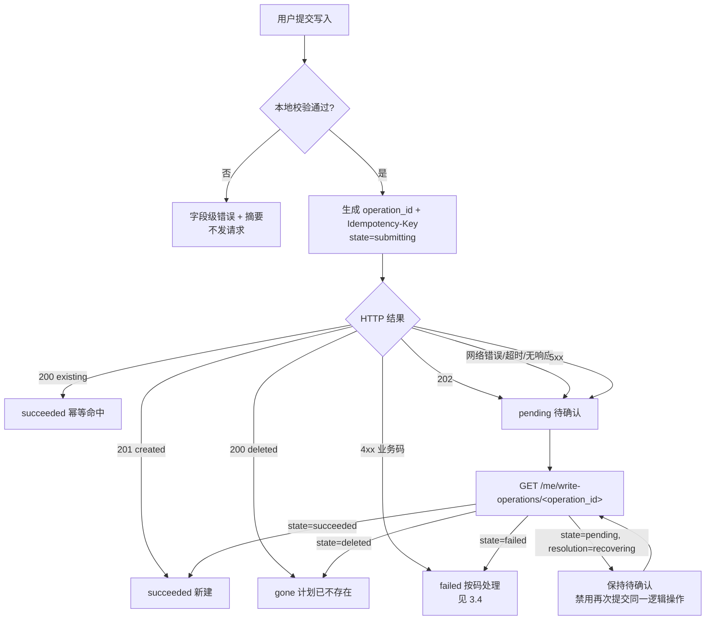

<!-- part: 60-forms-and-observability; chapters: 11,13,14,15; owner: sys-forms -->

## 11. 表单·校验·写入确认

本章回答三个问题：**字段约束谁说了算**、**校验失败怎么落到字段**、**写入结果未知时界面说什么**。

字段名与状态枚举的唯一来源是 [`API-REFERENCE.md`](API-REFERENCE.md)（由 `openapi_v0.1.json` 机械生成）；
通用错误码表在 **§3.4**，本章**只写码在具体表单上的行为**，不重列码表（契约 §3.8「分册之间不重复」）。

> **路径书写约定**：本章端点一律写成省略公共基路径的短形式（`POST /me/plans`），
> 完整路径就是 `API-REFERENCE.md` 里的 `POST /api/v1/me/plans`。
> 唯一的例外是 §11.8 那张「为什么需要幂等键」的表——那里写全路径，因为它与另外 22 个端点做对比。
> 前端代码里**必须**带 `/api/v1`（由 `VITE_API_BASE` 提供，见 §14.2）。

### 11.1 字段级约束表

约束分三层，**冲突时以更靠右的一层为准**：

| 层 | 来源 | 作用 |
| --- | --- | --- |
| L1 客户端即时反馈 | 本章表格的「前端即时校验」列 | 只为减少一次往返，**不是权威** |
| L2 OpenAPI 结构约束 | `API-REFERENCE.md` 各端点请求体 | 权威；违反 ⇒ `VALIDATION_FAILED` |
| L3 跨字段/业务规则 | 后端 Module（后端详细设计 §12.3） | 权威；OpenAPI 表达不了 |

#### 11.1.1 计划（手动创建 / 编辑）`POST /me/plans`、`PATCH /me/plans/{id}`

| 字段 | 类型 | 必填 | 长度/取值 | 前端即时校验 | 后端契约 | 依据 |
| --- | --- | --- | --- | --- | --- | --- |
| `title` | string | ✅ | 1–100 | trim 后非空、码点数 ≤100 才允许提交 | 同 | `API-REFERENCE.md` PlanCreate/PlanPatch；`content-spec` S09 |
| `goal` | string \| null | — | 0–500 | 码点数 ≤500 | 同 | PlanCreate/PlanPatch |
| `start_date` | string(date) \| null | — | `YYYY-MM-DD` | 与 `end_date` 同空或同填且有序 | 合并后完整记录校验（后端 §12.3） | PlanCreate/PlanPatch；`ck_plan_dates` |
| `end_date` | string(date) \| null | — | `YYYY-MM-DD` | 同上 | 同上 | 同上 |
| `content` | string | ✅ | 1–10000 | trim 后非空、码点数 ≤10000 | 同 | PlanCreate/PlanPatch |
| `expected_version` | integer | ✅（仅 PATCH/DELETE） | ≥1 | 从 `plan.version` 原样回填，**不让用户输入** | 乐观锁 | PlanPatch；`openapi components.parameters.ExpectedVersion` |

**码点数而非 UTF-16 长度**：后端按 Unicode 码点计数（后端详细设计 §3.1）。
前端 `String.length` 会把 emoji 算成 2，因此长度校验统一走 `[...s].length`（见 §11.2 的 `countCodepoints`）。

#### 11.1.2 草稿（助手生成）`PATCH /me/drafts/{draft_id}`、`POST /me/drafts/{draft_id}/save`

| 字段 | 类型 | 必填 | 长度/取值 | 说明 | 依据 |
| --- | --- | --- | --- | --- | --- |
| `title` | string | ✅ | 1–100 | 同计划 | API-REFERENCE（reviseDraft） |
| `goal` | string \| null | — | 0–500 | 同计划 | 同上 |
| `start_date` / `end_date` | string(date) \| null | — | 同计划 | 同计划 | 同上 |
| `content` | string | ✅ | 1–10000 | 同计划 | 同上 |
| **`expected_draft_version`** | integer | ✅（PATCH） | ≥1 | **草稿用这个名字**，来自 `draft.draft_version` | API-REFERENCE（DraftPatch） |
| **`draft_version`** | integer | ✅（save 请求体） | ≥1 | 保存时必须回传**被授权的那一版** | API-REFERENCE（DraftSave） |

> **硬错预防（同名不同义）**：草稿是 `expected_draft_version` / `draft_version`，**计划是 `expected_version`**。
> 两者写混会直接把请求打到不存在的字段上（OpenAPI 拒绝额外字段 ⇒ `VALIDATION_FAILED`）。
> 这不是命名风格问题，是**已有契约事实**：`DraftPatch.required = ['expected_draft_version']`、`PlanPatch.required = ['expected_version']`。

#### 11.1.3 课表（管理端）`POST /admin/schedules`、`PATCH /admin/schedules/{id}`

| 字段 | 类型 | 必填 | 取值 | 前端即时校验 | 依据 |
| --- | --- | --- | --- | --- | --- |
| `student_id` | string | ✅（仅创建） | 1–64，`^[A-Za-z0-9_-]+$` | 必须是下拉/搜索选中的真实学生 | ScheduleCreate |
| `course_id` | string | ✅ | 同上 | **停用课程不可选**（`content-spec` S12） | ScheduleCreate/Patch |
| `class_date` | string(date) | ✅ | `YYYY-MM-DD` | 原生 `type="date"` | 同上 |
| `start_time` | string | ✅ | `HH:mm`，`^(?:[01][0-9]\|2[0-3]):[0-5][0-9]$` | 原生 `type="time"` + 秒位固定 `00` | 同上 |
| `end_time` | string | ✅ | 同上 | 同日且 `>` `start_time` | 同上 |
| `location` | string \| null | — | 0–200 | 码点数 ≤200 | 同上 |
| `overlap_acknowledged` | boolean | — | — | 用户勾选确认后才置 `true` | 同上 |
| `reason` | string | **仅在 `overlap_acknowledged=true` 时** | 1–500 | 码点数 1–500，trim 后非空 | 同上 |
| `expected_version` | integer | ✅（仅 PATCH） | ≥1 | 从 `schedule.version` 回填 | SchedulePatch |

**`reason` 是条件必填**：契约里它是可选的普通字段，但 `content-spec` S12 把「原因（必填，≤500 字）」
绑在冲突确认面板上。因此前端规则是：**勾选「确认继续」后 `reason` 由必填变为必填（空则不发请求）**；
不勾选时既不传 `overlap_acknowledged` 也不传 `reason`——让后端按首次请求返回 `SCHEDULE_OVERLAP`。

#### 11.1.4 课程（管理端）`POST /admin/courses`、`PATCH /admin/courses/{id}`

| 字段 | 类型 | 必填 | 取值 | 前端即时校验 | 依据 |
| --- | --- | --- | --- | --- | --- |
| `code` | string | ✅（仅创建） | 1–32 | **创建后不可修改** ⇒ 编辑态渲染为 `readonly` 输入 | CourseCreate；`content-spec` S10 |
| `name` | string | ✅ | 1–100 | trim 后非空 | CourseCreate/CoursePatch |
| `description` | string \| null | — | 0–2000 | 码点数 ≤2000 | 同上 |
| `enabled` | boolean | — | — | 停用前弹确认 | CoursePatch；`content-spec` S10 |
| `expected_version` | integer | ✅（仅 PATCH） | ≥1 | 从 `course.version` 回填 | CoursePatch |

#### 11.1.5 学生（管理端）`POST /admin/students`、`PATCH /admin/students/{id}`

| 字段 | 类型 | 必填 | 取值 | 前端即时校验 | 依据 |
| --- | --- | --- | --- | --- | --- |
| `account` | string | ✅（仅创建） | 3–64 | 创建后不可修改 ⇒ 编辑态只读 | StudentCreate |
| `display_name` | string | ✅ | 1–50 | trim 后非空 | StudentCreate/StudentPatch |
| `initial_password` | string | ✅（仅创建） | 1–1024 | **不得回显、不得写入任何 store 持久字段**（契约 §3.7 规则 4） | StudentCreate |
| `enabled` | boolean | — | — | 禁用前弹确认 | StudentPatch；`FR-AUTH-002` |
| `expected_version` | integer | ✅（仅 PATCH） | ≥1 | 从 `user.version` 回填 | StudentPatch |

**`role` 不在任何请求体里**：创建学生时后端固定 `role=student`（后端详细设计 §3.2）。
前端**不得**渲染角色选择控件，也不得在提交体里附加 `role`（契约 §3.7 规则 3 的反面：伪造 role 必须被拒，见 AT-02）。

#### 11.1.6 上传（管理端）`POST /admin/document-batches`

| 字段 | 类型 | 必填 | 取值 | 前端即时校验 | 依据 |
| --- | --- | --- | --- | --- | --- |
| `files` | array<string> | ✅ | 1–10 个 | 选择后立即算个数 | Upload |
| `allow_duplicate_names` | boolean | — | — | 同名提示后由用户显式置 `true` | Upload |
| 单份大小 | — | — | ≤20 MiB = 20,971,520 B | `File.size` 比较 | `content-spec` S11；`ck_document_size` |
| 整批合计 | — | — | ≤50 MiB = 52,428,800 B | 求和比较 | `content-spec` S11；`ck_batch_size` |
| 后缀 | — | — | `txt` `md` `pdf` `docx` | 后缀 + **实际内容签名**都要一致（后端 §3.2），前端只做后缀预筛 | `content-spec` S11 |

> 上限写入 `content-spec` 的逐字限制说明：**TXT / MD / 含文字层的 PDF / DOCX；单文件 ≤ 20 MiB；单批 ≤ 10 个、合计 ≤ 50 MiB**。
> 前端读数为 MiB（`bytes / 1048576`），显示与后端 `byte_size ≤ 20971520` / `total_bytes ≤ 52428800` 对齐。

#### 11.1.7 登录 `POST /auth/login`

| 字段 | 类型 | 必填 | 取值 | 说明 |
| --- | --- | --- | --- | --- |
| `account` | string | ✅ | 3–64 | 失败时**保留账号**（`content-spec` S01 行为说明） |
| `password` | string | ✅ | 1–1024 | 失败时**清空密码**、焦点回密码框 |

不区分「账号不存在 / 密码错误 / 账号被禁用」的前端分支——三者**统一文案**（`FR-AUTH-001`）；
`enabled=false` 的账号走 `content-spec` S01 的「账号被禁用」并排提示态。

#### 11.1.8 助手输入 `POST /chat/stream`

| 字段 | 类型 | 必填 | 取值 | 依据 |
| --- | --- | --- | --- | --- |
| `client_request_id` | string | ✅ | 客户端生成、<64 且 `^[A-Za-z0-9_-]+$` | `FR-CHAT-001`；后端 §3.2 |
| `conversation_id` | string | 首轮不传、后续必传 | 1–64 | `FR-CHAT-001` |
| `message` | string | ✅ | trim 后 1–2000 | 后端详细设计 §3.2 |
| `history` | array | — | ≤40 条、至多 20 个完整问答对；`role ∈ {user, assistant}` | 后端详细设计 §3.2；SSE 契约 §3.5 |

**`history` 不接受 `system` / `tool`**：客户端只回传 user/assistant，服务端追加真正的系统指令（`FR-CHAT-002`）。
`Idempotency-Key` **不用于 `POST /chat/stream`**——该端点用 `client_request_id` 做去重（见 §11.7）。

### 11.2 客户端校验 vs 服务端校验的分工

| 规则 | 客户端 | 服务端 | 理由 |
| --- | --- | --- | --- |
| 空/长度/码点数 | ✅ 即时 | ✅ 权威 | 客户端只为减少往返；权威永远在服务端（`VALIDATION_FAILED` 是唯一裁决） |
| 格式（日期、`HH:mm`） | ✅ 用原生控件 | ✅ 权威 | 原生控件挡住大部分非法输入，但可被绕过 |
| 跨字段（起止有序、同空同填） | ✅ **提交前** | ✅ 权威 | 见 §11.4 |
| 唯一性（账号/课程代码） | ❌ | ✅ | 客户端无从得知；只能等 `DUPLICATE_*` |
| 时段重叠 | ❌ | ✅ | 需要全库视野；只能等 `SCHEDULE_OVERLAP` |
| 版本（`expected_version`） | ❌ | ✅ | 客户端只知道「我知道的那一版」 |
| 归属与权限 | ❌ | ✅ | `FR-AUTH-004`；客户端判断不构成授权 |
| 保存许可 | ❌ | ✅ | `FR-PLAN-003`：「仅靠模型返回 save=true 不构成授权」 |

**客户端校验的定位（不得越界）**：

1. 客户端**不得**因为自己的校验通过就跳过服务端错误处理——`VALIDATION_FAILED` 永远可能到达。
2. 客户端**不得**因为自己的校验失败就**不发**请求而不给用户原因；本地失败必须落到同一个 `field__error` 通路。
3. 客户端**不得**在本地"修正"用户输入（如自动 trim 后提交）而不告知——`account`/`code` 的 trim 是后端行为（后端 §3.1），
   前端 trim 只为即时反馈，**提交原文**由后端规范化。

**统一的长度校验纯函数**（放 `domain/validate.ts`，契约 §3.2 目录）：

```ts
/** 按 Unicode 码点计数：String.length 会把 emoji 算成 2，与后端 §3.1 不一致。 */
export const countCodepoints = (s: string): number => [...s].length;

/** 码点数（非 UTF-16 长度）上限校验。 */
export function withinCodepoints(s: string, min: number, max: number): boolean {
  const n = countCodepoints(s);
  return n >= min && n <= max;
}
```

### 11.3 错误摘要与字段定位

`NFR-UX-001`：「输入错误应明确字段及原因」。落地形态由设计系统给定
（[`design/system/components/04-forms-data.md`](../../design/system/components/04-forms-data.md) §一、§四），本章只定**数据流**。

| 环节 | 做法 | 依据 |
| --- | --- | --- |
| 错误来源 | `VALIDATION_FAILED` 响应的 `error.field_errors[]`，每项 `{ field, reason }`（`maxLength` 100 / 500） | `openapi components.schemas.FieldError` |
| 字段名映射 | `field` 是**后端字段名**（如 `start_date`）；前端按 `FORM_FIELD_MAP` 映射到控件 `id` | — |
| 归位 | 命中的 `.field` 加 `.field--invalid`，控件 `aria-invalid="true"` + `aria-describedby` 指向该字段的 `field__error` | `04-forms-data.md` §一.3–4 |
| 未命中字段的错误 | `field_errors` 为空或含未知 `field` ⇒ 全部进摘要，**不得静默丢弃** | `NFR-UX-001` |
| 摘要 | `<form>` 之前渲染 `.error-summary`，每条是对应字段 `id` 的 `<a href="#id">` | `04-forms-data.md` §四.2 |
| 焦点 | 提交失败后 `focus()` 到 `.error-summary`（`tabindex="-1"`） | `content-spec` §1「把焦点移到摘要」 |
| 就近 | 同时保留字段级 `field__error`——摘要**不替代**字段错误 | `content-spec` §1「错误就近」 |
| 三重表达 | 危险色 + 图标 + 文字（`NFR-UX-001`「状态不能仅用颜色表达」） | 契约 §3.7 规则 7 |

```ts
interface FieldError { field: string; reason: string; }   // openapi FieldError

/** 后端字段名 → 表单控件 id。未列出的字段进摘要。 */
const FORM_FIELD_MAP: Record<string, string> = {
  title: 'plan-title', goal: 'plan-goal',
  start_date: 'plan-start', end_date: 'plan-end', content: 'plan-body',
  code: 'course-code', name: 'course-name', description: 'course-desc',
  account: 'student-account', display_name: 'student-name',
  student_id: 'sched-student', course_id: 'sched-course',
  class_date: 'sched-date', start_time: 'sched-start', end_time: 'sched-end',
  location: 'sched-loc', reason: 'sched-reason',
  expected_version: '__form__',            // 版本类错误不是用户可改字段 ⇒ 只进摘要
  expected_draft_version: '__form__',
  message: 'chat-input',
};
```

> `expected_version` / `expected_draft_version` 的错误**不指向输入控件**：它们由「页面加载时拿到的版本」决定，
> 用户改了也没用，只能走 §11.6 的重新加载。映射到 `__form__` 即「只进摘要 + 提示重新加载」。

### 11.4 跨字段规则

| 规则 | 判据 | 违反时的文案（逐字，来源见右列） | 客户端时机 | 服务端 |
| --- | --- | --- | --- | --- |
| 计划两日期同空或同填且有序 | `(start==null && end==null) \|\| (start!=null && end!=null && start<=end)` | **开始与结束日期需要同时填写，且开始日期不能晚于结束日期。**（`content-spec` S09） | 提交前 + 两个日期控件 `change` 时 | `VALIDATION_FAILED`；`ck_plan_dates` |
| 课表不跨日、结束晚于开始 | `end_time > start_time`，且同为 `class_date` 当日 | **结束时间必须晚于开始时间，且不支持跨日记录。**（`content-spec` S12） | 提交前 + 时间控件 `change` 时 | `VALIDATION_FAILED`；`ck_schedule_times` |
| 个人课表查询跨度 ≤31 自然日 | `dateDiff(to, from) <= 31` | 说明文字「单次最多查询 31 天」（`content-spec` S07） | 日期导航控件即时禁用越界 | `VALIDATION_FAILED` |
| PATCH 至少一个可变字段 | 合并请求体后与 `expected_version` 对应的记录有差异 | 复用 SRS §8 原文（该场景无冻结界面文案） | 无差异则不提交，按钮禁用 | `VALIDATION_FAILED` |
| 助手 `history` 只允许完整问答对 | `history.length` 为偶数且 ≤40，`role ∈ {user,assistant}` | 复用 SRS §8 原文 | 构造时保证 | `VALIDATION_FAILED` |

**「不支持跨日」的两层含义**（易错点）：

1. `end_time < start_time`（如 `22:00`–`01:00`）**不是**跨日表达，必须拒绝；
2. 允许的 `end_time` 上限是 `23:59`——契约正则 `^(?:[01][0-9]|2[0-3]):[0-5][0-9]$`，
   **没有** `24:00`；而 DDL `ck_schedule_times` 要求 `end_time < '24:00:00'`。
   前端时间控件不得提供 `24:00` 选项。

### 11.5 冲突与并发：四种 409 的分工

四个码都在 409，但**处理方式完全不同**。通用行为见 §3.4；这里是**表单上的具体差异**。

| 码 | 触发 | 界面形态 | 用户动作 | 是否重试 | 依据 |
| --- | --- | --- | --- | --- | --- |
| `SCHEDULE_OVERLAP` | 同学生同日时间段有交集，且未确认 | **冲突确认面板**（内联，不移除表单） | 阅读重叠记录 → 填 `reason` → 点「确认保存」 | 确认后重新提交**同一逻辑操作** | `FR-SCH-004`；`content-spec` S12 |
| `DUPLICATE_SCHEDULE` | 学生的**同一天、同一课程、完全相同起止时间**已存在 | **字段级错误**，落在时间/课程字段上 | 只能修改输入 | 修改后重试 | `FR-SCH-004`；`uq_schedule_exact` |
| `VERSION_CONFLICT` | `expected_version` / `expected_draft_version` 不匹配 | **顶部错误摘要 + 重新加载入口** | 重新加载后核对；未提交编辑保留 | 重新加载后重提 | `FR-PLAN-001`；`content-spec` S09 |
| `IDEMPOTENCY_CONFLICT` | 同一 `Idempotency-Key` 配**不同内容** | 顶部摘要 + 「查看已有结果」 | 打开已有结果，不新建 | **不可**用同键重试 | `FR-PLAN-004`；SRS §8 |
| `REQUEST_ALREADY_EXISTS` | `client_request_id` 重复（同会话） | 顶部提示 + 「查询原请求状态」 | 查询原请求 | 不新建请求；用原 id 查询 | `FR-CHAT-001`；`GET /chat/requests/{request_id}` |
| `CHAT_IN_PROGRESS` | 同会话已有运行中轮次 | 输入区禁用 + 指向进行中轮次 | 等待或点「停止」 | 不重试（`CHAT_IN_PROGRESS` 不可重试） | `FR-CHAT-001`；后端 §8.1 |

#### 11.5.1 `SCHEDULE_OVERLAP` 与 `DUPLICATE_SCHEDULE` 的区别（重点）

| 维度 | `SCHEDULE_OVERLAP` | `DUPLICATE_SCHEDULE` |
| --- | --- | --- |
| 语义 | 时间段**有交集**（部分或包含） | 四元组**完全相同**（`user_id, course_id, class_date, start_time, end_time`） |
| 是否可保存 | **可以**——明确确认 + 填原因后 | **不可以**，任何情况下都不能重复保存 |
| 请求字段 | 需回传 `overlap_acknowledged=true` + `reason`（1–500） | 无可用字段；必须改输入 |
| `details` | 携带 `overlaps[]`（`Schedule` 摘要） | 无 `overlaps` |
| 文案（逐字） | **与 2026-10-22 10:00–11:40 大学英语 时间重叠。** | **该学生在同一天已有完全相同时间段的这门课，不能重复保存。** |
| 文案来源 | `content-spec` S12 | `content-spec` S12 |
| 面板结构 | 冲突提示 + 重叠记录摘要（学生/课程/日期/起止/地点）+ 原因（必填，≤500）+ 主按钮「确认保存」+ 次级「取消」 | 仅字段级错误，无面板 |

**顺序性**：后端在**同一次**提交里先查精确重复、再查重叠（`FR-SCH-004`「首次请求返回冲突及允许查看的重叠记录」）。
前端**不得**自行推断是哪种——必须以响应码为准；两者都可能在「保存时重新检查」阶段返回（`FR-SCH-004` 要求保存时重查）。

```ts
interface ErrorDetails {                    // openapi components.schemas.ErrorDetails
  existing_request_id?: string;
  operation_id?: string;
  plan_id?: string;
  state?: 'pending' | 'succeeded' | 'failed' | 'deleted';
  overlaps?: Schedule[];                    // 仅 SCHEDULE_OVERLAP
  retryable?: boolean;
}
```

#### 11.5.2 冲突确认面板的状态携带

1. 首次 `POST /admin/schedules`（不带 `overlap_acknowledged`、不带 `reason`）→ 409 `SCHEDULE_OVERLAP` + `details.overlaps[]`。
2. 面板渲染 `overlaps[]` 摘要；**`reason` 为空时「确认保存」禁用**（`content-spec` S12「原因（必填，≤500 字）」）。
3. 确认后**重新提交同一份表单**，带 `overlap_acknowledged=true` 与 `reason`。
4. 若第二次仍返回 `SCHEDULE_OVERLAP`（保存时重查发现新的重叠 ⇒ 别人刚插了一条），**回到第 2 步并展示新的 `overlaps[]`**，
   不得提示"已确认过"。
5. 若返回 `DUPLICATE_SCHEDULE`，退出面板、改为字段级错误——**两者不能同时展示在同一位置**。

### 11.6 `VERSION_CONFLICT` 的并发处理

| 项 | 值 |
| --- | --- |
| 携带字段 | 计划 PATCH/DELETE：`expected_version`；草稿 PATCH：`expected_draft_version`；草稿 save：`draft_version` |
| 值来源 | 上次 GET 拿到的 `version` / `draft_version`，**原样回填，不经用户** |
| DELETE 的位置 | **查询参数**（`openapi components.parameters.ExpectedVersion`：`in: query, required: true`）——不放请求体 |
| 命中后文案 | **这份计划已被其他标签页修改，请重新加载后再提交；你未提交的编辑会保留。**（`content-spec` S09，逐字） |
| 保留编辑 | 冲突时**不丢弃**用户输入：把当前表单值存进 `plans`/`drafts` store 的 `pendingEdit`，重新加载后回填并高亮差异 |
| 不自动合并 | `FR-PLAN-001` 只要求「防止覆盖其他标签页的新内容」，**未授权自动合并**。因此不实现三路合并，只做「重载 + 保留我的编辑 + 让用户再点一次保存」 |
| 不发第二次自动请求 | 冲突后**不得**自动用新版本重试——那等于替用户接受了他没看过的版本 |

**版本字段速查（易错，逐条对照 `API-REFERENCE.md`）**

| 端点 | 版本字段 | 位置 |
| --- | --- | --- |
| `PATCH /me/plans/{id}` | `expected_version` | 请求体 |
| `DELETE /me/plans/{id}` | `expected_version` | **query** |
| `PATCH /me/drafts/{draft_id}` | `expected_draft_version` | 请求体 |
| `POST /me/drafts/{draft_id}/save` | `draft_version` | 请求体 |
| `PATCH /admin/schedules/{id}` | `expected_version` | 请求体 |
| `DELETE /admin/schedules/{id}` | `expected_version` | **query** |
| `PATCH /admin/courses/{id}` | `expected_version` | 请求体 |
| `PATCH /admin/students/{id}` | `expected_version` | 请求体 |
| `POST /admin/documents/{id}/rebuild` | `expected_version` | 请求体 |
| `DELETE /admin/documents/{id}` | `expected_version` | **query** |

### 11.7 写入确认状态机（核心）

`FR-CHAT-005`：「网络断开时，客户端应将显示状态置为『结果待确认』，**不得直接认定执行失败或未写入**。」
后端详细设计 §12.2 同口径：「当数据库不可用且不能核实操作时返回 503 及原 operation_id 安全提示，
**客户端仍显示待确认，不将其转换为 failed**。」

#### 11.7.1 三态响应 = 三态界面

`POST /me/plans` 与 `POST /me/drafts/{draft_id}/save` **都返回 200/201/202 三态**，这不是"成功/失败"两分：

| HTTP | `data` 形态 | 语义 | 界面 | 文案（逐字） |
| --- | --- | --- | --- | --- |
| **201** | `status: "created"` + `operation_id` + `plan_id` | **本次新建成功** | 保存成功态 | **已保存 · 计划编号 <plan_id>** + 主按钮「打开计划」（`content-spec` S06） |
| **200** | `status: "existing"` | **幂等命中**：同一逻辑操作之前已成功 | **同样是成功** | 同上（`content-spec` S06）。`content-spec` S06 小字：**重复提交同一操作只会得到同一份计划。** |
| **200** | `status: "deleted"` | 操作曾成功，但计划此后被删除 | 不算成功、不算失败 | 复用 SRS §8 原文（该状态无冻结界面文案）；`plan_id` 指向已删对象，不提供「打开计划」 |
| **202** | `operation_id` + `state` + `resolution` + `retryable`（可带 `plan_id`/`error_code`） | **受理中 / 结果待确认** | 结果待确认态 | **正在确认是否保存…** + 「写入结果尚未确认，请勿重复创建；可稍后查询状态。」+ 次级按钮「查询写入状态」（`content-spec` S06，逐字） |

**`created` 与 `existing` 都是成功**（契约 §3.5：`tool_end` 的 `created`/`existing` 都算成功）。
「幂等命中」**不是错误**——`FR-PLAN-004`：「相同 operation_id 与相同内容重试，返回同一 plan_id」。
埋点上也**不计作新创建**（`NFR-OBS-001`，见 §13.5）。

> **`deleted` 与前面的 `succeeded` 不是同一维度的分类。** 它是「操作记录存在、但其 `plan_id` 已失效」。
> 前端应显示的语义是「这份计划现在不存在了」，而不是「保存失败」。这解释了 `deleted` 为何与 `existing`
> 同为 200 却单列一行。

#### 11.7.2 状态机



**关键约束**

| # | 约束 | 依据 |
| --- | --- | --- |
| 1 | **HTTP 关闭 ≠ 终态**。网络错误、读取中断、5xx、503 一律进「待确认」，**不进 failed** | 契约 §3.5；`FR-CHAT-005`；后端 §12.2 |
| 2 | 待确认期间**禁止再次提交同一逻辑保存**（按钮文本与禁用态都要表达） | `FR-PLAN-005`「处理中不得再提交新的逻辑保存」 |
| 3 | 待确认**不是**无限轮询：只提供「查询写入状态」按钮，用户点了才查 | `NFR-PERF-004` 禁止无限排队/占用连接 |
| 4 | `state=succeeded` ⇒ 复用 201 的成功界面；**不再新建** | `FR-PLAN-005`「已成功记录应直接复用」 |
| 5 | 只读操作失败**可以**用新请求重试；写操作必须先按 `operation_id` 核实 | `FR-CHAT-005` |

```ts
type OperationState = 'pending' | 'succeeded' | 'failed' | 'deleted';   // WriteOperation.state
type Resolution     = 'confirmed' | 'recovering';                       // WriteOperation.resolution

interface WriteOperation {                 // openapi components.schemas.WriteOperation
  operation_id: string;                    // 1–96, ^[A-Za-z0-9._:-]+$
  state: OperationState;
  resolution: Resolution;
  plan_id?: string;
  error_code?: string;
  retryable: boolean;
}

/** 待确认态在 store 里的形态（契约 §3.4 writeOps）。 */
interface PendingWrite {
  operationId: string;
  idempotencyKey: string;                  // 复用原键重试，不换键
  resolution: Resolution;
  retryable: boolean;
  submittedAt: string;                     // 仅用于界面提示，不做自动重试
}
```

**`resolution` 的两值语义（易混）**

| 值 | 含义 | 前端 |
| --- | --- | --- |
| `confirmed` | 操作已有确定结论（成功/失败/已删） | 直接落到对应终态界面 |
| `recovering` | 后端正在恢复/核实中 | **保持待确认**，不改变界面态，等待用户再次查询 |

### 11.8 幂等键：使用面与两个冲突码的区别

#### 11.8.1 使用面（**恰好 4 个端点**，不是"所有写操作"）

`Idempotency-Key` 是 **required header**，仅出现在以下 4 个端点（逐条核对 `openapi components.parameters.IdempotencyKey`）：

| 端点 | 为什么需要幂等键 |
| --- | --- |
| `POST /me/plans` | 手动创建计划，可能因网络重发 |
| `POST /me/drafts/{draft_id}/save` | 草稿保存，可能因待确认而重复提交 |
| `POST /admin/documents/{id}/rebuild` | 重建，长任务、易重发 |
| `POST /admin/documents/{id}/cleanup-retry` | 清理重试，长任务、易重发 |

**不带的端点不要"顺手加上"**：

| 端点 | 去重机制 |
| --- | --- |
| `POST /chat/stream` | `client_request_id`（`FR-CHAT-001`） |
| `POST /admin/schedules`、`PATCH`/`DELETE` 课表 | `expected_version` 乐观锁 + 精确重复唯一键 |
| `PATCH /me/plans/{id}`、`PATCH /me/drafts/{draft_id}` | `expected_version` / `expected_draft_version` |
| `POST /admin/courses`、`POST /admin/students` | 唯一键（`DUPLICATE_COURSE` / `DUPLICATE_ACCOUNT`） |

键的格式（`openapi components.parameters.IdempotencyKey`）：`minLength 1, maxLength 96, pattern ^[A-Za-z0-9._:-]+$`。
`description` 原文：**「同一逻辑写入必须复用；草稿保存必须匹配服务端版本绑定。」**
⇒ **重试必须复用原键**；换键等于新逻辑操作，会绕过幂等保护。

```ts
/** 幂等键生成：符合 ^[A-Za-z0-9._:-]+$ 且 ≤96。 */
export function newIdempotencyKey(): string {
  return `op.${crypto.randomUUID()}`;     // 40 字符，在允许集合内
}
```

#### 11.8.2 `IDEMPOTENCY_CONFLICT` vs `REQUEST_ALREADY_EXISTS`

| 维度 | `IDEMPOTENCY_CONFLICT` | `REQUEST_ALREADY_EXISTS` |
| --- | --- | --- |
| 作用对象 | `Idempotency-Key`（4 个写端点） | `client_request_id`（对话轮次） |
| 触发 | **同键配不同内容**（摘要不一致） | 同会话**重复 `client_request_id`** |
| 语义 | 「你换了内容却复用同一个逻辑操作标识」 | 「这个请求标识已经用过」 |
| 前端动作 | 展示已有结果（`details.operation_id`/`plan_id`），**不得**用同键重发新内容 | 用原 id 查询状态：`GET /chat/requests/{request_id}` |
| 是否可重试 | 不可（换内容 = 换新逻辑操作 ⇒ 必须换新键与新 `operation_id`） | 不可重发；查询原请求 |
| 依据 | `FR-PLAN-004`「相同操作标识配不同内容，返回冲突，不覆盖旧内容」 | `FR-CHAT-001`「重复请求标识不重复调用模型」 |

**`details` 的可用字段**（`components.schemas.ErrorDetails`）：`operation_id`、`plan_id`、`state`、
`existing_request_id`、`overlaps[]`、`retryable`。前端的「查看已有结果」直接消费这些白名单字段，
**不得**请求额外的内部字段。

### 11.9 计划保存许可（`SAVE_NOT_AUTHORIZED`）

`FR-PLAN-003` 明确定义了**哪些入口能授予保存许可**，以及哪些**不能**：

| 入口 | `authorization_kind` | 前端形态 |
| --- | --- | --- |
| 当前用户提交手动创建表单 | `manual_form` | S09 的「新建计划」表单提交 |
| 点击指定草稿版本的保存按钮 | `draft_button` | S06 的「保存为我的计划」 |
| 当前用户直接发出可确定的生成并保存指令 | `direct_instruction` | 对话里的明确指令（由后端判定） |

**必须拒绝的写入意图**（`FR-PLAN-003`）：否定表达、引用材料中的保存指令、历史转述、指代歧义。
前端责任：**不把"看起来像保存"的用户文本变成写入按钮的自动触发**——「示例入口只填写文本，不自动提交」（`FR-CHAT-001`）。
收到 `SAVE_NOT_AUTHORIZED` 时：**展示未保存草稿 + 保存按钮**（`FR-PLAN-002`「对于无法确定的表达，应保持预览并提供保存按钮」），
不得提示"保存失败"。

| 码 | 表单行为 |
| --- | --- |
| `SAVE_NOT_AUTHORIZED` | 退出确认态，回到**草稿预览**；主按钮变为「保存为我的计划」；不写摘要为错误 |
| `DRAFT_EXPIRED`（410） | 草稿不可恢复 ⇒ 明确提示重新生成（`FR-PLAN-002`）；**不得**用客户端持有的 assistant 文本重建草稿 |
| `SAVE_LIMIT_REACHED`（409） | 展示**已存在的**结果（同轮已成功创建一份），不再新建（`FR-PLAN-004`） |

### 11.10 S11 上传：文件状态与三个上传错误码

#### 11.10.1 五种文件状态（与 `Document.processing_state` 对齐）

`content-spec` S11 要求画出**全部 5 种状态**。以下是**展示态 → 契约字段 → 数值/枚举**的对齐：

| # | `content-spec` S11 展示态 | `Document.processing_state` | 批次态 `Batch.state` | 补充字段 | 逐字文案（来源） |
| --- | --- | --- | --- | --- | --- |
| 1 | **可检索** | `available` | `published` | `visibility: shared` | — |
| 2 | **处理中**（带进度） | `processing` | `accepted` / `processing` | `Task.state ∈ {pending, running, retry_wait}` | — |
| 3 | **失败** | `failed` | — | `error_code`（异步任务码） | **未提取到文字，可能是扫描件；本期不支持 OCR。**（`content-spec` S11，对应 `NO_TEXT_EXTRACTED`） |
| 4 | **删除中** | `deleting` | — | `cleanup_state ∈ {pending, running}` | — |
| 5 | **删除失败** | `delete_failed` | — | `cleanup_state: failed` | 「重试清理」入口（`content-spec` S11） |

**契约里还有两个没有对应展示态的 `processing_state`**（`rebuilding`、`deleted`）与批次态 `compensating`：

| 枚举值 | 说明 | 处理 |
| --- | --- | --- |
| `rebuilding` | `POST /admin/documents/{id}/rebuild` 进行中 | `content-spec` S11 **未冻结**该态文案 ⇒ 前端**不得自造**；本次实现按「处理中」呈现，并在 §16 登记为待冻结文案 |
| `deleted` | 清理已完成 | 从列表移除（`FR-DOC-006`「新检索及引用展开立即排除该文档」） |
| `Batch.state = compensating` | 整批失败进入补偿清理 | 沿用整批回滚提示：**本批 1 个文件失败，整批未发布；其他批次不受影响。**（`content-spec` S11，逐字） |

**6 个异步任务码**（来自 `API-REFERENCE.md` §0）：`NO_TEXT_EXTRACTED`、`DOCUMENT_ENCRYPTED`、
`PARSE_FAILED`、`EMBEDDING_FAILED`、`CLEANUP_FAILED`、`SERVICE_RESTARTED`。
它们**不是 HTTP 错误码**（SRS §8：其存在不意味着批次查询接口本身失败），
出现在 `Document.error_code` 与 `Task.error_code` 上。逐字对应关系：

| 异步码 | 展示文案 |
| --- | --- |
| `NO_TEXT_EXTRACTED` | **未提取到文字，可能是扫描件；本期不支持 OCR。**（`content-spec` S11，逐字） |
| `DOCUMENT_ENCRYPTED` / `PARSE_FAILED` / `EMBEDDING_FAILED` / `CLEANUP_FAILED` / `SERVICE_RESTARTED` | 复用 SRS §8 原文（无冻结界面文案；**不得自造**） |

#### 11.10.2 三个上传错误码

| 码 | HTTP | 触发 | 前端落点 | 文案 |
| --- | --- | --- | --- | --- |
| `UNSUPPORTED_FILE_TYPE` | 415 | 后缀或内容签名不受支持 | 上传区字段级错误 + 该文件行标红 | 复用 SRS §8 原文；限制说明用 `content-spec` S11 逐字句 |
| `UPLOAD_TOO_LARGE` | 413 | 单份 >20 MiB 或整批 >50 MiB | 上传区字段级错误，指明是**单份**还是**整批** | 复用 SRS §8 原文；同上 |
| `DUPLICATE_FILENAME` | 409 | 同名文件待处理 | 弹出选择：取消 / **作为独立文档上传** | `FR-DOC-004`「文件同名不自动覆盖，返回提示并要求选择取消或作为独立文档继续」 |

**`DUPLICATE_FILENAME` 的确认流程**：用户选「作为独立文档上传」⇒ 重新提交，`allow_duplicate_names=true`；
选「取消」⇒ 从待上传列表移除该文件。**不得**默认静默改名（`FR-DOC-004`）。

| 相关码 | 前端行为 |
| --- | --- |
| `DOCUMENT_BUSY`（409） | 提示等待：同一文档一次仅允许一个重建或删除变更（`FR-DOC-005`）；不自动重试 |
| `CLEANUP_FAILED` | 文件行显示「删除失败」+「重试清理」入口 → `POST /admin/documents/{id}/cleanup-retry`（需 `Idempotency-Key`） |

### 11.11 表单章节小结表

| 主题 | 一句话结论 | 关键依据 |
| --- | --- | --- |
| 校验权威 | 服务端；客户端只为即时反馈 | 后端 §3.3 |
| 长度单位 | Unicode 码点，不是 UTF-16 | 后端 §3.1 |
| 版本字段 | 草稿 `expected_draft_version`/`draft_version`；其余 `expected_version`；DELETE 放 query | `API-REFERENCE.md` |
| 冲突 | 重叠可确认保存、精确重复不可保存 | `FR-SCH-004` |
| 写入未知 | 待确认，**不是失败**；用 `operation_id` 核实 | `FR-CHAT-005`；后端 §12.2 |
| 三态响应 | 201 新建成功 / 200 幂等命中（也是成功）/ 202 待确认 | `API-REFERENCE.md` |
| 幂等键 | 恰好 4 个端点；重试复用原键 | `openapi components.parameters.IdempotencyKey` |
| 上传状态 | 5 种展示态；`rebuilding` 文案待冻结 | `content-spec` S11 |

---

## 13. 降级·错误·可观测

本章只写**错误分层、降级矩阵、可观测与红线**。**同步错误码的权威映射表在 §3.4**（码的数量口径见本册文末「本册依赖与未决」），本章不重列。

### 13.1 `NFR-REL-001` 降级矩阵（逐功能）

`NFR-REL-001` 原文：「模型、Embedding 或 MCP 故障时，直接业务课表读取、个人计划管理、
用户及课程管理仍可使用；资料处理可失败但应保留任务状态。」

下表把这句话**逐功能**展开。「只读」= 能看不能写；「降级」= 可用但能力受限。

| 功能 | 依赖 | 模型故障 | Embedding 故障 | MCP 故障 | 数据源（MySQL/存储）故障 |
| --- | --- | --- | --- | --- | --- |
| S01 登录 / 登出 | 无外部 AI | **可用** | **可用** | **可用** | **不可用**（无会话） |
| S07 我的课表查询 | 无外部 AI | **可用** | **可用** | **可用** | **不可用** |
| S09 计划列表 / 详情 | 无外部 AI | **可用** | **可用** | **可用** | **不可用** |
| S09 计划手动创建 / 编辑 / 删除 | 无外部 AI | **可用** | **可用** | **可用** | **不可用** |
| S10 课程管理 | 无外部 AI | **可用** | **可用** | **可用** | **不可用** |
| S10 学生管理 | 无外部 AI | **可用** | **可用** | **可用** | **不可用** |
| S11 文档列表 / 批次查询 | 存储 | **可用** | **可用** | **可用** | **只读**（列表可查、变更不可） |
| S11 上传 / 重建 / 删除 | Embedding + 存储 | **可用**（上传可受理） | **降级**：可受理，解析/向量化可失败 | **可用** | **不可用** |
| S11 预览抽取文本 | 存储 | **可用** | **可用** | **可用** | **不可用** |
| S12 课表维护 | 无外部 AI | **可用** | **可用** | **可用** | **不可用** |
| S02–S06 助手对话 | 模型 + MCP | **不可用**（`MODEL_UNAVAILABLE`） | **降级**：可对话但无资料依据（`RETRIEVAL_UNAVAILABLE`） | **不可用**（`MCP_UNAVAILABLE`） | **不可用** |
| 助手查课表工具 | MCP | **不可用** | **可用** | **不可用**（`MCP_UNAVAILABLE`） | **不可用** |
| 助手检索资料工具 | Embedding + MCP | **不可用** | **不可用**（`RETRIEVAL_UNAVAILABLE`） | **不可用** | **不可用** |
| 助手保存计划工具 | MCP + 数据库 | **不可用** | **可用** | **不可用** | **不可用** |
| S06 草稿保存（按钮路径） | 数据库 | **可用** | **可用** | **可用**（不经 MCP） | **不可用 ⇒ 待确认** |

**矩阵读法（三条不变量）**

1. **不经 AI 的功能永不因 AI 故障降级**——这是 `NFR-REL-001` 的核心，也是 SRS 把「直接业务课表读取、
   个人计划管理、用户及课程管理」并列的原因（它们**不经过模型**）。
2. **Embedding 故障 ≠ 助手全不可用**：对话仍可进行，只是资料检索能力不可用。
   前端提示要用 `RETRIEVAL_UNAVAILABLE` 的能力语义（SRS §8：「提示具体能力暂不可用」），
   **不得**说成"助手不可用"。
3. **`MCP_UNAVAILABLE` 打击面最大**：三个工具全部不可用 ⇒ 助手无法查课表、无法检索、无法保存。
   此时助手正文仍可能生成（模型可用），但**没有工具结果支撑**；前端必须让「无依据」与「有依据」可分辨（`FR-QA-003`）。

**降级态的页面级文案**（只允许用 `content-spec` 已冻结的坏消息文案）：

| 场景 | 逐字文案 | 来源 |
| --- | --- | --- |
| 课表读取失败 | **课表数据暂时无法读取，这不代表当天没有课。** | `content-spec` S08② |
| 课表读取成功但无记录 | **2026-10-22（周四）没有课程安排。** | `content-spec` S08① |
| 资料检索无足够依据 | **已检索共享资料，但没有找到足以回答这项要求的内容。** | `content-spec` S05 |
| 资料检索失败 | **课程资料暂时无法查询，请稍后重试。** | `content-spec` S05 |
| 全库为空 | **管理员还没有上传可检索的课程资料。** | `content-spec` S05 |
| 引用失效（410） | **这条引用已失效（资料已被删除），依据可能已变化。** | `content-spec` S04 |

> S08 ①②**必须视觉可分**（`content-spec` S08：两者禁止合并成同一个空态组件）。
> 这是 `NFR-REL-001` 在前端最容易做错的地方：**失败的空**与**成功的空**不能复用同一个组件实例的同一套文案。

### 13.2 错误分层

| 层 | 来源 | 前端观测到的形态 | 归类 | 用户可见文案策略 |
| --- | --- | --- | --- | --- |
| **L0 网络** | `fetch` reject、`AbortError`、DNS/TLS 失败 | 无 HTTP 状态 | `network` | 读操作：可重试；**写操作：待确认**（§11.7） |
| **L1 HTTP 同步** | 4xx/5xx + `{request_id, error:{code, message, field_errors?, details?}}` | 有 `code` | 按 §3.4 | 用 `code` 选文案；`INTERNAL_ERROR` 必须显示 `request_id` |
| **L2 SSE 流内** | `text/event-stream` 里的 `event: error` | 事件 `data.code` | 按 §3.4 + 契约 §3.5 | 同 L1；**流内不用 HTTP 状态**（SRS IF-010） |
| **L3 协议违规** | 事件顺序/结构违反契约 §3.5 | 无业务码 | `protocol_violation` | 不向用户暴露内部表述；记埋点 + 安全文案 |
| **L4 未知终态** | 流结束但未收到 `done`/`error` | 无终态 | `unknown` | **待确认**（写）/「未完成，可重试」（读） |
| **L5 超时** | `EXECUTION_TIMEOUT`(504) 或前端 `AbortController` 超时 | 有或没有码 | `timeout` | 按 §3.4；写操作**先核实**再决定 |

**L1 与 L2 共用同一套业务码**（SRS IF-010：「同一种错误在普通 API、SSE 和 MCP 中使用相同业务 code」）。
⇒ 前端**只实现一份 `mapError(code)`**（`domain/mapError.ts`，契约 §3.2 目录），
L1/L2 都调用它；**不得**为 SSE 单独写第二张码表。

**L3 协议违规的具体清单**（前端要能识别并记埋点，不崩溃）：

| # | 违规 | 依据 | 前端动作 |
| --- | --- | --- | --- |
| 1 | **第二个终态事件**（`done` 或 `error` 出现两次） | 契约 §3.5「一个轮次最多一个终态」 | 忽略第二个 + 记 `protocol_violation` |
| 2 | `seq` 非严格递增或重复 | 契约 §3.5 | 按 `(request_id, seq)` 去重；`seq ≤ lastSeq` 丢弃；**不得**用「覆盖」代替去重 |
| 3 | `tool_end` 找不到配对的 `tool_start` | 契约 §3.5 | 忽略该 `tool_end` + 记埋点；**不得**渲染成孤立步骤 |
| 4 | `status` 的 `code=ACCEPTED` 但缺 `conversation_id` | 契约 §3.5「schema 强制」 | 记 `protocol_violation`，进 `unknown` |
| 5 | `tool_end.success=false` 但缺 `code` | 契约 §3.5「`code` 必填」 | 按 `failed` 渲染，`code` 取通用失败文案 |
| 6 | `token` 的 `answer_block_id` 指向未知块 | 契约 §3.5 | 新建块并记埋点（不丢正文） |
| 7 | `done` 的 `state` 不在 `{succeeded, cancelled}` | 契约 §3.5 | 记埋点，按 `unknown` 处理 |
| 8 | 未知 `event:` 名 | SRS §6.7（六类事件） | **忽略**（前向兼容），不记 `protocol_violation` |

### 13.3 `request_id` 贯通（`NFR-OBS-001`）

`NFR-OBS-001`：「一个用户请求跨业务服务、MCP、外部调用和写入操作时能通过 request_id 关联。
统计能区分 empty、failed、cancelled、timeout 和 succeeded；幂等重试不计作新的计划创建。」

| 环节 | `request_id` 来源 | 前端动作 |
| --- | --- | --- |
| 所有响应 | 信封 `{ request_id, data }` 的 `request_id`（`API-REFERENCE.md` §0） | 存入 `api/client.ts` 的请求上下文 |
| 响应头 | 也可能出现在响应头 | **以 body 为准**（`API-REFERENCE.md` §0 明确） |
| SSE | 事件的 `request_id`（见 SSE schema） | 与发起时的 `client_request_id` 分开记：前者是**服务端**请求标识 |
| 错误 | `{ request_id, error }`（`components.schemas.Error`） | `INTERNAL_ERROR` 时必须把 `request_id` 显示给用户 |
| 对话轮次 | `GET /chat/requests/{request_id}` 的 `request_id` | 与 `ChatState.request_id` 一致 |
| 写入操作 | `details.operation_id` / `WriteOperation.operation_id` | 与 `request_id` **不是同一个东西**，两个都要记 |

**贯通约定**

1. 前端所有出站请求（含 SSE）在 `api/client.ts` 统一采集 `request_id`，写入 `ui` store 的 `lastRequestIds`（环形缓冲，仅内存）。
2. **`request_id` 不是幂等键、不是 `operation_id`、不是 `client_request_id`**——四者语义不同，埋点里分列。
3. `INTERNAL_ERROR`（500）的界面必须能展示 `request_id` 供支持定位（SRS §8「安全文案及 request_id，用于支持定位」）。
4. 前端**不生成** `request_id`；只生成 `client_request_id` 与 `Idempotency-Key`。

```ts
/** 出站请求上下文：区分四种标识，禁止互相顶替。 */
interface RequestTrace {
  requestId?: string;          // 服务端返回；响应 body 优先于响应头
  clientRequestId: string;     // 前端生成；仅用于 POST /chat/stream
  operationId?: string;        // 写操作；来自 details.operation_id 或 WriteOperation
  idempotencyKey?: string;     // 仅 4 个写端点；重试必须复用
}
```

### 13.4 前端埋点清单

`FR-OPS-002` 要求**区分** empty / 服务失败 / 用户取消 / 限额终止 / 认证失效（= `NFR-OBS-001` 的
empty、failed、cancelled、timeout、succeeded）。**埋点是前端唯一的"统计"产出**（本期不做可视化看板，`FR-OPS-002`）。

| 事件名 | 触发 | 必带字段 | 不得包含 |
| --- | --- | --- | --- |
| `request_submitted` | 任意出站请求发出 | `requestId?`、`clientRequestId?`、`endpoint`、`method` | 请求体正文 |
| `chat_terminal` | 对话轮次进终态 | `terminal ∈ {succeeded, cancelled, failed, unknown}`、`requestId`、`conversationId` | 消息正文 |
| `chat_counters` | 终态时 | `modelCalls`、`toolCalls`（来自 `ChatState`） | — |
| `tool_finished` | `tool_end` | `toolCallId`、`toolName`、`success`、`resultStatus`、`code?` | 工具返回正文 |
| `plan_saved` | **仅** 201 `status=created` **或** 202 核实后 `state=succeeded` 且本次为新建 | `operationId`、`planId` | 计划正文 |
| `plan_idempotent_hit` | 200 `status=existing` | `operationId`、`planId` | 计划正文 |
| `write_pending` | 进「待确认」 | `operationId`、`resolution` | 表单正文 |
| `write_pending_resolved` | 核实得到确定结论 | `operationId`、`state`、`durationMs` | — |
| `citation_opened` | 引用展开 | `referenceId`、`hasPageNumber` | 片段正文 |
| `draft_created` | 草稿形成 | `draftId`、`draftVersion` | 草稿正文 |
| `batch_finished` | 批次进终态 | `batchId`、`state` | 文件正文 |
| `empty_vs_failed` | 任一列表渲染出空态 | `screen`、`kind ∈ {empty, failed}` | 列表内容 |
| `auth_expired` | `AUTH_REQUIRED` / `SESSION_EXPIRED` | `requestId?`、`fromScreen` | 令牌 |
| `quota_limited` | `CAPACITY_LIMITED` / `CALL_LIMIT_REACHED` / `SAVE_LIMIT_REACHED` | `code`、`requestId?` | — |
| `protocol_violation` | §13.2 L3 清单命中 | `kind`（第几条）、`requestId?` | 事件正文 |
| `render_throttled` | §14.6 节流生效 | `coalescedTokens`、`flushes` | 正文 |

**三条计数纪律**

1. **幂等命中不计新创建**（`NFR-OBS-001`、`FR-OPS-002`）：`plan_saved` 只在**新建**时发；
   `existing` 发 `plan_idempotent_hit`。二者**互斥**，不得都发。
2. **empty 与 failed 分列**（`NFR-OBS-001`）：同一个列表的空态必须带 `kind`，禁止只发一个 `list_empty`。
3. **cancelled / timeout / failed 三分**：`cancelled` 由 `done.state=cancelled` 或用户取消触发；
   `timeout` 由 `EXECUTION_TIMEOUT` 或前端超时触发；其余进 `failed`。三者不得合并。

### 13.5 日志红线（`NFR-PRIV-001`）

`NFR-PRIV-001`：「日志、统计和审计默认不保存完整问答、课表、计划或资料正文，不记录密码、令牌或服务密钥。」
`FR-OPS-001` 同口径：「日志默认不复制问题、课表、计划、资料正文或凭据。」

| # | 红线 | 具体禁止 | 依据 |
| --- | --- | --- | --- |
| 1 | **令牌不入遥测** | `access_token` 不进埋点、不进 console、不进错误栈、不进文件名 | `NFR-SEC-002`；契约 §3.7 规则 4 |
| 2 | **令牌只在内存** | 不进 URL、`localStorage`、`sessionStorage`、`IndexedDB` | 契约 §3.7 规则 4；`HLD-D03` |
| 3 | **不记正文** | 对话 `message` / `content`、计划 `title`/`goal`/`content`、课表 `location`、资料原文、引用片段 | `NFR-PRIV-001` |
| 4 | **不记凭据** | 登录 `password`、学生 `initial_password`、`password_hash` | `FR-AUTH-001`；后端 §3.1 |
| 5 | **不记磁盘路径** | 后端已禁止输出；前端**也不得**把 `original_storage_key` 之类字段渲染进 DOM | `FR-DOC-004`；后端 §3.1 |
| 6 | **字段名可记，值不可记** | 记 `field_errors[].field` 是可以的；记 `reason` 内容不行 | `NFR-PRIV-001` |
| 7 | **错误栈脱敏** | `Error.stack` 进埋点前必须过滤 URL query 与 header | `NFR-SEC-002`「错误堆栈」 |

**可记 / 不可记对照**

| 可记（元数据） | 不可记（正文与凭据） |
| --- | --- |
| `endpoint`、`method`、HTTP 状态、`code` | 请求体、响应 `data` 的正文类字段 |
| `request_id`、`operation_id`、`client_request_id` | `access_token`、`password`、`initial_password` |
| 长度（码点计数）、条数、分页 `page`/`page_size` | 实际文本内容 |
| `toolName`、`success`、`resultStatus` | 工具返回的业务数据 |
| 枚举值（`state`、`resolution`、`terminal`、`kind`） | — |

```ts
/** 埋点白名单：只允许这些键离开浏览器。 */
const TELEMETRY_ALLOWLIST = new Set([
  'endpoint', 'method', 'status', 'code', 'requestId', 'clientRequestId', 'operationId',
  'planId', 'draftId', 'batchId', 'referenceId', 'conversationId', 'toolCallId', 'toolName',
  'success', 'resultStatus', 'state', 'resolution', 'terminal', 'kind', 'modelCalls',
  'toolCalls', 'durationMs', 'coalescedTokens', 'flushes', 'fromScreen', 'screen',
  'hasPageNumber', 'fieldNames',
]);

export function emit(event: string, props: Record<string, unknown>): void {
  const safe: Record<string, unknown> = {};
  for (const [k, v] of Object.entries(props)) {
    if (TELEMETRY_ALLOWLIST.has(k)) safe[k] = v;
  }
  // 未在白名单内的键被静默丢弃——这是红线 1/3/4 的机械保障。
  void event; void safe;
}
```

### 13.6 容量类错误的提示策略（`NFR-PERF-004`）

`NFR-PERF-004`：「超过配置的 AI 并发容量时应返回可理解的容量限制，**不得无限排队占用普通业务连接**。」

| 码 | HTTP | 触发 | 前端策略 | 禁止 |
| --- | --- | --- | --- | --- |
| `CAPACITY_LIMITED` | 429 | 部署并发保护上限 | 提示稍后重试；**不自动重放写操作**（SRS §8 原文行为） | 自动轮询重发；无限排队 |
| `CALL_LIMIT_REACHED` | 504 | 单轮执行预算耗尽 | **先核实写入结果**再决定后续（SRS §8 原文行为） | 直接判失败 |
| `SAVE_LIMIT_REACHED` | 409 | 同轮第二次创建 | 展示已存在结果，不新建 | 用新键绕过 |
| `CHAT_IN_PROGRESS` | 409 | 同会话已有运行轮次 | 输入区禁用 + 指向进行中轮次 | 并发排队第二条 |

**「禁止无限排队」的前端 4 条硬约束**

| # | 约束 | 实现 |
| --- | --- | --- |
| 1 | 同一会话同时最多 1 个进行中轮次（`FR-CHAT-001`） | `chat` store 单一 `activeRequestId`；有值时发送按钮禁用 |
| 2 | 容量类错误**不自动重试**（读操作也需用户再点） | `mapError` 对这些码返回 `retryable: false` 的前端语义 |
| 3 | 不做前端请求队列 | 不实现 `p-queue` 式缓冲；拒绝即提示 |
| 4 | 轮次有前端超时上限，到点走 `cancelChat` 或进 `unknown` | 契约 §3.5「取消」「断线」两行 |

```ts
/** 前端不做排队：容量类错误直接暴露给用户。 */
const RETRYABLE_BY_UI: ReadonlySet<string> = new Set([
  'STORAGE_UNAVAILABLE', 'RETRIEVAL_UNAVAILABLE', 'MODEL_UNAVAILABLE',
  'MCP_UNAVAILABLE', 'INTERNAL_ERROR', 'EXECUTION_TIMEOUT',
]);
// CAPACITY_LIMITED / CALL_LIMIT_REACHED / SAVE_LIMIT_REACHED 刻意不在集合内。
```

> 注意：这个集合表达的是**界面是否给"重试"按钮**，不是后端 `details.retryable` 的替代。
> 两者都有时以 **`details.retryable`** 为准（它是服务端权威判断）。

### 13.7 可观测章节小结

| 主题 | 结论 | 依据 |
| --- | --- | --- |
| 降级 | 不经 AI 的功能永不因 AI 故障降级 | `NFR-REL-001` |
| 错误分层 | 6 层（网络/HTTP/SSE/协议/未知终态/超时），L1 与 L2 共用一份码表 | SRS IF-010 |
| 协议违规 | 8 条可识别清单，记埋点不崩溃 | 契约 §3.5 |
| 追踪 | 4 种标识分列：`request_id` / `client_request_id` / `operation_id` / `Idempotency-Key` | `NFR-OBS-001` |
| 埋点 | 16 类事件；empty/failed 分列；幂等命中不计新建 | `FR-OPS-002` |
| 红线 | 令牌/正文/凭据/路径不进遥测；白名单机制保障 | `NFR-PRIV-001`、`NFR-SEC-002` |
| 容量 | 不排队、不自动重放写操作 | `NFR-PERF-004` |

---

## 14. 构建·配置·性能

### 14.1 Vite 配置要点

| 项 | 值 / 做法 | 理由 |
| --- | --- | --- |
| 基础配置 | `@vitejs/plugin-vue`；**不引** UI 框架、不引 CSS 框架 | 契约 §3.1 |
| 输出目录 | `dist/`，`base` 由部署注入（`VITE_BASE`，默认 `/`） | — |
| **按路由分包** | 用 `build.rollupOptions.output.manualChunks` 或**动态 import 视图**；至少把 `admin*` 与 `assistant` 分开 | 学生主流程不该为管理端的表格/上传代码付首屏代价 |
| `assetsInlineLimit` | **4096**（默认值，显式写死以免被上层配置覆盖） | 设计系统零位图（原型全内联 SVG）；4 KiB 以下内联可减少请求 |
| `cssCodeSplit` | `true`（默认） | 管理端样式不阻塞学生端首屏 |
| `build.target` | `'es2022'` | 目标浏览器为 Chrome/Edge 当前稳定版及前一主要版本（`NFR-COMP-001`） |
| `build.sourcemap` | **生产 `false`** | 红线：错误栈不得外泄（§13.5 红线 7）；需要排查时用带 `hidden` 的内部构建 |
| `server.port` | 5173 | — |
| 依赖预打包 | 仅 `vue` / `vue-router` / `pinia` | 契约 §3.1 的栈，无第三方 UI/HTTP 库 |

**分包边界的硬约束**

| # | 约束 | 理由 |
| --- | --- | --- |
| 1 | `views/Admin*` 必须**动态 import**，不得进首屏 chunk | `NFR-PERF-002` 的交互预算只覆盖学生主流程 |
| 2 | `api/sse/*` **可以**进主 chunk（学生主流程需要） | `/assistant` 是登录后默认页 |
| 3 | `styles/tokens.css` 进**全局** chunk（`main.ts` 静态 import） | 所有视图都要 token |
| 4 | 不得把 `domain/*` 纯函数拆到异步 chunk | `§15` 的单测直接 import，拆分只增加成本 |

```ts
// vite.config.ts（要点，非完整文件）
import { defineConfig } from 'vite';
import vue from '@vitejs/plugin-vue';

export default defineConfig({
  plugins: [vue()],
  base: process.env.VITE_BASE ?? '/',
  build: {
    target: 'es2022',
    sourcemap: false,                 // 生产不外泄源码映射
    assetsInlineLimit: 4096,          // 显式写死
    cssCodeSplit: true,
    rollupOptions: {
      output: {
        manualChunks: {
          vendor: ['vue', 'vue-router', 'pinia'],
        },
      },
    },
  },
  server: {
    port: 5173,
    proxy: { '/api': { target: process.env.VITE_DEV_PROXY ?? 'http://127.0.0.1:8080', changeOrigin: true } },
  },
});
```

### 14.2 环境变量清单

| 变量 | 必填 | 示例 | 用途 | 是否含敏感值 |
| --- | --- | --- | --- | --- |
| `VITE_API_BASE` | ✅ | `/api/v1` | API 基路径（生产由同源反代提供） | 否 |
| `VITE_BASE` | — | `/` | 静态资源基路径 | 否 |
| `VITE_DEV_PROXY` | — | `http://127.0.0.1:8080` | 开发代理目标（仅 `vite dev`） | 否 |
| `VITE_TELEMETRY_ENDPOINT` | — | `/telemetry` | 埋点上报地址；**留空则不上报** | 否 |
| `VITE_BUILD_SHA` | — | `git rev-parse --short HEAD` | 埋点与错误带上构建指纹 | 否 |

**红线：不得有任何令牌类变量。**

| 禁止的变量名模式 | 为什么 |
| --- | --- |
| `VITE_TOKEN` / `VITE_ACCESS_TOKEN` / `VITE_JWT` | `VITE_*` 会被**内联进产物**，等于把令牌发给所有访问者（契约 §3.7 规则 4） |
| `VITE_API_KEY` / `VITE_SECRET` | 同上；前端不存在"可配置的服务端密钥" |
| `VITE_ADMIN_PASSWORD` | 同上 |

**机制保障**：CI 增加一条 `grep -E '^VITE_[A-Z_]*(TOKEN|SECRET|KEY|PASSWORD|CREDENTIAL)' .env*` 检查，
命中即失败。这条检查与 §15.7 的「本设计包自检」清单第 9 项对应。

`.env` 的提交策略：

| 文件 | 是否提交 | 内容 |
| --- | --- | --- |
| `.env.example` | ✅ 提交 | 上表全部变量名 + 注释，值为占位 |
| `.env.development` | ✅ 提交 | 只有 `VITE_DEV_PROXY` 这类非敏感默认值 |
| `.env.local` / `.env.*.local` | ❌ 不提交 | `.gitignore` 覆盖 |

### 14.3 开发代理与令牌传递

| 项 | 做法 | 依据 |
| --- | --- | --- |
| 代理路径 | `vite.config.ts` 的 `server.proxy['/api']` | 同源开发，避免 CORS |
| 令牌 | **`Authorization: Bearer <access_token>`**，由 `api/client.ts` 从 `session` store（内存）读取 | `NFR-SEC-002`；契约 §3.7 规则 4 |
| 不进 URL | 任何情况下不把令牌拼进 query | 同上 |
| SSE 代理 | `POST /chat/stream` 需代理**不缓冲**（`changeOrigin` + 关闭压缩缓冲） | 契约 §3.5 流式 |
| 401 处理 | `api/client.ts` 统一拦截 → 清空 `session` → 跳 `/login` | `FR-AUTH-002` |

```ts
// api/client.ts 的请求头组装（要点）
function authHeaders(extra?: HeadersInit): Headers {
  const h = new Headers(extra);
  const token = useSessionStore().accessToken;      // 仅内存
  if (token) h.set('Authorization', `Bearer ${token}`);
  h.set('Accept', 'application/json');
  return h;                                          // 令牌不进日志、不进埋点
}
```

### 14.4 `tokens.css` 同步脚本

设计系统是样式的**唯一真源**（契约 §2）。`web/src/styles/tokens.css` 是**生成物**（契约 §3.2 已标注「勿手改」）。

| 项 | 做法 |
| --- | --- |
| 同步命令 | `node scripts/sync-tokens.mjs`：读 `design/system/tokens.css` → 写 `web/src/styles/tokens.css` |
| 源变更后 | **先**跑 `python design/system/generate.py`（它写 `tokens.css`）**再**跑同步脚本 |
| 校验 | 同步时比对内容；若目标文件已存在且内容不同，**覆盖并在 stdout 报 diff 行数** |
| CI 门 | `node scripts/sync-tokens.mjs --check`：内容不一致即非 0 退出 |
| 手改检测 | `tokens.css` 首行有 `请勿手改` 注释；CI 校验其哈希等于源文件哈希 |
| 分层纯度 | 由 `stylelint` 规则保障（§14.5），不靠人眼 |

```bash
# 正确的更新顺序（写进 README 与 CI）
python design/system/generate.py          # tokens.json -> design/system/tokens.css
node scripts/sync-tokens.mjs              # design/system/tokens.css -> web/src/styles/tokens.css
```

### 14.5 CI 门

| # | 门 | 命令 | 失败即阻断 |
| --- | --- | --- | --- |
| 1 | typecheck | `vue-tsc --noEmit`（`strict: true`） | ✅ |
| 2 | ESLint | `eslint . --max-warnings 0` | ✅ |
| 3 | **stylelint 分层纯度** | `stylelint "src/**/*.{vue,css}"` | ✅ |
| 4 | token 同步 | `node scripts/sync-tokens.mjs --check` | ✅ |
| 5 | 单测 | `vitest run --coverage` | ✅ |
| 6 | 组件测试 | `vitest run`（含 `@vue/test-utils`） | ✅ |
| 7 | 契约测试 | `vitest run tests/contract`（校验字段名/码表来自生成物） | ✅ |
| 8 | E2E | `playwright test` | ✅ |
| 9 | 构建 | `vite build` | ✅ |
| 10 | 环境变量红线 | `grep -E '^VITE_[A-Z_]*(TOKEN\|SECRET\|KEY\|PASSWORD\|CREDENTIAL)' .env*` | ✅ |

**stylelint 分层纯度规则**（契约 §3.1 要求「把分层规则做成 CI 门」）：

| 规则 | 内容 | 依据 |
| --- | --- | --- |
| `dsh/no-bare-color` | 禁止裸 hex / `rgb()` / `hsl()` | 设计系统分层纯度规则 3 |
| `dsh/no-bare-length` | 禁止带单位裸长度（`px`/`em`/`rem`/`%`），`0` 与关键字除外 | 同上 |
| `dsh/no-l1-l2-consume` | 组件样式里禁止 `var(--p-*)`（L1）与 `var(--bg-*)/var(--text-*)/var(--state-*)` 等 L2 | README 分层纯度规则 4 |
| `dsh/only-l3-in-component` | `.vue` 的 `<style>` 只允许出现 `--<组件>-<部位>-<属性>` | 同上 |
| `dsh/no-media-breakpoints` | `@media` 只允许 `480/767/768/1024/1200/1440` | 契约 §3.7 规则 8 |
| `dsh/no-forbidden-states` | 禁止给组件补 `rb.css` 里不存在的状态（`:active`、`transition`） | 契约 §3.7 规则 6 |

```js
// .stylelintrc.cjs（要点）
module.exports = {
  rules: {
    'dsh/no-bare-color': true,
    'dsh/no-bare-length': true,
    'dsh/no-l1-l2-consume': true,
    'dsh/only-l3-in-component': true,
    'dsh/no-media-breakpoints': [480, 767, 768, 1024, 1200, 1440],
    'dsh/no-forbidden-states': true,
  },
};
```

### 14.6 首屏与交互预算：后端指标 vs 前端可做的

**这一节的核心纪律：不得把后端指标写成本前端的承诺。**

| 指标 | 原文 | 归属 | 前端能做什么 | 前端**不能**承诺什么 |
| --- | --- | --- | --- | --- |
| `NFR-PERF-002` 首状态事件端到端 **P95≤1s** | 「助手首状态事件端到端 P95≤1 秒」 | **端到端**（服务端接受 + 网络 + 前端渲染） | ① 不阻塞事件循环；② `POST /chat/stream` 发出**不等待**任何非必要前置（不预取）；③ 首个 `status` 事件到达即渲染，**不攒批**；④ 不在流开始前做全量 store 水合 | **不能**承诺 ≤1s——它包含服务端调度与网络 RTT，前端只是链路的一段 |
| `NFR-PERF-002` 首段实质回答 **P95≤10s** | 同上 | **端到端** | ① token 到达即增量渲染（§14.7 的节流上限不得掩盖首段）；② 首段前不做 Markdown 全量重排 | **不能**承诺 ≤10s（取决于模型与工具耗时） |
| `NFR-PERF-001` 普通接口 P95≤1s | 服务端响应 | **服务端** | 不重复请求（缓存 `me` 身份、避免并行重复 GET） | 不能承诺（服务端指标） |
| `NFR-PERF-003` 入库 P95≤60s | 服务端 | **服务端** | 上传后轮询批次状态（用户点击触发，不自动高频轮询） | 不能承诺 |
| `NFR-PERF-004` 不无限排队 | 服务端限额 + 前端行为 | **双方** | 见 §13.6 的 4 条硬约束 | — |
| `NFR-PERF-005` 完成率 99% | 端到端 | **服务端为主** | 不因前端 bug 产生额外失败（错误处理完备、不丢事件） | 不能承诺 |

**前端可独立承诺的自有预算**（这些才是前端指标）：

| 指标 | 目标 | 测量方式 |
| --- | --- | --- |
| 首屏 JS（学生主流程，gzip） | ≤150 KB | `vite build` 产物 + `gzip -9` |
| 管理端 chunk 不进首屏 | 断言 `admin*` chunk 不出现在入口 `index.html` 的 `modulepreload` | 构建产物断言 |
| 首帧渲染（本地静态） | ≤1.5 s（中端笔记本，冷缓存） | Lighthouse / Playwright trace |
| 单次 `token` 追加的同步耗时 | ≤8 ms | `performance.measure` 包住渲染路径 |
| 流式期间的布局抖动（CLS） | ≤0.1 | 对话正文容器预留高度，不整体重排 |
| 分包边界不泄漏 | 学生路由不加载 `admin*` chunk | Playwright 断言网络请求（§15.3 高风险用例 1） |

> 上表全部是**前端拥有测量手段**的项。凡是需要服务端计时的，一律标注归属，不写入前端的验收承诺。
> 这是对 `NFR-PERF-002` 的**正确归属**：P95≤1s / ≤10s 由后端与部署验证（`AT-30`），
> 前端只保证"不成为额外延迟源"，并在 §15 用 trace 证据证明这一点。

### 14.7 SSE 渲染节流策略

**问题**：`token` 事件按 `text_delta` 高频到达（后端 §8.4：正常正文可合并为约 **100 ms 一块**，
单块文本 ≤4096 码点）。若**每个 token 一次 Vue 响应式更新 + 一次 DOM 提交**，
在长回答上会产生数千次渲染，直接吃掉 `NFR-PERF-002` 的首段预算并造成滚动抖动。

**策略：按帧批量 flush，不是按 token。**

| 项 | 值 | 理由 |
| --- | --- | --- |
| flush 触发 | `requestAnimationFrame`（≈16.7 ms）**或** 累积 ≥4096 码点，先到先 flush | 与浏览器绘制对齐；不产生"比屏幕更快"的无用渲染 |
| 追加而非重排 | 只对**最后一个** `answer_block_id` 的文本节点做 `append` | 避免整段重新解析 Markdown |
| Markdown 解析频率 | **每 flush 一次**，且只解析**当前未闭合块** | 全量重解析是 O(n²) |
| 首段优先 | 流开始后的**第一个** `token` 立即 flush（不等 rAF） | 保住 `NFR-PERF-002` 的"首段实质回答"体感 |
| 终态时 | `done`/`error` 到达时**强制 flush** 并做一次完整 Markdown 定型 | 终态正文必须完整且安全渲染 |
| 空闲 | 无 `token` 到达时不 flush（不空转） | — |
| 埋点 | 每次窗口发 `render_throttled{coalescedTokens, flushes}` | §13.4 |

```ts
/**
 * 流式正文节流器。契约 §3.5：token 追加 text_delta 到 answer_block_id 对应块，且不得抢焦点。
 * 设计目标：与浏览器绘制对齐，避免每 token 一次渲染。
 */
export function createTokenThrottle(flush: (blockId: string, text: string) => void) {
  const buffers = new Map<string, string>();
  let scheduled = false;
  let firstFlushDone = false;

  const run = () => {
    scheduled = false;
    for (const [blockId, text] of buffers) {
      if (text) flush(blockId, text);
    }
    buffers.clear();
  };

  return {
    /** token 事件入口。 */
    push(blockId: string, delta: string): void {
      buffers.set(blockId, (buffers.get(blockId) ?? '') + delta);
      const pending = buffers.get(blockId) ?? '';
      // 首段：立即出字；其余：按帧或按码点阈值。
      if (!firstFlushDone || pending.length >= 4096) {
        firstFlushDone = true;
        if (scheduled) return;
        run();
        return;
      }
      if (scheduled) return;
      scheduled = true;
      requestAnimationFrame(run);
    },
    /** done / error 到达时强制定型。 */
    flushNow(): void { run(); },
  };
}
```

**与契约 §3.5 的一致性**

| 契约要求 | 本策略如何满足 |
| --- | --- |
| `token` 追加 `text_delta` 到 `answer_block_id` 对应块 | 缓冲区**按 `answer_block_id` 分键**，不跨块合并 |
| **不得抢焦点**（`NFR-UX-001`） | flush 只写文本节点，不调用 `focus()`、不改 `scrollTop`（滚动跟随由用户是否在底部决定，见 §12） |
| `seq` 去重后再入缓冲 | 去重发生在 `domain/dedupe.ts`，**先于**节流器；节流器不承担去重 |
| 终态正文完整 | `flushNow()` 在 `done`/`error` 时无条件调用 |

**不得做的事**

1. **不得**用 `setInterval` 固定间隔 flush——会与绘制错拍，且在后台标签页持续消耗。
2. **不得**用 `setTimeout(…, 0)` 微任务循环——比 rAF 更频繁，等于没节流。
3. **不得**在 flush 里做全量 Markdown 重解析。
4. **不得**为了节流而丢弃 `token` 内容——缓冲区必须完整保留到 flush。
5. **不得**把节流器放在 `domain/*` 之外（它依赖 `requestAnimationFrame`，属浏览器层，放 `api/sse/stream.ts` 或组件内）。

### 14.8 构建与性能章节小结

| 主题 | 结论 |
| --- | --- |
| 分包 | 管理端动态 import；学生主流程不为管理端付代价 |
| `assetsInlineLimit` | 4096，显式写死 |
| 环境变量 | 5 个，**零令牌类**；CI grep 兜底 |
| token 同步 | 两步：`generate.py` → `sync-tokens.mjs`；CI `--check` |
| CI 门 | 10 道；分层纯度由 stylelint 机械保障 |
| 性能归属 | `NFR-PERF-002` 是端到端指标；前端只承诺"不成为额外延迟源"+ 6 项自有预算 |
| 渲染节流 | rAF 批量 flush + 首段立即出字 + 终态强制定型；禁止 `setInterval`/微任务循环 |

---

## 15. 验证方案与需求追踪

### 15.1 测试层次

| 层 | 工具 | 覆盖对象 | 是否可并行 | 依据 |
| --- | --- | --- | --- | --- |
| L1 纯函数单测 | Vitest | `domain/*`（`chatMachine`、`dedupe`、`validate`、`mapError`、`format`） | ✅ 无需 DOM | 契约 §3.2 |
| L2 组件测试 | Vitest + `@vue/test-utils` | `components/base/*`（27 族）、`components/product/*` | ✅ | 契约 §3.1 |
| L3 契约测试 | Vitest（读生成物） | 字段名/码表/事件名与 `API-REFERENCE.md`、`sse_events_v0.1.schema.json` 一致 | ✅ | 契约 §3.6 |
| L4 E2E | Playwright | S01–S13 主流程、窄屏、键盘、错误注入 | 部分（按项目分片） | `NFR-COMP-001` |
| L5 视觉/无障碍 | Playwright + axe | 三重表达、触控 44px、对比度、焦点可见 | ✅ | `NFR-UX-001` |

**层次间的不重复原则**：同一个行为只在**最便宜能证明它的那一层**测。
例：「`expected_draft_version` 字段名正确」在 L3 测（读 OpenAPI 生成物），**不在** E2E 测。

### 15.2 契约测试的具体断言（L3）

| 断言 | 数据源 | 失败意味着 |
| --- | --- | --- |
| 前端使用的每个端点都在 `openapi` 的 26 个 `/api/v1/*` 内 | `openapi_v0.1.json` | 发明了端点（契约 §3.7 规则 1） |
| 前端**不引用**任何 `/internal/v1/*` | 同上 | 契约 §3.7 规则 1 |
| `errors.ts` 的码集合 ⊆ §3.4 的同步码 + `API-REFERENCE.md` §0 的 6 个异步码 | `API-REFERENCE.md` §0 | 发明了错误码（契约 §3.7 规则 2） |
| SSE 事件名 ∈ `{status,tool_start,tool_end,token,done,error}` | `sse_events_v0.1.schema.json` | 契约 §3.5 |
| 每个请求体的字段名 ∈ `openapi` 该端点的 schema | `API-REFERENCE.md` | 字段名写错（如 `expected_version` vs `expected_draft_version`） |
| `Idempotency-Key` 只出现在 4 个端点 | `openapi components.parameters.IdempotencyKey` | §11.8.1 |
| 所有响应按 `{request_id, data}` 信封解析 | `API-REFERENCE.md` §0 | `NFR-OBS-001` |
| 版本字段位置正确（DELETE 用 query） | `openapi components.parameters.ExpectedVersion` | §11.6 |

```ts
// tests/contract/error-codes.spec.ts（要点）
import { describe, it, expect } from 'vitest';
import { CODES } from '../../src/api/errors';
import ref from '../../docs/frontend-detail/api-reference.json';   // 生成物

describe('错误码契约', () => {
  it('前端码集合是合法集合的子集', () => {
    const legal = new Set([...ref.syncCodes, ...ref.asyncCodes]);
    for (const c of CODES) expect(legal.has(c), `自造错误码: ${c}`).toBe(true);
  });
});
```

### 15.3 必须覆盖的高风险用例

**A 类：SSE 解析与状态机**（契约 §3.5 是最易错的一章；`api/sse/parse.ts` + `stream.ts`）

| # | 用例 | 输入 | 期望 | 依据 |
| --- | --- | --- | --- | --- |
| **A1** | **分包边界**：一个事件被切成任意多块到达 | 把同一段 SSE 字节流按 1、3、7、64 字节切分重放 | 事件完整解析，数量与内容不变；不产生半截事件 | `api/sse/parse.ts`（契约 §3.2 注释「分包 / UTF-8 边界 / 多行 data」） |
| **A2** | **UTF-8 截断**：多字节字符跨 chunk 边界 | 中文/emoji 的 UTF-8 序列被切在中间 | 用 `TextDecoder({stream:true})` 正确拼接，**不出现 U+FFFD** | 同上 |
| **A3** | 多行 `data:` | 一个事件含多个 `data:` 行 | 按 SSE 规范用 `\n` 连接（不是覆盖） | 同上 |
| **A4** | 重复 `seq` | 同一 `(request_id, seq)` 出现两次 | 只应用一次；**不得**用覆盖代替去重 | 契约 §3.5 |
| **A5** | `seq` 回退 | `seq` 从 5 变 3 | 丢弃 `seq ≤ lastSeq` | 契约 §3.5 |
| **A6** | **双终态** | `done` 之后又来 `error` | 忽略第二个；记 `protocol_violation`；终态仍是 `succeeded` | 契约 §3.5 |
| **A7** | **无终态关闭** | 流正常 `[DONE]`/关闭但**未收到** `done`/`error` | 读操作 → `unknown` +「未完成可重试」；**写操作 → 待确认 + 用 `operation_id` 核实** | 契约 §3.5「流结束但无终态」；`FR-CHAT-005` |
| **A8** | 取消竞态 | 用户点停止的**同时** `done` 到达 | 以服务端终态为准（`done` 优先）；不重复发 `cancelChat` | 契约 §3.5「取消」行 |
| **A9** | `tool_end` 无配对 `tool_start` | 单独的 `tool_end` | 忽略 + 埋点；不渲染孤立步骤 | 契约 §3.5 |
| **A10** | `tool_end.success=false` 缺 `code` | 缺码的失败工具 | 按 `failed` 渲染，用通用失败文案 | 契约 §3.5 |
| **A11** | `status.code=ACCEPTED` 缺 `conversation_id` | 缺字段 | 记 `protocol_violation`，进 `unknown` | 契约 §3.5 |
| **A12** | 未知 `event:` 名 | `event: ping` | 忽略，**不**记违规，不中断流 | SRS §6.7 六类事件 |
| **A13** | 心跳注释 | `: keep-alive` | 忽略，不影响 `seq` | 后端 §8.4「心跳为 SSE 注释，不是业务事件」 |
| **A14** | **令牌失效中途发生** | 流进行中服务端发 `error{code=AUTH_REQUIRED}` | 清空会话 → 跳 `/login`；**不得**保留 `plan_id`/`operation_id` | 契约 §3.5「`code=AUTH_REQUIRED|SESSION_EXPIRED` 时不得携带」 |
| A15 | 断线不自动重连 | 网络中断 | 提示失败，允许用户**重发（新 `client_request_id`）**；不自动重连、不续传 | 契约 §3.5「断线」；`HLD-D07`/`HLD-D11` |

**B 类：写入确认与并发**

| # | 用例 | 期望 | 依据 |
| --- | --- | --- | --- |
| B1 | 201 `created` | 保存成功态 + `plan_id` + 「打开计划」 | §11.7.1 |
| B2 | 200 `existing` | **同样是成功**；文案与 B1 一致；埋点发 `plan_idempotent_hit` 而非 `plan_saved` | `NFR-OBS-001`；§11.7.1 |
| B3 | 202 + `state=pending, resolution=recovering` | 待确认态；禁用再次提交同一逻辑操作；提供「查询写入状态」 | `FR-PLAN-005`；§11.7.2 |
| B4 | 网络错误 / 超时 / 503 | **待确认**，**不是 failed** | `FR-CHAT-005`；后端 §12.2 |
| B5 | 核实后 `succeeded` | 复用成功界面，**不新建** | `FR-PLAN-005` |
| B6 | 核实后 `failed` | 保留仍有效的草稿 | `FR-PLAN-005` |
| B7 | 同键同内容重试 | 同一 `plan_id` | `FR-PLAN-004` |
| B8 | 同键**异内容** | `IDEMPOTENCY_CONFLICT`；展示已有结果；**不覆盖旧内容** | `FR-PLAN-004`；§11.8.2 |
| B9 | 同轮换键再保存 | `SAVE_LIMIT_REACHED`；不新建 | `FR-PLAN-004` |
| B10 | **409 并发**：`VERSION_CONFLICT` | 重载 + **保留未提交编辑** + 不自动合并 | `FR-PLAN-001`；§11.6 |
| B11 | 409 并发：草稿 `expected_draft_version` 不匹配 | 同上（草稿版） | §11.6 |
| B12 | `SCHEDULE_OVERLAP` 确认后提交 | 带 `overlap_acknowledged=true` + `reason`；成功后保存 | `FR-SCH-004` |
| B13 | 确认后**再次** `SCHEDULE_OVERLAP` | 展示**新的** `overlaps[]`，不提示"已确认过" | §11.5.2 |
| B14 | `DUPLICATE_SCHEDULE` | **字段级错误**，无确认面板 | `FR-SCH-004` |
| B15 | `SAVE_NOT_AUTHORIZED` | 退出确认态，回到草稿预览 + 保存按钮 | `FR-PLAN-002`/`003` |
| B16 | `DRAFT_EXPIRED` | 明确提示重新生成；**不用**客户端 assistant 文本重建草稿 | `FR-PLAN-002` |

**C 类：长串与布局**（契约 §4 必修项 W3）

| # | 用例 | 期望 | 依据 |
| --- | --- | --- | --- |
| C1 | 超长无空格串（文件名/ID，255 字符连续） | 不产生页面级横向溢出；`.cell-name` 用 `break-word` + `min-width` | 契约 §4 W3；`content-spec` §1 |
| C2 | 长中文标题 100 字 | 换行不截断，不撑破卡片 | 同上 |
| C3 | 引用片段长文本 | `.cite__body` 不溢出 | 契约 §4 W3 |
| C4 | 390×844 学生主流程 | **无页面级横向滚动**（`scrollWidth − clientWidth = 0`） | 契约 §3.7 规则 10 |
| C5 | 管理端窄屏表格 | **允许**表格自身横向滚动，但页面级仍为 0 | `NFR-COMP-001`；契约 §3.7 规则 10 |
| C6 | `scroll-padding-top` | 锚点/skip-link 不被顶栏遮挡 | 契约 §4 W1 |
| C7 | 表格单元格 `overflow-wrap` | 用 `break-word`，**不得** `anywhere` | `content-spec` §1 |

**D 类：无障碍与状态表达**

| # | 用例 | 期望 | 依据 |
| --- | --- | --- | --- |
| D1 | 每个 `input`/`select`/`textarea` 有非空可访问名 | 由 `.field__label[for]` 提供 | `NFR-UX-001` |
| D2 | 状态三重表达 | 图标 + 文字 + 颜色，无一缺失 | `NFR-UX-001`；契约 §3.7 规则 7 |
| D3 | 触控目标 | ≥44px | 契约 §3.7 规则 8 |
| D4 | `.steps__toggle` 聚焦可见 | 有可见焦点（WCAG 2.4.7） | 契约 §4 W2 |
| D5 | 流式内容不抢焦点 | `token` 追加期间 `document.activeElement` 不变 | `NFR-UX-001` |
| D6 | 键盘完成主流程 | S01/S09 表单可纯键盘完成 | `NFR-UX-001` |
| D7 | 空态两态可分 | S08 ①② 视觉可分，不合并 | `NFR-REL-001`；`content-spec` S08 |

### 15.4 需求追踪表

**范围**：SRS 全量编号 —— **36 个 `FR-*` + 16 个 `NFR-*` = 52 个**，逐个映射，无留空、无「指向后端实现」的占位写法。

> 本表覆盖 SRS 中**所有**显式 FR/NFR 编号（与后端详细设计 §14.3 的「57 个显式需求编号」口径不同：
> 后者含 DR/IF 等；本表按 Lead 指定的 FR+NFR 口径 = 52）。
> 「本文章节」列给出本册的落点；跨册结论用「见 §N」形式引用，**不留空**。

#### 15.4.1 功能需求（36）

| 需求 | 要点 | 本文章节 | 关联他册 | 验收方式 |
| --- | --- | --- | --- | --- |
| `FR-AUTH-001` | 统一认证失败；不记凭据 | §11.1.7、§13.5 | 见 §4.2、§3.4 | AT-01；E2E 登录三态；单测断言 `password` 不进埋点 |
| `FR-AUTH-002` | 登出清态；失效即终止 | §11.1.5、§13.1、§13.6 | 见 §4.2、§5.3 | AT-01/03；E2E「流中令牌失效」= **A14** |
| `FR-AUTH-003` | 学生账号维护；无提权 | §11.1.5 | 见 §9.9 | AT-02；契约测试断言请求体无 `role` |
| `FR-AUTH-004` | 服务端授权；403/404 语义 | §11.2、§13.2 | 见 §3.4、§7 | AT-04；E2E 403/404 分支 |
| `FR-COURSE-001` | 课程维护；代码不可改 | §11.1.4 | 见 §9.9 | AT-05；E2E 编辑态 `code` 只读 |
| `FR-COURSE-002` | 无物理删除；快照独立 | §11.1.4、§11.9 | 见 §9.9 | AT-05；E2E 更名后计划正文不变 |
| `FR-SCH-001` | 本人课表；≤31 天；空≠错 | §11.1.3、§13.1 | 见 §9.7 | AT-06/08；E2E **D7** |
| `FR-SCH-002` | 相对日期锚点与完整日期展示 | §13.1 | 见 §9.7 | AT-07；E2E 跨午夜 |
| `FR-SCH-003` | 管理课表增改删；同日有序 | §11.1.3、§11.4 | 见 §9.12 | AT-08；单测跨字段规则 |
| `FR-SCH-004` | 重复 vs 重叠 vs 版本 | **§11.5** | 见 §9.12 | AT-09；E2E **B12/B13/B14** |
| `FR-DOC-001` | 上传校验；整批不发布 | §11.1.6、§11.10 | 见 §9.11 | AT-10；单测大小边界 |
| `FR-DOC-002` | 异步解析；可解释失败 | §11.10.1 | 见 §9.11 | AT-11；E2E 扫描件文案逐字 |
| `FR-DOC-003` | 批次可见性原子 | §11.10.1 | 见 §9.11 | AT-11；E2E 整批回滚提示 |
| `FR-DOC-004` | 预览与同名不覆盖 | §11.10.2 | 见 §9.11 | AT-12；E2E `DUPLICATE_FILENAME` 二选一 |
| `FR-DOC-005` | 重建单飞；版本切换 | §11.10.1、§11.8.1 | 见 §9.11 | AT-13；E2E `DOCUMENT_BUSY` |
| `FR-DOC-006` | 删除与引用失效 | §11.10.1、§13.1 | 见 §12、§9.11 | AT-14；E2E 引用失效文案 |
| `FR-DOC-007` | 恢复与补偿 | §11.10.1、§13.3 | 见 §9.11 | AT-15；E2E 状态可恢复 |
| `FR-CHAT-001` | 提交校验与并发 | §11.1.8、§11.8.2、§13.6 | 见 §5.2 | AT-16；E2E 示例入口不自动提交 |
| `FR-CHAT-002` | 临时上下文与可信度 | §11.1.8、§13.3 | 见 §5.2 | AT-17；契约测试 `history.role` 白名单 |
| `FR-CHAT-003` | 流式展示安全渲染 | **§13.2** | 见 §5.3、§10.4 | AT-18；E2E **A4/A6/A9**；XSS 用例 |
| `FR-CHAT-004` | 执行限制与停止 | §13.6 | 见 §5.5 | AT-19；E2E **A8** |
| `FR-CHAT-005` | 断线 → 待确认 | **§11.7** | 见 §5.6 | AT-20；E2E **A7 / B4** |
| `FR-CHAT-006` | 多步任务不虚称 | §13.1、§11.9 | 见 §5.2 | AT-21；E2E 缺口说明 |
| `FR-QA-001` | 先检索后归因 | §13.1 | 见 §12.2 | AT-22；E2E 有据/无据可分 |
| `FR-QA-002` | 引用与不可验证标注 | §13.1 | 见 §10.5、§12.2 | AT-22；契约 §3.7 规则 9 |
| `FR-QA-003` | 无结果 vs 失败 | **§13.1** | 见 §12.2 | AT-22；E2E 三条文案逐字 |
| `FR-QA-004` | 歧义与冲突 | §13.1 | 见 §12.2 | AT-23；E2E 补问/并列 |
| `FR-PLAN-001` | 个人管理；版本防覆盖 | **§11.6** | 见 §9.9 | AT-24；E2E **B10/B11** |
| `FR-PLAN-002` | 草稿与过期 | §11.1.2、§11.9 | 见 §5.2 | AT-25；E2E **B15/B16** |
| `FR-PLAN-003` | 保存授权边界 | **§11.9** | 见 §5.2 | AT-25；E2E 四类拒绝意图 |
| `FR-PLAN-004` | 幂等与同轮上限 | **§11.8** | 见 §5.2 | AT-26；E2E **B7/B8/B9** |
| `FR-PLAN-005` | 结果核实与恢复 | **§11.7** | 见 §5.6 | AT-20/27；E2E **B3/B5/B6** |
| `FR-GUARD-001` | 工具白名单与身份 | §13.1、§15.2 | 见 §5.2 | AT-28；契约测试无 `/internal` |
| `FR-GUARD-002` | 外部内容不可信 | §13.2、§13.5 | 见 §3.5 | AT-28；XSS/注入用例 |
| `FR-OPS-001` | 审计字段与日志红线 | **§13.5** | 见 §13.3（后端） | AT-29；单测埋点白名单 |
| `FR-OPS-002` | 运行统计与区分 | **§13.4** | 见 §14.3（后端） | AT-29；单测计数器语义 |

#### 15.4.2 非功能需求（16）

| 需求 | 要点 | 本文章节 | 关联他册 | 验收方式 |
| --- | --- | --- | --- | --- |
| `NFR-PERF-001` | 普通读 P95≤1s（服务端） | §14.6（归属表） | 见 §3.4 | AT-30（**服务端指标**，前端只证明不重复请求） |
| `NFR-PERF-002` | 首状态 P95≤1s / 首段 P95≤10s（端到端） | **§14.6**、§14.7 | 见 §5.3 | AT-30；前端 trace 证明「不成为额外延迟源」+ 自有预算 |
| `NFR-PERF-003` | 入库 P95≤60s（服务端） | §14.6 | 见 §9.11 | AT-15/30（服务端指标） |
| `NFR-PERF-004` | 不无限排队；60s 终止 | **§13.6** | 见 §5.5 | AT-30；E2E 容量码不排队 |
| `NFR-PERF-005` | 完成率 99% | §14.6 | 见 §14.3（后端） | AT-30；前端侧=错误处理完备不追加失败 |
| `NFR-SEC-001` | 授权覆盖无跨用户 | §13.2、§15.3 B 类 | 见 §4.3、§7 | AT-04/31；E2E 403/404 |
| `NFR-SEC-002` | 令牌不进 URL/遥测/栈 | **§13.5**、§14.2、§14.3 | 见 §4.2 | AT-31；CI 环境变量 grep + 单测脱敏 |
| `NFR-SEC-003` | Markdown 安全渲染 | §13.2 | 见 §10.4 | AT-31；XSS 用例（脚本/事件处理器/危险 URI） |
| `NFR-PRIV-001` | 日志不记正文与凭据 | **§13.5** | 见 §13.3（后端） | AT-29；单测白名单 + E2E 检查 console |
| `NFR-REL-001` | **降级矩阵** | **§13.1** | 见 §6.2 | AT-30；逐功能矩阵走查（本节表逐行可核对） |
| `NFR-REL-002` | 重启不重复不半批 | §11.7、§11.10.1 | 见 §9.11 | AT-15/33；E2E「重启后无第二份计划」 |
| `NFR-REL-003` | 备份 RPO/RTO | §15.3 B 类 | 见 §16（TBD-02） | AT-33（后端为主；前端验「恢复后不重复写入」） |
| `NFR-UX-001` | 字段级反馈；不抢焦点；可键盘 | **§11.3**、§14.7 | 见 §10、§12 | AT-31；E2E **D1–D6** |
| `NFR-COMP-001` | 1366×768 / 390×844；管理端可横向滚动 | §14.6、§15.3 C 类 | 见 §12.4 | AT-31；E2E **C4/C5** |
| `NFR-OBS-001` | `request_id` 贯通；5 态区分 | **§13.3**、§13.4 | 见 §3.4、§5.6 | AT-29；单测计数器 + 契约测试信封 |
| `NFR-AI-001` | 固定 50 条评测 | §15.6 | 见 §12.2 | AT-32（**评测门槛**，前端只提供可评估界面） |

**覆盖率自检**

| 项 | 数 |
| --- | --- |
| SRS 显式 `FR-*` 编号 | 36 |
| SRS 显式 `NFR-*` 编号 | 16 |
| **合计** | **52** |
| 本表已映射 | **52** |
| 未映射 | **0** |
| 映射到本册章节的条目 | 52（每条至少一个本册章节；跨册另附「见 §N」） |
| 出现「指向后端实现」的占位写法 | **0** |

### 15.5 本设计包自检

| # | 检查项 | 方法 | 结果 |
| --- | --- | --- | --- |
| 1 | 本册首行为 `<!-- part: 60-forms-and-observability; chapters: 11,13,14,15; owner: sys-forms -->` | 读首行 | ✅ |
| 2 | 本册无 `#` 一级标题，从 `## 11.` 开始 | `grep -c '^# '` = 0 | ✅ |
| 3 | 章节编号为 11/13/14/15（跳过 12，归 sys-convo） | 标题枚举 | ✅ |
| 4 | 错误码只用契约 §3.6 合法集合；通用码表**不在本册重列** | 与本册表格比对 `API-REFERENCE.md` §0；本册未定义任何新码 | ✅ |
| 5 | 未引用任何 `/internal/v1/*` 端点 | `grep '/internal'` | ✅ |
| 6 | 所有端点/字段名可在 `API-REFERENCE.md` 查到 | 逐条对照 | ✅ |
| 7 | 版本字段名正确：草稿 `expected_draft_version`/`draft_version`，其余 `expected_version`；DELETE 在 query | 对照 §11.6 速查表 | ✅ |
| 8 | `Idempotency-Key` 只写在 4 个端点 | §11.8.1 | ✅ |
| 9 | 环境变量无令牌类 | §14.2 + CI grep | ✅ |
| 10 | 文案全部来自 `content-spec.md`；无冻结文案处标注「复用 SRS §8 原文」 | 逐条检查 §11/§13 文案列 | ✅ |
| 11 | 未出现契约 §3.7 规则 3 列出的 6 个违禁表述（模型内部推理类 4 个 + 合并空态类 2 个） | `grep` 该 6 词，计数须为 0 | ✅ |
| 12 | 未使用 emoji 当图标 | `grep` emoji 区段 | ✅ |
| 13 | `NFR-REL-001` 降级矩阵**逐功能**给可用/不可用/只读 | §13.1 表 15 行 | ✅ |
| 14 | `NFR-PERF-002` 明确标注为端到端指标并区分归属 | §14.6 归属表 | ✅ |
| 15 | §15.3 含**分包边界**（A1）与 **UTF-8 截断**（A2）与**无终态关闭**（A7） | §15.3 A 类 | ✅ |
| 16 | 追踪表覆盖全部 52 个 FR/NFR，无留空、无指向后端实现的占位写法 | §15.4 | ✅ |
| 17 | 未重复别册内容，跨册一律「见 §N」 | 全文检查 | ✅ |
| 18 | 未修改 `CONTRACT.md`、其它分册、`design/` 下任何文件 | 写入范围核对 | ✅ |

### 15.6 与既有验证资产的关系

| 资产 | 关系 |
| --- | --- |
| `design/system/verification.md` | 设计系统侧的独立验证报告；本册 §14.5 的 stylelint 门是它的 **CI 化** |
| `design/system/README.md` 必修项 #1/#3/#6、W1–W3 | 本册 §15.3 C 类（W1/C6、W3/C1–C3）与 D 类（W2/D4）逐条落成用例 |
| 后端详细设计 §14.2 高风险竞态 | 本册 §15.3 B 类与之**互补**：后端测并发正确性，前端测**界面在并发下的表现** |
| SRS §11 的 AT-01—AT-33 | 本册追踪表逐条引用；前端侧的可执行部分是 §15.3 的 A/B/C/D 类 |
| `NFR-AI-001` 的 50 条固定评测 | 不由前端执行；前端职责是**提供可评估的界面**（引用可展开、依据类型可见、写入结果可核实） |

---

### 15.7 本册依赖与未决

| 项 | 说明 | 归口 |
| --- | --- | --- |
| `rebuilding` 状态的界面文案 | `content-spec` S11 只冻结了 5 种文件状态，未含 `rebuilding`。前端按「处理中」呈现，**不自造新文案** | 待冻结后回填；登记见 §16 |
| `deleted`（写入操作）的界面文案 | §11.7.1 已按语义处理（「计划已不存在」），但无逐字文案 | 同上 |
| 密码显示/隐藏切换的文案 | 契约 §4 必修项 #6：`content-spec` 点名却未冻结文案 | 须先冻结再实现（不属本册） |
| 前端首屏自有预算的具体数值 | §14.6 给出目标值（150 KB / 1.5 s / 8 ms / CLS 0.1），**尚未实测** | 标注为「目标，未实测」，不得当作已验证结论 |
| 同步码数量口径 | `API-REFERENCE.md` §0 与 Lead 口径均为 **28**；但 OpenAPI 中 `code` 属性的枚举并集实测为 **29**：多出的一个是 **`FORBIDDEN`**（403），它出现在 SRS §8 表里，但被 `API-REFERENCE.md` §0 的清单漏列。我按 29 处理（幂等键相关的 4 个码不受影响） | **已报 Lead 裁决**（§3.4 是权威表，本册不重列；裁决结果只需改 §3.4 一处） |
