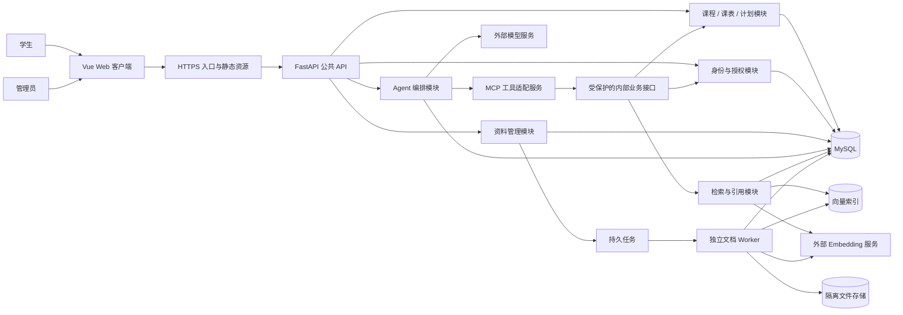
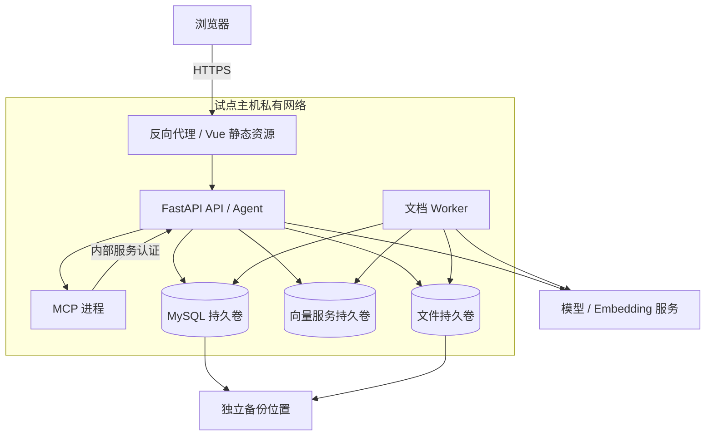
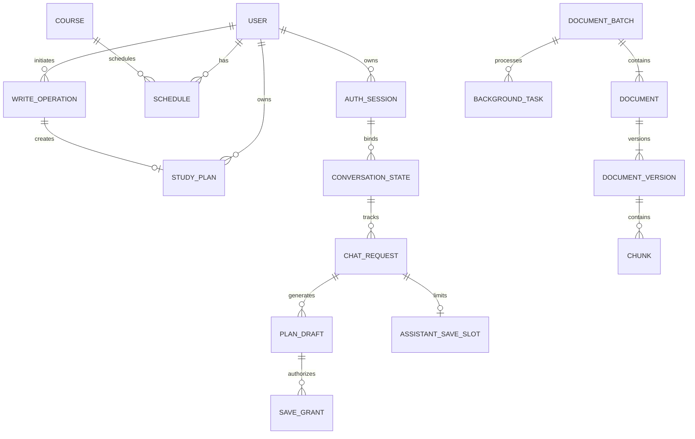
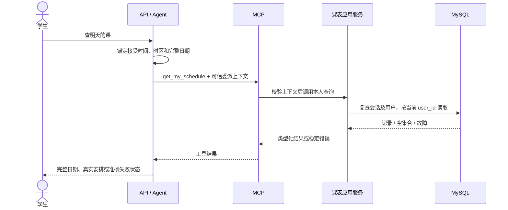
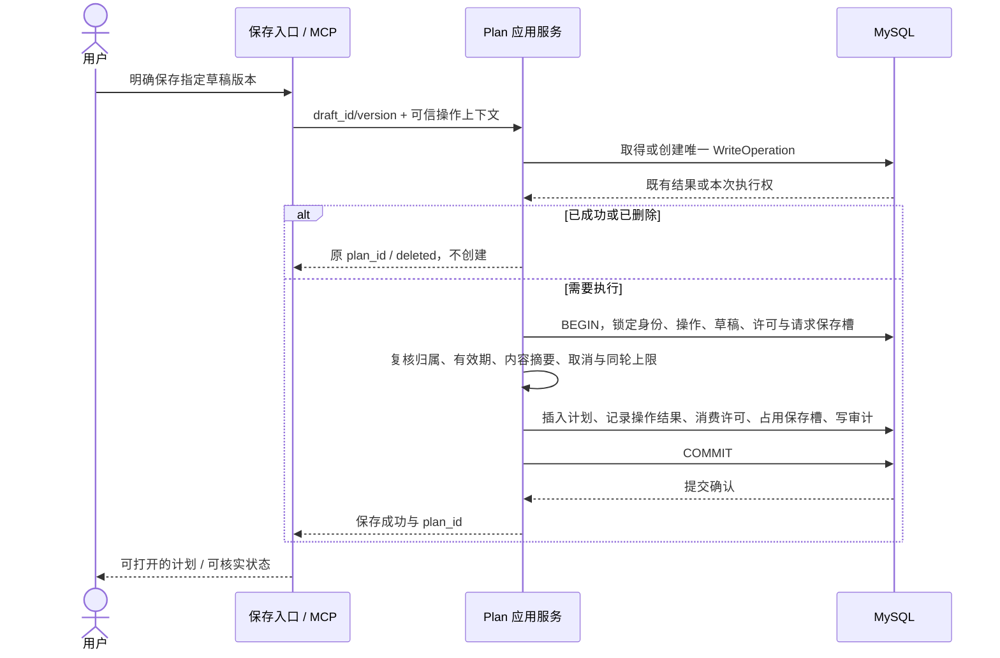
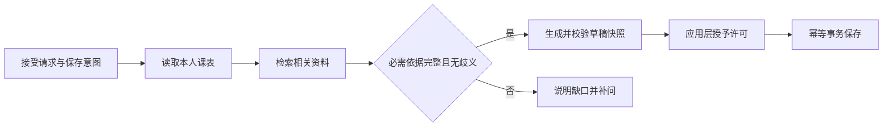
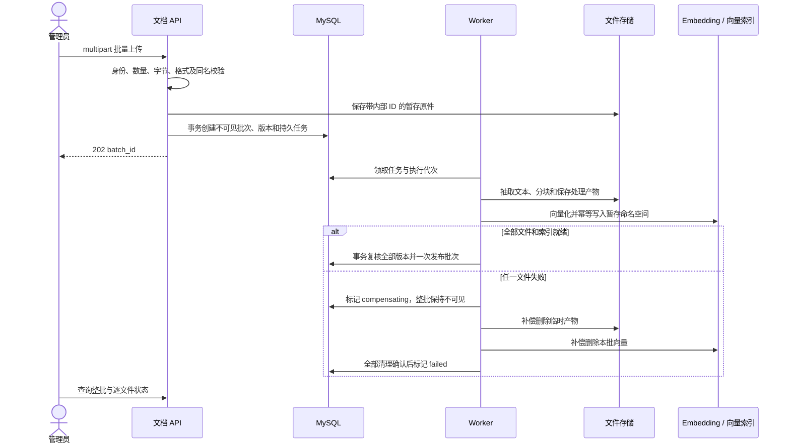

# 校园课程智能助手
# 概要设计说明书（HLD）

文档编号：CCA-HLD-001  
版本：v0.1  
编写日期：2026-10-21  
状态：待评审，非已批准基线  
适用版本：单组织、封闭试点 MVP（P0）  
主要读者：产品、架构、前后端、AI 工程、测试与运维

> 本文依据同目录 PRD、SRS 编写目标系统的概要设计。当前工作区仅有需求文档，未发现实现代码，因此文中的模块、部署拓扑、存储方案和处理流程均为拟议设计，不代表已实现或已验证。需求默认值、设计决策与待定项分别标识；具体组件版本、DDL、完整接口 Schema 和部署命令由详细设计补齐。

## 1. 设计依据与边界

### 1.1 输入文档与优先关系

| 输入 | 使用范围 |
| --- | --- |
| [校园课程智能助手 PRD v0.1](校园课程智能助手_PRD_v0.1.md) | 产品定位、角色、P0/P1 范围、用户流程与业务价值 |
| [校园课程智能助手 SRS v0.1](校园课程智能助手_SRS_v0.1.md) | FR、DR、IF、NFR、INV、AT 编号及可验证约束 |

本文不重新核实 PRD 引用的教程网站，也不将教程描述视为现有代码。SRS 对 PRD 的细化在本设计中作为工作输入；需求均待评审，若批准后的版本存在冲突，应登记差异并更新设计，不由 HLD 静默改变需求。

已识别的输入差异按以下方式处理：

| 差异 | 本设计处理 |
| --- | --- |
| PRD 工具示例包含计划正文，SRS IF-008 限定为 draft_id、draft_version | 采用 SRS：工具只能保存服务端可信草稿，不接受模型提交任意正文 |
| PRD 使用 MB 表述文件上限，SRS DEC-10 统一为 MiB | 上传校验与界面统一采用 MiB，即 1,048,576 字节 |
| PRD“生成不写数据库”与 SRS 允许短期服务端草稿 | 生成不创建 StudyPlan；允许保存限时 PlanDraft，不持久化长期完整对话 |

### 1.2 交付范围

P0 包含：账号与角色、课程管理、具体日期课表管理及本人查询、共享资料管理与检索问答、临时多轮对话、计划草稿与授权保存、个人计划管理、基础审计和统计。管理员维护课表的页面属于本次设计范围。

不纳入本期：自助注册、管理员授权界面、选课、成绩、考勤、周次排课、教务同步、多组织、受限课程资料授权、OCR、长期会话历史、公开版本管理、计划任务进度与提醒。内部版本切换和短期执行元数据属于 P0 一致性能力，不因此扩大产品范围。

### 1.3 设计目标

1. 页面和助手共享业务规则与数据源，课表、计划可在 AI 不可用时独立使用。
2. 身份、权限、保存许可、次数和提交结果由确定性的应用逻辑控制。
3. 通过关系库事务处理计划保存，通过发布标记与补偿处理文件、关系库和向量索引的一致性。
4. 对检索空结果、依赖异常、取消、超时和写入未知分别反馈。
5. 用适合 200 名学生、5 个并发助手请求的简单部署起步，并保留可替换的外部依赖边界。

## 2. 总体架构与主要决策

### 2.1 架构风格

采用“模块化业务单体 + 独立 MCP 适配服务 + 独立文档 Worker”。业务服务承载认证、普通业务、AI 编排及内部业务接口；MCP 仅提供三类工具的协议适配与独立校验；耗时的文档解析、Embedding 和清理在 Worker 中执行。

MVP 不强制引入消息中间件、Redis 或独立微服务集群。持久任务与审计待发送事件使用 MySQL 表实现；执行器通过租约和防旧执行者提交机制领取工作。后续扩容可替换任务分发实现，任务身份、幂等和业务事务语义保持一致。

### 2.2 系统逻辑视图



SRS 系统上下文中的 MCP 到数据库箭头在此细化为经内部业务接口访问：数据仍来自同一 MySQL，避免 MCP 再实现一套计划事务和课表规则。普通页面不经过 MCP；MCP 故障时普通业务路径仍可用。

### 2.3 架构决策表

以下为本稿提出的设计决策，评审后冻结，不表示技术已落地。

| 编号 | 决策 | 主要理由与代价 |
| --- | --- | --- |
| HLD-D01 | Vue + TypeScript 客户端、FastAPI 业务服务、MySQL 事务数据 | 延续需求兼容路线；版本与具体库另行锁定 |
| HLD-D02 | 业务模块共享事务边界，MCP 通过内部接口复用业务能力 | 权限和写入规则单一；内部接口需要独立服务认证 |
| HLD-D03 | 采用服务端可撤销的不透明 Bearer 会话，浏览器仅内存保存 | 便于登出、禁用即时生效；刷新后需重新登录，不提供自动续期 |
| HLD-D04 | 计划、操作结果、许可消费、助手保存占位及审计事件同事务提交 | 防重复、误报和审计遗漏；需定义锁顺序并验证并发 |
| HLD-D05 | MySQL 持久任务 + 租约 + 执行代次；文件和向量操作可重试 | 避免引入分布式事务；依赖补偿、巡检与垃圾回收 |
| HLD-D06 | 关系库控制资料可见性，向量索引仅提供候选 ID | 删除和发布语义有权威来源；检索增加一次元数据复核 |
| HLD-D07 | POST + Fetch 流式读取 SSE，不以自动重连恢复执行 | 支持认证头；前端须处理分包、去重和状态核实 |
| HLD-D08 | 模型仅提出意图和工具请求，应用层授予许可并执行白名单 | 自然语言歧义时回退草稿，不能仅靠提示词保证安全 |
| HLD-D09 | 本地持久卷作为试点文件存储，内部存储接口可替换 | 适配单机部署；多主机扩容前必须迁移共享存储 |
| HLD-D10 | 向量存储通过适配器接入，具体产品与模型在联调前评测冻结 | 当前需求未指定实现；必须验证过滤、持久性和读写可见性 |
| HLD-D11 | 对话正文只驻留浏览器和运行内存，服务端只持久化必要状态及短期草稿 | 符合临时会话边界；不承诺正文断线续传或跨设备恢复 |
| HLD-D12 | 统一 request_id、错误码、审计及结果状态 | 可跨业务、MCP、外部调用和 Worker 定位；不默认记录正文 |

### 2.4 信任边界

| 边界 | 可信内容 | 不可作为授权依据的内容 |
| --- | --- | --- |
| 浏览器 → API | 经过认证后确定的当前用户及当前直接操作 | 客户端 user_id、role、历史 assistant 内容、客户端声称的工具结果 |
| Agent → MCP | 经验证的内部执行上下文 | 模型填写的用户、许可、操作标识及任意未知字段 |
| 文档 / 模型 → 应用 | 通过结构、归属、版本和证据校验后的有限数据 | 文档内命令、模型自造引用、save=true 等声明 |
| Worker → 多种存储 | 任务 ID、当前租约代次、关系库发布状态 | 过期 Worker、孤立文件或向量记录自行宣布发布成功 |

## 3. 组件与模块设计

### 3.1 模块职责

| 模块 | 负责 | 主要持有对象 / 对外能力 |
| --- | --- | --- |
| Web | 角色路由、表单、临时上下文、SSE 展示、引用展开、结果核实 | 登录、助手、我的课表、计划、四类后台页面 |
| Auth | 凭据校验、会话撤销、当前身份、角色与归属规则 | User、AuthSession；认证依赖与权限策略 |
| CourseSchedule | 课程维护、本人查询、管理课表、重复与重叠检查 | Course、Schedule；本人查询与专用管理服务 |
| Plan | 草稿快照、保存许可、幂等创建、个人增删改查 | StudyPlan、PlanDraft、SaveGrant、WriteOperation、AssistantSaveSlot |
| ChatAgent | 请求去重、会话单轮互斥、日期锚点、上下文预算、工具调度、终态 | ConversationState、ChatRequest；模型与 SSE 适配 |
| Document | 上传校验、批次、版本、删除标记、任务管理和预览 | DocumentBatch、Document、DocumentVersion、Chunk |
| RetrievalCitation | 查询向量化、候选检索、有效性复核、引用构建 | 受控来源清单；引用读取和失效判断 |
| MCP Adapter | 服务认证、委派身份校验、三工具严格 Schema、统一错误映射 | get_my_schedule、search_course_docs、save_study_plan |
| Worker | 解析、切块、Embedding、切版准备、补偿、删除与巡检 | BackgroundTask、存储适配器；不处理交互式模型生成 |
| AuditOps | 事务审计、元数据指标、外部调用关联、告警 | AuditEvent、OutboxEvent；结构化日志与指标 |

业务模块通过应用服务调用，禁止公共控制器、MCP 和 Worker 各自编写同一份计划创建 SQL。只读与写入路径均使用带归属约束的 Repository。模块间不通过 HTTP 拆分所有内部函数，只有独立 MCP 进程使用受保护内部 API。

### 3.2 前端状态与页面

- 身份状态包含当前用户、角色、会话到期时间与学校时区；令牌、问答和草稿不写入 localStorage 或持久化缓存。
- 助手状态按 conversation_id、request_id、answer_block_id 组织；每轮记录 last_seq、当前工具、正文、终态和已确认保存引用。
- 页面及助手均调用 `/me` 语义的业务能力；管理课表使用独立 `/admin` 页面和接口。
- 计划草稿显示 draft_id、draft_version 对应的内容与“未保存”；编辑使用草稿接口生成新版本，保存时不能夹带改写正文。
- 流中断进入“结果待确认”，以请求和写入状态核实；AI 异常时保留普通课表、计划与后台页面入口。
- 退出、账号切换、认证失效时立即停止展示旧身份的私有状态；清空对话不删除已保存计划。输入错误、处理状态和结果均有文字与键盘可用反馈。

### 3.3 外部适配器

| 适配器 | 输入 / 输出边界 | 必须验证的行为 |
| --- | --- | --- |
| ModelGateway | 受控消息、工具描述 → 内容增量或工具请求 | 工具调用支持、上下文计量、取消与超时、供应商错误映射 |
| EmbeddingGateway | 文本与模型配置 → 向量和模型标识 | 维度匹配、批量失败处理、限流、同一向量空间一致性 |
| VectorStore | 命名空间、候选查询 → chunk_id、version_id、相似度 | 持久性、写入后可检索确认、过滤、按命名空间清理、重复 upsert |
| FileStore | 内部对象键 → 原件 / 抽取文本流 | 隔离路径、持久性、原子完成标记、缺失对象检测、重复删除 |
| TaskStore | 领取 / 续租 / 完成 / 重试 | 崩溃后再领取、租约代次校验、确定性对象键、防重复发布 |

外部响应均映射为内部类型；供应商响应、密钥及服务器路径不直接传到浏览器或模型可见结果。具体实现和依赖锁文件属于详细设计交付物。

## 4. 部署与运行视图

### 4.1 封闭试点拓扑



默认单机、单 API 实例、单 MCP 进程及单 Worker 起步；实例仍受数据库去重和租约约束，不能依赖单进程偶然避免竞态。只有 HTTPS 入口对外开放；内部路由、MySQL、向量服务和文件卷不对浏览器暴露。

单机方案存在整机故障停机风险，不宣称高可用。服务器规格、磁盘容量、备份位置与恢复目标由 TBD-02 冻结。扩大试点需要以压测和恢复演练作为依据。

### 4.2 运行隔离与连接

1. 普通 API、交互式模型调用、查询 Embedding 和入库 Embedding 使用分别受控的并发额度，避免文档任务耗尽交互配额。
2. AI 并发初始容量至少为 5；超出立即返回 `CAPACITY_LIMITED`，不无限排队。普通业务使用独立连接预算。
3. 解析运行于受限子进程或等效隔离环境，限制时间、内存、展开量和文件数，禁止执行宏及跟随文档外链取文件。
4. API 与 Worker 分别使用最小必要数据库、文件和外部服务权限；备份进程使用独立凭据。
5. 外部服务故障只影响相应能力；Liveness 不因模型不可用而反复重启应用。Readiness 与依赖诊断区分核心数据库和可降级 AI 依赖。

MCP 回调内部业务接口使用预留的业务连接与独立限额，不再次申请当前请求已经占用的 AI 容量；API 不在等待 MCP 时持有数据库事务。这样避免所有助手请求等待自身占用的资源而互锁。

### 4.3 扩展路径

若普通业务连接不足，先增加 API 实例并继续使用数据库级互斥；若文件处理积压，增加 Worker 并按任务代次防重；跨主机部署前更换共享 FileStore。模型容量以供应商配额和实测延迟扩展，不能只增加 Web 进程。引入消息代理或缓存需保留数据库权威状态、发布屏障及结果去重。

## 5. 身份、权限与执行上下文

### 5.1 登录会话

拟采用不可预测的不透明会话令牌：浏览器持有原令牌，关系库仅保存其安全摘要、user_id、expires_at、revoked_at 和建立时的 auth_version。会话有效期采用 SRS 初始值 2 小时，不自动续期。密码拟采用 Argon2id 摘要；具体库、参数、口令规则、初始交付与重置流程在 TBD-03 冻结。

每次受保护操作核实令牌摘要、到期、撤销、用户 enabled 和 auth_version。退出撤销单会话；禁用学生在事务内更新 enabled、递增 auth_version 并撤销全部会话。写入事务与禁用操作采用一致锁顺序，使先后关系明确，不允许通过旧权限快照在禁用已提交后启动新写入。

前端请求通过 Authorization 头传递 Bearer，不进入 URL、日志或文件名。非本机部署使用 HTTPS；登录失败统一文案，并设置可配置的尝试频率限制，具体阈值归入身份设计。

### 5.2 授权路径

| 路径 | 规则 |
| --- | --- |
| `/me/*` | user_id 只来自认证上下文；查询先限定归属；管理员也只访问本人私有对象 |
| `/admin/students` | 仅管理员；仅维护学生；请求不能指定 role，不能修改 account |
| `/admin/courses`、`/admin/schedules` | 仅管理员；允许声明的 student_id；变更必审计 |
| `/admin/document*` | 仅管理员；原文和全文预览不提供给学生 |
| `/citations/*` | 启用的登录用户；同时复查资料共享、发布与有效版本 |
| 请求、草稿与写入状态 | 按 user_id 限定，草稿另绑定当前认证会话；不能因标识已知而越权 |

未认证为 401；管理能力角色不足为 403；他人的私有对象统一 404。未知字段和系统保留字段按 422 拒绝。权限判定不交给模型，不以隐藏菜单替代后端校验。

### 5.3 MCP 委派上下文

API 向 MCP 传递与模型业务参数分离的可信上下文，至少包含 session_id、auth_version、request_id、会话标识、工具范围、短有效期及目标服务标识。采用经服务认证的通道和签名委派凭证；具体 MCP 传输与中间件由详细设计确定。

MCP 验证服务调用方、签名、有效期、目标与工具范围，再通过内部接口复查当前会话和用户状态。内部 API 同时验证调用服务和委派链，不接受公网请求自行提交的身份头。`save_study_plan` 仍须在业务事务中复核许可、草稿和同轮上限；签名上下文本身不等于保存授权。

内网是附加隔离，不能替代服务认证。模型可见 Schema 中只有业务参数，不出现令牌、user_id、role、operation_id 或 SaveGrant。

### 5.4 流式身份失效

发送新的工具动作、正文块、引用与计划标识前，事件写出器复查会话；禁用通知可加速关闭活动流，但不能替代权威检查。失效后仅返回通用认证错误并结束，不附带私有对象标识。已写入网络或已显示的数据不能撤回；验收针对失效后新产生的业务输出和后续调用。

## 6. 数据架构

### 6.1 权威存储与数据生命周期

| 存储 | 内容 | 权威性 / 生命周期 |
| --- | --- | --- |
| MySQL | 账号、会话、课程、课表、计划、写入结果、资料可见性、任务、审计 | 业务和发布状态的唯一权威；纳入备份 |
| MySQL 短期表 | 草稿正文、许可、会话互斥状态 | 草稿 30 分钟；到期不可使用，后台清除正文；不是长期会话历史 |
| 文件持久卷 | 原件、抽取文本、临时处理产物 | 仅内部键访问；原件和必要文本纳入恢复范围 |
| 向量索引 | chunk_id、版本、命名空间、向量及必要过滤元数据 | 可重建的派生索引，不单独决定访问与可见性 |
| 浏览器 / 执行内存 | 临时完整问答、正文增量、本轮模型输入输出 | 刷新、退出及进程退出不保证恢复；不写入默认日志 |

### 6.2 核心关系



图表示逻辑关系，未画出所有审计与任务关联；物理删除、级联策略由详细设计明确，不能使用级联删除抹掉幂等结果或误删被课表引用的课程。

### 6.3 关键表与约束

字段详细长度沿用 SRS §5.2；下表只补充实现一致性所需的关键约束。

| 对象 | 关键键、索引与约束 |
| --- | --- |
| User | account 的规范化值唯一；归一化遵守去首尾空白、大小写不敏感规则；role 仅 student/admin；enabled、auth_version、version |
| AuthSession | token_digest 唯一；索引 user_id、expires_at；撤销与失效状态可查 |
| Course | code 规范化值唯一；不提供物理删除；保留历史引用 |
| Schedule | 唯一 `(user_id, course_id, class_date, start_time, end_time)`；索引 `(user_id, class_date, start_time, id)`；同日起止校验 |
| StudyPlan | 索引 `(user_id, updated_at, id)`；version 乐观锁；删除不可再读正文，不使操作结果消失 |
| ConversationState | 绑定 user_id、auth_session_id；active_request_id 与执行租约；同会话只占用一个活动槽 |
| ChatRequest | 唯一 `(user_id, client_request_id)`；请求内容摘要用于辨别同 ID 异输入；持久化状态、计数、终止原因及已确认写入引用，不保存问答正文 |
| PlanDraft | `(draft_id, draft_version)` 不可变快照；用户、会话、到期时间、内容摘要与依据；另有当前版本指针和逻辑保存 operation_id 绑定 |
| SaveGrant | 绑定用户、认证会话、请求、草稿版本、内容摘要、operation_id 与到期；状态 issued/consumed/expired/revoked |
| WriteOperation | 唯一 `(user_id, operation_id)`；内容摘要、请求关联、pending/succeeded/failed/deleted、plan_id、可重试性 |
| AssistantSaveSlot | 唯一 `(user_id, request_id)`；记录唯一成功创建对应的 operation_id、plan_id；计划删除后仍保留占位 |
| DocumentBatch | state、published_at、期望文件数、错误、任务关联；单个批次发布点 |
| Document | batch_id、active_version_id、visibility、mutation_task_id、version、deleted_at；重建和删除互斥 |
| DocumentVersion / Chunk | 唯一 `(document_id, version_no)`、`(version_id, chunk_index)`；内容摘要、位置、处理状态、向量空间标识 |
| BackgroundTask | 对象与操作去重键唯一；state、attempt、next_run_at、lease_owner、lease_until、fence；索引可领取状态与时间 |
| AuditEvent / OutboxEvent | event_id 唯一；对象、操作者、request_id、结果与时间；不包含完整正文；事务写入后异步输出统计 |

ConversationState、AssistantSaveSlot、BackgroundTask 和 OutboxEvent 为 HLD 新增的控制实体，用于实现 SRS 的并发、恢复和审计要求，不增加业务页面。

### 6.4 时间、版本与并发

- 所有 API 资源标识均为不透明字符串，客户端不依赖其编码或大小；JSON 与文本采用 UTF-8。前后端长度均按 Unicode 码点计算，不能直接用 UTF-16 编码单元数替代，超限拒绝而非截断。
- 课表采用学校本地 `DATE + TIME`，分钟精度且禁止跨日；审计与通用时间戳为 UTC，API 使用带时区的 ISO 8601；计划日期不随浏览器时区偏移。
- 相对日期以 ChatRequest.accepted_at 和学校时区锚定，同轮跨午夜不漂移；周一为一周起点。歧义日期先补问。
- 更新、删除使用 `expected_version` 条件更新；零行更新区分不存在和版本冲突，但不得暴露他人对象。
- 课表写入在学生维度取得事务锁后检查精确重复和时段交集，防止两个并发创建都绕过重叠检查。重叠确认请求重新校验并审计原因；精确重复不能确认放行。
- 学生与课程启用状态在课表写入事务中复查。课程更名影响后续课表展示；已保存计划是独立快照，不随课程变化重写。

### 6.5 删除、保留与墓碑

计划删除事务清除可读取正文并更新操作为 deleted，保留最小幂等墓碑及助手保存占位；旧键重放只返回已删除状态，不能复活计划。资料删除保留不可见标记，直到文件、文本、片段、全部版本与向量清理完成，清理失败不反转标记。

草稿有效期初始为 30 分钟，过期先拒绝访问和消费，再清理正文。运行日志保留 30 天、审计 180 天，均待 TBD-06 确认。ChatRequest 去重摘要、AssistantSaveSlot 和操作墓碑不能按普通日志周期直接删除；必须先定义允许重试窗口、不可复用标识和墓碑淘汰政策，确保旧请求不重新执行。

备份中的删除对象按批准周期淘汰；恢复后重放有效删除标记和操作墓碑，在开放检索、引用及写入前完成校验。不得仅恢复较早的业务快照后直接提供服务。

## 7. 接口与协议设计

### 7.1 公共 API

保留 SRS IF-001—007 的 `/api/v1` 路由与语义，不另起一套工具专用业务模型。完整 OpenAPI 在详细设计生成，以下仅列接口分组和实现边界。

| 分组 | 主要接口 | 应用服务与关键约束 |
| --- | --- | --- |
| 身份 | `/auth/login`、`/auth/logout`、`/me` | Auth；会话失效与菜单能力，不回传摘要 |
| 学生与课程管理 | `/admin/students`、`/admin/courses` | Auth / CourseSchedule；仅管理角色，禁止提权和修改不可变代码 |
| 本人 / 管理课表 | `/me/schedules`、`/admin/schedules` | CourseSchedule；本人身份固定，管理路径允许 student_id |
| 个人计划 | `/me/plans`、`/me/plans/{id}` | Plan；创建幂等，修改删除带版本 |
| 草稿与保存 | `/me/drafts/{id}`、`/me/drafts/{id}/save` | Plan；指定草稿版本，服务端授权；不允许保存时改正文 |
| 写入状态 | `/me/write-operations/{operation_id}` | Plan；返回实际持久结果、可重试性与本人 plan_id |
| 文档 | `/admin/document-batches`、`/admin/documents` 及其状态、预览、重建、清理接口 | Document；长任务返回 202，状态查询成功不代表任务成功 |
| 引用 | `/citations/{reference_id}` | RetrievalCitation；复核有效性，失效为 410 |
| 助手 | `/chat/stream`、`/chat/requests/{id}`、`/chat/requests/{id}/cancel` | ChatAgent；POST SSE、状态查询、幂等取消 |

成功与失败均使用 SRS 的 request_id 信封；普通创建为 201，异步接受为 202，读取或已存在结果为 200。新计划创建必须有 Idempotency-Key。分页统一 items/page/page_size/total，默认 20、最大 100；过滤、排序字段均白名单化。

### 7.2 内部业务接口与 MCP

内部接口只向受认证的 MCP 服务开放，不经公共反向代理转发。内部路由名称属于详细设计，能力保持为以下三类：

| MCP 工具 | 模型可见参数 | 内部服务处理 | 成功结果 |
| --- | --- | --- | --- |
| get_my_schedule | from_date、to_date | 从委派身份查询本人，校验日期与跨度 | status=ok/empty，完整日期、时区及 items |
| search_course_docs | query | 检索已发布共享库，构建可信引用清单 | status=ok/empty，chunks 与来源标识 |
| save_study_plan | draft_id、draft_version | 从可信上下文取得许可及操作，调用唯一保存事务 | status=created/existing，plan_id、operation_id |

三个工具均拒绝未知字段；不暴露编辑、删除计划或后台管理工具。MCP 参数验证失败、身份失败、业务冲突和依赖失败映射到 IF-010 统一错误码，不返回伪空集合。内部接口不提供可由调用方指定任意用户执行的通用代理能力。

### 7.3 SSE 传输

```text
id: 2
event: status
data: {"request_id":"req_example","seq":2,"timestamp":"2026-10-21T02:00:00Z","code":"READING_SCHEDULE","message":"正在读取课表"}

id: 3
event: tool_end
data: {"request_id":"req_example","seq":3,"timestamp":"2026-10-21T02:00:01Z","tool_call_id":"call_1","success":true,"result_status":"empty"}

```

事件类型严格沿用 status、tool_start、tool_end、token、done、error；首次 status 返回 conversation_id。每轮由单一事件写出器分配递增 seq，id 与 seq 一致，tool_start/tool_end 通过 tool_call_id 配对，正文按 answer_block_id 归并。

前端使用支持认证头的 Fetch POST，解析 UTF-8 分包和 SSE 事件边界，以 request_id + seq 去重。心跳使用不携带业务正文的 SSE 注释，不计作模型决策或业务完成。代理关闭 SSE 缓冲，读超时须覆盖单轮终止处理；具体配置由部署设计验证。

建立流前返回正常 HTTP 错误；建立流后失败只能发 error。done 仅表达 succeeded/cancelled；失败用 error，二者互斥且最多一次。HTTP 连接关闭并不是可靠终态，客户端必须核实请求状态。Last-Event-ID 不重放模型或工具，不承诺正文续传。

## 8. Agent 编排与关键业务流程

### 8.1 请求接受与上下文处理

1. 完成认证、当前问题非空和 2,000 Unicode 码点限制、消息结构校验。history 只接受 user/assistant；最多 20 对历史，不接受 system/tool 消息或客户端工具结果。
2. 同事务建立 ChatRequest 去重记录并占用 ConversationState 活动槽；conversation_id 绑定当前用户和认证会话。相同 client_request_id 不重新执行，相同 ID 异输入拒绝。
3. 记录 accepted_at、学校时区及截止时间；首次 status 在取得请求执行权后尽快发出。无法取得 AI 容量时明确返回容量限制，不占用无限队列。
4. 依据所选模型 token 预算保留最近完整问答对；留出工具描述、工具结果与输出预算。发生截断发送状态，指代只能依据保留内容。
5. 服务端构造系统提示、可信执行上下文和当轮工具结果。历史只帮助理解语言，当前课表重查、课程资料重新检索，不复用客户端提供的事实证明。
6. 应用层建立任务依赖与保存意图状态，再进入受预算约束的模型调用和工具循环。完整问答只在内存使用，进程崩溃后不尝试从元数据恢复生成。

每轮最多 6 次模型决策、10 次工具执行，分别计数；对外模型重试也计数。总时限 60 秒，自接受起计。每次调用的超时取配置上限与剩余时限较小值，预留终止和写入核实时间；到达任一上限即停止后续调度。

### 8.2 查询本人课表



普通课表页面调用同一应用服务。只给一端日期按单日；两端不填按今天；跨度包含起止日且最多 31 天。记录按日期、开始时间、ID 排序。数据库不可用时返回错误，不将“无法读取”解释为“没有课”。

若当前请求明确要求查看其他学生的私人安排，应说明本人查询范围，不把当前用户课表包装成目标学生的结果，也不透露目标账号是否存在。后台课表维护始终进入独立管理路径。

### 8.3 保存意图与许可

当前可信用户操作经过独立的保存策略模块处理。手动表单、指定草稿按钮直接表达保存动作；自然语言只从当前 message 的直接指令识别。规则集需覆盖否定、引号、转述、条件句和指代，模型分类只能辅助，不能自行授予许可。

对可确定的“生成并保存”，先记录服务端保存意图，待必要数据获取、草稿结构校验和内容快照形成后才签发 SaveGrant，无须额外二次确认。只说“规划一下”、包含引用中的保存指令、存在多个可能草稿或无法可靠确定的表达时，保持未保存并提供明确版本的保存入口。

许可绑定用户、认证会话、授权请求、draft_id/version、规范化内容摘要、operation_id 和到期。内容摘要覆盖标题、目标、日期、正文、依据类型与引用标识，使用确定性序列化；不得隐式修改用户正文来使不同内容命中同一摘要。草稿更新递增版本并撤销旧许可。

同一草稿版本的同一逻辑保存在按钮和工具之间共用服务端记录的 operation_id，按钮用该值作为 Idempotency-Key；客户端不能通过换键绕过既有绑定。手动表单由客户端生成并保留逻辑操作键，服务端绑定内容摘要。新版本需要新的明确动作，但同一助手请求仍受最多一份的持久上限约束。

### 8.4 计划保存事务



执行规则：

1. 唯一键解决同用户同操作并发；第二个执行者读取已有记录，不另建计划。请求关联由服务端填写，模型不能换 request_id 或 operation_id。
2. pending 可先作为执行意向落库；实际计划创建、操作成功、许可消费、AssistantSaveSlot 与审计事件必须在同一个 MySQL 事务提交。长期事务不跨模型、MCP 网络或 Embedding 调用。
3. 相同键、相同摘要且已成功直接返回原结果；相同键、不同摘要返回 IDEMPOTENCY_CONFLICT。助手同轮换键仍受保存槽唯一约束，返回 SAVE_LIMIT_REACHED。
4. 事务内按全局固定锁顺序获取对象；与取消、身份禁用、草稿修改及计划删除保持一致。取消已先提交或许可失效则拒绝启动创建；写入已提交则取消不回滚计划。
5. COMMIT 响应丢失、连接超时或进程中断时结果为未知，不能发成功或断言未保存。使用新数据库连接按原操作读取；仍不能核实则返回 pending/recovering。
6. 恢复者取得执行权前，先查询原事务与持久结果并锁定操作；只有已确认未提交、无其他执行者且错误可重试时，才以原键重试。不能将一个超时直接改为可重新创建。
7. 草稿正文与许可过期后，不允许首次执行新的保存；但已成功或已删除操作的查询和重放仍从墓碑返回，不能要求旧许可仍有效才能发现已保存结果。

手动创建走同一幂等应用服务，当前表单提交在服务端产生对应授权，不需要虚构 assistant 草稿。更新、删除计划通过页面及 expected_version 完成，不暴露给助手。

### 8.5 多步请求依赖

“查明天的课，结合资料安排预习，并保存计划”采用如下依赖：



必需步骤失败、无足够资料或课程无法区分时，依赖状态阻断后续自动保存，不依赖模型自觉停止。用户之后明确接受一般建议时，按新直接指令建立新的依据类型和许可，不能沿用旧“已参考资料”的声明。

### 8.6 取消、断线与终态

ChatRequest 状态为 accepted → running → succeeded/failed/cancelled，终态通过条件更新只提交一次。取消接口先记录 cancel_requested，执行器在调用前、工具执行边界和输出边界检查。取消与成功竞争时以持久提交顺序为准；若已完成，取消返回实际完成状态。

断开 SSE 只释放连接，不自动等于取消；执行可在剩余预算内结束。前端查询本人 ChatRequest 和 WriteOperation 查找已提交计划。写入引用在保存成功后立即登记到执行元数据，不等待模型最终复述；整体回答失败也可以存在成功计划。

服务启动后 60 秒内扫描 accepted/running 请求。确认旧执行租约无效后，将无法恢复的请求标记 failed/SERVICE_RESTARTED，释放活动槽，并从写入操作核实计划结果；不重新执行整轮模型或工具。多实例时不得把其他仍持有有效租约的请求当作故障请求终结。

## 9. 资料处理、检索与一致性

### 9.1 上传与批次发布



上传边界为 1–10 文件、单文件 ≤20 MiB、整批 ≤50 MiB，按实际字节校验，代理 multipart 包装上限须另留开销。边接收边计量，不能只信 Content-Length。只接受 TXT、MD、含文字层 PDF、DOCX，并检查实际格式；空文本、扫描件、无法读取的加密文件和畸形文档分类失败。

存储键由服务端生成，不拼接原文件名。同名默认冲突，管理员明确继续才作为独立文档创建，不覆盖旧件。原文件成功暂存但数据库事务失败时进行补偿；巡检按引用关系清理无记录的暂存对象，不能只依赖异常处理器运行成功。

全部文件就绪不仅是 Embedding 返回成功，还必须确认片段元数据完整、向量维度一致、索引达到适配器规定的可检索屏障。最终事务只修改关系库发布状态，不跨外部存储持锁；如果事务失败，则资料继续不可见并可安全重试发布。

### 9.2 可见性与发布屏障

有效候选必须同时满足：

```text
batch.state = published
AND document.visibility = shared
AND document.deleted_at IS NULL
AND chunk.version_id = document.active_version_id
AND document_version.state = active
AND vector_space = 当前冻结的检索空间
```

初次批次发布时，在一个事务内设置各文档 active_version、visibility 和 batch.state；任一项不满足都不能返回片段。向量库出现部分新数据、旧数据或孤立数据时，关系库的复核仍会将其过滤。

处理中和补偿中的资料始终不可见。补偿失败保持 compensating，记录失败与重试原因；只有所有应清理对象均确认清理完成才进入 failed，不能把“批次失败”展示成“清理已完成”。

### 9.3 重建、删除与任务防重

重建和删除通过 Document.mutation_task_id 及版本锁互斥；重复管理请求命中原任务，并发不同操作返回 DOCUMENT_BUSY。

- 重建：创建 staging 版本，旧 active 继续使用；全部片段与向量就绪后，在一个事务中将新版本置 active、旧版 retired 并切 active_version_id。失败保留旧版，成功后异步清理旧索引和不再需要的处理产物。
- 删除：先事务设置 visibility=removed、deleted_at 并建立清理任务，再返回 202。此后新检索及引用展开立即排除资料。清理覆盖原件、抽取文本、全部版本、片段与向量；全部完成后才显示删除完成，失败可重试且不可恢复可见性。
- 防重：每次领取任务递增 fence，续租、状态更新及发布均校验当前代次。文件与向量使用确定性且按版本隔离的键；外部写操作即使不能检查 fence，也不能直接发布，过期 Worker 的产物由后续清理巡检回收。
- 重试：采用有上限的指数退避和 next_run_at，记录 attempt、last_error、cleanup_pending；达到自动重试上限进入待人工处理，不能循环占满外部服务。
- 恢复：启动后 60 秒内扫描未完成任务，回收已过期租约；清理在正常依赖下自失败或删除提交起 5 分钟内完成，超出告警。依赖持续故障时如实保留待清理状态。

### 9.4 检索与答案依据

1. 校验身份、问题长度及检索预算；对查询执行 Embedding，使用冻结的模型、维度和配置。
2. 向量索引返回候选 chunk_id、version_id 和相似度；服务端批量从关系库复核发布、删除、有效版本并读取权威片段。
3. 过滤导致候选不足时，在预算内扩大候选量，仍不足则返回真实依据不足。索引故障返回 RETRIEVAL_UNAVAILABLE；全库是否为空依据关系库有效资料判断。
4. 对每个文档固定本次选用的 active_version；若复查发现切版则移除该文档旧片段或重新检索，不能在同次结果混合新旧版本。
5. 从本次有效结果构建 reference_id、文件名、片段位置及可用页码；模型仅使用清单内来源标记。无法可靠抽取页码时只显示片段位置。
6. 将检索材料作为不可信证据区输入模型；不执行其中指令。资料类结论要求对应有效片段，学习建议单独标识；冲突资料并列说明，同名课程无法确定时补问。
7. 输出校验层过滤清单外标记和伪造链接；未验证标记在流中只显示待验证，不能先渲染为有效来源。存在无法支持的规定类结论时降级为依据不足，不能只去掉引用后仍作为事实输出。

SRS 的“有依据”要求不能仅靠相似度、模型自评或 Schema 实现。工程上采用来源白名单、逐项依据检查与固定人工标注评测共同约束；开放输入的语义正确性仍需评测和运营纠错，不宣称形式化保证。

### 9.5 引用有效性与生成中的资料变更

reference_id 为不透明来源标识，关联 document_id、version_id 和 chunk_id，不包含路径。每次展开均重新认证并验证有效性，失效返回 CITATION_UNAVAILABLE。管理员全文预览与学生引用片段是不同接口。

检索结果交给模型前复查，正文块和最终引用发出前再次复查来源。若资料已删除或切版，停止输出依赖这些片段的新内容，移除失效引用并说明依据变化；必要时重新检索。输出写出器集中处理校验，不能由异步工具各自直接向客户端写正文。

模型调用已发出或文字已发送时无法撤回对外数据；本设计阻断后续使用和新引用，不承诺撤回既有答案。需要强依据校验的段落可先形成有限缓冲块，再验证并输出，首段有效回答延迟应包含该校验时间。

### 9.6 Embedding 配置变化

初期只启用一个冻结的向量空间，记录模型标识、维度、预处理和切块配置摘要；禁止在同一有效空间混入不兼容向量。变更时使用新命名空间全量重建并评测，切换前短暂停止资料发布，核对当前有效版本映射，再原子切换检索配置及映射；删除仍按关系库即时生效。

迁移失败继续使用旧空间；成功后异步清理旧空间。具体向量产品是否支持所需可检索屏障和切换方式必须在 TBD-04/07 中验证，不能直接在线修改模型名称而复用旧索引。

## 10. 安全与隐私设计

### 10.1 输入、文件与输出

| 风险 | 设计控制 | 主要验证 |
| --- | --- | --- |
| 跨用户读取或写入 | 认证上下文固定归属、Repository 先限定 user_id、内部接口复查、私有对象统一 404 | 普通 API、MCP、状态、草稿及引用接口授权测试 |
| 提示注入与工具滥用 | 工具白名单、严格 Schema、可信与不可信内容分区、应用层许可、持久同轮上限 | 文档 / 历史 / 模型伪造身份与保存指令 |
| SQL 与排序注入 | 参数化访问、条件及排序白名单、拒绝未知字段 | 非法过滤、超长参数与保留字段 |
| 文件穿越与恶意解析 | 内部文件键、格式检测、隔离进程、展开和时间限额、解析服务无不必要外网权限 | 双后缀、伪格式、压缩炸弹、畸形 PDF/DOCX |
| XSS 与危险链接 | Markdown 安全渲染、禁止危险 HTML/URI、引用仅使用受控接口；配置内容安全策略 | 脚本、事件属性、危险协议与链接测试 |
| 凭据暴露与会话劫持 | HTTPS、内存令牌、摘要存储、服务端密钥、会话撤销、避免日志采集认证头 | 错误堆栈、代理日志、模型输入与工具结果检查 |
| 上传和外部调用耗尽 | 字节与文件数限制、并发隔离、执行预算、配额告警 | 边界压测与依赖持续慢响应 |

### 10.2 数据最小化

模型只接收当前请求所需的受控历史、本人业务结果和必要片段；Embedding 仅接收检索文本或待入库片段。共享库只接收已获准供全部启用用户查阅且允许按配置外发处理的资料。MVP 不具备班级级资料授权，不能通过仅在提示词中写“不要给其他班看”接收受限材料。

默认日志、审计、指标、追踪、错误采集及外部调用调试钩子均关闭正文记录；不记录口令、会话令牌、服务密钥和原始请求体。短期草稿正文属于受保护业务数据，仅由本人当前会话访问，并按期清除。额外正文采样需独立配置、限定人员和到期清理。

### 10.3 密钥与运维权限

首次管理员通过部署流程创建，启动后不持续重复创建或重置密码。模型、Embedding、服务认证及数据库凭据由环境密钥配置或等效秘密存储提供，不提交代码库。轮换服务签名密钥须兼顾短期在途上下文与立即撤销能力；具体流程归入 TBD-03。

运维可访问持久卷和数据库，因此需要独立的访问管理与审计，不通过产品管理员默认获取他人计划。备份密钥和恢复凭据与普通应用身份分离。

## 11. 非功能设计与可观测性

### 11.1 负载与目标映射

以下沿用 SRS 建议验收目标，均未实测。压测前冻结服务器、数据规模、模型、网络和配置，不以设计判断代替证据。

| 要求 | 目标 / 测量 | 设计支撑 |
| --- | --- | --- |
| NFR-PERF-001 | 普通读取 P95≤1 秒，至少 1,000 次，报告 P50/P95/P99、成功率 | 归属与日期索引、稳定分页、避免读取路径依赖 AI |
| NFR-PERF-002 | 首状态 P95≤1 秒；首段有效回答 P95≤10 秒；至少 100 次、每类≥20 次 | 接受后尽快发状态、流式输出、调用预算；分无工具 / 课表 / 检索报告 |
| NFR-PERF-003 | 1 MiB 内纯文本入库 P95≤60 秒，至少 30 份 | Worker 异步、分批 Embedding、阶段耗时统计；不外推至大 PDF |
| NFR-PERF-004 | 至少 5 并发助手容量；60 秒触发终止 | AI 信号量、无无限排队、调用前检查剩余预算 |
| NFR-PERF-005 | 正常负载普通读取与助手执行完成率分别≥99% | 超时、容量内 429 和系统异常均计失败；无依据正确结束计完成 |
| NFR-REL-001/002 | 外部故障可降级；启动后 60 秒内扫描；正常依赖下清理≤5 分钟或告警 | 普通业务独立、持久任务、请求恢复、补偿巡检 |
| NFR-AI-001 | 固定 50 条；有依据答案与引用联合通过率≥90%，关键正确性全部通过 | 模型 / 检索配置冻结、可信引用、独立许可与人工标注评测 |
| NFR-UX/COMP | Chrome/Edge 冻结时稳定版及前一主要版；桌面与窄屏核心流程 | 文字状态、键盘操作、安全渲染；至少 1366×768、390×844 验证 |

单次外部调用的重试次数和超时必须计入整体预算，写操作不得由通用网络重试器盲目重放。只读外部调用在剩余预算内可有限重试；计划重试始终先核实 WriteOperation。模型或检索参数改变后执行受影响评测。

### 11.2 追踪、审计与指标

公共业务请求由服务端生成 request_id；MCP、内部业务调用、外部模型、Embedding 及任务阶段携带关联标识。operation_id、batch_id、task_id 用于查业务执行；用户标识仅在必要审计中保留，汇总指标使用匿名化标识。

记录 chat_submitted、tool_finished、answer_finished、citation_opened、plan_draft_created、plan_saved、document_batch_finished。提交计划的事务写 AuditEvent 和 OutboxEvent，后台按 event_id 去重发送统计；幂等命中不再次计为创建。后台任务正文处理日志不能把抽取文本带入遥测。

核心指标包括：普通 API 延迟和失败率、AI 活动数、首状态及首有效正文延迟、工具 empty/failed/succeeded 分布、取消与超时、保存 created/existing/conflict/unknown、批次与清理积压、租约过期、补偿超时和备份结果。

告警至少覆盖清理超过 5 分钟、恢复扫描未按期执行、操作结果长期未知、任务持续失败、外部依赖持续故障、磁盘接近限额和备份失败。阈值、通知渠道及责任人由运维方案冻结；P0 提供日志与可查询指标，不强制新增运行看板。

## 12. 故障处理与恢复设计

### 12.1 主要故障矩阵

| 故障点 | 用户语义 | 系统处理与恢复 |
| --- | --- | --- |
| MySQL 不可用 | STORAGE_UNAVAILABLE；不能说空结果或保存成功 | 阻断依赖关系库的受保护能力，停止发布；连接恢复后核实未知写入 |
| MCP 不可用 | MCP_UNAVAILABLE，助手工具不可用 | 本轮准确失败或说明缺口；普通课表与计划 API 继续服务 |
| 模型不可用或超时 | MODEL_UNAVAILABLE / EXECUTION_TIMEOUT | 停止后续调度；已提交计划仍保留并可查 |
| 检索 Embedding / 向量索引不可用 | RETRIEVAL_UNAVAILABLE | 不返回“没有资料”；普通业务可用，资料任务按状态重试 |
| 入库某文件失败 | 整批不可检索、对应 task_error_code | 保持不可见，补偿本批新增产物，不影响其他批次 |
| 重建中断 | 旧版本可用，重建失败或待恢复 | 新版本不激活；按租约恢复或重建 |
| 删除清理失败 | 资料已不可见，清理未完成 | 保留 removed，重试与告警；禁止报彻底清理成功 |
| 计划提交响应丢失 | 保存结果待确认 | 原键查操作；确认成功返回原计划；未核实不启新操作 |
| SSE 断线 | 结果待确认，正文可能不完整 | 请求状态与操作状态核实，不重放整轮，不自动重存 |
| API / Worker 重启 | 请求可能失败，任务可恢复 | 扫描过期租约与未终态记录；写入和发布按持久结果判定 |
| 用户禁用 / 会话撤销 | 通用认证失效 | 停后续业务、工具及私有输出，撤销未消费许可 |

### 12.2 清理完成判定与巡检

删除或补偿完成前，需确认该文档相关写入者已结束、被终止或隔离，且没有未确认的外部写入，再检查各存储目标为空。无法排除过期 Worker 继续写入时保持清理未完成，不能仅因一次删除调用成功就报告彻底完成。

定期一致性巡检检查：无关系记录的暂存文件与向量、非 active 命名空间、removed 文档残留、ready 但未发布版本、过期草稿、pending 且失去执行者的操作、过期任务租约、未输出的审计事件。巡检只按服务端对象范围清理，不根据文件名模糊匹配删除。

### 12.3 备份与恢复

RPO、RTO、备份频率、日志保护周期、备份位置与责任人保持 TBD-02，不在 HLD 擅自承诺数值。方案必须覆盖 MySQL、文档原件、必要配置、模型 / 索引版本清单和密钥引用；删除清单及幂等墓碑随数据库日志或等效增量机制保护。向量可重建，但耗时必须计入 RTO。

恢复流程：隔离入口与 Worker → 恢复关系库及文件 → 将增量日志、删除标记与操作墓碑恢复到约定的一致恢复点 → 核对资料版本和文件 → 重建或验证向量索引 → 处理未完成请求与任务 → 执行权限、删除及幂等检查 → 开放流量。若缺少有效删除记录或恢复点无法确认，不开放相关对象访问。

恢复演练至少覆盖：已删除计划旧操作重放、已删除文档旧引用、新旧版本切换、半批资料、pending 写入、运行中任务与权限撤销。备份存在本身不构成恢复验收通过。

### 12.4 版本发布与回退

数据库迁移使用版本化脚本，先做兼容扩展再切换代码，避免回退代码依赖已删除字段。发布前完成任务与活动请求的排空或明确中止；原件、关系库和索引配置要可对应追溯。

应用版本回退不撤销已提交计划、文档删除标记或操作墓碑。模型提示与检索参数按配置版本回退；涉及向量空间变化时使用 §9.6 的完整切换流程。对不兼容数据迁移，须有单独恢复方案，不能以覆盖旧备份冒充无损回退。

## 13. 一致性不变量与需求追踪

### 13.1 不变量实现与验证

| SRS 不变量 | 实现位置 | 主要证据 |
| --- | --- | --- |
| INV-01 本人数据归属 | §5.2/5.3、带归属 Repository、独立管理接口 | A/B 越权、管理员个人工具、状态和草稿隔离测试 |
| INV-02 操作及同轮最多一份 | §6.3、§8.4；唯一操作键与 AssistantSaveSlot | 并发重试、换键、删除后旧键重放、崩溃恢复 |
| INV-03 无许可零计划 | §8.3/8.4；可信草稿、摘要绑定与事务校验 | 否定、引用、历史伪造、指代歧义、过期及改版许可 |
| INV-04 只使用有效资料 | §9.2—9.5；发布屏障、active 指针与输出复核 | 混合失败批次、重建、删除竞态、旧引用、孤立向量 |
| INV-05 成功与事实一致 | §7.3、§8.4、§12.1 | 查询空与错、提交未知、工具失败和统计去重 |
| INV-06 外部内容不改变权限 | §2.4、§5、§8.3、§10 | Prompt 注入、系统字段、身份 / 许可伪造测试 |
| INV-07 终态唯一、写入独立可核实 | §8.6、ChatRequest 条件更新、WriteOperation | 取消 / 成功竞态、超时、断线、服务重启与已保存结果 |

### 13.2 SRS—HLD—验收映射

| SRS 需求 | HLD 章节 / 组件 | 主要验收 |
| --- | --- | --- |
| FR-AUTH-001—004 | §5、§10；Auth 与 MCP 身份链 | AT-01—04 |
| FR-COURSE-001/002 | §3.1、§6.3/6.4；CourseSchedule | AT-05 |
| FR-SCH-001—004 | §6.4、§7.1、§8.2 | AT-06—09 |
| FR-DOC-001—004 | §7.1、§9.1/9.2、§10.1 | AT-10—12 |
| FR-DOC-005—007 | §9.3/9.5、§12.2 | AT-13—15 |
| FR-CHAT-001/002 | §3.2、§6.3、§8.1 | AT-16/17 |
| FR-CHAT-003—005 | §7.3、§8.4/8.6 | AT-18—20 |
| FR-CHAT-006 | §8.5；依赖状态阻断保存 | AT-21 |
| FR-QA-001—004 | §9.4/9.5；RetrievalCitation | AT-22/23 |
| FR-PLAN-001 | §6.4/6.5、§7.1、§8.4 | AT-24 |
| FR-PLAN-002—005 | §8.3/8.4/8.5；Plan | AT-20/25—27 |
| FR-GUARD-001/002 | §2.4、§5.3、§7.2、§10 | AT-28/31 |
| FR-OPS-001/002 | §6.3、§11.2；AuditOps | AT-29 |
| DR-001—005 | §6、§7.1；编码、标识、归属、时间、唯一键、稳定分页 | AT-04/08/09/15/24/26/27/33 |
| IF-001—010 | §5.3、§7、§12.1；公共 / 内部接口与外部适配器 | 契约检查及 AT-04/18/20/28 |
| NFR-PERF-001—005 | §4.2、§8.1、§11.1 | AT-30 |
| NFR-SEC-001—003、NFR-PRIV-001 | §5、§6.5、§10 | AT-03/04/28/29/31 及安全专测 |
| NFR-REL-001—003 | §4、§9、§12 | AT-15/30/33 |
| NFR-UX-001、NFR-COMP-001 | §3.2、§11.1 | AT-31 |
| NFR-OBS-001 | §7.3、§11.2 | AT-29 |
| NFR-AI-001 | §9.4、§11.1 | AT-32 |

### 13.3 高风险技术验证

详细设计与实现优先验证以下问题，结果回填设计评审记录：

1. 两个并发保存、同轮换键、COMMIT 后断线、计划删除后重放，是否始终最多一份且状态可核实。
2. API→MCP→内部业务链是否拒绝伪造、过期、撤销的上下文；禁用用户后活动流是否停止新的私有输出。
3. 索引写入未完全可见时能否阻止提前发布；Worker 租约过期、崩溃与删除并发是否不使资料复活。
4. 重建、删除与正在生成的答案并发时，引用及待输出块能否按照有效版本收敛。
5. 数据库活动槽和任务领取在多实例下是否防重，内部 MCP 回调是否拥有预留连接且不会与 AI 容量互锁。
6. 代表性 TXT/MD/PDF/DOCX 的解析质量、资源上限、入库时长和固定问答质量是否达标。

这些验证不是增加产品范围，而是为权限、幂等及多存储一致性提供实现证据。尚无代码，本稿不宣称任何测试已通过。

## 14. 实施顺序与详细设计交付

| 阶段 | 交付物 | 进入下一阶段的条件 |
| --- | --- | --- |
| M0 基线与设计 | 需求差异记录、HLD 评审、关键依赖及责任人 | 确认试点范围、数据源、共享与外发边界 |
| M1 普通业务 | 登录、课程、管理课表、个人计划、迁移与审计 | 不接 AI 可完成基础业务；权限、唯一键和版本冲突验证通过 |
| M2 可信保存与工具 | 草稿、许可、幂等事务、操作查询、三 MCP 工具 | 重试、提交未知、同轮上限、身份传递独立验证通过 |
| M3 资料链路 | 解析 Worker、任务恢复、批次发布、重建删除、检索引用 | 混合失败、删除竞态、故障补偿与有效性验证通过 |
| M4 助手闭环 | 上下文、依赖编排、预算、SSE、取消、状态恢复 | 端到端和固定 AI 评测达到 SRS 门槛 |
| M5 试点准备 | 压测、部署运维、备份恢复、版本回退、操作说明 | 所有 P0 证据齐备，阻断性 TBD 已签认 |

详细设计至少产出：模块接口与依赖方向、完整 OpenAPI、MCP 输入输出 Schema、SSE 示例与前端状态表、DDL/索引/迁移、事务和锁顺序、任务租约与清理协议、文件解析及向量产品验证、配置与依赖锁定清单、部署拓扑与恢复手册、AT 证据模板。无需在 HLD 中预先承诺未经团队估算的工期。

## 15. 待定项、风险与评审出口

### 15.1 需冻结的事项

沿用 SRS 待定编号，以下角色为建议责任角色，具体人员尚未指定。

| 编号 | 需产出结果 | 建议责任角色 / 冻结时点 |
| --- | --- | --- |
| TBD-01 | 封闭试点定位、账号来源、课表来源和维护责任签认 | 产品与业务管理员；开发排期前 |
| TBD-02 | 主机及容量、存储和备份位置、RPO/RTO、备份周期、恢复演练 | 架构与运维；试点前 |
| TBD-03 | Argon2id 参数与库、口令规则、初始密码交付、受控重置、会话及服务签名验证、密钥轮换 | 后端与安全负责角色；身份设计及试点前 |
| TBD-04 | 工具调用模型、Embedding 模型与维度、token 预算、切块 / 重叠 / Top-K / 阈值、保存意图允许及拒绝示例集 | AI 与测试；联调和发布前 |
| TBD-05 | 允许全员共享与外发的资料范围、解包量 / 文件数 / CPU / 内存 / 解析时限及安全样本结果 | 业务、后端与运维；首批资料上线前 |
| TBD-06 | 日志审计最终保留值、短期状态清理、幂等墓碑与保存槽生命周期、备份删除政策 | 业务与运维；试点前 |
| TBD-07 | 向量产品与可检索屏障、MCP 传输与身份中间件、框架依赖版本、完整接口字段和稳定错误码 | 架构及前后端；契约冻结前 |

### 15.2 主要风险与取舍

| 风险 | 影响 | 设计应对 / 剩余限制 |
| --- | --- | --- |
| 单机故障 | 所有用户暂时不可用 | 用可恢复部署起步；高可用另行评估，不能以备份代替可用性 |
| 自然语言保存误判 | 未经意愿创建计划 | 独立策略、保守识别、版本许可及测试集；歧义回退预览 |
| 有引用但结论仍不受支持 | 学生误信课程规定 | 逐项依据检查、输出过滤及人工标注评测；开放语义仍有残余风险 |
| 多存储部分成功 | 半批资料、残留及错误删除状态 | 权威发布标记、租约、防旧提交、补偿与巡检；外部故障时允许清理延迟并如实展示 |
| 供应商延迟与配额 | 回答超时、入库积压 | 并发隔离、有限预算、稳定错误、普通页面降级；目标需实测 |
| 资料共享范围错误 | 敏感资料扩散 | 上传准入与外发确认；MVP 不接收需要细粒度授权的材料 |
| 关键技术尚未冻结 | 接口或恢复方案不可实现 | 在对应阶段前完成验证，未冻结不宣称达到发布门槛 |

### 15.3 HLD 评审出口

本稿完成评审需确认：P0 边界与输入差异、HLD-D01—12 的取舍、模块和存储权威性、身份委派与写入事务、发布及删除协议、关键技术验证责任人，以及详细设计交付清单。HLD 通过表示方案可进入详细设计，不等于功能验收或试点放行；最终发布仍以 SRS 第 11 节门槛和可复现证据为准。
