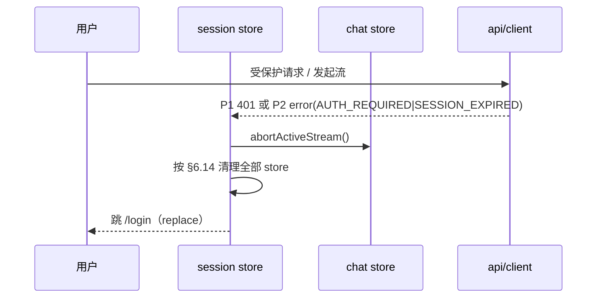
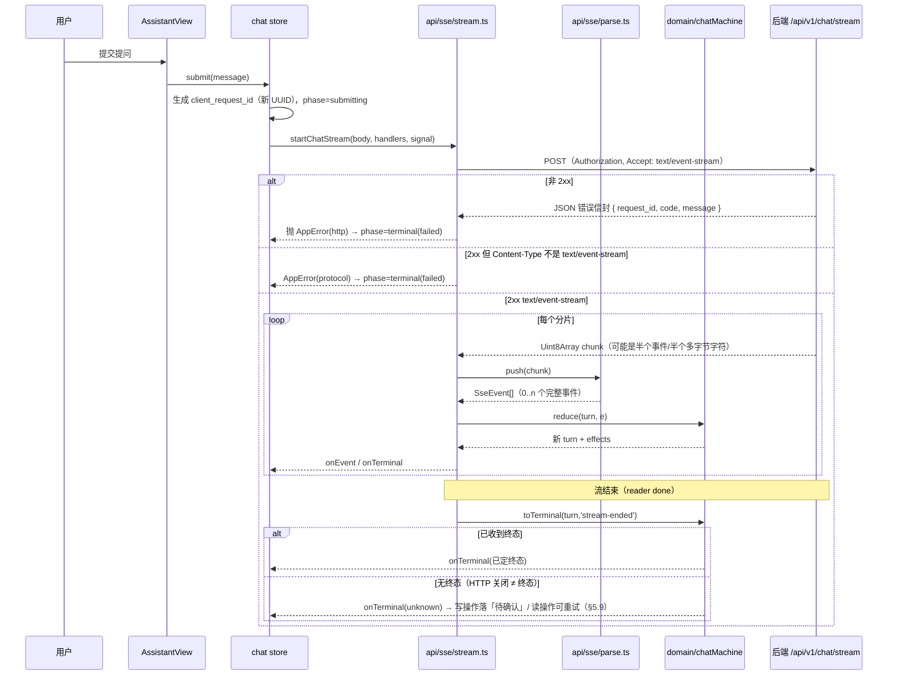
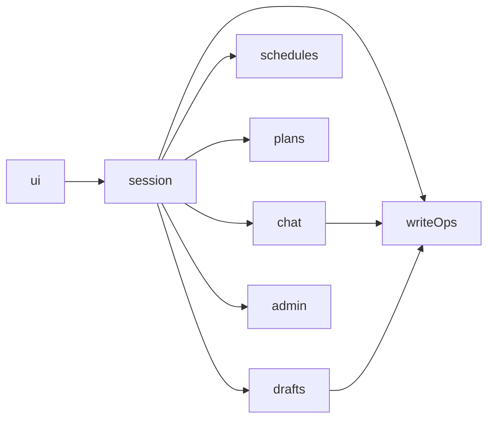
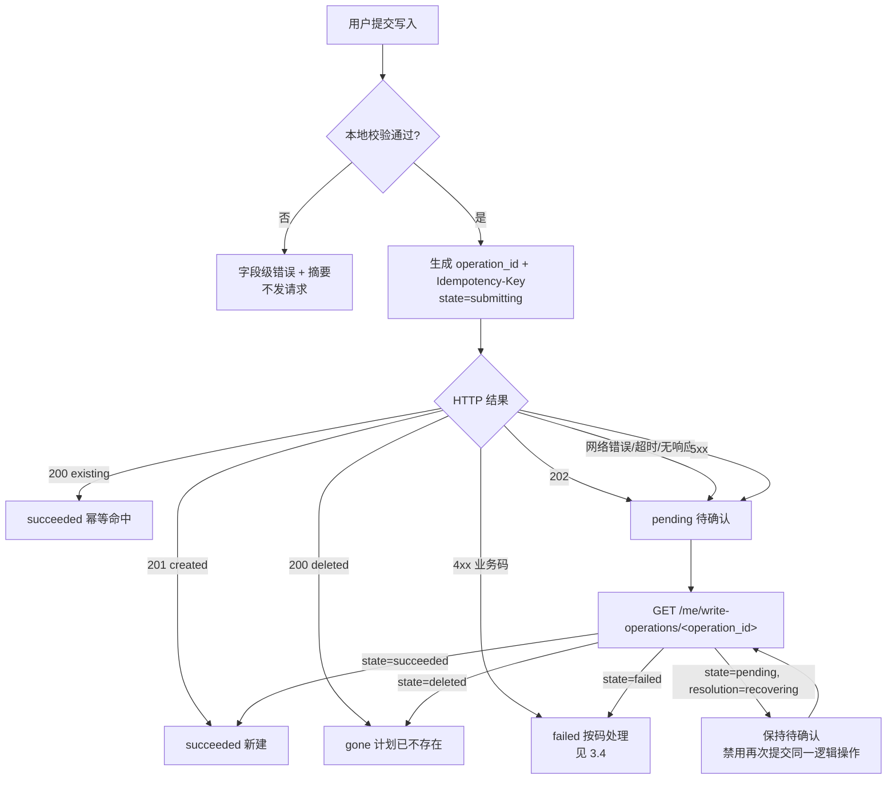
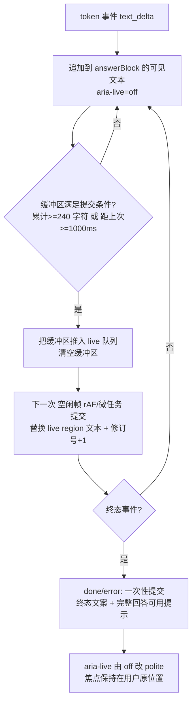

# 校园课程智能助手前端详细设计

**版本** v0.1　**对应上游** PRD / SRS / HLD v0.1、`openapi_v0.1.json`、`sse_events_v0.1.schema.json`

> 本文件由 `docs/frontend-detail/build.py` 从 7 个分册组装而成，**请勿手改**；改动请改分册后重跑组装。
> 字段名的唯一来源是 [`API-REFERENCE.md`](frontend-detail/API-REFERENCE.md)（由 OpenAPI 机械生成）；
> 样式与组件的唯一来源是 [`design/system/`](../design/system/)（519 个 token 的四层设计系统 + 27 个组件族规格）；
> 写作契约与冻结口径见 [`CONTRACT.md`](frontend-detail/CONTRACT.md)；独立验证见 [`verification.md`](frontend-detail/verification.md)。

## 目录

- [1. 设计产物与技术基线](#1-设计产物与技术基线)
- [2. 工程组织与模块界面](#2-工程组织与模块界面)
- [3. 类型、错误与请求层](#3-类型-错误与请求层)
- [4. 会话与鉴权](#4-会话与鉴权)
- [5. 流式会话客户端](#5-流式会话客户端)
- [6. 状态管理](#6-状态管理)
- [7. 路由与导航](#7-路由与导航)
- [8. 设计系统落地](#8-设计系统落地)
- [9. 页面详细设计 S01–S13](#9-页面详细设计-s01-s13)
- [10. 组件 Vue 映射](#10-组件-vue-映射)
- [11. 表单·校验·写入确认](#11-表单-校验-写入确认)
- [12. 无障碍与响应式实现](#12-无障碍与响应式实现)
- [13. 降级·错误·可观测](#13-降级-错误-可观测)
- [14. 构建·配置·性能](#14-构建-配置-性能)
- [15. 验证方案与需求追踪](#15-验证方案与需求追踪)
- [16. 待定项与实现入口条件](#16-待定项与实现入口条件)

<!-- part: 10-baseline-and-modules; chapters: 1,2,3; owner: lead -->

## 1. 设计产物与技术基线

### 1.1 产物清单

本文件是**前端详细设计**，与 `docs/校园课程智能助手_后端详细设计_v0.1.md` 平行。上游输入与下游承接如下。

| 类别 | 产物 | 关系 |
| --- | --- | --- |
| 上游需求 | `PRD_v0.1.md`、`SRS_v0.1.md`、`HLD_v0.1.md` | 本文的实现依据；编号引用一律用 `PRD §x` / `FR-xxx` / `HLD-Dxx` |
| 上游契约 | `docs/backend/openapi_v0.1.json`、`sse_events_v0.1.schema.json`、`mcp_tools_v0.1.json`、`cca_schema_v0.1.sql` | 端点、字段、事件、工具白名单的**唯一来源** |
| 上游设计 | `design/responsive/`（已冻结并通过六宽度渲染验证的响应式原型 + `rb.css`） | 视觉与响应式行为的基线 |
| 上游设计 | `design/system/`（519 个 token 的四层设计系统 + 27 个组件族 API 规格 + 活样式手册） | 样式与组件的唯一真源；本文**引用而不复制** |
| 上游内容 | `design/directions/shared/content-spec.md`（S01–S13 逐字文案） | 用户可见文案的唯一来源 |
| 本文 | 16 章；分册见 `docs/frontend-detail/CONTRACT.md` | 前端实现入口条件见 §16 |
| 下游 | Vue 3 + TypeScript 工程（目前尚未创建，目标目录见 §2.1） | 本文交付后进入实现 |
| 不在本文范围 | 后端实现、MCP 内部接口实现、向量库选型、部署与运维 | 见后端详细设计与 HLD |

**本文不含**：可运行的代码、组件视觉稿（已在设计系统里冻结）、性能实测数据（无实现可测，见 §14 与 §15）。

### 1.2 技术选择

HLD-D01 只锁定「Vue + TypeScript」，其余由本文锁定并给出理由；锁定值同时写入 `CONTRACT.md` §3.1。

| 项 | 冻结值 | 理由 | 依据 |
| --- | --- | --- | --- |
| 框架 | Vue 3（Composition API，`<script setup>`） | HLD-D01 已定；组合式 API 便于把流式解析与 UI 解耦成可单测的纯函数 | HLD-D01 |
| 语言 | TypeScript，`strict: true` | 端点字段与 SSE 事件字段都由 JSON Schema 可生成类型，`strict` 让契约漂移在编译期暴露 | HLD-D12 |
| 构建 | Vite | 原生 ESM 开发服务器；按路由分包；官方 Vue 支持 | — |
| 状态 | Pinia | 对话流与流式状态需跨路由存活；避免把流状态塞进组件树 | HLD-D11 |
| 路由 | vue-router 4，history 模式 | 深链入门（`/me/plans/{id}`）；但对话正文不入 URL（§7.3） | SRS DEC-01 |
| HTTP | **原生 `fetch`** | 流式必须用 `fetch` + `ReadableStream` reader；同时保留 axios 会造成两条请求通路与两套错误语义 | HLD-D07 |
| UI / CSS 框架 | **不引入**（含 Tailwind） | 设计系统已是样式唯一真源；引入第二套会产生双真源与"该改哪个"的持续歧义 | `design/system/README.md` |
| 样式落地 | 组件 `<style>` **只消费 L3 token**，并用 `stylelint` 自定义规则做成 CI 门 | 把分层纯度从文档约定变成机器约束 | §8 |
| Markdown 渲染 | 自实现白名单渲染（**不引入** `v-html` 直出） | 需清除脚本、事件处理器与危险 URI | NFR-SEC-003 |
| 测试 | Vitest（纯函数与 store）· @vue/test-utils（组件）· Playwright（E2E 与流式） | §15 |
| 时间/日期 | 原生 `Intl` + `Temporal` 不可用时用 `Date` 封装在 `domain/format.ts` | 日期跨字段校验与展示需统一口径（§11） |

**明确不做的选择及其原因**（避免评审时反复）：

| 不做 | 原因 |
| --- | --- |
| 服务端渲染（SSR） | 会话令牌仅存内存（HLD-D03），SSR 无法携带会话；且试点为内网单机，首屏指标无 SSR 诉求 |
| 自动重连 / 断点续传 | HLD-D07 明确「不以自动重连恢复执行」、HLD-D11 明确「不承诺正文断线续传」 |
| 把对话正文持久化到浏览器 | HLD-D11：正文只驻留浏览器内存与运行内存 |
| SW / 离线缓存 | 与「刷新即需重新登录」冲突，且会引入令牌或正文的落盘风险（NFR-SEC-002） |
| 多标签页会话共享 | 令牌在内存 ⇒ 新标签页天然无会话；共享需落盘，与 NFR-SEC-002 冲突（§4.5 说明其后果） |

### 1.3 对 HLD 的细化

| HLD 决策 | 前端落点 | 章节 |
| --- | --- | --- |
| HLD-D01 客户端技术路线 | 冻结为 §1.2 的选型表；工程结构与模块边界见 §2 | §1.2、§2 |
| HLD-D03 不透明 Bearer、仅内存、刷新需重登 | 令牌只存在于 `session` store 的模块级变量；逐条否定 7 个泄漏面 | §4 |
| HLD-D07 POST + Fetch 流式读取、不自动重连、须处理分包/去重/状态核实 | 流式客户端：字节流解析器 + 事件状态机 + 去重 + 未知终态核实 | §5 |
| HLD-D11 正文只驻留浏览器与服务端运行内存 | 不持久化任何正文；`chat` store 不落盘；不提供跨设备或断线恢复 | §6.4 |
| HLD-D12 统一 `request_id`、错误码、结果状态 | 请求层统一提取 `{request_id, data}` 信封；`AppError` 携带 `requestId`；埋点以它为关联键 | §3、§13 |
| SRS IF-010 同一错误在 API/SSE/MCP 用相同 code | 流内**没有 HTTP 状态**，只能靠 `error.code` / `tool_end.code`；前端不得用状态码判断流内错误 | §5.6 |
| NFR-REL-001 依赖故障时直接业务仍可用 | 降级矩阵按功能逐项给「可用/不可用/只读」 | §13.2 |
| NFR-UX-001 状态不只靠颜色、流式内容不抢焦点 | 状态三重表达 + `aria-live` 节流策略 + 焦点落点规则 | §12 |
| NFR-COMP-001 浏览器与视口 | Chrome/Edge 当前稳定版 + 前一主要版本；1366×768 与 390×844 为核心验收视口 | §12.7 |

## 2. 工程组织与模块界面

### 2.1 目标目录

目录结构与 `CONTRACT.md` §3.2 一致，落地时**不得自创平行目录**。

```
web/
├─ index.html  vite.config.ts  tsconfig.json  package.json
├─ .stylelintrc.cjs              # 分层纯度门：禁裸 hex/裸长度、禁消费 L1/L2
└─ src/
   ├─ main.ts  App.vue           # App.vue = 外壳（顶栏 / 底部标签栏 / 路由出口）
   ├─ styles/
   │  ├─ tokens.css              # 由 design/system/tokens.css 同步（生成物，勿手改）
   │  ├─ global.css              # html/body 与元素级全局规则（消费 L3）
   │  └─ base.css                # 27 个组件族样式；按族分块并标注 rb.css 行号锚点
   ├─ api/
   │  ├─ client.ts               # fetch 封装：认证头、超时、信封解包、错误归一化
   │  ├─ errors.ts               # 码表与 AppError 构造（与 §3.4 一一对应）
   │  ├─ types.gen.ts            # 由 openapi 生成（勿手改）
   │  ├─ auth.ts  me.ts  chat.ts  admin.ts  citations.ts
   │  └─ sse/ parse.ts  stream.ts
   ├─ domain/                    # 纯函数，不碰 DOM、不碰 store、可 100% 单测
   │  ├─ chatMachine.ts  dedupe.ts  validate.ts  mapError.ts  format.ts
   ├─ stores/                    # 会话与业务状态（8 个，名字固定，见 §6.1）
   ├─ router/ index.ts  routes.ts  guards.ts
   ├─ components/ base/  product/
   ├─ views/                     # S01–S13
   └─ a11y/ live.ts  focus.ts
```

### 2.2 模块边界与依赖方向

依赖**只能向下**，禁止反向与跨层回环：

```
views/  components/
      ↓
stores/            ← 唯一持有跨路由状态的地方
      ↓
api/  domain/      ← api 管 I/O；domain 是纯函数
      ↓
styles/（tokens.css 由构建期同步）
```

| 规则 | 内容 | 违例后果 |
| --- | --- | --- |
| R1 | `domain/**` **不得** import `stores/**`、`api/**`、`vue` 之外的任何东西；不得有副作用 | 无法单测；流式逻辑会与 UI 耦合 |
| R2 | `api/**` 不得 import `stores/**`（令牌通过参数注入，见 §3.2） | 循环依赖 |
| R3 | `stores/**` 之间禁止环形依赖；允许的依赖方向在 §6.5 穷举 | 初始化顺序不确定 |
| R4 | `components/base/**` 不得 import `api/**` 或 `stores/**`（纯展示组件） | 组件复用性丧失，无法在设计系统层面核对 |
| R5 | 只有 `views/**` 可以读多个 store 并组合 | 逻辑散落 |
| R6 | `styles/base.css` 里不得出现裸 hex、裸长度、`--p-*`、L2 语义名 | `stylelint` 直接失败（§8.3） |

`domain/` 是本文最看重的一层：**流式解析、去重、状态机、校验、错误映射都放在这里**，因为它们是最容易出错、
又最适合被纯函数单测覆盖的部分（§15.2 的高风险用例全部落在这一层）。

### 2.3 主要接口签名

```ts
// ---------- api/client.ts ----------
export interface RequestOptions {
  method: 'GET' | 'POST' | 'PATCH' | 'DELETE'
  path: string                                   // 必须是 API-REFERENCE.md 里的路径
  query?: Record<string, string | number | undefined>
  body?: unknown
  idempotencyKey?: string                        // 仅 4 个端点允许（见 API-REFERENCE §0）
  signal?: AbortSignal
  timeoutMs?: number                             // 默认 15_000；流式不走此超时
  auth?: AuthSnapshot                            // 令牌以参数注入，见 R2
}
export interface Envelope<T> { request_id: string; data: T }

/** 成功返回 data；失败抛 AppError。所有响应信封的 request_id 都会被保留到 AppError.requestId。 */
export function request<T>(o: RequestOptions): Promise<T>

// ---------- api/sse/parse.ts ----------
/** 字节流 → SSE 事件。纯函数式增量解析，可在单测里用任意分片喂入。 */
export interface SseParser {
  /** 喂入一个 Uint8Array 分片（可能是半个多字节字符、半个事件） */
  push(chunk: Uint8Array): SseEvent[]
  /** 流结束：返回残留缓冲的诊断信息（不产生事件） */
  end(): { pendingBytes: number; pendingEvent: string }
}
export function createSseParser(): SseParser

// ---------- api/sse/stream.ts ----------
export interface StreamHandlers {
  onEvent(e: SseEvent): void
  onTerminal(t: TerminalState): void
  onProtocolIssue(issue: ProtocolIssue): void
}
export interface StreamResult {
  requestId: string
  terminal: TerminalState            // 含 unknown
  events: SseEvent[]                 // 已按 seq 去重后的完整序列（用于调试与埋点）
}
export function startChatStream(
  body: ChatStreamRequest,           // { client_request_id, conversation_id, message, history }
  h: StreamHandlers,
  signal: AbortSignal,
): Promise<StreamResult>

// ---------- domain/chatMachine.ts ----------
export type Phase = 'idle' | 'submitting' | 'streaming' | 'terminal'
export type TerminalKind = 'succeeded' | 'cancelled' | 'failed' | 'unknown'
export interface ChatTurn { /* 见 §5.4 的状态形状 */ }
/** 纯函数：旧状态 + 事件 → 新状态 + 副作用指令列表（不发请求、不碰 DOM） */
export function reduce(turn: ChatTurn, e: SseEvent): { turn: ChatTurn; effects: Effect[] }
export function toTerminal(turn: ChatTurn, how: 'stream-ended' | 'aborted' | 'error'): TerminalState

// ---------- domain/dedupe.ts ----------
/** seq 严格递增 + 终态唯一。返回 { accepted, dropped }，dropped 用于埋点。 */
export function accept(seen: Set<number>, lastSeq: number, e: SseEvent): 'accept' | 'duplicate' | 'out-of-order'

// ---------- a11y/live.ts ----------
/** 流式文本进 live region 的节流批量提交；保证不抢焦点、不逐字朗读 */
export function createLiveBuffer(opts: { politeness: 'polite' | 'assertive'; flushMs: number }): {
  push(text: string): void
  flush(): void
  clear(): void
}
```

### 2.4 命名与文件约定

| 对象 | 约定 | 例 |
| --- | --- | --- |
| 组件文件 | `PascalCase.vue`，与设计系统的组件族同名 | `Pill.vue`、`TableStack.vue` |
| 组件 class | **沿用 `rb.css` 的既有 class 名**，不另造 | `.pill--warn`、`.table--stack` |
| store | `use<Name>Store` | `useSessionStore` |
| 纯函数 | 动词开头，无副作用 | `reduce`、`validatePlanForm`、`mapError` |
| 端点封装 | 与 `API-REFERENCE.md` 的端点一一对应，函数名用其 `operationId` | `saveDraft`、`listPlans` |
| 常量 | 错误码、事件名、路由名集中在 `domain/constants.ts`，禁止散落字符串 | — |

## 3. 类型、错误与请求层

### 3.1 类型来源

| 类型 | 来源 | 手改 |
| --- | --- | --- |
| 端点请求/响应类型 | `openapi_v0.1.json` → `api/types.gen.ts` | **禁止**（生成物） |
| SSE 事件类型 | `sse_events_v0.1.schema.json` → `api/sse/types.gen.ts` | **禁止**（生成物） |
| 前端内部状态 | 手写于 `domain/` 与 `stores/` | 允许 |
| 样式 token | `design/system/tokens.ts` | **禁止**（生成物） |

字段名以 `docs/frontend-detail/API-REFERENCE.md` 为准。三个已确认的易错点，实现时按此写：

| 事项 | 正确写法 | 常见错误 |
| --- | --- | --- |
| 响应结构 | 一律 `{ request_id, data }` 信封，`request_id` 在 **body** | 以为只有响应头 |
| `/chat/stream` 幂等 | body 里的 `client_request_id` | 以为用 `Idempotency-Key` 头 |
| 并发版本 | 草稿 `expected_draft_version`；计划 `expected_version` | 两处写成同一个名字 |

### 3.2 请求层职责

`request<T>()` 的实现顺序固定如下，任一步失败都归一化为 `AppError`（§3.3）：

1. **拼 URL**：`VITE_API_BASE` + `path` + `query`。`path` 必须出现在 `API-REFERENCE.md` 中——实现期加一条单测，把代码里出现的所有 `path` 常量与 `API-REFERENCE.md` 的路径集合比对。
2. **注入认证头**：`Authorization: Bearer <token>`。令牌从 `auth` 参数传入，**请求层不 import store**（R2）。无令牌时对需要认证的端点直接短路为 `AUTH_REQUIRED`，不发请求。
3. **注入幂等头**：仅当 `idempotencyKey` 存在且端点属于 4 个允许端点时设置 `Idempotency-Key`；否则实现期报错（防止误用）。
4. **设超时**：`AbortController` + `timeoutMs`（默认 15s）。**流式请求不使用该超时**（§5.8 单独处理）。
5. **发请求并解包**：非 2xx 时读 body 的 `code`/`message` 构造 `AppError`；2xx 时返回 `data`，同时把 `request_id` 交给调用方用于埋点。
6. **记录**：只记 `method`、`path`、状态、`request_id`、耗时。**不记请求体与响应体正文**（NFR-PRIV-001，§13.4）。

**重试策略**：只对**幂等读**（`GET`）在网络错误或 5xx 时重试 1 次，退避 300ms。**所有写操作不自动重试**
——写入必须走显式用户动作或 `operation_id` 核实（SRS §8 的 429 行明确「不自动重放写操作」）。

### 3.3 错误归一化

```ts
export type ErrorKind =
  | 'network'        // fetch 抛错 / DNS / 连接中断
  | 'timeout'        // 本地超时
  | 'http'           // 收到非 2xx，带 code
  | 'protocol'       // 2xx 但信封或字段不符合契约（如缺 request_id）
  | 'stream-protocol'// 流内协议违规：seq 回退、双终态、事件字段不合法
  | 'stream-unknown' // 流结束但无终态（HTTP 关闭 ≠ 终态）
  | 'aborted'        // 用户取消

export interface AppError {
  kind: ErrorKind
  code?: string          // 合法集合见 §3.4；'protocol'/'network' 等无 code
  httpStatus?: number
  message?: string       // 服务端 message，仅用于诊断，不直接展示给用户
  requestId?: string     // 有则必带，用于支持定位（NFR-OBS-001）
  retryable: boolean
  fieldErrors?: Array<{ field: string; code: string; message: string }>  // 仅 VALIDATION_FAILED
}
```

**展示文案一律不取 `AppError.message`**：`message` 是诊断信息（可能含内部细节），用户可见文案只能来自
`content-spec.md` 或 SRS §8 的原文（出处是 §4.8 与各屏「错误分支」表里的「用户可见文案（来源）」列；
§3.4 本表用 5 列形式，把该列并入了「客户端行为」与「前端落点」，见该节末的列映射说明）。
`INTERNAL_ERROR` 必须展示「安全文案 + `request_id`」（SRS §8 原文要求）。

### 3.4 错误码映射（权威表）

**码的允许集合**（`API-REFERENCE.md` §0 同）：`openapi` 的 `Error` 枚举（28 个）∪ `SRS §8`（1 个独有，
即 `FORBIDDEN`）= **29 个同步码**；另有 **6 个异步任务码**（`NO_TEXT_EXTRACTED`、`DOCUMENT_ENCRYPTED`、
`PARSE_FAILED`、`EMBEDDING_FAILED`、`CLEANUP_FAILED`、`SERVICE_RESTARTED`），它们出现在文档批次/文件状态里，
**不是 HTTP 错误**，也不代表批次查询接口本身失败（SRS §8 原文）。

> **上游不一致（登记，未抹平）**：`SRS §8` 有 `FORBIDDEN`(403)，但 `openapi` 的 `Error` 枚举没有。
> 前端按并集实现并保留该分支；需后端确认是 OpenAPI 漏写还是 SRS 多写。**在确认前不得删除该分支。**

下表第二至四列**逐字取自 SRS §8**；第五列是前端落点（本文新增，便于实现期直接跳转）。

| HTTP | code | 条件（SRS §8 原文） | 客户端行为（SRS §8 原文） | 前端落点 |
| --- | --- | --- | --- | --- |
| 401 | `AUTH_REQUIRED` / `SESSION_EXPIRED` | 无有效会话、过期或撤销 | 停止后续请求，重新登录 | 清空 `session` → 按 §4.3 的顺序清全部 store → `router.replace('/login')`；**不弹"是否重试"** |
| 403 | `FORBIDDEN` | 角色无权操作管理能力 | 返回可访问页面，不重试 | 不渲染 `requiresAdmin` 路由；已进入时回退到 `/assistant` 并给出无权限提示（§7.2） |
| 404 | `RESOURCE_NOT_FOUND` | 不存在或不属于当前用户 | 不显示目标是否真实存在 | 文案不得区分"不存在"与"无权限"；计划详情 404 → 回 `/me/plans`（§9.5） |
| 409 | `DUPLICATE_ACCOUNT` / `DUPLICATE_COURSE` / `DUPLICATE_SCHEDULE` | 唯一键冲突 | 修改输入 | 字段级错误落在对应字段（§11.3）；`DUPLICATE_SCHEDULE` 是**同日完全相同时间段**，不可保存 |
| 409 | `VERSION_CONFLICT` | 更新版本不匹配 | 重新加载，保留未提交编辑供核对 | 保留用户已填内容，拉取最新 `version` 并展示差异；**不得直接覆盖用户的编辑**（§11.5） |
| 409 | `SCHEDULE_OVERLAP` | 时间重叠未确认 | 展示冲突，管理员可说明后确认 | 打开重叠确认面板：冲突摘要 + 原因必填 ≤500 + 确认/取消（§11.4） |
| 409 | `CHAT_IN_PROGRESS` / `REQUEST_ALREADY_EXISTS` | 同会话运行或请求重复 | 查询原请求状态 | 用原 `request_id` 调 `GET /api/v1/chat/requests/{request_id}` 接管显示，**不新建轮次**（§5.9） |
| 409 | `IDEMPOTENCY_CONFLICT` / `SAVE_LIMIT_REACHED` | 同键异内容或同轮第二次创建 | 展示已有结果，不新建 | 展示已有结果（`plan_id` 若已知则给入口）；`SAVE_LIMIT_REACHED` 明确说明"本轮已创建过" |
| 409 | `DOCUMENT_BUSY` / `DUPLICATE_FILENAME` | 文档变更并行或同名待处理 | 等待，或明确按独立文档上传 | 批次面板给"等待后重试"与"按独立文档上传"两个动作（§9.8） |
| 410 | `DRAFT_EXPIRED` / `CITATION_UNAVAILABLE` | 临时内容或引用失效 | 重新生成或检索 | 草稿过期 → 转「未保存」并提示重新生成；引用失效 → 标记该引用不可用而非整轮失败（§9.4） |
| 413 | `UPLOAD_TOO_LARGE` | 单文件或整批超限 | 提示限额 | 提示规格上限；**不得**回显服务端具体阈值以外的内部信息 |
| 415 | `UNSUPPORTED_FILE_TYPE` | 类型不受支持 | 选择允许文件 | 提示允许类型清单；文件行状态转失败（§9.8 的 5 种状态之一） |
| 422 | `VALIDATION_FAILED` / `SAVE_NOT_AUTHORIZED` | 字段错误、日期错误、许可不成立 | 修正输入或展示未保存草稿 | `VALIDATION_FAILED` → 错误摘要 + 字段定位（§11.2）；`SAVE_NOT_AUTHORIZED` → 草稿保持「未保存」外观 |
| 429 | `CAPACITY_LIMITED` | 达到部署并发保护上限 | 告知稍后重试，不自动重放写操作 | 提示稍后重试；**禁止**自动排队与自动重放（NFR-PERF-004） |
| 503 | `MODEL_UNAVAILABLE` / `RETRIEVAL_UNAVAILABLE` / `MCP_UNAVAILABLE` / `STORAGE_UNAVAILABLE` | 依赖失败 | 提示具体能力暂不可用 | 按 §13.2 降级矩阵处理；**直接业务（课表、计划、管理）必须仍可用**（NFR-REL-001） |
| 504 | `EXECUTION_TIMEOUT` / `CALL_LIMIT_REACHED` | 时间或执行预算耗尽 | 核实写入结果后再决定后续操作 | 若本轮有写意图 → 落「待确认」并用 `operation_id` 核实（§11.6），**不得直接判失败** |
| 500 | `INTERNAL_ERROR` | 未预期系统错误 | 安全文案及 request_id，用于支持定位 | 展示安全文案 + `request_id` 字符串（可复制），供支持定位 |

**流内错误**（`error` 事件 / `tool_end.code`）与上表**同码同义**（SRS IF-010），但没有 HTTP 状态：
前端判断分支必须只看 `code`，**不得**假设某个状态码。其中 `AUTH_REQUIRED` / `SESSION_EXPIRED`
在流内被 schema 强制**不得**携带 `plan_id` / `operation_id`——前端不得指望这两个字段来补救。

**本表的列映射（与 CONTRACT §3.6 的 6 列形式的对应）**：`CONTRACT §3.6` 规定映射表为
`码 | HTTP | 触发场景 | 前端行为 | 用户可见文案（来源） | 是否可重试` 六列。本表用**五列**
（`HTTP | code | 条件 | 客户端行为 | 前端落点`），少的那一列来自**把末两列折进前两列**——
`码` 与 `HTTP` 仍各占一列（未合并），`触发场景`→`条件`、`前端行为`→`前端落点`；
折叠的理由是 SRS §8 原文本身就把「行为」与「文案要求」写在了一起。具体映射如下。

| CONTRACT §3.6 的列 | 本表落在哪 |
| --- | --- |
| `码` / `HTTP` | 「code」与「HTTP」仍各占一列（本表第 2、3 列），未合并 |
| `触发场景` | 「条件（SRS §8 原文）」 |
| `前端行为` | 「前端落点」 |
| `用户可见文案（来源）` | 并入「客户端行为（SRS §8 原文）」与「前端落点」；逐字文案的完整出处另有 §4.8 与各屏「错误分支」表 |
| `是否可重试` | 并入「前端落点」：**部分码行**显式写了重试/不重试，「重试」一词未逐行出现——凡未写的，按 SRS §8「客户端行为」列判定（该列不是"是否可重试"的同义表述） |

这是**声明的偏离**，不是漏列；若评审要求严格六列，按上表拆开即可，信息无损失。

### 3.5 请求层与埋点的接口

每个请求完成（成功或失败）都产出一条埋点记录，字段与 §13.3 的清单一致；`requestId` 是 `NFR-OBS-001`
要求的跨服务关联键。埋点**不含**请求体、响应体、正文、令牌、密码（NFR-PRIV-001）。

<!-- part: 30-session-and-state; chapters: 4,6; owner: sys-actions -->

## 4. 会话与鉴权

### 4.1 范围、依据与边界

本章定义**浏览器侧的会话生命周期**：令牌存放面、登录/登出、身份与角色、失效处理、多标签页后果。它不定义服务端校验算法（见后端详细设计 §6.1），也不定义路由表本身（见 §7）。

| 本章决策 | 上游依据 |
| --- | --- |
| 不透明 Bearer 会话，浏览器**仅内存**保存，刷新后重新登录，不提供自动续期 | HLD-D03、SRS FR-AUTH-001/002、SRS §3.2（登录会话有效期 2 小时；本期不自动续期） |
| 令牌只走 `Authorization: Bearer` 头 | SRS IF-001（「采用 Bearer 令牌时由 Authorization 头传递，不放入 URL」）、HLD §5.1 |
| 令牌不得出现在 URL／遥测／文件名／错误堆栈 | NFR-SEC-002、CONTRACT §3.7.4 |
| 401 与流内认证错误统一收敛为一个出口 | SRS §8（401 → 停止后续请求，重新登录）、HLD §5.4（失效后仅返回通用认证错误并结束） |
| 登出撤销当前会话并清除浏览器临时身份、问答与草稿引用 | SRS FR-AUTH-002、HLD §3.2 |
| 对话正文与临时上下文只驻留浏览器内存 | HLD-D11、SRS DEC-01、SRS FR-CHAT-002 |
| 管理入口按角色渲染，隐藏菜单不替代后端校验 | SRS FR-AUTH-004、HLD §5.2（「不以隐藏菜单替代后端校验」） |

**不在本章范围**：登录页视觉与逐字文案（见 §9 S01 与 `content-spec.md`）、SSE 字节流解析与状态机本体（见 §5）、路由守卫实现（见 §7）。需要时按 CONTRACT §3.8 用交叉引用，不重复。

### 4.2 会话模型：内存令牌

#### 4.2.1 唯一持有者与访问方式

令牌与身份只由 `session` store（§6.4）持有。请求层 `api/client.ts` **不 import 任何 store**，通过依赖倒置拿令牌，避免 `api → store → api` 环：

```ts
// api/client.ts —— 不依赖 store
type TokenProvider = () => string | null;
export function setAuthTokenProvider(p: TokenProvider): void;

// main.ts —— 唯一装配点
setAuthTokenProvider(() => useSessionStore().accessToken);
```

| 项 | 规定 | 依据 |
| --- | --- | --- |
| 存放位置 | `session` store 的私有 state（Pinia 内存态） | HLD-D03 |
| 传输方式 | `Authorization: Bearer <access_token>`（`token_type` 固定为 `Bearer`） | `openapi` `securitySchemes.UserSession`（`type: http, scheme: bearer`）、SRS IF-001 |
| 令牌来源 | 仅 `POST /api/v1/auth/login` 的响应 `data.access_token` | `openapi /api/v1/auth/login` |
| 生命期 | 到 `expires_at`、或收到 401、或主动登出，三者任一即作废 | SRS FR-AUTH-002、`openapi` `Login.expires_at` |
| 不在前端做续期 | 无 refresh token、无静默续期、无定时器重建会话 | HLD-D03、SRS §3.2 |
| 不在前端持久化 | 见 §4.2.2 与 §6.15 | NFR-SEC-002、HLD-D11 |

#### 4.2.2 NFR-SEC-002 泄漏面逐条否定

下表每行是一条**实现禁令 + 可检手段**，不是建议。判据来源：NFR-SEC-002（「令牌不可出现在 URL、遥测、文件名或错误堆栈中」）、CONTRACT §3.7.4、HLD-D03。

| # | 面 | 结论 | 强制实现措施 | 可检手段 |
| --- | --- | --- | --- | --- |
| L1 | URL（path／query／hash） | **禁止** | 令牌只进 `Authorization` 头；任何导航不得把令牌写入 `router.push` 的 path/query/hash；`/assistant` 等路由不带会话参数 | E2E 断言 `location.href` 不含令牌前缀；断言 `history` 条目无令牌 |
| L2 | `localStorage` | **禁止** | 不写、不读；不引入 `pinia-plugin-persistedstate` | E2E 遍历 `Object.keys(localStorage)` 断言为空 |
| L3 | `sessionStorage` | **禁止** | 同上；不得以「按标签隔离」为由放宽 | E2E 断言 `sessionStorage.length === 0` |
| L4 | `IndexedDB` 及任何浏览器数据库 | **禁止** | 不建库、不开事务 | E2E 断言 `indexedDB.databases()` 为空 |
| L5 | `Cache Storage` / Service Worker | **禁止** | 不注册 SW；不用 Cache API 缓存任何 `/api/v1/*` 响应（响应体含私有数据） | E2E 断言 `navigator.serviceWorker.controller === null`、`caches.keys()` 为空 |
| L6 | 遥测／埋点 | **禁止** | 只允许上报 `request_id`、错误 `code`、耗时；**禁止**上报 `Authorization` 头、`access_token`、响应体整体、草稿与计划正文 | 单测：埋点 payload 白名单校验；注入令牌后断言 payload 不含该串 |
| L7 | 文件名 | **禁止** | 下载／导出／Blob 的 `File`/`download` 名不得含令牌；上传文件名只来自用户选择的 `File.name`（NFR-SEC-003） | 单测覆盖导出路径；断言生成名只含业务字段 |
| L8 | 错误栈／异常对象 | **禁止** | `AppError` 只保留 `code`／`message`／`field_errors`／`details`（§3.3）；`fetch` 抛出的异常必须归一化，**不得**把请求头、URL 查询串或 `error.stack` 并入 message 或上报字段 | 单测：构造带 `Authorization` 的失败请求，断言归一化后对象与其 `JSON.stringify` 均不含令牌 |
| L9 | 控制台日志 | **禁止** | `console.*` 不得打印令牌或含令牌的对象；生产构建剥离调试日志 | 单测/A11y 冒烟：捕获 console 断言不含令牌 |
| L10 | 剪贴板／分享 | **禁止** | 不提供「复制会话链接」「分享对话」类入口（会话不可移植，且对话正文不入 URL） | 交互走查 |

> 令牌在这些面上「为 null」与「为空串」等价：不存在任何形式的副本。唯一的存储点就是 L1 通过的那个内存变量。

#### 4.2.3 2 小时不续期与「刷新即失效」

| 场景 | 行为 | 依据 |
| --- | --- | --- |
| 会话有效期 | 2 小时；**本期不自动续期** | SRS §3.2（登录会话有效期 2 小时；本期不自动续期） |
| 到期前 | 不发起任何续期请求；`expires_at` 只用于 UI 预判与页脚提示 | HLD-D03 |
| 到期后首次请求 | 服务端返回 401（`AUTH_REQUIRED`／`SESSION_EXPIRED`）→ 走 §4.6 | SRS §8 |
| 浏览器刷新（F5） | JS 上下文重建 → 内存令牌丢失 → 等价于未登录，**必须重新登录**；不做任何「恢复」尝试 | HLD-D03（刷新后需重新登录） |
| 关闭标签页后重开 | 同上 | HLD-D03 |
| 本地预判 | 若本地时钟已过 `session_expires_at`，可先清会话再跳登录页，省掉一次注定 401 的请求；**权威判定始终是服务端 401**，本地时钟不可信（判断项，见 §4.10-2） | 判断项 |
| 登录页提示 | 页脚「登录会话有效期 2 小时，到期后需要重新登录。」（逐字） | `content-spec.md` S01（页脚提示） |

**不做**：`setInterval` 续期、`silent renew`、`refresh_token`、跨标签恢复、「记住我」。四者都会把会话寿命或凭据副本推到 HLD-D03 之外。

#### 4.2.4 多标签页行为（令牌在内存的必然结果）

| # | 场景 | 结果 | 依据 |
| --- | --- | --- | --- |
| M1 | 在新标签页打开任一需会话路由 | 新标签是**全新 JS 上下文**，无令牌 → 路由守卫判定未登录 → 跳 `/login` | HLD-D03、CONTRACT §3.3（需会话守卫） |
| M2 | 同一账号在 N 个标签各自登录 | 产生 **N 个独立服务端会话**（每次登录建立一条 `AuthSession`） | SRS §5.2（AuthSession 表）、后端详细设计 §6.1 |
| M3 | 标签 A 登出 | 只撤销 A 的会话（「登出应撤销当前会话」），**B 仍然有效** | SRS FR-AUTH-002 |
| M4 | 管理员禁用某学生 | 服务端撤销该账号**全部**会话 → 各标签在下一次请求或流写出边界收到 401／`error` | SRS FR-AUTH-002、HLD §5.4 |
| M5 | 两个标签同时编辑同一计划 | 后提交者得 409 `VERSION_CONFLICT` → 文案「这份计划已被其他标签页修改，请重新加载后再提交；你未提交的编辑会保留。」（逐字） | `content-spec.md` S09（409 文案）、SRS DR-003 |
| M6 | 标签间共享令牌 | **禁止**用 `BroadcastChannel`／`storage` 事件传令牌。凭据离开单一 JS 上下文会扩大 NFR-SEC-002 的暴露面，且服务端会话模型未授权跨标签搬运（判断项，见 §4.10-3） | NFR-SEC-002 |
| M7 | 「清空对话」 | 只清当前标签的内存；不删除已保存计划；不跨标签广播 | `content-spec.md` S02（边界提示条逐字）、HLD §3.2 |
| M8 | 刷新后想找回未保存的草稿 | **不可能**：草稿正文只驻留内存，刷新即丢；服务端短期草稿需 `draft_id` 才能取回，而 `draft_id` 同样在内存（见 §6.8） | HLD-D11、SRS §5.3（退出或账号切换后浏览器不继续持有可展示的草稿正文） |

M1／M3／M8 必须写进产品说明与验收脚本：它们是「令牌只在内存」的直接后果，不是缺陷。M8 的处置口径见 §6.8。

### 4.3 登录 `POST /api/v1/auth/login`

| 项 | 内容 | 依据 |
| --- | --- | --- |
| 鉴权 | 无（`security: []`，唯一不需要会话的业务端点） | `openapi /api/v1/auth/login` |
| 请求体 | `account`（string，3–64）、`password`（string，1–1024），二者必填、`additionalProperties:false` | `LoginInput` |
| 成功响应 | `data.access_token`、`data.token_type`（`const "Bearer"`）、`data.expires_at`、`data.user` | `Login` |
| 成功后的落地 | `session.accessToken = data.access_token`；`session.user = data.user`；`session.expiresAt = data.expires_at`；随后按 `data.user.role` 决定是否渲染管理入口 | §6.4 |
| 信封 | 响应为 `{ request_id, data }`；`request_id` 记入 `session.lastRequestId` 供 NFR-OBS-001 关联 | `API-REFERENCE §0`、NFR-OBS-001 |
| 失败 | 见 §4.8；错误体为 `{ request_id, error: { code, message, field_errors?, details? } }` | `Error` |

**前端校验与提交规则**

1. `account` 先 `trim()` 再判长度 3–64（SRS §5.2：account「去首尾空白」）；不满则不提交，按 §11 的字段级错误就近展示。
2. `password` 不做 `trim`，1–1024。
3. 提交中禁用「登录」按钮并保留输入；响应到达前不接受第二次提交。
4. 401 → 保留 `account` 输入，清空 `password`，焦点回到密码框（`content-spec.md` S01 行为说明）。
5. 成功 → 立即离开登录页，目标为 `redirect` 指定的需会话路由，否则 `/assistant`（CONTRACT §3.3：登录后默认页）。

`POST /api/v1/auth/login` 的**失败响应不写入任何 store**：登录失败不建立会话，也不得因失败而写入令牌字段（SRS FR-AUTH-001：均不得建立会话）。

### 4.4 当前身份 `GET /api/v1/me`

| 字段 | 用途 | 依据 |
| --- | --- | --- |
| `data.user` | 身份与权限判定的唯一来源：`id`、`account`、`display_name`、`role`（`student`／`admin`）、`enabled`、`version` | `Me`、`User` |
| `data.session_expires_at` | 会话到期展示/预判；**不据此续期** | `Me` |
| `data.school_timezone` | 课表与日期展示的时区（默认 `Asia/Shanghai`，SRS §3.2） | `Me`、SRS DR-002 |
| `data.capabilities` | 服务端下发的菜单能力提示（`array<string>`） | `Me`、SRS IF-002（GET /me → 当前身份、菜单能力及学校时区） |

调用时机（其余时刻不重复调用，避免额外鉴权往返）：

| 时机 | 说明 |
| --- | --- |
| 登录成功后 | 可用登录响应的 `data.user` 先渲染，再并行拉 `/me` 补齐 `school_timezone` 与 `capabilities` |
| 刷新后的首次受保护导航 | 内存中无令牌时**不调用**（必然 401），直接跳登录页（§4.2.3） |
| 收到 403 `FORBIDDEN` 后 | 不再重试管理接口，改为回到可访问页面（SRS §8 403 行） |

**`capabilities` 的使用边界（判断项）**：`openapi` 把它定义为 `array<string>` 且**未枚举任何取值**，因此前端**禁止**对其内容做等值判断（如 `capabilities.includes('admin')`）。管理入口渲染以 `user.role === 'admin'` 为准（`User.role` 是唯一有 `enum` 的权限字段）。`capabilities` 只可用于展示性菜单排序/隐藏提示；若产品要求由它决定菜单，须先冻结取值集合。登记为 §4.10-1。

### 4.5 登出 `POST /api/v1/auth/logout`

| 项 | 内容 | 依据 |
| --- | --- | --- |
| 鉴权 | 需要当前会话（继承全局 `UserSession`） | `openapi`（global security） |
| 请求体 | 无 | `API-REFERENCE`（无请求体） |
| 成功响应 | `data.revoked`（`const true`） | `Logout` |
| 语义 | 撤销**当前**服务端会话 | SRS FR-AUTH-002 |

**登出序列（顺序固定，无论服务端结果如何，本地清理都必须完成）**

1. `chat.abortActiveStream()`：置 `AbortController.abort()`，停止接收后续事件（§4.6.3 同款动作）。
2. 调用 `POST /api/v1/auth/logout`；结果三态——200 `revoked:true`、401（会话已无效）、网络失败。
3. **不依赖第 2 步结果**：三种情况都继续执行 4–7。理由：登出的安全目标（A 标签不再持有可展示的私有状态与令牌）由本地清理达成；401 说明服务端已经撤销。
4. 按 §6.14 的顺序清空 `chat`／`drafts`／`plans`／`schedules`／`writeOps`／`admin`。
5. 清 `session`（令牌置 `null`、`user` 置 `null`）。
6. `router.replace('/login')`（用 `replace`，避免回退键回到已清理的私有页面）。
7. 若第 2 步为 401 或网络失败，仅在开发日志记录一次，不向用户展示错误——用户意图已达成。

**不做的动作**：登出**不**调用 `POST /api/v1/chat/requests/{request_id}/cancel`。取消接口需要有效会话；令牌已撤销时调用只会再收一次 401，且「客户端中止连接与取消接口是不同动作」（SRS IF-006），登出不是取消。

**不清除的内容**：已保存的计划（服务端对象）。`content-spec.md` S02 的边界提示条已向用户声明「已保存的计划不受影响」。

### 4.6 会话失效的统一处理（401 与 SSE `error`）

#### 4.6.1 两条触发路径、一个出口

失效有且只有两种到达方式，二者都调用同一个函数 `session.onAuthFailure(reason)`：

| 路径 | 触发点 | 载荷 | 依据 |
| --- | --- | --- | --- |
| P1 同步 401 | 任一 `fetch` 响应 `status === 401`，`error.code ∈ {AUTH_REQUIRED, SESSION_EXPIRED}` | `Error` 信封 | SRS §8（401 行）、`openapi` `Error.error.code` enum |
| P2 流内 error | SSE `event: error` 且 `data.code ∈ {AUTH_REQUIRED, SESSION_EXPIRED}` | `error.data` | CONTRACT §3.5（error 行）、`sse_events_v0.1.schema.json` |



**出口唯一的意义**：无论失效从哪条路径来，用户看到同一个结果、store 走同一条清理序列，不会出现「某个页面还留着上一个人的计划列表」。

#### 4.6.2 `AUTH_REQUIRED`／`SESSION_EXPIRED` 的 schema 约束与前端义务

`sse_events_v0.1.schema.json` 的 `error` 事件里有一段 `allOf`：当 `data.code ∈ {AUTH_REQUIRED, SESSION_EXPIRED}` 时，`then` 为 `not(anyOf[required plan_id, required operation_id])`。也就是**这两个码不得携带 `plan_id` 与 `operation_id`**。

| 前端义务 | 说明 | 依据 |
| --- | --- | --- |
| 不读取、不期待这两个字段 | 事件缺这两个字段是**规范行为**，不是数据缺失 | SSE schema `error.allOf` |
| 不据此推断写入结果 | 本轮的写操作是否落库**不由认证错误推断** | SRS INV-07（计划写入状态独立可核实）、FR-CHAT-005 |
| 该轮终态仍为 `failed` | CONTRACT §3.5 明确：`error` → terminal `failed` | CONTRACT §3.5 |
| 与「写操作待确认」并存 | 轮次 `failed` 与 `writeOps` 的 `pending` 可同时存在；前者不否定后者 | SRS INV-07、FR-CHAT-005 |
| 若已收到 `operation_id` | 只认两个来源：`tool_end.data.operation_id`、写端点 202 响应的 `data.operation_id`。会话有效期内用 §6.9 核实；失效清理会丢弃它（见 §4.6.3 第 4 步） | SSE schema `tool_end`、`openapi` `WriteOperation` |
| 不把私有标识写进提示 | 失效后的界面不得再展示上一身份的 `plan_id`／`operation_id`／引用 | HLD §5.4、SRS FR-AUTH-002 |

#### 4.6.3 清理序列（含活动流收尾）

顺序固定，前 3 步必须**先于**清令牌，否则收尾动作会再触发一次 401：

1. **停止接收**：`chat.abortActiveStream()` → `AbortController.abort()`；此后到达的事件一律丢弃（不再写入任何 store）。
2. **冻结该轮**：`chat.freezeActiveRound()` → 该轮 `phase = 'terminal'`、`terminal = 'unknown'`、`terminalReason = 'AUTH_FAILED'`。用 `unknown` 而不是 `failed`，与 CONTRACT §3.5「无终态 → unknown」一致：服务端可能已提交写入，前端没有证据判定失败。
3. **停止核实轮询**：`writeOps.freezeAll()` → 停止 `GET /api/v1/me/write-operations/{operation_id}` 的定时器；已登记的记录转 `frozen` 只读态。
4. **清业务态**：`chat.clear()`（含对话正文）、`drafts.clear()`（含草稿正文）、`plans.clear()`、`schedules.clear()`、`admin.clear()`、`writeOps.clear()`。清 `writeOps` 会丢弃未核实的 `operation_id`——这是 NFR-SEC-002/HLD-D03 的必然代价，见下。
5. **清会话**：`session.clear()`。
6. **导航**：`router.replace('/login')`。

**步骤 4 的用户后果（必须写进实现与用例）**：认证失效会丢失内存中的 `operation_id`。重新登录后**不存在**自动核实旧写操作的路径（`GET /api/v1/me/write-operations/{operation_id}` 需要该标识）。可用的补救路径是**列表核对**：用户在「我的计划」里查看是否已出现该计划（`GET /api/v1/me/plans`，按 `user_id` 限定）。这与 SRS FR-CHAT-005「当前用户可据此找到已保存计划」一致：核实入口是本人计划列表，不是会话内存。

**已显示的内容不撤回**：已经渲染到屏幕的正文不回滚（HLD §5.4「已写入网络或已显示的数据不能撤回」）。清理发生在导航之后的新页面，旧页面不保留。

### 4.7 角色与权限差异

| 项 | 学生（`role: "student"`） | 管理员（`role: "admin"`） | 依据 |
| --- | --- | --- | --- |
| 一级入口 | 助手／我的课表／我的计划 | 同上 + 管理中心（4 条 `/admin/*` 路由） | CONTRACT §3.3、SRS FR-AUTH-001（「获得限时会话及对应菜单」） |
| 管理入口渲染判定 | 不渲染 | `user.role === 'admin'` | `User.role` enum、SRS IF-002 |
| 私有数据范围 | 本人 `/me/*` | 本人 `/me/*`；**管理员无默认读取他人计划的接口** | SRS NFR-SEC-001、HLD §5.2 |
| 管理接口 | 不调用 | `/admin/*` | CONTRACT §3.3 守卫「需会话 + 管理员」 |
| 收到 403 `FORBIDDEN` | 回到可访问页面，**不重试** | 同左（角色不足也走同一条） | SRS §8（403 行） |
| 隐藏菜单的性质 | 隐藏入口**不是**安全边界：后端仍会 403 | 同左 | HLD §5.2（「不以隐藏菜单替代后端校验」） |

**实现规则**

1. 管理路由守卫：`session.isAuthenticated && session.user?.role === 'admin'`，否则 `router.replace('/assistant')`，**不展示 403 页面**（学生没有「越权页」可看）。管理员以外的 403 才按 §4.8 处理。
2. 顶栏/标签栏的管理入口使用同一判定函数 `session.canAdmin`，两处不得各写一份（避免出现「顶栏没有、标签栏有」）。
3. `enabled === false` 的用户不可能持有有效会话（服务端在登录与每次校验时拒绝），因此前端**不**需要 `enabled` 分支；若 `data.user.enabled === false` 出现在 `/me` 响应里（会话已失效的竞态），按 §4.6 处理。
4. 会话切换（登出后换账号登录）：必须先完成 §6.14 清理，再写入新身份，禁止新旧身份状态并存（HLD §3.2「退出、账号切换、认证失效时立即停止展示旧身份的私有状态」）。

### 4.8 本章错误处理

列格式遵循 CONTRACT §3.6（`码 | HTTP | 触发场景 | 前端行为 | 用户可见文案（来源） | 是否可重试`）。**完整码表见 §3.4**；下表只覆盖 §4 需要分支的码，未列出的码按 §3.4 处理。

| 码 | HTTP | 触发场景 | 前端行为 | 用户可见文案（来源） | 是否可重试 |
| --- | --- | --- | --- | --- | --- |
| `AUTH_REQUIRED` | 401 | 无有效会话 | `session.onAuthFailure('HTTP_401')` → §4.6.3 | 复用 SRS §8 原文（401 → 停止后续请求，重新登录）；登录页页脚用 `content-spec.md` S01「登录会话有效期 2 小时，到期后需要重新登录。」 | 否（需重新登录） |
| `SESSION_EXPIRED` | 401 | 会话过期或已撤销 | 同 `AUTH_REQUIRED` | 同左 | 否 |
| `FORBIDDEN` | 403 | 角色无权操作管理能力 | 不重试；管理路由守卫回 `/assistant`；隐藏入口已在渲染期生效 | 复用 SRS §8 原文（403 → 返回可访问页面，不重试） | 否 |
| `RESOURCE_NOT_FOUND` | 404 | 不存在或不属于当前用户 | 不区分「不存在」与「无权」，不提示目标是否存在 | 复用 SRS §8 原文（404 → 不显示目标是否真实存在） | 否 |
| `VALIDATION_FAILED` | 422 | 登录字段不合法（如 `account` 长度） | 按 `error.field_errors[]`（`field`／`reason`）就近展示，焦点移到首个错误字段 | 逐字段 `reason` 由服务端给出；字段级提示格式见 §11 | 是（修正输入后重提） |
| `INTERNAL_ERROR` | 500 | 未预期错误 | 展示安全文案 + 可复制的 `request_id` 供支持定位，不清会话 | 复用 SRS §8 原文（500 → 安全文案及 request_id） | 是 |

**禁止事项**：不得用 `error.message` 文本做分支判断（`message` 是服务端生成的用户文案，长度上限 500，会变）；分支一律基于 `error.code`。

### 4.9 与相邻章节的接口

| 对接方 | 接口 | 说明 |
| --- | --- | --- |
| §3 请求层 | `setAuthTokenProvider`、`AppError`、错误归一化 | 令牌注入见 §4.2.1；错误对象形状由 §3.3 定义，本章不新增字段 |
| §5 流式客户端 | P2 路径：`error` 事件的 `code` 冒泡到 `session.onAuthFailure` | 解析、去重、状态机本体归 §5；本章只规定失效分支 |
| §6 状态管理 | `session.clear()` 与各 store 的清理钩子 | 具体顺序见 §6.14；静态依赖方向见 §6.2 |
| §7 路由与守卫 | `requiresAuth`、`requiresAdmin` 判定函数 | 令牌存在性判定只来自 `session`；路由不带会话参数（CONTRACT §3.3） |
| §11 表单与写入确认 | 登录字段错误就近展示、`field_errors` 渲染 | 表单规范归 §11 |

### 4.10 判断项与待裁决

| # | 事项 | 现状 | 处置 |
| --- | --- | --- | --- |
| 1 | `capabilities` 取值未枚举 | `openapi Me.capabilities` 为 `array<string>`，无 `enum`；SRS 只说「菜单能力」 | 管理入口改用 `user.role`；若产品要由 `capabilities` 驱动，须先冻结取值集合 |
| 2 | 本地过期预判 | 无上游依据 | 仅作省流的 UI 优化，权威判定是服务端 401；关闭该优化不影响契约 |
| 3 | 跨标签令牌共享 | 上游未授权也未禁止 | 禁止（`BroadcastChannel`／`storage` 事件）；理由：扩大 NFR-SEC-002 暴露面 |
| 4 | 登录失败文案的二义 | `content-spec.md` S01 要求并排展示「账号或密码不正确，请重试。」与「当前账号不可用，请联系管理员。」；但 `openapi` 的 401 码集合只有 `AUTH_REQUIRED`／`SESSION_EXPIRED`，无法区分「账号禁用」；SRS FR-AUTH-001 又要求「对外使用统一认证失败文案」 | **待裁决**：若后端在登录失败时用 403 表示禁用，前端按 403 → 禁用文案分支；否则只保留统一文案。**禁止**前端解析 `message` 文本判定 |
| 5 | `DRAFT_EXPIRED` 与草稿保存版本不匹配 | SRS §8 把 410 `DRAFT_EXPIRED` 归为「临时内容失效」，`VERSION_CONFLICT` 归为「更新版本不匹配」；保存草稿时旧 `draft_version` 究竟回哪个码，`openapi` 未逐码绑定 | 两个码都实现分支（§6.8）；不预设单一码 |
| 6 | `deleted` 状态的用户文案 | `WriteOperation.state=deleted`（计划已删除的墓碑）无 `content-spec.md` 逐字句 | 不新增句子：关闭该记录并刷新列表；列表为空时用 `content-spec.md` S09「还没有学习计划。」 |
| 7 | `redirect` 参数 | CONTRACT §3.3 要求深链但未规定登录后回跳载体 | 允许 `/login?redirect=<§3.3 中的路由 name>`，只允许路由名/路径，禁止携带任何业务 query（对话正文不入 URL，SRS DEC-01／CHAT-03） |

---

<!-- part: 20-sse-client; chapters: 5; owner: lead -->

## 5. 流式会话客户端

本章是前端最容易出错、也最难靠人工点测覆盖的部分：**分包、编码边界、去重、终态唯一、以及"HTTP 关闭不等于终态"**。
因此它的实现被刻意切成两层——**纯函数解析/状态机（`domain/` + `api/sse/parse.ts`）** 与 **I/O 驱动（`api/sse/stream.ts`）**，
前者可以用任意分片与任意事件序列做穷举单测（§15.2），后者只负责取流与派发。

### 5.1 为什么必须用 POST + `fetch` reader

HLD-D07 已定「POST + Fetch 流式读取 SSE，不以自动重连恢复执行」。这不是偏好，是被三条约束逼出来的：

| 约束 | 后果 |
| --- | --- |
| 需要携带 `Authorization` 头（HLD-D03 的不透明 Bearer） | 浏览器 `EventSource` **不能**设置自定义请求头，且不支持 POST |
| 请求体是 JSON（`client_request_id`/`conversation_id`/`message`/`history`，见 `API-REFERENCE.md`） | `EventSource` 只能 GET + query |
| 不以自动重连恢复执行（HLD-D07） | `EventSource` 的自动重连语义反而是负担：会在无 `Last-Event-ID` 语义的情况下重放请求 |

所以：`fetch(path, { method:'POST', headers:{...}, body, signal })` → 检查响应 → `response.body.getReader()`
→ 交给 §5.3 的解析器。**不使用 `EventSource`，也不引入任何 SSE 客户端库**（它们大多内建重连与
"自动解析 JSON"，会掩盖我们需要显式处理的协议违规）。

### 5.2 端到端时序



### 5.3 字节流解析器（`api/sse/parse.ts`）

**输入是字节，不是文本。** 中文与 emoji 会被切在分片边界上，所以必须在字节→文本这一段用
`TextDecoder` 的流式模式，而不是自己按字节拼字符串。

```ts
export function createSseParser(): SseParser {
  const dec = new TextDecoder('utf-8', { fatal: false })   // 不抛错：非法字节由 U+FFFD 表示并计数
  let buf = ''            // 已解码但未成行的文本
  let dataLines: string[] = []
  let eventName = ''
  let lastId = ''
  let sawBom = false
  // push(chunk) 内部：
  //   const text = dec.decode(chunk, { stream: true })      // 关键：stream:true 保留半个码点
  //   buf += (sawBom ? text : stripBom(text)); sawBom = true
  //   逐行切分并处理（见下表），遇空行 dispatch
}
```

解析规则（按 SSE 规范，逐条都要满足，且每条都有对应单测）：

| # | 规则 | 易错点 |
| --- | --- | --- |
| P1 | 行分隔符为 `CRLF`、`LF`、`CR` 三者之一 | 只按 `\n` 切会把 `CRLF` 留出多余空行，产生**幽灵 dispatch** |
| P2 | 以 `:` 开头的行是注释，忽略 | keep-alive 注释不能被当成事件 |
| P3 | `field: value`，冒号后的**第一个空格**被吃掉（仅一个） | 吃掉全部空格会破坏 `text_delta` 的前导空格 |
| P4 | 无冒号的行，整行视为字段名、值为空串 | — |
| P5 | 多个 `data:` 行以 `\n` 连接成一个 payload | 直接用最后一行的值会截断 |
| P6 | 空行触发 dispatch；若 `data` 缓冲为空则**不派发**事件（但 `id` 更新仍生效） | 把空 data 派发成空事件会导致状态机收到垃圾 |
| P7 | `event:` 决定事件名；缺省为 `message` | 我们只认 §5.5 的 6 个名字，其余记协议违规 |
| P8 | `id:` 更新 lastEventId；含 `\0` 时忽略 | 与 schema「id 与 data.seq 一致」互校 |
| P9 | `retry:` 被容忍但**不使用**（不重连） | 不得因此启用重连 |
| P10 | 流结束时（`end()`）：flush decoder（`dec.decode()` 无参）；若 `buf` 还有非空残留 → 记 `truncated-frame` 协议违规 | 忘记 flush 会丢掉最后一帧 |
| P11 | 首个分片可能带 UTF-8 BOM（U+FEFF），必须剥离 | 否则第一个字段名变成 `\uFEFFevent`，第一帧全丢 |
| P12 | 单事件 payload 上限与总缓冲上限（如 1 MiB）：超限即终止并记协议违规 | 防止服务端异常导致内存爆掉 |

**`id` 与 `data.seq` 不一致**时（schema 要求二者一致）不抛错，但记 `id-seq-mismatch` 协议违规并以 `data.seq` 为准——
因为它才是去重与顺序的判据。

**`data` 必须是 JSON**：解析失败即 `bad-event-json` 协议违规，**该事件被丢弃但不终止整轮**（
避免一个坏帧让用户丢失整段回答）。累计 3 次协议违规则终止并落 `failed`。

### 5.4 事件到状态的转换（权威口径）

状态与 `CONTRACT.md` §3.5 一致，这里是可直接实现的形状与转换表。

```ts
export interface ToolStep {
  toolCallId: string
  toolName: 'get_my_schedule' | 'search_course_docs' | 'save_study_plan'
  displayName: string
  status: 'running' | 'done' | 'failed'
  resultStatus?: 'ok' | 'empty' | 'created' | 'existing' | 'failed'
  code?: string
  planId?: string
  operationId?: string
}

export interface ChatTurn {
  clientRequestId: string        // 前端生成，body.client_request_id
  requestId?: string             // 服务端给的，来自响应或首个事件
  conversationId?: string        // ACCEPTED 事件必带
  phase: Phase                   // idle | submitting | streaming | terminal
  terminal?: TerminalState
  lastSeq: number                // 去重游标
  blocks: Array<{ answerBlockId: string; text: string }>   // 按 answer_block_id 分组
  steps: ToolStep[]              // 按 tool_call_id 归并
  citations: Reference[]         // 仅 done 事件提供
  issues: ProtocolIssue[]
}
```

| 事件 | 转换 | 必须做的事 | 不得做的事 |
| --- | --- | --- | --- |
| `status`(`ACCEPTED`) | `submitting → streaming` | 取 `conversation_id`（schema 强制必带）；把 `request_id` 存进 turn | 不得把它当终态 |
| `status`(其它 `code`) | 保持 `streaming` | 作为过程提示渲染（文案来自 content-spec，不得自造） | 不得据它判断成功/失败 |
| `tool_start` | `streaming` | 按 `tool_call_id` 新建 `running` 步骤；`tool_name` 只可能是三个白名单值，出现别的即协议违规 | 不得渲染"正在思考"一类表述（见 §5.5 的白名单） |
| `tool_end` | `streaming` | 按 `tool_call_id` 配对；`success=false ⇒ result_status='failed'` 且 `code` 必填；`created`/`existing` **均为成功**（后者是幂等命中，不是错误）；记 `plan_id`/`operation_id` | 不得把 `existing` 当失败或重复创建 |
| `token` | `streaming` | 追加 `text_delta` 到 `answer_block_id` 对应块（块可能首次出现） | 不得逐 token 触发一次渲染（§5.10 节流）；不得抢焦点 |
| `done` | `terminal` | `state='succeeded'\|'cancelled'`；`citations` 以此为准，替换过程中的临时引用 | 不得再接受后续事件 |
| `error` | `terminal failed` | 记 `code`；`AUTH_REQUIRED`/`SESSION_EXPIRED` 走 §4.3 的会话失效路径 | 不得期待它带 `plan_id`/`operation_id`（schema 禁止） |
| 第二个终态事件 | 忽略 | 记 `double-terminal` 协议违规 + 埋点 | 不得覆盖第一个终态 |

**工具步骤的收尾规则**：到终态时若仍有 `running` 的步骤，一律渲染为**未完成**（不是成功、也不是失败），
并在埋点里记 `unpaired-tool`。这直接对应用户可见的「过程区只能展示三类可核实工具动作」——
没有 `tool_end` 的动作不能显示成完成。

### 5.5 事件名与工具白名单

- 事件名只允许 `status`、`tool_start`、`tool_end`、`token`、`done`、`error`（`sse_events_v0.1.schema.json` 的六个 `const`）。
  出现别的名字 → 记 `unknown-event` 协议违规并丢弃该事件。
- `tool_name` 只允许 `get_my_schedule`、`search_course_docs`、`save_study_plan`（PRD §11.2、SRS IF-008）。
- 过程区的文案只能是这三个动作的可核实描述（如「正在读取课表」「正在检索课程资料」「正在确认是否保存」，
  逐字取自 `content-spec.md`）。**绝对不得出现「正在思考」「AI 推理中」「推理过程」「思考中」**——
  这条是硬规则，且已有自动化检查（§15.1）。

### 5.6 流内没有 HTTP 状态

SRS IF-010 明确：**同一错误在普通 API、SSE 和 MCP 中使用相同业务 `code`；HTTP 状态只适用于建立流前及普通接口，
流内通过 `error` 或 `tool_end` 的业务状态表达。**

因此实现上必须分成两段，且**不得混用**：

| 阶段 | 错误表达 | 前端路径 |
| --- | --- | --- |
| 建立流之前（连接、认证、限流、参数） | 非 2xx + JSON 错误信封 | §3.3 `kind='http'`，按 §3.4 表处理 |
| 建立流之后（执行期） | `error` 事件 / `tool_end.result_status='failed'` + `code` | 同样按 §3.4 表的 **code** 处理，**没有** `httpStatus` |

写代码时的具体禁令：**流内分支不得出现 `if (response.status === 200)` 这类判断**；
所有流内分支只看 `event.data.code` / `event.data.result_status`。

### 5.7 取消

三种取消来源，处理一致：

| 来源 | 触发 |
| --- | --- |
| 用户点「停止」 | 组件 → `chat.cancel()` |
| 路由离开 `/assistant` | 路由守卫（§7.2）；**只有进行中才提示** |
| 会话失效 | §4.3 |

动作顺序固定为：**先 `POST /api/v1/chat/requests/{request_id}/cancel`，再 `signal.abort()`**。
顺序反了会丢失服务端的取消机会。取消后：

- 本地立即把该轮标为 `cancelled`（**乐观**，用于即时反馈）；
- 但仍以服务端终态为准：若随后收到 `done(state='cancelled')` 或 `error`，以服务端为准并记埋点差异；
- 若已有写入意图（本轮出现过 `save_study_plan`），取消**不改变**写操作的核实义务（§5.9）。

### 5.8 超时

| 场景 | 超时 | 理由 |
| --- | --- | --- |
| 普通请求 | 15s（`client.ts` 默认） | NFR-PERF-001 的目标是 P95≤1s，15s 只用于兜底 |
| 建立流（首字节） | 10s | NFR-PERF-002 要求首状态事件端到端 P95≤1s |
| 流进行中「无事件间隔」 | 30s | 服务端有执行预算（SRS §8 的 504 `EXECUTION_TIMEOUT`）；30s 无任何事件即可判为异常 |
| 整轮总时长 | 不设本地上限 | 由服务端预算决定；本地设上限会与服务端不一致 |

「无事件间隔」超时**不等于**失败：按 §5.9 核实（服务端可能仍在执行）。这是最容易写错的地方——
很多实现会直接把"读超时"当失败，从而在服务端其实成功的情况下误报失败。

### 5.9 未知终态：核实而不是猜测

**HTTP 关闭 ≠ 终态。** 流结束而没有终态事件、或本地超时、或网络中断，都落到 `terminal='unknown'`。
处理原则：**读操作可以重试，写操作必须核实**。

| 本轮是否出现过写意图（`save_study_plan` / 保存草稿 / 保存计划） | `unknown` 时的处理 |
| --- | --- |
| 否（纯问答 / 查课表 / 检索） | 提示"未完成"，给「重试」；重试是**新** `client_request_id` 的新轮次 |
| 是 | 落**「待确认」**（不是失败，FR-CHAT-005 / 后端详细设计 §12.2），并按下面的核实流程处理 |

核实流程（有 `operation_id` 时优先用它，没有则用 `request_id`）：

1. **有 `operation_id`**（来自 `tool_end` 或 `error`）：`GET /api/v1/me/write-operations/{operation_id}` 轮询。
   **退避节奏以 §6.9 的唯一权威表为准**：`1s→2s→4s→8s→10s 封顶`、**无步数上限**、得到确定结果即停、页面不可见即暂停。
   若连续 5 次仍未决，则**停止轮询并保持「待确认」**，把出口交给用户（见下条第 3 点）——
   这是**终止条件**，不是另一套退避节奏（本处曾写成「间隔 1s/2s/3s/5s、最多 5 次」，与 §6.9 冲突，已按唯一权威表统一）。
2. **无 `operation_id` 但有 `request_id`**：`GET /api/v1/chat/requests/{request_id}` 查该请求的最终状态。
   注意 `CHAT_IN_PROGRESS` 表示仍在跑——此时**不要**另起新轮次（会产生重复创建，见 §3.4）。
3. **两者都拿不到结果**：保持「待确认」并给用户两个明确出口——「再查一次」与「去计划列表看看」。
   **不得**自动重发保存。这是 §3.4 中 429 行「不自动重放写操作」与 `REQUEST_ALREADY_EXISTS` 处理的同一条原则。

界面要求：待确认态的文案与「失败」**必须不同**（视觉与文字双重不同，NFR-UX-001 的状态三重表达）。

### 5.10 渲染节流与无障碍的接口

`token` 事件可能高频到达（schema 允许单次 `text_delta` 最大 4096 字符，但频率无上限）。
两条约束同时成立：**不能逐 token 触发一次渲染**，**不能让流式内容持续抢焦点**（NFR-UX-001）。

实现口径（机制细节与 `aria-live` 选择见 §12.3）：

| 项 | 口径 |
| --- | --- |
| 文本缓冲 | `token` 只写入 `blocks` 缓冲区，**不直接改 DOM** |
| 刷新 | 用 `requestAnimationFrame` 合并（同一帧内多次 `token` 只渲染一次），最长 100ms 强制 flush |
| 滚动 | 仅当用户已在底部附近（距底 < 48px）时自动跟随；用户上滑后停止跟随并显示"回到最新" |
| live region | 使用 `aria-live="polite"` 的独立节点，**按句/按 500ms 批量**提交；终态时一次性提交完整结论 |
| 焦点 | 流式过程中**绝不移动焦点**；焦点只在用户动作、终态提示、错误摘要出现时按 §12.2 的规则移动 |

### 5.11 可测性要求

`parse.ts` 与 `chatMachine.ts` 必须是纯的，且**不依赖网络**。单测必须能构造这些输入（§15.2 给出用例清单）：
按字节切在**多字节字符中间**、切在**事件中间**、切在 `CRLF` 中间；重复 `seq`；`seq` 回退；双终态；
`data` 非 JSON；空行无 `data`；BOM 开头；流在最后一帧中途结束；`tool_end` 无对应 `tool_start`。

**报告必须给出真实覆盖**：这些用例在 Windows CRLF 与 LF 两种服务端实现下都要通过。

## 6. 状态管理

### 6.1 范围与依据

本章定义 8 个 Pinia store 的**接口、状态形状、持久化与失效规则、依赖方向**，以及与 §3.5 流式状态机的消费接口。它不重定义状态机（§5）、不重定义类型与错误（§3）、不重定义组件（§8）。

| 决策 | 依据 |
| --- | --- |
| 用 Pinia；8 个 store 名称冻结为 `session`／`chat`／`schedules`／`plans`／`drafts`／`writeOps`／`admin`／`ui` | CONTRACT §3.1（状态：Pinia）、§3.4 |
| **默认零持久化**，对话正文、草稿正文、问答历史只驻留内存 | HLD-D11、CONTRACT §3.7 硬规则 4、SRS DEC-01 |
| 可编辑资源一律带版本字段提交 | SRS DR-003、IF-001（「更新和删除可编辑资源必须携带 expected_version」） |
| 读失败**不得**转成业务空结果 | SRS INV-05、FR-SCH-001（「数据源失败应返回错误而非空集合」） |
| 写操作结果未知时进入「待确认」并按 `operation_id` 核实 | SRS FR-CHAT-005、FR-PLAN-005、§3.5（无终态行） |

### 6.2 store 总览与依赖方向（禁止环形）



图中箭头是**静态 import 方向**（`A --> B` 表示 A 可以 import B），必须保持无环；实线只有这些。

| store | 职责（冻结） | 允许静态依赖 | 依据 |
| --- | --- | --- | --- |
| `ui` | 断点、live region 文案、全局提示 | 无 | CONTRACT §3.4 |
| `session` | 令牌（内存）、`/me` 身份、登录/登出、会话失效处理 | `ui` | CONTRACT §3.4 |
| `chat` | 当前对话轮次列表、进行中请求的流式状态、`request_id`、终态 | `session`、`ui`、`writeOps` | CONTRACT §3.4 |
| `schedules` | 我的课表；两种空态 | `session`、`ui` | CONTRACT §3.4 |
| `plans` | 计划列表与详情、`version`（并发控制） | `session`、`ui` | CONTRACT §3.4 |
| `drafts` | 草稿（未保存/已保存）、`draft_version` | `session`、`ui`、`writeOps` | CONTRACT §3.4 |
| `writeOps` | 写操作结果未知时的「待确认」态与 `operation_id` 核实轮询 | `session`、`ui` | CONTRACT §3.4 |
| `admin` | 课程/学生/课表维护、文档与批次 | `session`、`ui` | CONTRACT §3.4 |

**反向通知不用 import**：`session` 需要清空其它 store（§6.14），但不能 import 它们（会成环）。做法是**注册回调**：

```ts
// stores/session.ts
type SessionCleanup = () => void;
function registerCleanup(fn: SessionCleanup): void;   // 由各 store 在 setup 时注册
function onAuthFailure(reason: AuthFailureReason): void; // 内部按固定顺序调用已注册回调
```

各 store 在自身 `setup` 内调用 `useSessionStore().registerCleanup(() => store.clear())`，因此依赖方向仍是「子 → 父」。**禁止**用全局事件总线或 `window` 事件做同一件事（无法类型化清理顺序）。

### 6.3 通用约定

| 约定 | 规定 |
| --- | --- |
| 响应信封 | 所有响应为 `{ request_id, data }`；store 成功后把 `request_id` 记入自身 `lastRequestId`（NFR-OBS-001 贯通关联） |
| 嵌套字段的来源 | `API-REFERENCE.md` 只展开到响应 `data` 的**顶层**字段，嵌套对象渲染为 `object`／`array<object>`。本文用到的嵌套子字段以 `openapi_v0.1.json` 的 `components.schemas` 为准，共 5 个：`Document`（`original_name`／`file_type`／`byte_size`／`visibility`／`processing_state`／`uploaded_at`／`cleanup_state`／`batch_id`／`version`）、`Task`（`task_id`／`state`／`error_code`／`retryable`）、`Error.error`（`code`／`message`／`field_errors`／`details`）与 `FieldError`（`field`／`reason`）、`ErrorDetails`（`existing_request_id`／`operation_id`／`plan_id`／`state`／`overlaps`／`retryable`），以及 multipart 请求体 `Upload`（`files`／`allow_duplicate_names`，`API-REFERENCE` 未渲染上传请求体） |
| 错误表示 | 每个 store 有 `error: AppError \| null`；`AppError` 形状由 §3.3 定义。禁止把 `Error` 原始对象塞进 state（会把请求头带进 state，违反 §4.2.2 L8） |
| 加载态 | 统一三值 + 空态四分（见 §6.6）：`status: 'idle' \| 'loading' \| 'ready' \| 'error'`；**「空」不是独立 status**，而是 `ready && items.length === 0` 且 `error === null` |
| 码点计数 | 所有长度校验按 Unicode 码点：`[...s].length`（SRS DR-001「字符串上限按 Unicode 码点计数」） |
| 幂等键 | 仅 4 个端点接受 `Idempotency-Key` 头：`POST /me/plans`、`POST /me/drafts/{draft_id}/save`、`POST /admin/documents/{id}/rebuild`、`POST /admin/documents/{id}/cleanup-retry`（依据：`API-REFERENCE` 各端点参数/头）。**`POST /chat/stream` 没有该头**，其去重靠请求体 `client_request_id` |
| 幂等键取值 | 同一逻辑写入必须复用同一键（`IdempotencyKey` 描述：「同一逻辑写入必须复用」）；键值须匹配 `^[A-Za-z0-9._:-]+$`、≤96 |
| 状态机术语 | `phase`／`terminal` 四值（`succeeded`／`cancelled`／`failed`／`unknown`）严格照 §3.5，store 不新增终态 |
| 不持久化 | 见 §6.15：不引入任何持久化插件 |

### 6.4 `session` store

```ts
// stores/session.ts
type AuthFailureReason = 'HTTP_401' | 'SSE_ERROR';

interface SessionState {
  accessToken: string | null;        // 唯一存放点，见 §4.2.2
  tokenType: 'Bearer' | null;
  expiresAt: string | null;          // Login.expires_at / Me.session_expires_at
  user: User | null;                 // User: id/account/display_name/role/enabled/version
  schoolTimezone: string | null;     // Me.school_timezone
  capabilities: string[];            // Me.capabilities（仅展示，见 §4.4）
  status: 'anonymous' | 'authenticating' | 'authenticated' | 'expired';
  error: AppError | null;
  lastRequestId: string | null;
}

interface SessionStore {
  // getters
  readonly isAuthenticated: boolean;         // accessToken !== null && status === 'authenticated'
  readonly canAdmin: boolean;                // user?.role === 'admin'（§4.7）
  // actions
  login(input: LoginInput): Promise<void>;            // POST /api/v1/auth/login
  fetchMe(): Promise<void>;                           // GET  /api/v1/me
  logout(): Promise<void>;                            // POST /api/v1/auth/logout（§4.5 序列）
  onAuthFailure(reason: AuthFailureReason): void;      // §4.6，唯一失效出口
  registerCleanup(fn: () => void): void;              // 供各 store 注册清理钩子
  clear(): void;                                      // 清令牌与身份，不导航（导航由 onAuthFailure 负责）
}
```

| 规则 | 说明 | 依据 |
| --- | --- | --- |
| `login` 失败不改 state | 失败时只写 `error`，`accessToken` 保持 `null` | SRS FR-AUTH-001 |
| `fetchMe` 只填 `schoolTimezone`/`capabilities`/`user` | 不回写令牌（`/me` 响应不含令牌） | `openapi GET /api/v1/me` |
| `logout` 幂等 | 无论响应如何都完成 §4.5 的第 4–7 步 | SRS FR-AUTH-002 |
| `clear()` 不发请求 | 纯本地 | — |
| 令牌不进 URL/日志/埋点 | 见 §4.2.2 | NFR-SEC-002 |

### 6.5 `chat` store（消费 §3.5 状态机）

```ts
// stores/chat.ts
type StreamPhase = 'idle' | 'submitting' | 'streaming' | 'terminal';
type TerminalState = 'succeeded' | 'cancelled' | 'failed' | 'unknown';

interface ChatStepVM {                 // 由 tool_start / tool_end 配对而来
  toolCallId: string;
  toolName: 'get_my_schedule' | 'search_course_docs' | 'save_study_plan';
  displayName: string;                 // 逐字取自事件，前端不得改写
  status: 'running' | 'ok' | 'empty' | 'created' | 'existing' | 'failed';
  code?: string;                       // success=false 时必有
  planId?: string;                     // tool_end.plan_id
  operationId?: string;                // tool_end.operation_id → 移交 writeOps
}

interface ChatRound {
  clientRequestId: string;             // ChatInput.client_request_id
  requestId: string | null;            // 响应/首事件给出
  conversationId: string | null;       // status.data.conversation_id（ACCEPTED 必有）
  phase: StreamPhase;
  lastSeq: number;                     // 去重水位线
  seen: Set<string>;                   // `${request_id}:${seq}`
  blocks: Map<string, string>;         // answer_block_id → 正文
  steps: ChatStepVM[];
  terminal: TerminalState | null;
  terminalReason: string | null;
  citations: Reference[];              // 以 done.citations 为准
  planId: string | null;               // done.plan_id
  operationId: string | null;          // done.operation_id
  protocolViolations: string[];        // 第二个终态等
  transportClosed: boolean;
}

interface ChatStore {
  rounds: ChatRound[];
  activeIndex: number | null;
  status: 'idle' | 'loading' | 'ready' | 'error';
  error: AppError | null;
  lastRequestId: string | null;

  submit(message: string): Promise<void>;             // 发起一轮（§3.5「发起」行）
  applyEvent(ev: SseEvent): void;                     // 状态机唯一入口（下表）
  onTransportClosed(roundIndex: number): void;        // HTTP 关闭 ≠ 终态
  verifyByState(requestId: string): Promise<void>;    // GET /api/v1/chat/requests/{request_id}
  cancel(requestId: string): Promise<void>;           // POST .../cancel + AbortController.abort()
  abortActiveStream(): void;                          // 仅 abort，不调接口（§4.5/§4.6.3）
  freezeActiveRound(reason: 'AUTH_FAILED' | 'LOGOUT'): void;
  clear(): void;                                      // 清空全部轮次与正文（HLD-D11）
}
```

**`submit(message)` 规则**

1. `message` 去首尾空白后非空，且 `[...message].length <= 2000`；否则不发请求（SRS FR-CHAT-001、SRS §3.2）。空白时按钮保持禁用（`content-spec.md` S02）。
2. 生成 `client_request_id`：`crypto.randomUUID()`（36 字符、含 `-`，满足 `^[A-Za-z0-9_-]+$` 与 ≤64）。
3. `conversation_id` 取本会话内**最近一轮**的 `conversationId`；首轮不传该字段（`conversation_id` 非必填）。
4. `history` 由本地轮次构造，只含 `role ∈ {user, assistant}` 的完整问答对，`content` ≤20000，**最多 20 轮**（SRS §3.2 传入历史轮数 20）；**禁止**把工具结果、草稿标识或任何 `system` 内容放进 `history`（SRS FR-CHAT-002）。
5. **不带 `Idempotency-Key` 头**（`POST /api/v1/chat/stream` 无该头）；重复提交由 `client_request_id` 去重（SRS FR-CHAT-001）。
6. 置 `phase = 'submitting'`，`terminal = null`，`seen = new Set()`，`lastSeq = 0`。
7. 同一会话内已有一轮处于 `submitting`／`streaming` 时**不得**发起第二轮；若服务端返回 409 `CHAT_IN_PROGRESS`／`REQUEST_ALREADY_EXISTS`，用 `error.details.existing_request_id` 调 `verifyByState`（SRS §8 409 行「查询原请求状态」）。

**`applyEvent(ev)` 与 §3.5 的逐行对应（store 侧义务）**

| §3.5 事件 | store 实现 | 依据 |
| --- | --- | --- |
| 发起 | `phase='submitting'`；记录 `request_id`（响应或首事件） | §3.5 |
| `status` | `phase='streaming'`；`code==='ACCEPTED'` 时**必须**取到 `conversation_id`，取不到则记 `protocolViolations` 并按协议违约处理；`code` 属容量类（`CAPACITY_LIMITED`／`CALL_LIMIT_REACHED`）时给出可理解提示；**若带 `draft_id`/`draft_version` → 调 `drafts.bind()`**（§6.8） | §3.5、SSE schema `status` |
| `tool_start` | 按 `tool_call_id` 建步骤；`display_name` 原样存；`tool_name` 只可能是白名单三值 | §3.5、SSE schema `tool_name` enum |
| `tool_end` | 按 `tool_call_id` 配对；`success=false` ⇒ `status='failed'` 且 `code` 必填；`created`/`existing` **都算成功**（后者是幂等命中） | §3.5、SSE schema `tool_end.allOf` |
| `token` | 把 `text_delta` 追加到 `blocks.get(answer_block_id)`；**不得**触发焦点/滚动抢占（NFR-UX-001「流式内容不持续抢夺焦点」） | §3.5、NFR-UX-001 |
| `done` | `terminal = data.state`（`succeeded`／`cancelled`）；`citations = data.citations`；`planId`／`operationId` 按需记录 | §3.5、SSE schema `done` |
| `error` | `terminal='failed'`；`code` 冒泡（401 两码走 §4.6）；**不读** `plan_id`／`operation_id` | §3.5、SSE schema `error.allOf` |
| 第二个终态事件 | **忽略**并 push `protocol_violation`；一轮最多一个终态 | §3.5 |
| `seq` 重复／倒退 | 去重键 `k` = `request_id + ":" + seq`；`if (seen.has(k) \|\| ev.data.seq <= lastSeq) return;`；**不得用覆盖代替去重** | §3.5 |
| 流结束但无终态 | `terminal = 'unknown'`；**`transportClosed=true` 不等于终态** | §3.5 |
| 取消 | `cancel()`：`POST /api/v1/chat/requests/{request_id}/cancel` + `AbortController.abort()`；取消后仍以服务端终态为准 | §3.5、SRS IF-006 |
| 断线 | **不自动重连、不续传**；提示后允许用户重发（新 `client_request_id` → 新 `request_id`） | §3.5、HLD-D07／D11 |

**`onTransportClosed(roundIndex)`：HTTP 关闭 ≠ 终态**

1. 置 `transportClosed = true`。
2. 若 `terminal !== null`（已收到 `done`/`error`）→ 不动终态。**正常关闭就是成功路径**。
3. 若 `terminal === null` → `terminal = 'unknown'`，并调用 `verifyByState(request_id)` 用服务端权威状态核实（`GET /api/v1/chat/requests/{request_id}`）。
4. `ChatState.state` 映射（只读核实，不改服务端）：

| `ChatState.state` | 前端处置 | 依据 |
| --- | --- | --- |
| `accepted` / `running` | 仍是「结果待确认」；不判定失败，不判定未写入 | SRS FR-CHAT-005 |
| `succeeded` | 显示完成；`ChatState.plan_id`／`operation_id` 存在时移交 `writeOps` 核实 | `openapi ChatState` |
| `failed` | 显示失败；`terminal_reason` 可选展示 | `openapi ChatState` |
| `cancelled` | 显示已取消 | `openapi ChatState` |

5. 写操作部分：本轮出现过 `tool_end.operation_id` 或 `done.operation_id` → 调 `writeOps.track(operationId)`（§6.9）。读操作（`get_my_schedule`／`search_course_docs`）失败时只提示可重试（SRS FR-CHAT-005「只读失败可以用新请求重试」）。

**对话正文的边界**：`blocks` 只存在于内存；`clear()` 后不可恢复（HLD-D11）。UI 上必须向用户声明这一边界（`content-spec.md` S02 边界提示条逐字）。

### 6.6 `schedules` store

```ts
// stores/schedules.ts
interface SchedulesState {
  items: Schedule[];            // Schedule: id/student_id/course_id/course_name/class_date/start_time/end_time/location/version
  page: number; pageSize: number; total: number;
  fromDate: string | null; toDate: string | null;   // 回显服务端 from_date / to_date
  schoolTimezone: string | null;                    // SchedulePage.school_timezone
  status: 'idle' | 'loading' | 'ready' | 'error';
  error: AppError | null;
  lastRequestId: string | null;
}
interface SchedulesStore {
  fetchMine(p?: { page?: number; page_size?: number; from_date?: string; to_date?: string }): Promise<void>;
  clear(): void;
}
```

| 规则 | 说明 | 依据 |
| --- | --- | --- |
| 默认查询 | 不传日期即服务端当日（学校时区） | SRS FR-SCH-001（「默认查询学校时区的当日记录」） |
| 跨度 | 单次最多 31 个自然日，含起止（SRS §3.2）；前端在选择器上限制，不发送超限请求 | SRS §3.2、`content-spec.md` S07「单次最多查询 31 天」 |
| 只传一端 | 视为查询该单日 | SRS FR-SCH-001 |
| 时区 | 日期展示用 `schoolTimezone`，不用浏览器时区；时间不加时区偏移 | SRS DR-002、`content-spec.md` S07 页脚 |
| **两种空态必须分开** | `items.length === 0 && error === null` ⇒ 成功的空（`content-spec.md` S08①「2026-10-22（周四）没有课程安排。」）；`error !== null` ⇒ 服务异常（S08②「课表数据暂时无法读取，这不代表当天没有课。」）。**禁止**把错误转成空列表 | SRS FR-SCH-001（「数据源失败应返回错误而非空集合」）、SRS INV-05、`content-spec.md` S08 |
| 排序 | 直接用服务端返回顺序（服务端按日期、开始时间、ID 升序） | SRS FR-SCH-001 |
| 失效 | 登出/失效清理；切换查询日期即整表替换（不做增量合并，避免跨日期串行） | §6.14 |

### 6.7 `plans` store（`version`／`expected_version`）

```ts
// stores/plans.ts
interface PlansState {
  items: Plan[];               // Plan: id/title/goal/start_date/end_date/content/source/basis_types/references/version/created_at/updated_at
  page: number; pageSize: number; total: number;
  titleFilter: string;         // → query `title`
  detail: Plan | null;
  status: 'idle' | 'loading' | 'ready' | 'error';
  error: AppError | null;
  lastRequestId: string | null;
}
interface PlansStore {
  list(p?: { page?: number; page_size?: number; title?: string }): Promise<void>;
  get(id: string): Promise<void>;                                  // GET /me/plans/{id}
  create(input: PlanCreate, idempotencyKey: string): Promise<CreateOutcome>;
  patch(id: string, input: Omit<PlanPatch, 'expected_version'>): Promise<void>; // 自动带 detail.version
  remove(id: string, expectedVersion: number): Promise<void>;      // DELETE ?expected_version=
  clear(): void;
}
type CreateOutcome =
  | { kind: 'created';  operationId: string; planId: string }   // 201 SaveCreatedResult(status=created)
  | { kind: 'existing'; operationId: string; planId: string }   // 200 SaveReusedResult(status=existing) 幂等命中
  | { kind: 'deleted';  operationId: string; planId: string }   // 200 SaveReusedResult(status=deleted) 计划已被删除的墓碑
  | { kind: 'pending';  operationId: string };                  // 202 WriteOperation → §6.9
```

| 规则 | 说明 | 依据 |
| --- | --- | --- |
| 创建必须带 `Idempotency-Key` | 键匹配 `^[A-Za-z0-9._:-]+$`、≤96；同一逻辑创建复用同一键 | `openapi`（`IdempotencyKey` 参数）、SRS IF-001 |
| 创建成功不回填整份 Plan | 201/200 只返回 `status`/`operation_id`/`plan_id`，需再 `get(id)` 取完整计划 | `openapi` `SaveCreatedResult`／`SaveReusedResult` |
| `existing` 不是错误 | 幂等命中：直接复用既有 `plan_id` 并跳详情，**不显示为失败** | §3.5（「`created`/`existing` 都算成功」）、SRS FR-PLAN-004 |
| `deleted` | 计划已删除的墓碑：不可复活、不重新创建；提示后刷新列表 | SRS §5.3（操作墓碑）、SRS §7.3 |
| `pending`（202） | 立即进入 §6.9 待确认流程，**不**显示「保存成功」 | SRS FR-PLAN-005（「只有数据库确认提交后才显示“保存成功”，并提供 plan_id 和详情入口」） |
| 更新 | `PATCH /me/plans/{id}` 请求体必须含 `expected_version`（不是 `version`、不是 `expected_draft_version`） | `PlanPatch.required = [expected_version]` |
| 删除 | `DELETE /me/plans/{id}?expected_version=`（**query 参数**，不是 body） | `openapi DELETE /me/plans/{id}` |
| 409 冲突 | `VERSION_CONFLICT` → 保留用户未提交的编辑、重新加载详情，文案「这份计划已被其他标签页修改，请重新加载后再提交；你未提交的编辑会保留。」（逐字） | SRS §8 409 行、SRS DR-003、`content-spec.md` S09 |
| 空列表 | `items=[]` 且 `error===null` ⇒ `content-spec.md` S09「还没有学习计划。」+「手动新建」 | SRS DR-005（空列表 `items=[]`）、`content-spec.md` S09 |
| `source` 不可改 | 请求体**没有** `source` 字段，不得提交 | SRS IF-005（「手动创建不接受 source=assistant、user_id 或 save_grant」） |

### 6.8 `drafts` store（`draft_version`／`expected_draft_version`）

```ts
// stores/drafts.ts
interface DraftsState {
  draftId: string | null;
  draftVersion: number | null;      // Draft.draft_version
  operationId: string | null;       // Draft.operation_id（服务端预分配）
  fields: { title: string; goal: string | null; start_date: string | null; end_date: string | null; content: string };
  basisTypes: Array<'schedule' | 'documents' | 'general'>;
  references: Reference[];
  expiresAt: string | null;         // Draft.expires_at
  saved: boolean;                   // 已保存（planId 非空）→ 「已保存」而非「未保存」
  planId: string | null;
  dirty: boolean;                   // 本地有未提交编辑 → 重新触发保存入口
  status: 'idle' | 'loading' | 'ready' | 'error';
  error: AppError | null;
  lastRequestId: string | null;
}
interface DraftsStore {
  bind(draftId: string, draftVersion?: number): void;   // 由 chat 的 status 事件触发
  load(draftId: string): Promise<void>;                 // GET /me/drafts/{draft_id}
  revise(patch: Omit<DraftPatch, 'expected_draft_version'>): Promise<void>; // PATCH，自动带 draftVersion
  save(idempotencyKey: string): Promise<SaveOutcome>;   // POST /me/drafts/{draft_id}/save
  clear(): void;
}
type SaveOutcome =
  | { kind: 'created';  operationId: string; planId: string }
  | { kind: 'existing'; operationId: string; planId: string }
  | { kind: 'deleted';  operationId: string; planId: string }
  | { kind: 'pending';  operationId: string };
```

| 规则 | 说明 | 依据 |
| --- | --- | --- |
| 草稿来源 | `status` 事件携带 `draft_id`／`draft_version` 时 `bind()`；随后 `load()` 取全文 | SSE schema `status`（可选 `draft_id`/`draft_version`）、SRS IF-007 |
| 编辑产生新版本 | `PATCH` 必带 `expected_draft_version`；成功后用响应覆盖 `draftVersion` | `DraftPatch.required`、SRS IF-005 |
| 保存带 `draft_version` | `POST .../save` 请求体只有 `draft_version`（+ 头 `Idempotency-Key`）；**不得夹带正文改写** | `openapi` `DraftSave`、SRS IF-005 |
| 编辑后旧许可失效 | `dirty=true` 时禁止沿用旧版本的保存动作；须先 `revise()` 再 `save()` | SRS §7.3（旧版本许可不得继续消费）、FR-PLAN-005 |
| 过期 | 410 `DRAFT_EXPIRED`（草稿有效期 30 分钟，SRS §3.2）→ 清本地草稿并提示重新生成；**不得**用客户端 assistant 文本重建草稿 | SRS §3.2、SRS FR-PLAN-002 |
| 版本不匹配 | 两个码都要分支：410 `DRAFT_EXPIRED` 与 409 `VERSION_CONFLICT`（见 §4.10-5） | SRS §8 |
| 未保存标记 | 「未保存」= 有 `draftId` 且 `planId === null`；标记必须**文字 + 视觉**双重（`content-spec.md` S06） | `content-spec.md` S06 |
| 刷新即丢 | `draft_id` 只在内存；刷新后无法取回（§4.2.4 M8） | HLD-D11 |

### 6.9 `writeOps` store（写操作待确认与 `operation_id` 核实）

```ts
// stores/writeOps.ts
type WriteOpState = 'pending' | 'succeeded' | 'failed' | 'deleted';
type Resolution = 'confirmed' | 'recovering';

interface WriteOpRecord {
  operationId: string;
  state: WriteOpState;
  resolution: Resolution;
  planId?: string;            // state ∈ {succeeded, deleted} 时必有
  errorCode?: string;
  retryable: boolean;
  source: 'draft-save' | 'plan-create' | 'chat-tool' | 'chat-done';
  firstSeenAt: number; lastPolledAt: number | null; pollCount: number;
  frozen: boolean;            // 会话失效后冻结，不再轮询
  lastRequestId: string | null;
}

interface WriteOpsStore {
  records: Record<string, WriteOpRecord>;
  track(input: { operationId: string; source: WriteOpRecord['source'] }): void; // 进入待确认并开始核实
  verify(operationId: string): Promise<void>;   // GET /api/v1/me/write-operations/{operation_id}
  freezeAll(): void;                            // §4.6.3 第 3 步
  clear(): void;
}
```

**状态来源与判定（不新增状态）**

| `WriteOperation` 字段 | 判定 | 依据 |
| --- | --- | --- |
| `state = pending`、`resolution = confirmed` | 已确认受理、尚未确认结果 → 继续核实 | `openapi WriteOperation` |
| `state = pending`、`resolution = recovering` | 恢复中（提交异常导致结果未知）→ 继续核实；schema 强制 `recovering` 时 `state` 必为 `pending` | `WriteOperation.allOf` 第二段、SRS §7.3 |
| `state = succeeded` | 写入成功；`plan_id` **必有** → 显示「已保存 · 计划编号 plan_7Q2F9K」（逐字形态，实际编号取自 `plan_id`）并给详情入口 | `WriteOperation.allOf` 第一段、`content-spec.md` S06 |
| `state = failed` | 明确失败；按 `error_code`（合法码集合见 §3.4）与 `retryable` 决定是否给重试入口 | SRS FR-PLAN-005、SRS §8 |
| `state = deleted` | 曾成功、计划已被删除的墓碑：关闭记录，**不重新创建** | SRS §5.3、§7.3 |

**何时进入待确认（三个入口，来源必须记录）**

| 入口 | 触发 | 依据 |
| --- | --- | --- |
| `draft-save` | `POST /me/drafts/{id}/save` 返回 **202**（`data.operation_id`） | `openapi` 202 → `WriteOperation`、FR-PLAN-005 |
| `plan-create` | `POST /me/plans` 返回 **202**（`data.operation_id`） | `openapi` 202、SRS FR-PLAN-005 |
| `chat-tool` / `chat-done` | 流内 `tool_end.data.operation_id` 或 `done.data.operation_id`；或 §3.5「流结束但无终态」且本轮含写工具 | SSE schema `tool_end`/`done`、§3.5、FR-CHAT-005 |

**核实节奏（判断项，无上游数值依据）**

| 项 | 规定 |
| --- | --- |
| 首查 | `track()` 后立即调用一次 `verify()`（`GET /api/v1/me/write-operations/{operation_id}`） |
| 退避（**唯一权威表**） | 未决时按 1s → 2s → 4s → 8s → 上限 10s 的指数退避继续核实；**无步数上限**，得到确定结果即停，页面不可见即暂停。**全文档的 `operation_id` 核实节奏以本行为准**（§5.9 与 §9.0 均指向此处；管理端批次状态轮询是另一套间隔，见 §9.0 与 §16.5 T15） |
| 停止条件 | `state !== 'pending'`；或 `frozen`；或用户离开该草稿/计划上下文；或登出（§4.6.3） |
| 手动入口 | 页面提供次级按钮「查询写入状态」（`content-spec.md` S06 逐字）调用 `verify()` |
| 提示文案 | 「写入结果尚未确认，请勿重复创建；可稍后查询状态。」（逐字，`content-spec.md` S06） |
| 禁止 | 待确认期间**不得**再次提交同一逻辑保存（会撞 `IDEMPOTENCY_CONFLICT`／`SAVE_LIMIT_REACHED`；依据 SRS FR-PLAN-005、SRS §8 409 行） |

**与 chat 轮次的解耦**：`chat` 的 `terminal` 与 `writeOps` 的记录**互不推断**（SRS INV-07）。一轮 `failed` 可以有 `writeOps.state = succeeded`；一轮 `succeeded` 也可以没有写操作。UI 需要分别表达这两件事。

**不新增文案**：本 store 不产生新句子；`failed` 的文案按 `error_code` 取 §3.4 的对应项，缺项写「复用 SRS §8 原文」。

### 6.10 `admin` store

```ts
// stores/admin.ts
interface AdminState {
  courses: { items: Course[]; page: number; pageSize: number; total: number; query: string; enabled: boolean | null };
  students: { items: User[]; page: number; pageSize: number; total: number; query: string; enabled: boolean | null };
  schedules: { items: Schedule[]; page: number; pageSize: number; total: number; studentId: string | null; fromDate: string | null; toDate: string | null; schoolTimezone: string | null };
  documents: { items: Document[]; page: number; pageSize: number; total: number; name: string | null; state: string | null };
  batch: Batch | null;                       // Batch: batch_id/state/published/documents/tasks/error_code
  documentText: DocumentText | null;         // document_id/version_id/offset/next_offset/text
  overlap: Schedule[] | null;                // 409 SCHEDULE_OVERLAP 的 error.details.overlaps
  status: 'idle' | 'loading' | 'ready' | 'error';
  error: AppError | null;
  lastRequestId: string | null;
}
interface AdminStore {
  listCourses(p?: { page?: number; page_size?: number; query?: string; enabled?: boolean }): Promise<void>;
  createCourse(input: CourseCreate): Promise<Course>;
  patchCourse(id: string, input: Omit<CoursePatch, 'expected_version'>, expectedVersion: number): Promise<Course>;
  listStudents(p?: { page?: number; page_size?: number; query?: string; enabled?: boolean }): Promise<void>;
  createStudent(input: StudentCreate): Promise<User>;
  patchStudent(id: string, input: Omit<StudentPatch, 'expected_version'>, expectedVersion: number): Promise<User>;
  listAdminSchedules(p: { student_id: string; page?: number; page_size?: number; from_date?: string; to_date?: string }): Promise<void>;
  createSchedule(input: ScheduleCreate): Promise<Schedule>;
  patchSchedule(id: string, input: Omit<SchedulePatch, 'expected_version'>): Promise<Schedule>;
  deleteSchedule(id: string, expectedVersion: number): Promise<{ schedule_id: string; audit_id: string }>;
  uploadBatch(files: File[], opts?: { allow_duplicate_names?: boolean }): Promise<Batch>;   // multipart
  getBatch(batchId: string): Promise<Batch>;
  listDocuments(p?: { page?: number; page_size?: number; name?: string; state?: string }): Promise<void>;
  previewDocumentText(id: string, p?: { offset?: number; limit?: number }): Promise<DocumentText>;
  rebuildDocument(id: string, expectedVersion: number, idempotencyKey: string): Promise<DocumentMutation>;
  deleteDocument(id: string, expectedVersion: number): Promise<DocumentMutation>;
  retryCleanup(id: string, idempotencyKey: string): Promise<DocumentMutation>;
  clear(): void;
}
```

| 规则 | 说明 | 依据 |
| --- | --- | --- |
| 全部动作需管理员 | 路由守卫已拦；接口仍会 403，前端保留 `FORBIDDEN` 分支 | SRS FR-AUTH-004、HLD §5.2 |
| 课程代码不可改 | `CoursePatch` 无 `code` 字段；表单把代码渲染为只读并说明原因 | SRS FR-COURSE-001、`content-spec.md` S10 |
| 学生只改显示名/启用 | `StudentPatch` 只有 `display_name`／`enabled`／`expected_version` | `StudentPatch`、SRS IF-002 |
| 上传字段 | multipart 字段为 `files`（1–10 个）与可选 `allow_duplicate_names`；同名时先由服务端返回提示再按独立文档继续 | `Upload`（`files` minItems 1 / maxItems 10）、SRS FR-DOC-004 |
| 上传即异步 | 202 → 只拿到 `batch_id` 与状态；进度靠 `getBatch()` 轮询 | `openapi` 202、SRS FR-DOC-002 |
| 批次四种展示态 | `Batch.state`（`accepted`／`processing`／`published`／`compensating`／`failed`）+ `published`；整批回滚提示用 `content-spec.md` S11 逐字「本批 1 个文件失败，整批未发布；其他批次不受影响。」 | `Batch`、`content-spec.md` S11 |
| 文档状态映射（展示层） | `processing_state` → 展示：`available`+`visibility==='shared'` ⇒ 可检索；`processing`／`rebuilding` ⇒ 处理中；`failed` ⇒ 失败；`deleting` ⇒ 删除中；`delete_failed` ⇒ 删除失败；`deleted` ⇒ 不展示。S11 的 5 态展示由该映射驱动 | `Document.processing_state`／`visibility`、SRS §7.2（检索须同时满足批次发布、shared、active）、`content-spec.md` S11 |
| 文档变更并发 | `rebuild`／`delete`／`cleanup-retry` 返回 202 + `DocumentMutation`（含 `task`）；并行变更回 409 `DOCUMENT_BUSY`，等待或提示 | `DocumentMutation`、SRS §8 409 行 |
| 课表重叠 | 409 `SCHEDULE_OVERLAP` 时读 `error.details.overlaps`（`array<Schedule>`）渲染冲突摘要；覆盖提交须 `overlap_acknowledged: true` + 非空 `reason` | `ErrorDetails.overlaps`、`ScheduleCreate`／`SchedulePatch`、SRS §8、`content-spec.md` S12 |
| 精确重复 | 409 `DUPLICATE_SCHEDULE` **始终拒绝**，不因 `overlap_acknowledged` 放行 | SRS FR-SCH-004、`content-spec.md` S12 |
| 审计标识 | 删除课表返回 `audit_id`，仅用于回执，不拼进 URL | `ScheduleDelete` |
| 名单/课程列表空态 | `items=[]` 且无错误 ⇒ 空列表态 | SRS DR-005 |
| 失效 | 登出/失权即 `clear()` | §6.14 |

**`admin` 的 refresh 规则**：文档批次用**定时轮询** `getBatch()`（间隔属判断项，建议 3s，批次进入终态 `published`/`failed` 即停）；课程/学生/课表/文档列表**不轮询**，只在显式动作后失效重取（§6.12）。

### 6.11 `ui` store

```ts
// stores/ui.ts
type Breakpoint = 'base' | 'xs' | 'sm' | 'md' | 'lg' | 'xl';   // 0 / 480 / 768 / 1024 / 1200 / 1440

interface UiState {
  breakpoint: Breakpoint;      // 由 matchMedia 驱动，取值只用契约断点
  liveMessage: string;         // 供 a11y/live.ts 播报的当前消息（不重复播报）
  toasts: Array<{ id: string; code: string; level: 'info' | 'warn' | 'danger' | 'ok' }>;
  focusReturnTo: string | null; // 弹层/确认面板关闭后的焦点回收目标（selector 或 id）
}
interface UiStore {
  initBreakpoints(): void;     // 注册 6 档 matchMedia
  announce(message: string): void;   // 写入 liveMessage，由 a11y/live.ts 渲染
  pushToast(code: string, level: UiState['toasts'][number]['level']): void;
  dismissToast(id: string): void;
  setFocusReturn(target: string | null): void;
}
```

| 规则 | 说明 | 依据 |
| --- | --- | --- |
| 断点只用 6 档 | `base`/`xs 480`/`sm 768`/`md 1024`/`lg 1200`/`xl 1440`（`max-width` 向下写法为 `min-1`，即 479／767） | CONTRACT §3.7.8、`tokens.json` breakpoint 表 |
| live region 只播文案，不播令牌/标识 | 播报内容不得含 `access_token`；`plan_id`／`operation_id` 只在用户主动查看时出现 | NFR-SEC-002、§4.2.2 L6 |
| 提示不承载业务分支 | `toasts` 的 `code` 取自 §3.4 码表，文案由 §3.4 表给出；`ui` 不新增句子 | CONTRACT §3.6、§3.7.3 |
| 状态三重 | 任何提示同时给图标 + 文字 + 颜色（不是只给颜色） | NFR-UX-001、CONTRACT §3.7.7 |
| 不持久化 | 断点、toast 均为会话内状态 | HLD-D11 |

### 6.12 缓存与失效规则

| 数据 | 持有者 | 何时失效／重取 | 依据 |
| --- | --- | --- | --- |
| 令牌、身份、`school_timezone`、`capabilities` | `session` | 登录、`/me` 成功后刷新；登出/失效即清 | §4.2、§4.4 |
| 对话轮次、正文、步骤、引用 | `chat` | 每轮事件增量更新；「清空对话」清空；失效/登出清空 | HLD-D11、`content-spec.md` S02 |
| 我的课表 | `schedules` | 查询参数变化即整表替换；日期导航改 `from_date`/`to_date` 重取；不轮询 | SRS FR-SCH-001 |
| 计划列表 | `plans` | 创建/编辑/删除成功后重取当前页；`title` 变化重取第 1 页 | SRS FR-PLAN-001 |
| 计划详情 | `plans.detail` | `get(id)` 后持有；`patch` 成功用响应整体替换（含新 `version`） | SRS DR-003 |
| 草稿 | `drafts` | `status` 事件 `bind()` + `load()`；`revise` 成功后用响应替换；`save` 成功后置 `saved` | SRS FR-PLAN-002/005 |
| 写操作记录 | `writeOps` | `track()` 起轮询；`state` 落定即停；失效/登出清 | §6.9 |
| 课程/学生/课表（管理） | `admin` | 显式动作后重取；**不轮询** | — |
| 文档列表/批次 | `admin` | 批次轮询到终态即停；文档列表动作后重取 | SRS FR-DOC-002 |
| 引用正文 | 不缓存（由 §5 引用展开流程按需取 `GET /api/v1/citations/{reference_id}`） | 每次展开都重新请求；失效引用不得被缓存展示 | SRS FR-QA-002、`content-spec.md` S04 引用失效态 |

**统一原则**：不使用「缓存优先 + 后台刷新」。上述每个动作都是**请求-替换**语义，读写路径都以服务端响应为准，避免前端出现与后端不一致的私有快照（NFR-OBS-001 的可核对性依赖这一点）。

### 6.13 并发控制：版本字段对照（易错点）

| 资源 | 提交字段（**请求**） | 版本字段（**响应**） | 端点与位置 | 冲突码 |
| --- | --- | --- | --- | --- |
| 计划更新 | `expected_version`（body） | `version` | `PATCH /api/v1/me/plans/{id}` | 409 `VERSION_CONFLICT` |
| 计划删除 | `expected_version`（**query**） | `version`（`PlanDelete.version`） | `DELETE /api/v1/me/plans/{id}` | 409 `VERSION_CONFLICT` |
| 草稿编辑 | `expected_draft_version`（body） | `draft_version` | `PATCH /api/v1/me/drafts/{draft_id}` | 409／410（见 §4.10-5） |
| 草稿保存 | `draft_version`（body，作为保存目标版本） | `draft_version` | `POST /api/v1/me/drafts/{draft_id}/save` | 410 `DRAFT_EXPIRED`／409 |
| 课程更新 | `expected_version`（body） | `version` | `PATCH /api/v1/admin/courses/{id}` | 409 `VERSION_CONFLICT` |
| 学生更新 | `expected_version`（body） | `version` | `PATCH /api/v1/admin/students/{id}` | 409 `VERSION_CONFLICT` |
| 课表更新 | `expected_version`（body） | `version` | `PATCH /api/v1/admin/schedules/{id}` | 409 `VERSION_CONFLICT`／`SCHEDULE_OVERLAP` |
| 课表删除 | `expected_version`（**query**） | —（`ScheduleDelete` 无 version） | `DELETE /api/v1/admin/schedules/{id}` | 409 `VERSION_CONFLICT` |
| 文档重建 | `expected_version`（body） | `version` | `POST /api/v1/admin/documents/{id}/rebuild` | 409 `DOCUMENT_BUSY`／`VERSION_CONFLICT` |
| 文档删除 | `expected_version`（**query**） | `version` | `DELETE /api/v1/admin/documents/{id}` | 409 `DOCUMENT_BUSY`／`VERSION_CONFLICT` |
| 写操作核实 | 无版本字段，用 `operation_id` | `state`／`resolution` | `GET /api/v1/me/write-operations/{operation_id}` | — |

**三条硬规则**

1. `expected_draft_version` 只属于草稿 `PATCH`；计划一律 `expected_version`。写混即硬错（两个字段名都来自 `API-REFERENCE`）。
2. `expected_version` 在两个端点是 **query** 参数（计划删除、课表删除、文档删除），其余是 body。不得一律塞 body。
3. 版本值一律取**最近一次服务端响应**的字段，不取本地乐观递增。冲突后按 SRS §8「重新加载，保留未提交编辑供核对」处理。

### 6.14 会话失效时的 store 清理顺序

顺序是契约的一部分（§4.6.3 的实现细节）：先停流、再冻结轮次、再停轮询、再清业务态、最后清令牌。

| 序 | 动作 | 目的 |
| --- | --- | --- |
| 1 | `chat.abortActiveStream()` | 停止接收事件，避免清理期间又被写入 |
| 2 | `chat.freezeActiveRound('AUTH_FAILED')` | 该轮 → `terminal='unknown'`（不误报失败） |
| 3 | `writeOps.freezeAll()` | 停止 `GET /me/write-operations/{operation_id}` 轮询 |
| 4 | `chat.clear()` → `drafts.clear()` → `plans.clear()` → `schedules.clear()` → `admin.clear()` → `writeOps.clear()` | 清空全部私有正文与标识（含未核实的 `operation_id`） |
| 5 | `session.clear()` | 最后清令牌，保证第 1–3 步仍有可用认证时也无需再发请求 |
| 6 | `router.replace('/login')` | 唯一导航点 |

| 规则 | 说明 |
| --- | --- |
| 注册而非 import | 第 4 步的具体 store 清单由各 store 在 setup 时注册的清理回调决定；`session` 只按注册顺序执行（§6.2） |
| 顺序不得打乱 | 把 `session.clear()` 提前会让第 3 步的收尾请求带着已失效令牌再撞 401 |
| 清理必须完整 | 不允许「只清令牌、留着列表」：HLD §3.2 要求立即停止展示旧身份的私有状态 |
| 幂等 | 重复触发（多个并发 401）只执行一次：`if (this.status === 'expired') return;` |

### 6.15 持久化策略

| store | 持久化 | 说明 | 依据 |
| --- | --- | --- | --- |
| `session` | **无** | 令牌只在内存（NFR-SEC-002、HLD-D03） | §4.2.2 |
| `chat` | **无** | 对话正文只驻留浏览器内存；不承诺断线续传或跨设备恢复 | HLD-D11、SRS DEC-01 |
| `drafts` | **无** | 草稿正文不持久化；服务端短期草稿（30 分钟）需 `draft_id` 取回，而 `draft_id` 也在内存 | SRS §5.3、SRS §3.2 |
| `plans` | **无** | 列表/详情每次按需取 | — |
| `schedules` | **无** | 同上 | — |
| `writeOps` | **无** | `operation_id` 不落盘 | HLD-D11 |
| `admin` | **无** | 同上 | — |
| `ui` | **无** | 断点与提示都是会话内状态 | — |

**实现禁令**

1. 不安装、不引入 `pinia-plugin-persistedstate` 或任何等价插件。
2. 不直接调用 `localStorage`／`sessionStorage`／`indexedDB`／`caches`（与 §4.2.2 的 L2–L5 是同一禁令，只是从 store 侧再写一遍）。
3. 唯一允许出现在浏览器存储里的是**非正文、非凭据**的东西；本期没有任何这类需求，因此**零持久化**。若后续要保存 UI 偏好（如侧栏折叠），须登记 ADR 并证明不含正文与令牌，再改本节。

### 6.16 验收点与判断项

**验收点（可机械核对）**

| # | 断言 | 依据 |
| --- | --- | --- |
| 1 | 8 个 store 名称与 CONTRACT §3.4 完全一致，无增无减 | CONTRACT §3.4 |
| 2 | 静态 import 图无环（§6.2 表之外没有新的依赖边） | CONTRACT §3.4／§3.8 |
| 3 | 任一 store 动作请求的端点、参数名、body 字段都能在 `API-REFERENCE.md` 查到 | CONTRACT 真源表（API-REFERENCE） |
| 4 | `expected_draft_version` 只出现在草稿 PATCH；`expected_version` 不出现在草稿 | `API-REFERENCE` |
| 5 | `POST /chat/stream` 的调用不带 `Idempotency-Key` 头 | `API-REFERENCE` |
| 6 | 重复 `(request_id, seq)` 事件不改变 `blocks` 内容；一轮内 `terminal` 只被写一次 | §3.5 |
| 7 | `transportClosed` 单独发生时不置终态为 failure，且触发 `verifyByState` | §3.5 |
| 8 | 课表查询失败时 `items` 不写成 `[]`（错误与空结果互斥） | SRS INV-05、FR-SCH-001 |
| 9 | 全仓库检索 `localStorage`／`sessionStorage`／`indexedDB`／`caches.` 命中为 0 | §4.2.2 |
| 10 | 令牌字符串不出现在任何 `console`／埋点 payload／下载文件名／`AppError` 序列化结果中 | NFR-SEC-002 |

**判断项（无上游数值依据，需在实现前确认）**

| # | 事项 | 建议值 | 备注 |
| --- | --- | --- | --- |
| 1 | `writeOps` 轮询退避与上限 | 1s→2s→4s→8s→10s 封顶 | 无上游依据；不得据此写死为「契约」 |
| 2 | `admin` 批次轮询间隔 | 3s，终态即停 | 同上 |
| 3 | `capabilities` 是否参与菜单判定 | 不参与（用 `user.role`） | 见 §4.10-1 |
| 4 | 登录后回跳的 `redirect` 载体 | `/login?redirect=<路由路径>` | 见 §4.10-7 |
| 5 | 草稿保存版本不匹配的码归属 | 两码都实现 | 见 §4.10-5 |

<!-- part: 40-routing-and-screens; chapters: 7,9; owner: sys-shell -->

## 7. 路由与导航

本章定义**唯一的路由真源落地方式**：路由表照抄 `CONTRACT.md` §3.3 的 10 条（不得增删路径），`meta` 为本章新补；守卫链、导航换形态、深链范围与「对话正文不进 URL」的代价在此收口。组件外观不在此重复——需要时指向 `design/system/components/01-shell-navigation.md`。

### 7.1 冻结路由表（10 条 + `meta`）

> 前 5 列逐字来自 `CONTRACT.md` §3.3；后 4 列为本册补的 `meta`。**路径、name、视图名不得改动**。

| 路径 | name | 视图 | 屏幕 | 守卫（契约原文） | `requiresAuth` | `requiresAdmin` | `title`（`document.title`） | `activeNav` |
| --- | --- | --- | --- | --- | --- | --- | --- | --- |
| `/login` | `login` | `LoginView` | S01 | 已登录则重定向到 `assistant` | 否 | 否 | 登录 | — |
| `/assistant` | `assistant` | `AssistantView` | S02–S06 | 需会话；**登录后默认页** | 是 | 否 | 助手 | `assistant` |
| `/me/schedules` | `schedules` | `MyScheduleView` | S07–S08 | 需会话 | 是 | 否 | 我的课表 | `schedules` |
| `/me/plans` | `plans` | `PlansView` | S09 | 需会话 | 是 | 否 | 学习计划 | `plans` |
| `/me/plans/:planId` | `planDetail` | `PlanDetailView` | S09 详情 | 需会话 | 是 | 否 | 学习计划 | `plans` |
| `/admin/courses` | `adminCourses` | `AdminCoursesView` | S10 | 需会话 + 管理员 | 是 | 是 | 管理中心 · 课程管理 | `admin` |
| `/admin/documents` | `adminDocuments` | `AdminDocumentsView` | S11 | 需会话 + 管理员 | 是 | 是 | 管理中心 · 文档与批次 | `admin` |
| `/admin/document-batches/:batchId` | `adminBatch` | `AdminBatchView` | S11 批次 | 需会话 + 管理员 | 是 | 是 | 管理中心 · 文档与批次 | `admin` |
| `/admin/schedules` | `adminSchedules` | `AdminScheduleView` | S12 | 需会话 + 管理员 | 是 | 是 | 管理中心 · 课表维护 | `admin` |
| `/admin/students` | `adminStudents` | `AdminStudentsView` | 管理 · 学生（`content-spec` 无屏幕块） | 需会话 + 管理员 | 是 | 是 | 管理中心 · 学生账号 | `admin` |

**`title` 的来源**：`content-spec.md` S01「登录」(`content-spec:51`)、S07「我的课表」(`:112`)、S09「学习计划」(`:128`)、S10「管理中心 · 课程管理」(`:140`)、S11「管理中心 · 文档与批次」(`:150`)、S12「管理中心 · 课表维护」(`:163`)、S02 助手 (`:61`)。最后一行的「管理中心 · 学生账号」**没有 content-spec 依据**，是为满足 `FR-AUTH-003`（学生账号维护）与 `CONTRACT.md` §3.3 路由而**登记待冻结**的标题（见 §9.15 T1）。

**`activeNav` 的取值域**＝4 个一级入口，取自 `tokens.json` → `--tabbar-cols` 的 `d`（「一级入口数：助手/课表/计划/管理」）：`assistant | schedules | plans | admin`。`/login` 为 `undefined`（登录屏不渲染主导航）。映射到顶栏/标签栏文案见 §7.4。

**列表状态不进 URL（判断项 J1）**：`GET /me/plans` 的 `title` 筛选、`GET /admin/*` 的 `query/enabled/page` 等**分页与筛选状态只存在 store**，不写进 query string。依据：本册的深链口径只有 `/me/plans/:planId`（§7.6），`HLD-D11` 不承诺跨刷新恢复视图状态。若产品要「可分享的筛选结果」，需先改这条口径。

### 7.2 `meta` 类型与约定

```ts
// router/routes.ts
import type { RouteRecordRaw } from 'vue-router'

export interface ShellMeta {
  requiresAuth: boolean          // false 仅 /login
  requiresAdmin: boolean         // 5 条 /admin/* 为 true，其余 false
  title: string                  // 写入 document.title（见 7.1 表）
  activeNav?: 'assistant' | 'schedules' | 'plans' | 'admin'  // 4 个一级入口之一
}

declare module 'vue-router' {
  interface RouteMeta extends ShellMeta {}
}
```

| 约定 | 值 | 依据 |
| --- | --- | --- |
| 路由模式 | vue-router 4 **history** | `CONTRACT.md` §3.1 |
| 未匹配路径 | **不新增路由记录**；在 `router.beforeEach` 内用 `to.matched.length === 0` 判定后重定向 | 契约 §3.3 只有 10 条，`CONTRACT.md` §3.1「不得自创」 |
| `document.title` | `route.meta.title` + 固定后缀「· 校园课程智能助手」 | 产品名取自 `content-spec:52`；后缀写法为**判断项 J2**（未在任何真源冻结） |
| 滚动行为 | `scrollBehavior` 返回 `{ top: 0 }`（新路由）与 `{ el: to.hash }`（同页锚点）；**依赖 W1 的 `scroll-padding-top`** | §7.6 |
| 视图与外壳 | 10 条路由共用 `App.vue` 外壳（顶栏/标签栏/`<main id="main">`）；`/login` 是否套外壳见 §7.6 (P3) | `CONTRACT.md` §3.2 |

### 7.3 守卫链（顺序即优先级）

`router/guards.ts` 导出单个 `beforeEach`，按 G1→G4 顺序判定；G5–G8 是运行期分支（不在 `beforeEach` 内）。

| 序 | 条件 | 动作 | 依据 |
| --- | --- | --- | --- |
| **G1** 未匹配（404） | `to.matched.length === 0` | 未登录 → `login`；已登录 → `assistant`。**不渲染「页面不存在」文案**（无冻结文案），也不新增 catch-all 路由记录 | 契约 §3.3 冻结 10 条；`CONTRACT.md` §3.7-3 |
| **G2** 未登录 | `to.meta.requiresAuth && !session.token` | 重定向 `login`；把 `to.fullPath` 存 `session.pendingPath`（**内存，不写 URL**），仅当 `to.name === 'planDetail'` 时登录后回跳，其余一律回 `assistant` | §7.5 / §7.6 |
| **G3** 已登录访问登录页 | `to.name === 'login' && session.token` | 重定向 `assistant` | 契约 §3.3 第 1 行 |
| **G4** 非管理员 | `to.meta.requiresAdmin && session.user?.role !== 'admin'` | 重定向 `assistant` + `ui` 播报一次失败提示；**不重试、不重定向到管理页** | SRS §8 403 行「返回可访问页面，不重试」；`FR-AUTH-004` |
| **G5** 会话失效（运行期） | 任一端点返回 401 `AUTH_REQUIRED`/`SESSION_EXPIRED`；或 SSE `error` 事件 `code` 为这两者 | `session.clear()` → 清空 chat/drafts 临时态 → 跳 `login`；**不提示具体资源** | SRS §8 401 行；`CONTRACT.md` §3.5 error 行（该事件不得携带 `plan_id`/`operation_id`）；`FR-AUTH-002` |
| **G6** 刷新页面 | 令牌在内存（`HLD-D03`）→ 刷新后 `session.token` 为空 | 自然落到 G2：**刷新即回登录页**是设计行为，不是缺陷 | `HLD-D03`「浏览器仅内存保存…刷新后需重新登录」；SRS `DEC-01` |
| **G7** 登录成功 | `POST /auth/login` 200 后 | `await GET /me`（补齐 `capabilities`、`school_timezone`、`session_expires_at`）→ 再放行；`pendingPath` 为 `planDetail` 则回跳，否则 `assistant` | `openapi /api/v1/me`；`FR-AUTH-001` |
| **G8** 登出 | `POST /auth/logout` | 无论 200 还是 401，一律 `session.clear()` + 跳 `login` + 清空问答与草稿引用 | `FR-AUTH-002`「登出应撤销当前会话并清除浏览器临时身份、问答和草稿引用」 |

**守卫不做的三件事**（避免与其它章重复）：

1. 守卫**不预取页面数据**（列表首屏请求在视图 `onMounted` 内发起），因此守卫不持有 `schedules/plans/admin` store。
2. 守卫**不判细粒度能力**：`role` 决定 G4；`Me.capabilities`（`array<string>`，枚举未在 openapi 冻结）只做功能开关的数据源，**不发明 capability 字符串**（判断项 J3，见 §9.15）。
3. 守卫**不做轮询**：`writeOps` 的 `operation_id` 核实与批次状态轮询都在视图/store 内（见 §9.6、§9.11）。

```mermaid
flowchart TD
  A[导航请求] --> B{to.matched 为空?}
  B -- 是 --> C{有令牌?}
  C -- 否 --> L[/login/]
  C -- 是 --> AS[/assistant/]
  B -- 否 --> D{requiresAuth 且无令牌?}
  D -- 是 --> L
  D -- 否 --> E{name=login 且有令牌?}
  E -- 是 --> AS
  E -- 否 --> F{requiresAdmin 且 role≠admin?}
  F -- 是 --> AS2[/assistant/ + 提示]
  F -- 否 --> G[渲染视图]
```

### 7.4 导航换形态与当前项

形态切换点**只有一个：`768px`**（`tokens.json` → `breakpoint.sm`）。外观与状态细节在 `components/01-shell-navigation.md`，此处只定行为契约。

| 断点 | 顶栏内联 `.appbar__nav` | 底部标签栏 `.tabbar` | 组件规格 |
| --- | --- | --- | --- |
| `< 768`（base–xs） | `display:none`（`rb.css:136`） | `display:grid;repeat(4,1fr)`（`rb.css:151`） | `components/01-shell-navigation.md` §2 AppBar · §5 Tabbar |
| `≥ 768`（sm 起） | `display:flex`（`rb.css:146`） | `display:none`（`rb.css:161`） | `components/01-shell-navigation.md` §4 NavLink · §6 TabbarItem |

| `activeNav` | 顶栏文案（≥768） | 标签栏文案（<768） | 目标路由 | 文案来源 |
| --- | --- | --- | --- | --- |
| `assistant` | 课程助手 | 助手 | `/assistant` | `content-spec:61`（S02 标题同产品名）+ `--tabbar-cols` 的 `d` |
| `schedules` | 我的课表 | 课表 | `/me/schedules` | `content-spec:112`（S07 页面标题） |
| `plans` | 学习计划 | 计划 | `/me/plans` | `content-spec:128`（S09 列表标题） |
| `admin` | 管理中心 | 管理 | `/admin/courses` | `content-spec:140`（S10 区块名） |

- **当前项**：`aria-current="page"` 加在 `activeNav === route.meta.activeNav` 的那一个 `<a>` 上；`/me/plans/:planId` 与 5 条 `/admin/*` 都分别归属 `plans` 与 `admin`（§7.1 表）。样式：顶栏三色（主色+底色+600），标签栏两色（主色+600）——`components/01-shell-navigation.md` §4/§6 状态矩阵。
- **只渲染一个可见导航**：两套载体共用同一份 4 项数据与同一个 `activeNav`，可见性交给媒体查询，**不在 JS 里按宽度增删节点**。
- **触控目标**：顶栏项 ≥44px（`rb.css:139`），标签栏项 ≥56px（`rb.css:156`）；320px 下标签栏每项宽 320÷4=80px。
- **层级**：`.appbar`/`.tabbar` `z-index:40`，跳过链接 `z-index:60`（`rb.css:122/150/115`）；焦点不得被粘性栏遮挡（WCAG 2.2 2.4.11）→ 依赖 W1。
- **管理端入口**：`admin` 项对 `role==='admin'` 才渲染（`FR-AUTH-003`「不得授予管理员的界面」反向约束：学生不显示管理入口）。渲染条件用 `session.user.role`，不用 `capabilities`。

### 7.5 为什么助手对话不进 URL（含代价）

依据链：SRS `DEC-01`（`SRS:103`「浏览器内存保存当前会话；刷新、退出、关闭页面后不保证恢复」，明确 `CHAT-03`）、`FR-CHAT-002`（临时上下文与可信度）、`HLD-D11`（「对话正文只驻留浏览器和运行内存…不承诺正文断线续传或跨设备恢复」）、`HLD-D03`（令牌仅内存）、`NFR-SEC-002`（令牌不进 URL）。

| 项 | 做法 | 依据 |
| --- | --- | --- |
| 路由形态 | `/assistant` **不带 `?q=`、不带对话 id、不带轮次序号**；一轮问答不产生新的 history 记录 | 契约 §3.3 末尾；`HLD-D11` |
| `conversation_id` | 只存在 `chat` store 内存 + `ChatInput.conversation_id` 请求体；首轮可不传，由服务端分配（`status` 事件 `code=ACCEPTED` 时必带 `conversation_id`） | `openapi /chat/stream`；SSE schema `status` 行 |
| 轮次数据 | `chat` store 内存（`HistoryMessage{role,content}`，`FR-CHAT-002` 只接受 user/assistant，上限 20 问答对＝`SRS §3.2`） | `FR-CHAT-002`；`SRS §3.2`「传入历史轮数 20」 |
| 令牌 | 只存 `session` store 内存字段；**不进 URL/localStorage/sessionStorage/IndexedDB/遥测/文件名/错误栈** | `HLD-D03`；`NFR-SEC-002`；`CONTRACT.md` §3.7-4 |
| 清空时机 | 登出、账号切换、用户点「清空对话」、刷新（内存丢失）都清空临时上下文；清空前说明不删除已保存计划 | `FR-CHAT-002`；`content-spec:64`（S02 边界提示条逐字） |

**代价（必须写清，不是遗漏）**

| 代价 | 具体表现 | 是否接受 |
| --- | --- | --- |
| 浏览器**后退键无法在对话轮次之间移动** | 每轮问答不产生 history 记录，后退会直接离开 `/assistant`（回到上一个路由，通常是 `/me/plans` 或上一入口），不会回到「上一轮回答」 | 接受：`DEC-01` 只承诺内存级临时上下文 |
| **前进键**同理，不能重放上一轮；也不能用「后退再前进」找回已流式输出的正文 | 刷新/离开后 `chat` store 清空 | 接受 |
| **无法分享某一轮问答**：分享链接只能指向 4 个一级入口 | 无对话 id，链接不能定位轮次 | 接受；`HLD-D11` |
| **多标签页各自独立**：两个标签的助手会话互不可见 | 令牌在各自内存 | 接受；`HLD-D11` |
| 断线后**不自动重连、不续传**，只能由用户显式重发（新 `request_id`） | 无 URL 可回放 | 接受；`HLD-D07`、`FR-CHAT-005`、契约 §3.5 断线行 |
| 唯一例外：**计划详情可深链** | `/me/plans/:planId` 是唯一对外可寻址的私有资源 | 需要：`FR-PLAN-005`「提供 plan_id 和详情入口」 |

**对用户可见的承诺**只有一条，且已冻结：`content-spec:64`「对话只保存在当前浏览器标签页，刷新或关闭后不会恢复；已保存的计划不受影响。」——实现时该条必须出现在 S02 边界提示条，不得改写、不得省略后半句。

**反向假设**：若产品要求「刷新后回到上轮对话」，必须改成服务端持久化会话，与 `DEC-01`/`HLD-D11` 直接冲突，属**改契约**而非改前端。

### 7.6 深链范围与前置条件

| 项 | 口径 | 依据 |
| --- | --- | --- |
| 允许的深链集合 | **仅 `/me/plans/:planId`**（+ 公开的 `/login`） | task-12；`FR-PLAN-005` |
| 其余 `requiresAuth` 路由的登录前 URL | **不恢复**，登录后统一到 `/assistant` | §7.5；`DEC-01` |
| `/assistant` 的参数 | 无（连 `?q=` 都没有） | 契约 §3.3 |
| 计划详情的授权 | 非本人计划按 `RESOURCE_NOT_FOUND` 404 处理，不显示目标是否存在 | `FR-AUTH-004`；SRS §8 404 行 |
| skip-link | `.skip-link` → `#main`；`<main id="main">` 由 `App.vue` 提供，**10 条路由的所有视图内都必须存在**（否则跳过链接目标缺失） | `components/01-shell-navigation.md` §7；`b-responsive-spec.md` §7 |
| 锚点/跳转偏移 | `html{scroll-padding-top:calc(var(--appbar-min-h) + var(--sp-1))}`（**W1 修的正是这条**） | W1；`design/system/README.md:206–211` 实测遮挡 56.4–56.7px |
| 同页锚点 | 产品页面不提供页内目录；仅有 `#main` 一个目标 | 评审期屏幕导航不进产品（`components/01-shell-navigation.md` 族概览「原型双角色」） |

**实现前置条件（不改冻结产物，但必须在 Vue 落地前修掉）**

| 编号 | 与本册的关系 | 影响的路由/屏幕 |
| --- | --- | --- |
| **W1** | 无 `scroll-padding-top` → `#main` 与任何锚点跳转被顶栏遮 56.4–56.7px | 全部 10 条路由；§7.4 当前项跳转、SkipLink |
| **W2** | `.steps__toggle` 聚焦无可见焦点（WCAG 2.4.7） | S03（过程区折叠）、S13 |
| **W3** | `.kv__v`/`.cite__name`/`.card__body`/`.bubble` 长串溢出 | S04（引用）、S06（草稿）、S09（详情） |
| **#1** | 「处理中」不得用 `pill--warn` → 改 `pill--info` | S11（文件/批次处理中）、S06（待确认） |
| **#3** | `records.html:273` 危险胶囊缺图标 → 实现期按规格补 | S09（删除确认） |
| **#6** | 密码显示/隐藏切换的**文案从未冻结** | **S01 阻塞项**：文案冻结前该控件不得实现（§9.1、§9.15 T2） |

### 7.7 路由 ↔ store 触发边界（不重复 §6）

| 时机 | 触发的 store 动作 | 说明 |
| --- | --- | --- |
| G7 登录成功 | `session.setFromLogin(Login.user)` → `session.loadMe()` | `Me` 提供 `capabilities`/`school_timezone`/`session_expires_at` |
| 进入 `/me/schedules` | `schedules.fetch({from_date,to_date})` | 默认今天（`FR-SCH-001`） |
| 进入 `/me/plans`、`/me/plans/:planId` | `plans.fetchList()` / `plans.fetchOne(planId)` | 详情深链的唯一入口 |
| 进入 5 条 `/admin/*` | `admin.fetchXxx()` | 管理端不复用学生端 store 动作 |
| 离开 `/assistant` | **不清空** `chat`（同会话内切页应保留）；仅登出/刷新清空 | `FR-CHAT-002` 的清空时机见 §7.5 |
| 401（G5） | `session.clear()` + `chat.reset()` + `drafts.reset()` | 见 §7.3 |

---

<!-- part: 50-design-system-and-a11y; chapters: 8,10,12; owner: sys-convo -->

## 8. 设计系统落地

本章把已冻结并独立验证的 **设计系统**（`design/system/`：519 个 token、27 个组件族规格、只消费 L3 的活样式手册）
落进 `web/` 工程。**本章不重新设计任何样式**；样式与 token 的唯一真源是 `design/system/`，
每个属性依据见 `design/system/components/*.md` 的行号锚点与 `rb.css`。

### 8.1 三层落地与唯一真源

| 层 | 真源（只读） | 运行期文件 | 生成 / 同步方式 | 是否可手改 |
| --- | --- | --- | --- | --- |
| L1 primitive `--p-*` | `design/system/tokens.json` → `primitive` | `web/src/styles/tokens.css` | `python design/system/generate.py` | **否**（生成物） |
| L2 semantic `--bg-*`/`--text-*`/… | 同上 → `semantic` | 同上 | 同上 | **否** |
| L3 component `--<组件>-<部位>-<属性>` | 同上 → `component`（27 组、337 个） | 同上 | 同上 | **否** |
| L0 compat `--c-*`/`--sp-*`/… | 同上 → `compat`（50 个，deprecated） | 同上 | 同上 | **否**（迁移完成后删除，见 §8.6） |
| 组件样式 | `design/system/components/01–04*.md` | `web/src/styles/base.css` + 各 `components/base/*.vue` 的 `<style>` | 手工按锚点抄写，**只能消费 L3** | 是（但受 §8.2 门禁） |

**硬约束**：`tokens.json` 是**单一真源**；`tokens.css` / `tokens.md` / `tokens.ts` / `tokens.flat.json` 都是**生成物**。

```powershell
:: 任何时候想改样式数值，唯一合法路径：
:: 1) 改 design/system/tokens.json  2) 重跑生成器  3) 同步 web/  4) 跑门禁
$env:PYTHONIOENCODING="utf-8"; python design\system\generate.py
$env:PYTHONIOENCODING="utf-8"; python design\system\verify-system.py   # 独立校验，J 项验「每个 token 在浏览器里真正生效」
```

| 禁止 | 依据 | 后果 |
| --- | --- | --- |
| 手改 `web/src/styles/tokens.css` | 它是生成物（`design/system/tokens.md` 文件头「请勿手改」） | 下次 `generate.py` 覆盖；且 `design/system/verify-system.py` 逐字节比对会 FAIL |
| 就地写死颜色/长度 | CONTRACT §3.7 第 5 条 | `stylelint` 门禁 FAIL（§8.2） |
| 在组件里 `var(--p-*)` / `var(--bg-*)` | `design/system/README.md` 纯度规则 4 | 跨层违规，同上 |

**同步机制与漂移检测**（`npm run tokens:check`，进 CI）：

| 步骤 | 命令 | 判据 |
| --- | --- | --- |
| 1 | `python design/system/generate.py --check` | `tokens.css`/`tokens.md`/`tokens.ts`/`tokens.flat.json` 与 `tokens.json` 一致；不一致以非 0 退出（生成器已具备该语义：任一项 FAIL 即不产出） |
| 2 | 逐字节比对 `design/system/tokens.css` ↔ `web/src/styles/tokens.css` | 必须完全相同（同步即整文件复制，不做任何人工修补） |
| 3 | `python design/system/verify-system.py` | token 一致性、规格↔token 覆盖、**J 项：注释感知剥离后每条规则 prelude 恰好 `:root`、519/519 token 可达** |
| 4 | `npx stylelint "src/**/*.{css,vue}"` | §8.2 的分层纯度门 |

> **为什么第 3 步不可省**：M1 缺陷（`generate.py` 文件头注释里的 `*/` 提前闭合注释）让品牌色 `:root`
> 与垃圾文本拼成一条永不匹配的规则，**30 个 token 运行时为空**、主按钮变成透明底白字。当时 29 项校验
> 全绿——因为「文本逐值比对」与「字节比对」都在文件内容层，**没有任何一项把 CSS 交给解析器**。
> J 项就是那条补上的「解析器层」证据（`design/system/README.md`「本轮的 M1」）。

### 8.2 组件只消费 L3：`stylelint` 自定义门禁

`web/.stylelintrc.cjs`（CONTRACT §3.2 已冻结该路径）。三类规则全部做成 **CI 非 0 退出**：

```js
// web/.stylelintrc.cjs （结构示意；规则实现见 web/stylelint-rules/layer-purity.cjs）
module.exports = {
  plugins: ['./stylelint-rules/layer-purity.cjs'],
  rules: {
    // ① 禁裸 hex / 命名色 / rgb()/rgba()/hsl()——颜色必须来自 var(--<l3>)
    'dsh/no-raw-color': true,
    // ② 禁带单位裸长度；白名单：0、100%（--bubble-max-w 已经是 token，此处只放结构性 0/auto/100%）
    'dsh/no-raw-length': [true, { allow: ['0', '0px', '1px', '100%', 'auto', 'none'] }],
    // ③ 层纯度：组件样式（src/components/**、src/styles/base.css）禁消费 L1/L2
    'dsh/layer-purity': [true, {
      scope: ['src/components/**/*.vue', 'src/styles/base.css'],
      forbidPrefixes: ['--p-', '--bg-', '--text-', '--accent', '--state-',
                       '--border', '--danger-border', '--pending', '--layout-',
                       '--shell-', '--elevation-', '--motion-', '--focus-ring-', '--size-'],
      allow: ['--root-', '--wrap-', '--card-', '--btn-', '--pill-', '--notice-', '--chat-', '--msg-',
              '--bubble-', '--steps-', '--step-', '--composer-', '--cite-', '--draft-', '--empty-',
              '--field-', '--control-', '--errorsummary-', '--table-', '--kv-', '--chip-', '--chips-',
              '--prose-', '--login-', '--stack-', '--row-', '--muted-', '--small-',
              '--appbar-', '--brand-', '--navlink-', '--tabbar-', '--skiplink-', '--sr-',
              '--focus-outline-'],
    }],
  },
};
```

| 规则 | 覆盖的违规 | 依据 |
| --- | --- | --- |
| ① 禁裸颜色 | `color:#14665B`、`background:rgba(28,25,23,.04)`、`border-color:white` | rb.css 的裸字面量迁移对照表已把每一处映射到 L1→L3（`tokens.md` §10） |
| ② 禁裸长度 | `padding:18px`、`border-radius:14px`、`min-height:44px` | 同上；**例外**必须写进 `allow` 并注明依据，不允许 inline `stylelint-disable` |
| ③ 层纯度 | `var(--p-space-3)`、`var(--bg-card)`、`var(--text-muted)`、`var(--pending)` 出现在组件样式里 | `design/system/README.md` 纯度规则 4；CONTRACT §3.7 第 5 条 |

- **`global.css` 与 `tokens.css` 豁免 ③**：`tokens.css` 本身就是声明层；`global.css` 是元素级全局规则（`html`/`body`/`h1`/`p`/`a`/`code`/`:focus-visible`），
  其中 `html{scroll-padding-top:var(--root-scroll-offset)}` 消费的是 L3 `root` 组，仍然合规。
- **`base.css` 的例外处理**：若某个组件族规则只能靠 `@media` 断点字面量表达（`480`/`767`/`768`/`1024`/`1200`/`1440`），
  走独立的 `dsh/breakpoint-whitelist` 规则（§8.3），不靠放宽 ② 的长度白名单。
- **禁止清单**（与 CONTRACT §3.7 第 6 条一致）：不得给组件补 `rb.css` 里不存在的状态（`:active`、`transition`）。
  设计系统已机械核过这一点（`design/system/README.md` 硬要求 4）；`stylelint` 追加一条 `dsh/no-unknown-state`，
  比对白名单（`:hover`、`:focus-visible`、`[disabled]`、`:checked`、`[aria-current="page"]`、`[readonly]`）。

### 8.3 断点、`reduced-motion`、`:focus-visible` 的全局约定

**断点只有 5 档 + base**，取值只允许 480 / 767 / 768 / 1024 / 1200 / 1440（CONTRACT §3.7 第 8 条）：

| 档 | `min-width` 写法 | `max-width` 写法 | 工程常量（`web/src/domain/breakpoints.ts`，由 `tokens.ts` 派生） |
| --- | --- | --- | --- |
| base | 无媒体查询（最窄按 **320px** 验收） | — | `BP.base = null` |
| xs | `@media (min-width:480px)` | `@media (max-width:479px)` | `BP.xs = { min: 480, max: 479 }` |
| sm | `@media (min-width:768px)` | `@media (max-width:767px)` | `BP.sm = { min: 768, max: 767 }` |
| md | `@media (min-width:1024px)` | `@media (max-width:1023px)` | `BP.md = { min: 1024, max: 1023 }` |
| lg | `@media (min-width:1200px)` | `@media (max-width:1199px)` | `BP.lg = { min: 1200, max: 1199 }` |
| xl | `@media (min-width:1440px)` | `@media (max-width:1439px)` | `BP.xl = { min: 1440, max: 1439 }` |

- **JS 侧**：`import { breakpoints } from '@/styles/tokens'`（`design/system/tokens.ts` 的生成物）驱动 `matchMedia`。
  只在 `ui` store 里维护「当前档位」一个值，组件不得各自 `addEventListener('resize')`。
- **`max-width` 档只允许写 `min-width 档 − 1`**（`767px` 而非 `768px`）：`design/system/README.md` 纯度规则 5。
- **不引入容器查询**（`@container`）：`b-responsive-spec.md` §8 明确否决，避免两套响应式模型。
- **`prefers-reduced-motion`**（全局唯一一处，`global.css`）：

```css
@media (prefers-reduced-motion: reduce) {
  *, *::before, *::after { transition: none !important; animation: none !important; }
}
```

  依据 rb.css:111 与本方向唯一动效「`.step--running .step__ico` 旋转」（rb.css:252–253，时长/缓动由
  `--step-running-spin-duration`/`-easing` 承载，`design/system/README.md` 裁决 9）。
  组件层**不得**再写第二处 `reduced-motion` 块；流式回答的「打字机」效果一律不做（无 token）。

- **`:focus-visible`**（全局唯一一处，`global.css`）：`outline:var(--focus-outline-w) solid var(--focus-outline-color); outline-offset:var(--focus-outline-offset); border-radius:var(--focus-outline-radius)`（= 3px / `#0F4A42` / 2px / 4px，rb.css:110）。
  组件**不得**覆盖 `outline`——唯一例外是 W2 的焦点补偿（§8.4），它加的是**兄弟元素**的环，不是替换。
- **触控目标**：`min-height:44px` 由 `.btn`/`.input`/`a.chip`/`.navlink` 各自的 L3 token 提供（rb.css:120）；组件不得写 `height:32px` 之类压缩。

### 8.4 6 个必修项 = 本设计文档的实现前置条件

以下 6 项在**冻结的设计系统里仍是缺陷**（`design/system/README.md` 裁决表 #1/#3/#6 与 W1–W3）。
它们是**开工前置条件**：不修完，§8.2 的门禁会通过、§10 的映射会照抄、§12 的无障碍声明会**不成立**。

| # | 必修项 | 现状（冻结产物） | **不修会怎样** | 修法（已验证 / 已裁决） | 验收判据 |
| --- | --- | --- | --- | --- | --- |
| **#1** | 「处理中」误用琥珀警告态 | `admin.html:1686`/`1756` 用 `pill--warn` 表示处理中（2 处橙色）；另「未保存」误用 `pill--warn`（视觉等价但语义标签错，应 `pill--pending`） | ① 语义污染：琥珀在本设计系统**专用于「未保存 / 待确认」**（`tokens.md` §3 `color.pending`「不得用于其他语义」），处理中混进来后，用户无法用颜色区分「在跑」与「没保存」；② 屏幕阅读器与自动化断言无法区分两类状态；③ `--pending*` 与 `--state-warning` 两条 token 通路被抹平 | 处理中 → `.pill--info`（`--pill-info-bg/fg`，`#E3EEF2`/`#164A5B`）；未保存 → `.pill--pending` | 全仓（含 `web/`）`pill--warn` 仅出现在：依据不足、待确认、需确认后继续三类；「处理中/进行中」0 处使用 `pill--warn` |
| **#3** | 危险胶囊自身缺图标 | `records.html:273` 的 `.pill--danger`「不可恢复」无 `<svg>`（其父卡片标题有 24×24 警告三角） | 违反「状态三重表达」（CONTRACT §3.7 第 7 条、NFR-UX-001）：删除确认这一**最危险**的状态只剩颜色 + 文字；色盲用户与灰度打印下与普通胶囊难分 | 按 `components/02-actions-status.md` §Pill 的规格补 24×24 内联 SVG（`stroke-width:1.75`、`fill:none`、`aria-hidden="true" focusable="false"`） | `web/src/components/base/Pill.vue` 在 `variant==='danger'` 时**必须有** icon slot 内容；单测断言「danger 无 icon 时警告/报错」 |
| **#6** | 密码显示/隐藏切换的文案从未冻结 | `content-spec.md:54` 要求密码字段「带显示/隐藏切换」，`parts/login.html:29–33` **未实现**，且该按钮文案、图标、`aria-pressed` 语义在任何上游文件里都没有 | ① 实现者只能自造文案 → 直接违反 CONTRACT §3.7 第 3 条「不得发明文案」；② 密码框无法在移动端核对输入，登录失败率上升；③ 若只给图标不给可访问名，读屏用户拿不到控件语义 | **先冻结再实现**：在 `content-spec.md` 补一组两态可访问名（明文态 / 密文态各一）+ `aria-pressed` 语义；在某 `tokens.json` 组补图标槽 token（如需）。**在此之前 `LoginView` 该槽位不得实现**（`components/01-shell-navigation.md:936` 已明写） | `content-spec.md` 出现该按钮的两条逐字文案且被 §15 追踪表引用；`LoginView` 切换按钮有 `aria-pressed` + `aria-controls` + 两态可访问名；`npm run docs:gate` 能检出「未冻结文案」用例 |
| **W1** | 缺 `scroll-padding-top`，锚点/skip-link 被顶栏遮挡 | 实测 `#v-S11` 跳转后目标 `top=0.3px`、sticky 顶栏底 `56.7px` → **遮挡 56.4px**；skip-link 到 `#main` 遮挡 **56.7px**；`rb.css`、`system.html`、token 层 `scroll-padding-*` **各 0 条** | ① 键盘/读屏用户点「跳到主要内容」后，**焦点与目标内容都藏在顶栏下**（WCAG 2.2 2.4.11 焦点不被遮挡）；② 所有页内锚点（S11 批次定位、错误摘要跳字段）全部偏上 56px | `html{scroll-padding-top:calc(var(--appbar-min-h) + var(--sp-1))}`（= 56 + 6 = **62px**）。**落到工程里**：在 `tokens.json` 的 `root` 组新增 `--root-scroll-offset`（指向 L1 求和，禁止组件硬编码），`global.css` 消费它 | Playwright：`page.keyboard.press('Tab')` 聚焦 skip-link → `Enter` → 断言**实测遮挡量** `occlusion = .appbar.getBoundingClientRect().bottom - 目标.getBoundingClientRect().top` **≤ 0.5px**，且 `document.activeElement === #main`；**必须覆盖 320 / 390 / 480 / 767 / 768 / 772 / 774 / 775 / 1024 / 1366**（768–774 是顶栏在修复前会因 navlink 换行升到 72.17px 的窄带） |
| **W2** | `.steps__toggle` 聚焦无任何可见焦点 | 它是 `.sr-only` 的 1×1 `clip:rect(0 0 0 0)` 元素（rb.css:113–114），聚焦后 `outline-style:none`，且**没有** `.steps__toggle:focus-visible ~ .steps__summary` 联动规则 | **WCAG 2.4.7 Focus Visible（AA）失败**：`<480` 折叠态下键盘用户 Tab 到该控件时，页面上没有任何焦点指示——他们无法知道当前焦点在过程区折叠开关上，也无法发现 Space 能展开过程 | 给**可见的摘要行**加补偿环（3 行，见 `design/system/verification.md` §6.1）：`.steps__toggle:focus-visible ~ .steps__summary{outline:var(--focus-outline-w) solid var(--focus-outline-color); outline-offset:var(--focus-outline-offset)}`；并在 `rb.css` 补 token | 键盘实测（真实 Tab，非 `.focus()`）：`<480` 下 Tab 到 toggle 时 `.steps__summary` 的 `outline-style !== 'none'` 且宽度 ≥3px；≥480 下摘要 `display:none`，改用 `.steps` 容器可见焦点（需一并裁定，见 §8.7 待裁决 3） |
| **W3** | 长串溢出，两条独立根因 | 注入 60 字符**无空格**串，320px 下页面级溢出：`.kv__v` **+523px**、`.cite__name` **+359px**、`.card__body` **+375px**、`.bubble` **+375px** | ① `.kv__row{grid-template-columns:8em 1fr}` 的 `1fr` = `minmax(auto,1fr)`，下限 **min-content**，第 2 轨实测被撑到 **657.9px** → 整页横向滚动；② **`overflow-wrap` 不影响 min-content，所以它救不了 `.kv__v`**；③ 其余三处是 `overflow-wrap:normal`（无空格串没有断点）。**注意**：两轮验证都放行是因为夹具里没有超长无空格串——「页面级溢出 = 0」是**内容相关**结论 | 两处分别修：① `.kv__row{grid-template-columns:var(--kv-row-key-col) minmax(0,1fr)}`；② `.cite__name`、`.card__body`、`.bubble` 及同类文本容器加 `overflow-wrap:anywhere`（**仅非表格容器**；表格单元格仍用 `break-word` + `min-width`，见 `b-responsive-spec.md` §5 与 content-spec §1） | 对四个容器各注入 60 字符无空格串：320px 下 `documentElement.scrollWidth - clientWidth === 0`；`.table--stack` 的 `<td>` 仍为 `break-word` + `min-width:180px`（不得改成 `anywhere`） |

**修哪一层、怎么改（唯一合法顺序，本节 = Lead 开工前要执行的三步）**：

1. 改 `design/responsive/rb.css`（#1 的两处 `pill--info` 在原型 markup 侧；W1/W2/W3 在 rb.css）——
   **哈希变化** → 上一阶段「六宽度页面级溢出 = 0」的验证失效，必须重跑。产物：新的 `rb.css` 哈希。
2. 在 `tokens.json` 补 W1 的 `--root-scroll-offset`、W2 的焦点补偿 token（如需要）；产物：518 → 519。
   > **阶段 A（实现期）已完成**：`root` 组已新增 `--root-scroll-offset`；W2 按 §8.7 裁决 J2 改为「`<480` 给摘要行加 `:focus-visible` 补偿环 + `≥480` 直接 `display:none`」，**不需要**新增 token。合计 **519**，`generate.py` 的 rb.css 逐值等价为 **75/75**。
3. `python design/system/generate.py` + `verify-system.py` → 生成物与独立校验全绿。
4. 同步 `web/src/styles/tokens.css`，重跑六宽度渲染验证与键盘走查 → 新的验收基线。

> 全部 6 项**一次改完再整体重跑**，不要零散打补丁——零散补会让「六宽度溢出为 0」这条已验证结论
> 一次次失效（`design/system/README.md` 文末建议）。

### 8.5 `web/src/styles/` 三个文件的分工

| 文件 | 内容 | 允许消费 | 锚点要求 | 依据 |
| --- | --- | --- | --- | --- |
| `tokens.css` | 从 `design/system/tokens.css` **整文件同步**（L1/L2/L3/L0 四层 `:root`，519 个 token） | — | — | CONTRACT §3.2 |
| `global.css` | `html`/`body`/`*`/`h1–h4`/`p`/`a`/`code`/`.sr-only`/`.skip-link`/`:focus-visible`/`reduced-motion`/`scroll-padding-top` | L3（`--root-*`、`--focus-outline-*`、`--skiplink-*`、`--sr-*`） | 每条规则注 `rb.css:行号` | rb.css:93–118、106–110 |
| `base.css` | 27 个组件族样式，**按族分块**；每块首行注释 `/* ==== 族名（design/system/components/0X-*.md §N；rb.css:A–B）==== */` | 只 L3，且只消费**本族** token | 同左 | `design/system/components/*.md` §5 |

- `base.css` 按族分块的**顺序**与 `design/system/components/01→04` 一致，便于机械比对：改族内样式只需对一行锚点。
- **不引入第二个样式真源**：不引 Tailwind、不自绘组件库、不用 CSS-in-JS（CONTRACT §3.1）。
- 组件 `<style scoped>` 里**只允许**放该组件的布局胶水（`display`/`position`/`gap` 方向等**结构属性**——
  它们被设计系统刻意判定为「结构性、不 token 化」，见 `README.md` 收口段末），**不放颜色、不放尺度**。
#### 8.5.1 字段名与端点的唯一来源

`base.css` 只管**类名与 token**，不定义字段名；但 `Field`/`Control`/`Table` 三族在**绑定与文案**上会写字段名，
它们**不得自拟**，唯一来源是 [`API-REFERENCE.md`](frontend-detail/API-REFERENCE.md) §1（由 `openapi_v0.1.json` 机械生成）：

| 场景 | 端点（`API-REFERENCE.md` §1） | 字段名（逐字，不得增删改） |
| --- | --- | --- |
| 登录表单 | `POST /api/v1/auth/login` | `account`、`password` |
| 计划新建/编辑（S09） | `POST /api/v1/me/plans`、`PATCH /api/v1/me/plans/{id}` | `title`、`goal`、`start_date`、`end_date`、`content`、`expected_version`（新建无此项） |
| 草稿继续修改（S06→S09） | `PATCH /api/v1/me/drafts/{draft_id}` | `title`、`goal`、`start_date`、`end_date`、`content`、`expected_draft_version` |
| 课程新建/编辑（S10） | `POST /api/v1/admin/courses`、`PATCH /api/v1/admin/courses/{id}` | `code`、`name`、`description`、`enabled`、`expected_version`（创建时 `code` 必填且**创建后不可修改** → `readonly`） |
| 课表维护（S12） | `POST /api/v1/admin/schedules`、`PATCH /api/v1/admin/schedules/{id}` | `student_id`、`course_id`、`class_date`、`start_time`、`end_time`、`location`、`overlap_acknowledged`、`reason`、`expected_version` |
| 学生（管理） | `POST /api/v1/admin/students`、`PATCH /api/v1/admin/students/{id}` | `account`、`display_name`、`initial_password`、`enabled`、`expected_version` |
| 只读字段「来源」（S09） | `GET /api/v1/me/plans/{id}` → `source` | `source`：`enum(manual\|assistant)` → 只读控件（`.input[readonly]`） |

**三条硬规则**：① 请求体字段名与这里逐字一致（`snake_case`，**不用** camelCase）；
② `expected_version`／`expected_draft_version` 是**并发控制字段**，必须随请求发送，缺它就丢掉 409 分支；
③ 表单**可见 `<label>` 的文案**来自 `content-spec.md`，与字段名解耦（字段名是 `title`，label 是「标题」）。
违反任一条都会与 §11（表单·校验·写入确认）冲突。

- **`prose` 组的特殊警告**：`--prose-*` 有 6 个描述的是**全局元素规则**（`p`/`h1–h4`/`a`/`code`，rb.css:106–109），
  `rb.css` 里并不存在 `.prose p` 这类选择器。**这些规则必须留在 `global.css`**；若搬进 `Prose.vue` 的 `scoped` 样式，
  `.prose` 内的段落节奏、标题字重、链接色、行内代码字体会**静默丢失**（`components/03-conversation.md` §Prose 第 5 节「诚实说明」）。

### 8.6 L0 兼容层与 `rb.css` 的退役时机

| 阶段 | `rb.css` | L0（`--c-*`/`--sp-*`/`--fs-*`…50 个） | 判据 |
| --- | --- | --- | --- |
| **当前（本轮）** | 冻结、只读、哈希不变（`94DF48EDFFC1DC33858A545C3574048F`） | 保留 | 原型零改动继续工作 |
| **阶段 A（实现期）已完成** | **已改**：6 个必修项修完（+ W1-b 顶栏窄带治本），新哈希 `0749FA7A47BC155F52A12406123DF6CC`；产物 `b-responsive.html = 5B73454136F261AC13E9A0203C0C6D73` | 保留（`generate.py` 已逐值比对新的 `rb.css`，**75/75**） | §8.4 验收判据全绿（遮挡实测 0px，13 个宽度）；独立验证见 `design/reviews/rb-verify-report.md` |
| **M0 前置修复** | 6 个必修项改完 + 重跑六宽度验证 | 保留（`generate.py` 重新逐值比对新的 `rb.css`） | §8.4 验收判据全绿 |
| **M1 迁移** | 仍保留作对照 | 保留 | `web/` 的 `base.css` 覆盖全部 27 族，`a11y` 与断点走 token |
| **M2 退役** | **删除 `rb.css` 与 `b-responsive.html` 在 `web/` 的引用** | **删除 L0 段** | ① `web/` 全仓 0 处引用 `--c-`/`--sp-`/`--fs-`/`--r-card`/`--w-*`/`--h-*`/`--tap`/`--font-*`；② 计算样式等价性复测通过；③ `generate.py` 去掉 `compat` 段后仍全绿 |

- L0 是**兼容声明**，不是第二套设计：它逐值等价（74/74，`tokens.md` §9），删掉不改变任何解析值。
- **删除顺序不可颠倒**：先删 L0 再删 `rb.css` 会让冻结原型的视觉基线失去参照，等价性证明无从复核。
- 迁移期**新代码禁止引用 L0**（`design/system/tokens.md` §6 表头「新代码不得引用」），由 §8.2 规则 ③ 的
  `forbidPrefixes` 扩一项即可（`--c-`、`--sp-`、`--fs-`、`--lh-`、`--r-`、`--shadow-hair`、`--w-`、`--h-`、`--tap`、`--font-`）。

### 8.7 本章登记的实现期待裁决项

| # | 待裁决 | 影响 | 建议 |
| --- | --- | --- | --- |
| 1 | W1 的 token 名（`--root-scroll-offset` / `--appbar-scroll-offset`）与归属组 | 命名一旦定下就被 `global.css` 与 E2E 断言引用 | 建议 `root` 组 `--root-scroll-offset`（`--root-*` 已是「全局根」组，与 `--root-tabbar-reserve` 同类）；**判断项** |
| 2 | `--root-scroll-offset` 的值是否等于 `calc(--appbar-min-h + --sp-1)`（62px）还是含 `env(safe-area-inset-top)` | iOS 横屏/刘海下顶栏实际高度 > 56px | 先按 62px 落地并在真机复测；**判断项** |
| 3 | W2 在 `≥480` 的等价处理：摘要行 `display:none`（rb.css:263），焦点补偿无处可加 | 键盘用户在大屏同样看不到 toggle 焦点 | 建议 `≥480` 让 `.steps__body` 常显、toggle 与摘要一并 `display:none`（不可聚焦即无该问题）；需 Lead 确认后写入 rb.css |
| 4 | #1 涉及的原型 markup（`parts/admin.html`）是否随 rb.css 一起改 | 冻结产物哈希 | 建议同批改并重跑全套渲染验证（§8.4 顺序表第 1 步） |

---

## 9. 页面详细设计 S01–S13

屏幕块编号与文案一律取 `design/directions/shared/content-spec.md`（S01–S13）。**每屏固定 8 项**：路由与进入条件 / 数据依赖 / 组件组成 / 状态清单 / 交互与事件 / 错误分支 / 无障碍要点 / 响应式行为。

### 9.0 通用约定（13 屏共同适用）

| 项 | 约定 | 依据 |
| --- | --- | --- |
| 数据依赖的写法 | 端点一律写全 `/api/v1/...`；响应字段用 `API-REFERENCE.md` 的 `data` 字段名；**所有响应都是信封 `{request_id, data}`**，下文表格只列 `data` 内字段 | `API-REFERENCE.md` §0；契约 §3.7-1 |
| 请求标识 | `request_id` 取自响应 **body**，用于错误提示与支持定位（`NFR-OBS-001`）；**不进 URL** | `API-REFERENCE.md` §0；`NFR-SEC-002` |
| 幂等头 | 只有声明了 `Idempotency-Key` 的写端点才带：`POST /me/plans`、`POST /me/drafts/{draft_id}/save`、`POST /admin/documents/{id}/rebuild`、`POST /admin/documents/{id}/cleanup-retry`。**`POST /chat/stream` 与 `POST /admin/schedules` 没有该头** | `API-REFERENCE.md` 逐条 |
| 并发控制字段 | 计划/课程/学生/课表/文档用 `expected_version`；**草稿用 `expected_draft_version`**；`DELETE` 类把 `expected_version` 放在 **query** | `API-REFERENCE.md` 逐条 |
| 三态语义 | 200＝已有结果（幂等命中）/ 201＝新建成功 / 202＝受理中或待核实。**202 不得渲染成成功** | `API-REFERENCE.md`；`FR-PLAN-005` |
| 三态渲染（loading/empty/failed） | 「成功的空」与「失败」**必须两套**（S08 是最硬的一处）；加载中**只用 `aria-busy` + 禁用控件**表达，设计系统无 skeleton 组件，**不自造「加载中」文案** | 契约 §3.7-3；`FR-SCH-001`；`components/02-actions-status.md` Empty §1 |
| 坏消息文案 | 页面级坏消息只能用 `content-spec` 已冻结的句子；没有对应句子的码，按契约 §3.6 写「复用 SRS §8 原文」并标注 | 契约 §3.6 |
| 错误映射 | 码→行为统一查 §3.4 的映射表（本章各屏只给「码 → 本屏行为」）；`field_errors` 存在时渲染到字段下方并用 `.error-summary` 聚焦 | 契约 §3.6；`components/04-forms-data.md` §四 |
| 401/403 的处理 | 全部由 §7.3 G5/G4 承担，页面**不自行跳登录、不自行隐藏报错** | §7.3 |
| 状态三重 | 状态表达必须图标 + 文字 + 颜色（`NFR-UX-001`），不得只靠颜色 | 契约 §3.7-7 |
| 轮询（管理端批次状态） | 仅在页面可见时轮询；`document-visibilitychange` 变 hidden 即暂停；页面离开即停止。间隔 3s 起、指数退避至 10s（**判断项 J4**，任何真源未冻结间隔）。<br>**分工**：这里是**管理端批次状态**轮询；**`operation_id` 写操作核实**的退避节奏以 §6.9 为唯一权威表（`1s→2s→4s→8s→10s 封顶`），两者不是同一套间隔 | `FR-DOC-002`（异步任务可查状态）、`FR-PLAN-005`（据持久操作记录核实） |
| 时间与数字 | 日期/时间/编号用 `tabular-nums`；学校时区取 `Me.school_timezone`（默认 `Asia/Shanghai`） | `content-spec:21`、`content-spec:118`；`SRS §3.2` |

### 9.1 S01 登录 `/login`

#### 路由与进入条件
`name=login`；`requiresAuth=false`。进入：未持令牌（含刷新后，§7.3 G6）、G5 会话失效跳转、G1 未匹配兜底。已持令牌进入 → G3 重定向 `assistant`。屏幕块 `content-spec:51–59`。

#### 数据依赖（端点 + 字段）
| 时机 | 端点 | 请求字段 | 响应 `data` 字段 | 说明 |
| --- | --- | --- | --- | --- |
| 提交 | `POST /api/v1/auth/login` | `account`(3–64)、`password`(1–1024) | `access_token`、`token_type`、`expires_at`、`user{id,account,display_name,role,enabled,version}` | 200；令牌只进 `session` 内存 |
| 成功后 | `GET /api/v1/me` | — | `user`、`session_expires_at`、`school_timezone`、`capabilities[]` | 补齐角色与能力，再放行（§7.3 G7） |
| 忘记会话时 | `POST /api/v1/auth/logout` | — | `revoked` | 仅用于「已有令牌但失效」的清理路径 |

#### 组件组成
`components/01-shell-navigation.md` §10 Login（`.login`/`.login__brand`/`.login__sub`/`.login__foot`）、§3 BrandMark、§1 全局根（`:focus-visible`）；`components/04-forms-data.md` §一 Field、§二 Control；`components/02-actions-status.md` Button、Notice。**不引用任何 token 表**。

#### 状态清单
| 状态 | 触发 | 表现 |
| --- | --- | --- |
| 正常 | 初始 | 账号 + 密码 + 主按钮「登录」；页脚提示 |
| 凭据错误 | 401 | `notice--danger` + `role="alert"`，文案「账号或密码不正确，请重试。」（`content-spec:56`）；账号保留、密码清空、**焦点回密码框** |
| 账号不可用 | 403（**判断项 T3**：openapi 同时声明 401/403，SRS §8 只把 `FORBIDDEN` 绑定到管理能力） | 同款危险提示块，文案「当前账号不可用，请联系管理员。」（`content-spec:59`）；控件与主按钮禁用 |
| 字段校验失败 | 422 `VALIDATION_FAILED` + `field_errors[]` | 字段下方错误 + 顶部 `.error-summary` 并聚焦 |
| 提交中 | 请求飞行 | 主按钮禁用（`.btn[disabled]`，`rb.css:205`）；`aria-busy` |
| 密码明文切换 | 用户点击 | **`content-spec:54` 要求该控件，但文案从未冻结 → 实现前置条件未满足，本状态不得实现**（`design/system/README.md:144` 裁决 6） |

#### 交互与事件
1. 提交：Enter / 点击「登录」 → 校验非空 → `POST /auth/login` → 成功则 §7.3 G7；失败按上表。
2. 失败后：清空密码、保留账号、`focus()` 到密码输入框（`content-spec:57` 行为说明）。
3. 显示/隐藏切换：**槽位已预留**（`components/01-shell-navigation.md` §10 §3 表），文案冻结前不实现。
4. 页脚提示常显，不做可关闭组件。

#### 错误分支
| 码 | HTTP | 本屏行为 | 用户可见文案（来源） | 可重试 |
| --- | --- | --- | --- | --- |
| — | 401 | 统一失败态（不区分账号不存在/密码错误） | 「账号或密码不正确，请重试。」（`content-spec:56`） | 是 |
| `FORBIDDEN` | 403 | 账号不可用态，控件禁用 | 「当前账号不可用，请联系管理员。」（`content-spec:59`） | 否 |
| `VALIDATION_FAILED` | 422 | 字段错误 + 摘要聚焦 | 复用 SRS §8 原文（无冻结句子） | 是 |
| `CAPACITY_LIMITED` | 429 | 留在本屏，允许重试 | 复用 SRS §8 原文 | 是 |
| `INTERNAL_ERROR` | 500 | 留在本屏 + 显示 `request_id` | 复用 SRS §8 原文 | 是 |
| `MODEL_UNAVAILABLE`/`STORAGE_UNAVAILABLE` 等 | 503 | 留在本屏 | 复用 SRS §8 原文 | 是 |
| `EXECUTION_TIMEOUT` | 504 | 留在本屏 | 复用 SRS §8 原文 | 是 |

#### 无障碍要点
可见 `<label for>`（「账号」「密码」）+ 文字「必填」（`content-spec:54`；内容契约 §1）；提示块 `role="alert"`；字段错误 `aria-describedby` + `aria-invalid`；失败后焦点移到密码框（不是摘要，因为本屏字段少且失败文案统一）；`autocomplete="username"` / `"current-password"`；对比度见 `components/01-shell-navigation.md` §10 §6；触控 ≥44px（`rb.css:195/320`）。

#### 响应式行为
| 档位 | 行为 |
| --- | --- |
| `< 480` | `.login{max-width:420px;margin:0 auto}` → 可视宽 320−36＝284px，满宽卡片、单列、无横向滚动 |
| `480–767` | 同上，不换列 |
| `≥ 768` | 同上；**不随断点加宽**，字段列数恒为 1（`components/01-shell-navigation.md` §10 §8） |

### 9.2 S02 助手 · 空闲态 `/assistant`

#### 路由与进入条件
`name=assistant`；`requiresAuth=true`；G7 后默认落地页。进入条件：`chat.state === 'idle'`（契约 §3.5 状态机初态）。屏幕块 `content-spec:61–69`。

#### 数据依赖（端点 + 字段）
| 时机 | 端点 | 请求 | 响应 `data` 字段 | 说明 |
| --- | --- | --- | --- | --- |
| 进入 | `GET /api/v1/me` | — | `school_timezone`、`session_expires_at`、`capabilities[]` | 时区用于相对日期说明；会话有效期用于边界提示 |
| 提交 | `POST /api/v1/chat/stream` | `client_request_id`、`conversation_id`(可省)、`message`(1–2000)、`history[]` | `text/event-stream` | 首个请求可不传 `conversation_id`（`FR-CHAT-001`） |
| 无 | — | — | — | **没有「取会话历史」端点**：`DEC-01`/`HLD-D11` |

#### 组件组成
`components/03-conversation.md` Chat/Composer/Prose；`components/02-actions-status.md` Button、Empty；`components/01-shell-navigation.md` §9 Wrap（`.wrap--assistant` 720px 助手列）。

#### 状态清单
| 状态 | 触发 | 表现 |
| --- | --- | --- |
| 空闲 | `chat.state==='idle'` | 标题「你好，我是校园课程助手」（`content-spec:62`）+ 能力说明（`:63`）+ 边界提示条（`:64`）+ 3 个示例入口（`:65–68`）+ 输入区 |
| 空白不可提交 | `message.trim()===''` | 主按钮「发送」禁用（`.btn[disabled]`，`rb.css:205`），依赖 `FR-CHAT-001`「去空白后非空」 |
| 可提交 | 非空且 ≤2000 码点 | 按钮可用；超出时按 `field` 错误处理（`ChatInput.message` `maxLength=2000`） |
| 加载中 | 首屏 `GET /me` 飞行 | `aria-busy`；不新增 loading 文案（§9.0） |
| 失败 | `GET /me` 失败 | 按 §9.0 错误映射；401 走 G5 |

#### 交互与事件
1. 3 个示例入口**只把文本填入输入框、不自动提交**（`FR-CHAT-001` 明文）；填入后焦点移到输入框。
2. 输入区 `<textarea>` 可见 label「你的问题」，辅助文字「最多 2000 字」（`content-spec:69`；上限依据 `SRS §3.2`「单条当前问题 2,000」）。
3. 主按钮「发送」（`content-spec:69`）。
4. 次级操作「清空对话」（`content-spec:64`）：清空 `chat` store 与 `HistoryMessage[]`，**不删除已保存计划**（`FR-CHAT-002`）。
5. 提交 → 转 S03（`submitting`，契约 §3.5）。

#### 错误分支
| 码 | HTTP | 本屏行为 | 文案 | 可重试 |
| --- | --- | --- | --- | --- |
| `AUTH_REQUIRED`/`SESSION_EXPIRED` | 401 | G5：清会话 → `/login` | 复用 SRS §8 原文 | 否（需重登） |
| `VALIDATION_FAILED` | 422 | 输入框下方错误 + `aria-invalid` | 复用 SRS §8 原文 | 是 |
| `CAPACITY_LIMITED` | 429 | 留在本屏；**不自动重发** | 复用 SRS §8 原文 | 是（手动） |
| `CHAT_IN_PROGRESS`/`REQUEST_ALREADY_EXISTS` | 409 | 转入 S03 并查 `GET /chat/requests/{request_id}` | 复用 SRS §8 原文 | 否，改查询 |
| `INTERNAL_ERROR`/503 类 | 500/503 | 留在本屏 + `request_id` | 复用 SRS §8 原文 | 是 |

#### 无障碍要点
`<textarea>` 必须可见 `<label>`（不得用 placeholder 当唯一标签，契约 §3.7/内容契约 §1）；辅助文字用 `aria-describedby` 关联；发送按钮禁用用原生 `disabled`；示例入口是 `<button type="button">`（不提交表单）；流式内容**不得抢焦点**（`NFR-UX-001`）。

#### 响应式行为
| 档位 | 行为 |
| --- | --- |
| `< 480` | 单列；`.composer` 吸底并避开标签栏（`rb.css:267`，`bottom:56px+safe-area`）；示例入口换行 |
| `480–767` | 同上；气泡限宽 88%（`rb.css:242`） |
| `≥ 768` | 助手列 720px 居中（`.wrap--assistant`）；`.composer{bottom:0}`（`rb.css:271`）；示例入口同行 |

### 9.3 S03 助手 · 执行中（过程反馈） `/assistant`

> **本屏逐字文案（`content-spec:71–80` 冻结，实现时照抄，不得自拟）**：
> 过程区标题「**本轮执行**」；三个可核实步骤「**正在读取课表**」→ 完成 · 2 条记录、
> 「**正在检索课程资料**」→ 完成 · 3 个片段、「**正在拟定计划草稿**」→ 进行中（**唯一的进行中项**，
> 用动画时须支持 `prefers-reduced-motion`）；顶部状态行「**正在处理 · 最长 60 秒**」+ 次级按钮「**停止**」；
> 正文区含一个**待验证引用标记**（样式必须与已验证引用可区分）。
> 过程区**只允许**出现三个白名单工具（`get_my_schedule`/`search_course_docs`/`save_study_plan`）的可核实动作，
> **禁止**出现「正在思考」类表述（`content-spec:73`、SRS IF-008）。

#### 路由与进入条件
同一路由 `name=assistant`；`chat.state ∈ {submitting, streaming}`（契约 §3.5）。进入：S02 提交、或从 `GET /chat/requests/{request_id}` 恢复显示（`FR-CHAT-005`）。屏幕块 `content-spec:71–80`。

#### 数据依赖（端点 + 字段）
| 时机 | 端点 | 请求 | 响应/事件字段 | 说明 |
| --- | --- | --- | --- | --- |
| 发起 | `POST /api/v1/chat/stream` | `client_request_id`、`conversation_id`、`message`、`history[]` | **SSE 六类事件**：`status`/`tool_start`/`tool_end`/`token`/`done`/`error` | **无 `Idempotency-Key`**；`seq` 单调，`(request_id,seq)` 去重 |
| 流中 | — | — | `status{request_id,seq,timestamp,code,message,conversation_id?,draft_id?,draft_version?}`；`tool_start{tool_call_id,tool_name,display_name}`；`tool_end{tool_call_id,success,result_status,code?,plan_id?,operation_id?}`；`token{text_delta,answer_block_id}`；`done{state,citations[],plan_id?,operation_id?}`；`error{state:'failed',code,message}` | 字段名取自 `sse_events_v0.1.schema.json` |
| 停止 | `POST /api/v1/chat/requests/{request_id}/cancel` | — | `accepted`、`request{ChatState}` | 配合 `AbortController.abort()`；取消后仍以服务端终态为准 |
| 断线后 | `GET /api/v1/chat/requests/{request_id}` | — | `request_id`、`conversation_id`、`state(accepted\|running\|succeeded\|failed\|cancelled)`、`cancel_requested`、`accepted_at`、`finished_at`、`terminal_reason`、`model_calls`、`tool_calls`、`plan_id`、`operation_id` | `FR-CHAT-005` 的状态查询接口 |

#### 组件组成
`components/02-actions-status.md` Steps（`.steps`/`.step`，三态：进行中/完成/失败）、Button（「停止」为次级按钮）、Pill；`components/03-conversation.md` Chat/Composer；`components/01-shell-navigation.md` §1 全局根（`prefers-reduced-motion` 归零动画）。

#### 状态清单
| 状态 | 触发 | 表现（逐字文案见 `content-spec:73–77`） |
| --- | --- | --- |
| 顶部状态行 | `status` 事件后 | 「正在处理 · 最长 60 秒」+ 次级按钮「停止」（60 秒＝`SRS §3.2` 单轮调度时限） |
| 步骤 · 进行中 | `tool_start` 已到、`tool_end` 未到 | 图标旋转 + 「进行中」；`prefers-reduced-motion` 下不旋转（`rb.css:111`，W2 关联折叠控件） |
| 步骤 · 完成 | `tool_end.success=true`（`result_status ∈ ok/empty/created/existing`） | 图标 + 摘要文字（如「完成 · 2 条记录」「完成 · 3 个片段」） |
| 步骤 · 失败 | `tool_end.success=false`（`result_status='failed'`，`code` 必填） | 危险色 + 失败文字；**不得显示完成勾** |
| 正文流入 | `token` 事件 | 追加到 `answer_block_id` 对应块；待验证引用标记 `〔资料 1〕` 与已验证可区分 |
| 一键停止 | 点击「停止」 | 按钮禁用 + 取消请求；终态仍以服务端为准 |

**只允许出现的工具（白名单 3 个）**：`get_my_schedule`、`search_course_docs`、`save_study_plan`（`sse_events_v0.1.schema.json` → `tool_name` enum；`docs/backend/mcp_tools_v0.1.json`；`FR-GUARD-001`）。步骤标题取事件的 **`display_name`**，不得改用模型文本。

**绝对禁止的表述**：界面只展示任务阶段与实际工具动作（`FR-CHAT-003`），**不得出现模型内部推理类措辞**；过程区文案只能来自 `content-spec:73–77` 的三种步骤句与状态行。

#### 交互与事件
1. 「停止」→ `POST /chat/requests/{request_id}/cancel` + `abort()`；`accepted=true` 时按钮变禁用，等待 `done{state:'cancelled'}`。
2. 第二个终态事件 → 忽略并记 `protocol_violation`（契约 §3.5）。
3. `token` 到达**不移动焦点、不滚动到底**（除非用户已在底部，`NFR-UX-001`「流式内容不持续抢夺焦点」）。
4. 断线/流结束但无终态 → `unknown`：读操作提示未完成且可重试；写操作（本屏通常无）落「待确认」；**HTTP 关闭 ≠ 终态**（契约 §3.5）。
5. `status.code ∈ {CAPACITY_LIMITED, CALL_LIMIT_REACHED}` → 给出可理解提示，不自动重发（`SRS §8` 429/504 行）。

#### 错误分支
| 码/事件 | HTTP | 本屏行为 | 文案 | 可重试 |
| --- | --- | --- | --- | --- |
| `error{code=AUTH_REQUIRED\|SESSION_EXPIRED}` | 流内 | 清会话 → `/login`；**该事件不得带 `plan_id`/`operation_id`** | 复用 SRS §8 原文 | 否 |
| `error{code=MODEL_UNAVAILABLE}` | 流内 | 终态失败，保留已完成步骤 | 复用 SRS §8 原文 | 是（新 `request_id`） |
| `error{code=RETRIEVAL_UNAVAILABLE}` | 流内 | 终态失败 → 转入 S05「检索失败」态 | S05 文案（`content-spec:94`） | 是 |
| `error{code=MCP_UNAVAILABLE}` | 流内 | 终态失败，步骤标失败 | 复用 SRS §8 原文 | 是 |
| `error{code=EXECUTION_TIMEOUT}` / `CALL_LIMIT_REACHED` | 流内 | 终态失败；若有 `plan_id`/`operation_id` 则提供核实入口 | 复用 SRS §8 原文 | 视 `operation_id` 核实 |
| `tool_end.success=false` | 流内 | 该步骤失败，其余步骤继续 | 步骤内文本取 `content-spec:79` 的「失败」语义 | 由下一步骤决定 |
| 无终态（断流） | — | `unknown`：提示未完成、可重发 | 复用 SRS §8 原文 | 是 |
| `CAPACITY_LIMITED` | 429 | 首事件前可能为 HTTP 429 | 复用 SRS §8 原文 | 是（手动） |

#### 无障碍要点
过程区用 `.steps` 列表（`components/02-actions-status.md` Steps §6）；状态三重（图标+文字+颜色）；步骤状态变化通过 `a11y/live.ts` 的 polite live region 播报，**不逐 token 播报**；「停止」按钮有可访问名且 ≥44px；进行中动画在 `prefers-reduced-motion:reduce` 下关闭（`rb.css:111`）；`answer_block_id` 块用 `aria-busy="true"`→终态清除。

#### 响应式行为
| 档位 | 行为 |
| --- | --- |
| `< 480` | 过程区**默认折叠为一行摘要**（`rb.css:261–263`），可展开；输入区吸底避标签栏；触控 ≥44px；点击折叠控件必须可见焦点（W2） |
| `480–767` | 过程区常显（`rb.css:263`） |
| `≥ 768` | 常显；助手列 720px；`.composer{bottom:0}` |

### 9.4 S04 助手 · 有据回答 + 引用展开 `/assistant`

#### 路由与进入条件
同一路由；`chat.state === 'terminal'` 且 `done.state==='succeeded'`，`citations[]` 非空（契约 §3.5 done 行）。屏幕块 `content-spec:81–89`。

#### 数据依赖（端点 + 字段）
| 时机 | 端点 | 请求 | 响应 `data` 字段 | 说明 |
| --- | --- | --- | --- | --- |
| 终态 | `done` 事件 | — | `state(succeeded\|cancelled)`、`citations[]: Reference{reference_id,document_id,version_id,file_name,location_label,page_number?}` | **引用以 `done` 为准**（契约 §3.5） |
| 展开片段 | `GET /api/v1/citations/{reference_id}` | path `reference_id` | `reference{...}`、`text`(1–20000) | 折叠态不请求；展开才请求（省流量且避免无谓失效） |
| 流中 | — | — | `tool_end{result_status}` | `search_course_docs` 的 `SearchToolOutput{status,corpus_empty,revision,chunks[],references[]}` 只用于过程区摘要 |

#### 组件组成
`components/03-conversation.md` Citation（`.cite`/`.cite--invalid`/`cite-mark--pending`）、Prose（`68ch` measure）、Chat；`components/02-actions-status.md` Pill（内容性质标签）、Notice；`components/04-forms-data.md` §八 Utility。

#### 状态清单
| 状态 | 触发 | 表现 |
| --- | --- | --- |
| 引用折叠 | 默认 | 「资料 1」+ 文件名 + 位置 + 「展开片段」（`content-spec:85`） |
| 引用展开 | 点击 | 片段原文（`content-spec:86`） |
| 无页码引用 | `Reference.page_number` 缺失 | 只显示文件名与位置（`content-spec:87`；`FR-QA-002`「无法可靠抽取页码时不展示页码」） |
| 未验证标记 | 正文流中的 `〔资料 1〕` 校验前 | 待验证样式，与已验证**可区分**（`content-spec:78`；`FR-QA-002`；`IF-007`） |
| 引用失效 | `GET /citations/{id}` 410 | `.cite--invalid` + 危险色 + 文案（`content-spec:89`） |
| 内容性质标签 | 回答含资料事实/建议 | 「课程规定」（来自资料）与「一般学习建议」（非资料依据）视觉区分、**不得混排**（`content-spec:88`；`FR-QA-003`） |

#### 交互与事件
1. 折叠→展开：`GET /citations/{reference_id}`；成功后渲染 `text`，按 `location_label` 显示位置。
2. 展开失败 410 → 该引用卡转失效态，**保留已渲染的答案文字**（`FR-DOC-006`「已经发送的答案文字不承诺撤回」）。
3. 引用标记点击 → 滚动并展开对应引用卡；焦点移到该卡（可访问名 = 文件名 + 位置）。
4. 正文 Markdown **必须安全渲染**（`FR-CHAT-003`）：禁用原始 HTML，链接 `rel="noopener noreferrer"`。

#### 错误分支
| 码 | HTTP | 本屏行为 | 文案 | 可重试 |
| --- | --- | --- | --- | --- |
| `CITATION_UNAVAILABLE` | 410 | 该引用卡转失效态；答案文字保留 | 「这条引用已失效（资料已被删除），依据可能已变化。」（`content-spec:89`） | 否（需重新检索） |
| `RESOURCE_NOT_FOUND` | 404 | 同 410 的降级表现（不透露是否存在） | 复用 SRS §8 原文 | 否 |
| `STORAGE_UNAVAILABLE` | 503 | 引用卡保留折叠态 + 可重试 | 复用 SRS §8 原文 | 是 |
| `AUTH_REQUIRED`/`SESSION_EXPIRED` | 401 | G5 | 复用 SRS §8 原文 | 否 |

#### 无障碍要点
展开按钮用 `<button aria-expanded aria-controls>`，展开区 `id` 对应；引用卡的 `location_label` 与文件名共同构成可访问名；失效引用不能只靠颜色（危险色 + 文字 + 图标 = 三重）；`〔资料 1〕` 标记的未验证态除样式外必须有可读文本或 `aria-label`；长文件名溢出按 W3 处理（`.cite__name` 补 `overflow-wrap`，`design/system/README.md:218–226`）。

#### 响应式行为
| 档位 | 行为 |
| --- | --- |
| `< 480` | 引用卡单列，头部字段换行；正文 measure 自然宽；无页面级横向溢出（W3 修后） |
| `480–767` | 单列；气泡 ≤88% |
| `≥ 768` | 单列，头部字段同行；`.prose{max-width:68ch}`（`rb.css:170`） |

### 9.5 S05 助手 · 依据不足 / 检索失败 / 全库为空（三态并列） `/assistant`

#### 路由与进入条件
同一路由；三个互斥终态。进入条件：`tool_end` 的检索结果、或 `error` 事件的 `RETRIEVAL_UNAVAILABLE`。屏幕块 `content-spec:91–96`。三个态**必须与 S04「有据」在视觉上一眼可分**，且**都不能用成功色**。

#### 数据依赖（端点 + 字段）
| 时机 | 端点/事件 | 判定字段 | 说明 |
| --- | --- | --- | --- |
| 依据不足 | `tool_end`（`search_course_docs`） | `success=true`、`result_status='ok'` 但答案被判定依据不足；检索侧对应 `SearchToolOutput.status='ok'` 且 `chunks[]` 不足以支撑 | `FR-QA-003`「有效检索但依据不足」 |
| 检索失败 | `error{code:'RETRIEVAL_UNAVAILABLE'}`（HTTP 503） | `code` | `SRS §8` 503 行 |
| 全库为空 | `tool_end`（`search_course_docs`） | `SearchToolOutput.corpus_empty=true`（`status='empty'`） | `FR-QA-004`「全库为空时提示管理员尚未提供材料」 |
| 均无 | — | — | 不调用 `GET /citations/*`（无引用可查） |

#### 组件组成
`components/02-actions-status.md` Empty（`.empty`/`.empty--error`，两者视觉必须可分）、Notice、Button（「换个问法」「联系管理员补充材料」「重试」）。

#### 状态清单
| 状态 | 逐字文案（`content-spec`） | 动作 | 颜色语义 |
| --- | --- | --- | --- |
| 依据不足 | 「已检索共享资料，但没有找到足以回答这项要求的内容。」（`:92`） | 「换个问法」/「联系管理员补充材料」（`:93`） | 中性/警示，**不得用成功色** |
| 检索失败 | 「课程资料暂时无法查询，请稍后重试。」（`:94`） | 主按钮「重试」（`:94`） | 错误语义（`.empty--error`） |
| 全库为空 | 「管理员还没有上传可检索的课程资料。」（`:95`） | — | 中性 |

**严禁**：把「成功的空」（依据不足/全库为空）与「失败」（检索失败）合并为同一种视觉或同一句「空」文案（`FR-QA-003`；契约 §3.7-3）。

#### 交互与事件
1. 「换个问法」→ 焦点回输入框并保留原问题文本供修改（不自动提交）。
2. 「重试」→ 以**新的** `client_request_id` 重新提交（读操作允许重试；写操作必须先核实，`FR-CHAT-005`）。
3. 「联系管理员补充材料」→ 纯提示性动作（无对应端点，**不做假链接**）。

#### 错误分支
| 码 | HTTP | 本屏行为 | 文案 | 可重试 |
| --- | --- | --- | --- | --- |
| — | 200 | 依据不足态（`status='ok'` 但无有效依据） | `content-spec:92` | 是（换问法） |
| `RETRIEVAL_UNAVAILABLE` | 503 | 检索失败态 | `content-spec:94` | 是 |
| `MODEL_UNAVAILABLE`/`MCP_UNAVAILABLE` | 503 | 按下述映射到检索失败或独立提示 | 复用 SRS §8 原文 | 是 |
| `CAPACITY_LIMITED` | 429 | 留在本屏 | 复用 SRS §8 原文 | 是 |
| `EXECUTION_TIMEOUT` | 504 | 提示超时；**若有写入则先核实** | 复用 SRS §8 原文 | 视核实结果 |
| `AUTH_REQUIRED`/`SESSION_EXPIRED` | 401 | G5 | 复用 SRS §8 原文 | 否 |

#### 无障碍要点
三态各自用 `.empty` 容器且标题不同、插画/图标不同（不能只靠颜色）；`role="status"` 播报终态；「重试」为 `<button>` 且 ≥44px；`aria-describedby` 关联说明文字；错误态不得只改颜色。

#### 响应式行为
| 档位 | 行为 |
| --- | --- |
| `< 480` | 单列居中；动作按钮纵向堆叠（`.btn--block` 可用） |
| `480–767` | 单列；动作按钮同行换行 |
| `≥ 768` | 单列居中，动作按钮同行 |

### 9.6 S06 助手 · 草稿未保存 → 保存成功 / 结果待确认 `/assistant`

#### 路由与进入条件
同一路由；由 `status` 事件携带 `draft_id`/`draft_version`（SSE schema 中 `status` 的可选字段）或 `tool_end`（`save_study_plan`，`created`/`existing` 都算成功）驱动。屏幕块 `content-spec:98–110`。

#### 数据依赖（端点 + 字段）
| 时机 | 端点 | 请求字段 | 响应 `data` 字段 | 说明 |
| --- | --- | --- | --- | --- |
| 取草稿 | `GET /api/v1/me/drafts/{draft_id}` | path `draft_id` | `draft_id`、`draft_version`、`operation_id`、`title`、`goal`、`start_date`、`end_date`、`content`、`basis_types[]`、`references[]`、`expires_at` | `expires_at` 与「草稿 30 分钟」对应（`SRS §3.2`） |
| 改草稿 | `PATCH /api/v1/me/drafts/{draft_id}` | `title`、`goal`、`start_date`、`end_date`、`content`、**`expected_draft_version`** | 同上（`Draft`） | 版本字段名与计划不同，注意区别 |
| 保存 | `POST /api/v1/me/drafts/{draft_id}/save` | header `Idempotency-Key`；body `draft_version` | **200** `status(existing\|deleted)`+`operation_id`+`plan_id`；**201** `status(created)`+…；**202** `operation_id`、`state(pending\|succeeded\|failed\|deleted)`、`resolution(confirmed\|recovering)`、`plan_id`、`error_code`、`retryable` | 三态必须分别渲染 |
| 核实 | `GET /api/v1/me/write-operations/{operation_id}` | path `operation_id` | 同 202 的 `WriteOperation` | `FR-PLAN-005`；轮询策略见 §9.0 J4 |
| 计划详情 | `GET /api/v1/me/plans/{id}` | path `id` | `Plan{...version...}` | 「打开计划」跳 `/me/plans/:planId` |

#### 组件组成
`components/03-conversation.md` Draft（`.draft`/`.draft--saved`、未保存＝琥珀虚线+文字双标记）、Chat；`components/02-actions-status.md` Button、Pill（`pill--pending` 表示未保存/待确认，**不得用 `pill--warn`**，`design/system/README.md:139`）；`components/03-conversation.md` KVList（依据字段）。

#### 状态清单
| 状态 | 触发 | 表现（逐字文案见 `content-spec:100–110`） |
| --- | --- | --- |
| 未保存 | 草稿存在、未保存 | 标题「复习计划草稿」+ 状态「**未保存**」（文字 + 视觉双标记）；依据显式标注「本人课表」+「课程资料 〔资料 1〕」 |
| 保存中 | 请求飞行 | 「保存为我的计划」禁用 + `aria-busy` |
| 已保存 | 201（或 200 `existing`） | 「已保存 · 计划编号 plan_7Q2F9K」+ 对勾图标 + 主按钮「打开计划」（对勾+文字，不能只靠绿色） |
| 结果待确认 | **202** | 「正在确认是否保存…」+「写入结果尚未确认，请勿重复创建；可稍后查询状态。」+ 次级按钮「查询写入状态」 |
| 草稿过期 | 410 `DRAFT_EXPIRED` | 提示重新生成，**不以客户端文本重建草稿**（`FR-PLAN-002`） |
| 幂等命中 | 200 `status='existing'` | 按已保存渲染（同一 `plan_id`），**不新建**（`FR-PLAN-004`） |
| 同轮上限 | 409 `SAVE_LIMIT_REACHED` | 展示已有结果，不新建 |

#### 交互与事件
1. 「保存为我的计划」→ `POST .../save`（带 `Idempotency-Key`，同一逻辑操作**复用同一个键**，`FR-PLAN-004`）。
2. 202 → 进入待确认；点「查询写入状态」→ `GET /me/write-operations/{operation_id}`；`state='succeeded'` 且 `resolution='confirmed'` → 转已保存。
3. 「继续修改」→ `PATCH .../drafts/{id}` 带 `expected_draft_version`；成功后旧许可失效（`FR-PLAN-005`），需重新发起保存。
4. 「打开计划」→ `router.push({name:'planDetail', params:{planId}})`（唯一深链）。
5. 小字说明「重复提交同一操作只会得到同一份计划。」（`content-spec:110`）。

#### 错误分支
| 码 | HTTP | 本屏行为 | 文案 | 可重试 |
| --- | --- | --- | --- | --- |
| — | 202 | 待确认态（**不得渲染成成功**） | `content-spec:109` | 轮询核实 |
| — | 200 `existing`/`deleted` | 幂等命中，按已保存/已删除渲染 | `content-spec:107` | 否 |
| `DRAFT_EXPIRED` | 410 | 草稿失效，要求重新生成 | 复用 SRS §8 原文 | 是（重新生成） |
| `VERSION_CONFLICT` | 409 | 提示重载；**保留未提交编辑** | 复用 SRS §8 原文（S09 有对应句） | 是（重载后） |
| `IDEMPOTENCY_CONFLICT` | 409 | 展示已有结果，不新建 | 复用 SRS §8 原文 | 否 |
| `SAVE_LIMIT_REACHED` | 409 | 展示已有结果 | 复用 SRS §8 原文 | 否 |
| `SAVE_NOT_AUTHORIZED` | 422 | 保持预览 + 提供保存按钮（不自动保存） | 复用 SRS §8 原文 | 是（用户显式点） |
| `EXECUTION_TIMEOUT`/`CALL_LIMIT_REACHED` | 504 | **先按 `operation_id` 核实再决定** | 复用 SRS §8 原文 | 视核实 |
| 无终态 | — | 待确认（`unknown` ≠ 失败） | `content-spec:109` | 核实 |

#### 无障碍要点
「未保存」必须文字 + 视觉双标记（`content-spec:99`；`NFR-UX-001` 状态三重）；保存结果变化用 polite live region 播报；「打开计划」是链接语义还是按钮语义二选一并保持一致（判断项 J5）；草稿字段与表单组件参考 `components/04-forms-data.md` §一/§二；对勾图标 `aria-hidden="true"` 且有同义文字。

#### 响应式行为
| 档位 | 行为 |
| --- | --- |
| `< 480` | 草稿卡占满宽；条目一行一条；按钮纵向（`.btn--block`） |
| `480–767` | 占满宽；按钮可同行换行 |
| `≥ 768` | 占满助手列 720px；按钮同行 |

### 9.7 S07 课表有课 `/me/schedules`

#### 路由与进入条件
`name=schedules`；`requiresAuth=true`；`activeNav='schedules'`。进入：底部/顶栏「课表」入口，或登录后手动导航。默认查询**学校时区当日**（`FR-SCH-001`）。屏幕块 `content-spec:112–119`。

#### 数据依赖（端点 + 字段）
| 时机 | 端点 | 请求参数 | 响应 `data` 字段 | 说明 |
| --- | --- | --- | --- | --- |
| 进入/翻日期 | `GET /api/v1/me/schedules` | `page`、`page_size`（默认 20，最大 100）、`from_date`(date)、`to_date`(date) | `items[]: Schedule{id,student_id,course_id,course_name,class_date,start_time,end_time,location,version}`、`page`、`page_size`、`total`、`from_date`、`to_date`、`school_timezone` | 两端都不传＝今天；只传一端＝该单日；`from_date ≤ to_date`（`SRS:174`） |
| 无 | — | — | — | **学生端没有「按学生查课表」的端点**：`GET /admin/schedules` 有必填 `student_id`，是管理接口，学生端不得调用（`FR-GUARD-001`） |

#### 组件组成
`components/04-forms-data.md` §六 Table（+`§5` 的 `--stack` 判定规则）、§五 TableWrap、§八 Utility；`components/01-shell-navigation.md` §9 Wrap；`components/02-actions-status.md` Empty、Button。

#### 状态清单
| 状态 | 触发 | 表现 |
| --- | --- | --- |
| 有课 | `items.length > 0` | 页面标题「我的课表」；日期导航 `‹ 2026-10-22 周四 ›` + 「今天」按钮 + 说明「单次最多查询 31 天」（`content-spec:114`，31＝`SRS §3.2`「个人课表查询跨度」）；列表按 `start_time` 升序 |
| 加载中 | 请求飞行 | `aria-busy` + 控件禁用（无 skeleton） |
| 空 | 200 且 `items=[]` | **转入 S08 状态①**（本屏不渲染自己的空态） |
| 失败 | 非 2xx | **转入 S08 状态②** |
| 页脚 | 常显 | 「时间为学校时区 Asia/Shanghai」（`content-spec:118`；值取 `school_timezone`） |

每行字段＝「开始–结束时间 / 课程名 / 地点」（`content-spec:115`）：`start_time`–`end_time`、`course_name`、`location`（`location` 可为 null → 显示占位由内容契约决定，**不得自造**）。

#### 交互与事件
1. `‹`/`›` → 日期 ±1 天并重新请求；「今天」→ 回到当日（`from_date=to_date=今天`）。
2. 跨度校验：`from_date`/`to_date` 相差 >31 天时**前端先拦**（不发请求），按 `VALIDATION_FAILED` 的字段错误处理。
3. 分页：用 `page`/`page_size`（**不进 URL**，§7.1 J1）。
4. 时间显示统一 `tabular-nums`，不因数字宽度抖动（`content-spec:21`）。

#### 错误分支
| 码 | HTTP | 本屏行为 | 文案 | 可重试 |
| --- | --- | --- | --- | --- |
| `STORAGE_UNAVAILABLE` | 503 | 转 S08 状态②（**不得渲染成空列表**） | 「课表数据暂时无法读取，这不代表当天没有课。」（`content-spec:124`） | 是 |
| `VALIDATION_FAILED` | 422 | 日期范围错误提示在控件下方 | 复用 SRS §8 原文 | 是 |
| `RESOURCE_NOT_FOUND` | 404 | 不适用（无资源 id）；若出现按 SRS §8 原文 | 复用 SRS §8 原文 | 否 |
| `CAPACITY_LIMITED` | 429 | 保留当前列表，提示稍后重试 | 复用 SRS §8 原文 | 是 |
| `EXECUTION_TIMEOUT` | 504 | 转 S08 状态② | `content-spec:124` | 是 |
| `AUTH_REQUIRED`/`SESSION_EXPIRED` | 401 | G5 | 复用 SRS §8 原文 | 否 |

#### 无障碍要点
表格必须有 `<caption>` 与 `scope`（内容契约 §1）；窄屏卡片化后字段名由 `data-label` 提供（`b-responsive-spec.md` §5 规则 3，构建期有检查）；日期切换按钮需可访问名（文案未冻结 → 按钮用图标 + 现有 `aria-label` 口径，**登记 T6**）；列表更新用 polite live region 播报条数；「今天」按钮 ≥44px。

#### 响应式行为
| 档位 | 行为 |
| --- | --- |
| `< 480` | `.table--stack` 卡片化：`thead` 隐藏、`tr` 成卡、首列 `.cell-name` 独占一行 17px；**页面级横向溢出必须为 0** |
| `480–767` | 同上卡片化 |
| `≥ 768` | 恢复表格 + `thead`；`.table-wrap{overflow-x:auto}` 作兜底 |

**硬约束**：学生端核心流程 S07–S09 **不得页面级横向溢出**（契约 §3.7-10）；`NFR-COMP-001` 的横向滚动豁免**只给管理端**。

### 9.8 S08 课表 · 两种空状态（必须并列且视觉可分）`/me/schedules`

#### 路由与进入条件
同一路由 `name=schedules`。两个状态**互斥且都由本屏渲染**，来源不同：状态①是 HTTP 200 的空集合，状态②是 HTTP 失败。屏幕块 `content-spec:121–126`。

#### 数据依赖（端点 + 字段）
| 状态 | 端点 | 判定字段 | 依据 |
| --- | --- | --- | --- |
| ① 查询成功但无记录 | `GET /api/v1/me/schedules` | **200** 且 `items.length === 0`、`total === 0` | `FR-SCH-001`「查询成功无记录时返回空集合」；`SRS:174` |
| ② 服务异常 | 同上 | 非 2xx（如 503 `STORAGE_UNAVAILABLE`、504 `EXECUTION_TIMEOUT`） | `FR-SCH-001`「数据源失败应返回错误而非空集合」 |

#### 组件组成
`components/02-actions-status.md` Empty（`.empty` 用中性；`.empty--error` 用错误语义 —— **两者视觉必须可分**）、Button（「换个日期」/「重试」）。

#### 状态清单
| # | 逐字文案（`content-spec`） | 动作 | 视觉 | 禁止 |
| --- | --- | --- | --- | --- |
| ① | 「2026-10-22（周四）没有课程安排。」（`:122`） | 「换个日期」（`:122`） | 中性插画/图标，**不得使用错误色** | 不得使用成功色或错误色 |
| ② | 「课表数据暂时无法读取，这不代表当天没有课。」（`:124`） | 「重试」（`:124`） | 错误/警告语义，与①明显不同 | 不得渲染成①的任何变体 |

**这是 PRD/SRS 的硬验收点**（`content-spec:126`）：两个态**禁止合并**成一个「空」表述；契约 §3.7-3 同时禁止用无信息量的合并式说法把「成功的空」与「失败的空」写成同一件事。

#### 交互与事件
1. ①「换个日期」→ 打开日期选择/前后翻日（复用 S07 的日期导航），**不改变路由**。
2. ②「重试」→ 以相同 `from_date`/`to_date` 重新请求（读操作允许重试，`FR-CHAT-005`）。
3. 两态都保留页面标题与日期导航，用户能看出「查的是哪一天」。

#### 错误分支
| 码 | HTTP | 本屏行为 | 文案 | 可重试 |
| --- | --- | --- | --- | --- |
| — | 200（`items=[]`） | 状态①，**不是错误** | `content-spec:122` | 不适用 |
| `STORAGE_UNAVAILABLE` | 503 | 状态② | `content-spec:124` | 是 |
| `EXECUTION_TIMEOUT` | 504 | 状态② | `content-spec:124` | 是 |
| `RETRIEVAL_UNAVAILABLE` 等其它 503 码 | 503 | 状态②（本屏不细分依赖来源） | `content-spec:124` | 是 |
| `AUTH_REQUIRED`/`SESSION_EXPIRED` | 401 | G5 | 复用 SRS §8 原文 | 否 |
| `VALIDATION_FAILED` | 422 | 日期错误（不是空态） | 复用 SRS §8 原文 | 是 |

#### 无障碍要点
两态用不同 `role`：① `role="status"`（非错误），② `role="alert"`（错误）；两态标题文字不同（读屏用户也必须能区分）；「重试」≥44px；空态插画 `aria-hidden="true"`；不得只靠颜色区分两态。

#### 响应式行为
| 档位 | 行为 |
| --- | --- |
| `< 480` | 单列居中；按钮全宽可用（`.btn--block`）；无横向溢出 |
| `480–767` | 单列居中；按钮同行 |
| `≥ 768` | 单列居中；内容列 880px |

### 9.9 S09 计划列表 + 详情编辑 `/me/plans`、`/me/plans/:planId`

#### 路由与进入条件
两条路由共用一个屏幕块：`plans`（列表，S09）与 `planDetail`（详情，S09 详情）。`requiresAuth=true`；`activeNav='plans'`。**`planDetail` 是唯一对外可深链的私有路由**（§7.6）；未登录深链 → 存 `pendingPath` → 登录后回跳。列表排序按 `updated_at` + `id` 倒序（`FR-PLAN-001`；`SRS:268`）。屏幕块 `content-spec:128–138`。

#### 数据依赖（端点 + 字段）
| 时机 | 端点 | 请求字段/参数 | 响应 `data` 字段 | 说明 |
| --- | --- | --- | --- | --- |
| 列表 | `GET /api/v1/me/plans` | `page`、`page_size`、`title`（按标题筛选） | `items[]: Plan{id,title,goal,start_date,end_date,content,source(manual\|assistant),basis_types[](schedule\|documents\|general),references[],version,created_at,updated_at}`、`page`、`page_size`、`total` | 搜索框 label 可见（`content-spec:129`） |
| 新建 | `POST /api/v1/me/plans` | header `Idempotency-Key`（必填）；body `PlanCreate{title(1–100),goal,start_date,end_date,content(1–10000)}` | **200** `SaveReusedResult{status(existing\|deleted),operation_id,plan_id}`；**201** `SaveCreatedResult{status(created),…}`；**202** `WriteOperation{operation_id,state,resolution,plan_id,error_code,retryable}` | 三态分别渲染 |
| 详情 | `GET /api/v1/me/plans/{id}` | path `id` | `Plan`（同上） | `source` 只读；`references[]` 展示依据 |
| 编辑 | `PATCH /api/v1/me/plans/{id}` | body `PlanPatch{title,goal,start_date,end_date,content,**expected_version**}` | `Plan` | 并发用 `expected_version` |
| 删除 | `DELETE /api/v1/me/plans/{id}` | query `expected_version`（必填） | `PlanDelete{deleted,plan_id,version}` | 删除前确认文案见下 |
| 核实 | `GET /api/v1/me/write-operations/{operation_id}` | path | `WriteOperation` | 202 后核实（`FR-PLAN-005`） |

长度上限取自 `SRS §3.2`「计划标题／目标／正文长度 100／500／10,000」（正文上限 10,000 与 `PlanCreate.content maxLength=10000` 一致）。

#### 组件组成
`components/04-forms-data.md` §六 Table + §五 TableWrap、§一 Field、§二 Control、§三 FormGrid、§四 ErrorSummary、§八 Utility；`components/02-actions-status.md` Button、Empty、Notice；`components/03-conversation.md` KVList（详情只读字段）。

#### 状态清单
| 状态 | 触发 | 表现 |
| --- | --- | --- |
| 列表有数据 | `total>0` | 标题「学习计划」+ 搜索框；表格列＝标题 / 覆盖日期 / 来源 / 更新时间 / 操作（`content-spec:130`） |
| 空列表 | 200 且 `items=[]` | 「还没有学习计划。」+「手动新建」（`content-spec:133`） |
| 新建 | 点「新建计划」 | 空表单；`source='manual'` |
| 详情查看 | 深链或「打开」 | 字段：标题 / 目标 / 开始日期 / 结束日期 / 正文 / **来源（只读）**（`content-spec:135`） |
| 保存中 | 请求飞行 | 主按钮禁用 + `aria-busy` |
| 保存成功 | 201 | 展示 `plan_id` 与详情入口（`FR-PLAN-005`） |
| 结果待确认 | 202 | 待确认态 + 核实入口（文案复用 S06 的 `content-spec:109`） |
| 版本冲突 | 409 | 保留未提交编辑供核对（`content-spec:137` 文案） |
| 删除确认 | 点「删除」 | 展示学生/课程/时间无关；本屏展示标题与「删除后无法恢复。助手对话不受影响。」 |
| 加载/失败 | 飞行 / 非 2xx | `aria-busy`；失败按 §9.0 映射 |

**空值显示**：`goal`/`start_date`/`end_date` 可为 null。列表「覆盖日期」列在 `start_date`/`end_date` 均空时显示 `content-spec:132` 的「未设置日期」（该串已冻结，用于第二行示例）。

#### 交互与事件
1. 搜索：输入 `title` → debounce 后请求（间隔为**判断项 J4**）；空输入＝清筛选。
2. 新建/编辑校验：`title` 必填 ≤100、`content` 必填 ≤10,000、`goal` ≤500；日期「可同时不填，若填写则须起止完整且有序」（`FR-PLAN-001`）→ 违反时文案 `content-spec:136`「开始与结束日期需要同时填写，且开始日期不能晚于结束日期。」
3. 保存：新建用 `Idempotency-Key`（同一逻辑操作复用同一个键）；编辑用 `expected_version`。
4. 删除：二次确认（文案 `content-spec:138`）→ `DELETE ...?expected_version=` → 成功后从列表移除并 `router.replace({name:'plans'})`（若在详情页）。
5. 详情页深链：`GET /me/plans/{id}` 404 → 按 §9.0「复用 SRS §8 原文」，**不显示该计划是否存在**（`FR-AUTH-004`）。
6. 依据展示：`basis_types[]` 与 `references[]` 映射到 `content-spec:131` 的「助手生成 / 手动创建」与依据类型；`source` 只读字段必须可见。

#### 错误分支
| 码 | HTTP | 本屏行为 | 文案 | 可重试 |
| --- | --- | --- | --- | --- |
| `VERSION_CONFLICT` | 409 | 提示重载；**保留未提交编辑** | 「这份计划已被其他标签页修改，请重新加载后再提交；你未提交的编辑会保留。」（`content-spec:137`） | 是（重载后） |
| `VALIDATION_FAILED` | 422 | 字段错误 + `.error-summary` 聚焦；日期错误用冻结句 | `content-spec:136`（日期）／复用 SRS §8 原文（其它） | 是 |
| `RESOURCE_NOT_FOUND` | 404 | 详情目标不存在 | 复用 SRS §8 原文（不透露存在性） | 否 |
| `IDEMPOTENCY_CONFLICT` | 409 | 展示已有结果，不新建 | 复用 SRS §8 原文 | 否 |
| `SAVE_LIMIT_REACHED` | 409 | 展示已有结果 | 复用 SRS §8 原文 | 否 |
| `SAVE_NOT_AUTHORIZED` | 422 | 仅手动表单路径不产生此码；若出现按未授权处理 | 复用 SRS §8 原文 | 是 |
| — | 202 | 待确认（**不得渲染为成功**） | `content-spec:109` | 核实 |
| `CAPACITY_LIMITED` | 429 | 保留编辑内容 | 复用 SRS §8 原文 | 是 |
| `INTERNAL_ERROR`/503 类 | 500/503 | 保留编辑内容 + `request_id` | 复用 SRS §8 原文 | 是 |
| `AUTH_REQUIRED`/`SESSION_EXPIRED` | 401 | G5（**先落盘编辑内容到内存再跳转**） | 复用 SRS §8 原文 | 否 |

#### 无障碍要点
搜索框必须有可见 `<label>`（`content-spec:129`；不得用 placeholder 当唯一标签）；表格 `<caption>` + `scope`；窄屏 `data-label` 齐全；错误摘要 `role="alert"` 且聚焦；删除确认是危险操作 → 语义危险色 + 二次确认 + 与主操作分离（内容契约 §1）、并使用 `.pill--danger`（**实现期须补图标**，#3）；日期输入用原生 `type="date"` 或等价控件并提供可见标签。

#### 响应式行为
| 档位 | 行为 |
| --- | --- |
| `< 480` | 表格卡片化；`.cell-name` 独占行；**页面级溢出 0** |
| `480–767` | 同上卡片化 |
| `≥ 768` | 表格形态；`form-grid--2` 两列（宽字段 `field--wide` 跨列） |

**已知风险（必须在实现期实测）**：`b-responsive-spec.md` §5 的 ⚠ 记录 S09 表格在 **767–899px 有 25–57px 内部滚动**（768 下 57px），目前封闭在 `.table-wrap` 内、页面级仍为 0。改动本屏表格列宽或删掉 `table--stack` 会立刻变成页面级溢出。

### 9.10 S10 管理中心 · 课程管理 `/admin/courses`

#### 路由与进入条件
`name=adminCourses`；`requiresAuth=true` + `requiresAdmin=true`（`role==='admin'`，否则 G4）。入口：顶栏/标签栏「管理中心」（`activeNav='admin'`）→ 默认落本屏。屏幕块 `content-spec:140–148`。

#### 数据依赖（端点 + 字段）
| 时机 | 端点 | 请求字段/参数 | 响应 `data` 字段 | 说明 |
| --- | --- | --- | --- | --- |
| 列表/筛选 | `GET /api/v1/admin/courses` | `page`、`page_size`、`query`（按代码或名称）、`enabled` | `items[]: Course{id,code,name,description,enabled,version}`、`page`、`page_size`、`total` | 必须有筛选/搜索区（`content-spec:148`） |
| 新建 | `POST /api/v1/admin/courses` | `CourseCreate{code(1–32),name(1–100),description,enabled}` | `Course` | 201；**无 `Idempotency-Key`** |
| 编辑 | `PATCH /api/v1/admin/courses/{id}` | `CoursePatch{name,description,enabled,expected_version}` | `Course` | 200 |
| 无 | — | — | — | **没有课程删除端点**（`FR-COURSE-002`「本期不暴露课程物理删除接口」）→ 界面不得有删除按钮 |

#### 组件组成
`components/04-forms-data.md` §六 Table、§五 TableWrap、§一 Field、§二 Control、§三 FormGrid、§四 ErrorSummary；`components/02-actions-status.md` Button、Pill（启用/已停用）、Notice。

#### 状态清单
| 状态 | 触发 | 表现 |
| --- | --- | --- |
| 列表有数据 | `total>0` | 表格列＝课程代码 / 名称 / 简介 / 状态 / 操作（`content-spec:141`）；行内含「编辑」+「停用」（启用中）或「启用」（已停用） |
| 空列表 | 200 且 `items=[]` | 用 `.empty`；**文案未在 content-spec 冻结** → 不自造（登记 T6） |
| 新建表单 | 点「新建课程」 | 课程代码可编辑；名称必填；简介 ≤2000；启用状态开关 |
| 编辑表单 | 点「编辑」 | **课程代码只读**且说明「课程代码创建后不可修改」（`content-spec:145`） |
| 重复代码 | 409 | 字段错误：`content-spec:146` |
| 停用确认 | 点「停用」 | 二次确认，说明 `content-spec:147` |
| 保存中/失败 | 飞行 / 非 2xx | 按钮禁用 + `aria-busy`；失败按 §9.0 |

#### 交互与事件
1. 筛选区：输入 `query`（代码或名称）+ `enabled` 过滤 → 重新请求（**不进 URL**，§7.1 J1）。
2. 新建：`POST /admin/courses`；`code` 唯一（`FR-COURSE-001`），成功后回到列表并高亮新行。
3. 编辑：`PATCH` 带 `expected_version`；`code` 字段渲染为只读控件并加说明文字。
4. 停用/启用：`PATCH {enabled:false|true}` + `expected_version`；停用前二次确认。
5. **停用课程不可用于新增课表**（`FR-COURSE-001`）→ 该约束在 S12 的下拉里生效（本屏只负责把 `enabled=false` 落库）。

#### 错误分支
| 码 | HTTP | 本屏行为 | 文案 | 可重试 |
| --- | --- | --- | --- | --- |
| `DUPLICATE_COURSE` | 409 | 课程代码字段错误 | 「该课程代码已存在，请更换。」（`content-spec:146`） | 是（改代码） |
| `VERSION_CONFLICT` | 409 | 提示重载并保留编辑 | 复用 SRS §8 原文 | 是 |
| `VALIDATION_FAILED` | 422 | 字段错误 + 摘要聚焦 | 复用 SRS §8 原文 | 是 |
| `RESOURCE_NOT_FOUND` | 404 | 目标课程不存在（可能已被并发停用/删除流程影响） | 复用 SRS §8 原文 | 否 |
| `FORBIDDEN` | 403 | G4（正常不会到达本屏） | 复用 SRS §8 原文 | 否 |
| `INTERNAL_ERROR`/503 类 | 500/503 | 保留表单内容 + `request_id` | 复用 SRS §8 原文 | 是 |

#### 无障碍要点
表格 `<caption>` + `scope`；只读字段用 `readonly`（不是 `disabled`），并用 `aria-describedby` 关联「课程代码创建后不可修改」（只读与禁用必须视觉可区分，内容契约 §1）；启用状态用 `pill--ok`/中性胶囊 + 文字 + 图标三重；停用确认面板焦点管理（进入时聚焦面板标题，确认后回触发按钮）；弹层不做无冻结支撑的自造结构。

#### 响应式行为
| 档位 | 行为 |
| --- | --- |
| `< 480` | **允许表格横向滚动**（`NFR-COMP-001`；`b-responsive-spec.md` §5 规则 4）——滚动必须由 `.table-wrap` 承担，不是页面 |
| `480–767` | 同上；表单单列 |
| `≥ 768` | 表格形态；`form-grid--2` 两列 |

### 9.11 S11 管理中心 · 文档与批次 `/admin/documents`、`/admin/document-batches/:batchId`

#### 路由与进入条件
两条路由：`adminDocuments`（列表 + 上传，S11）与 `adminBatch`（批次详情，S11 批次，`:batchId` 与端点 `{id}` 对应）。均 `requiresAuth+requiresAdmin`。屏幕块 `content-spec:150–161`。

#### 数据依赖（端点 + 字段）
| 时机 | 端点 | 请求字段/参数 | 响应 `data` 字段 | 说明 |
| --- | --- | --- | --- | --- |
| 上传 | `POST /api/v1/admin/document-batches` | `multipart/form-data`：`files`（数组）、`allow_duplicate_names` | **202** `Batch{batch_id,state(accepted\|processing\|published\|compensating\|failed),published,documents[],tasks[],error_code}` | 受理即 202（`FR-DOC-001`） |
| 批次详情 | `GET /api/v1/admin/document-batches/{id}` | path `id` | `Batch`（同上，含 `documents[]`、`tasks[]`） | 与路由 `:batchId` 一对一对齐 |
| 文档列表 | `GET /api/v1/admin/documents` | `page`、`page_size`、`name`、`state` | `items[]: Document{id,batch_id,original_name,file_type(txt\|md\|pdf\|docx),byte_size(≤20971520),visibility(unpublished\|shared\|removed),processing_state(processing\|available\|failed\|rebuilding\|deleting\|delete_failed\|deleted),version,uploaded_at,error_code,cleanup_state(not_required\|pending\|running\|succeeded\|failed)}`、`page`、`page_size`、`total` | `state` 是**自由字符串（1–32 字符，openapi 未枚举）**→ 筛选值域未冻结（J6） |
| 任务 | 同批次/列表 | — | `Task{task_id,state(pending\|running\|retry_wait\|succeeded\|failed),error_code,retryable}` | 异步任务码见下 |
| 预览 | `GET /api/v1/admin/documents/{id}/text` | `offset`(≥0)、`limit`(1–20000) | `document_id`、`version_id`、`offset`、`next_offset`、`text` | 入口文案「预览抽取文本」（`content-spec:161`） |
| 重建 | `POST /api/v1/admin/documents/{id}/rebuild` | header `Idempotency-Key`（必填）；body `Rebuild{expected_version}` | **202** `DocumentMutation{document_id,visibility,task,version}` | `FR-DOC-005` |
| 删除 | `DELETE /api/v1/admin/documents/{id}` | query `expected_version` | **202** `DocumentMutation` | 先不可见再异步清理（`FR-DOC-006`） |
| 重试清理 | `POST /api/v1/admin/documents/{id}/cleanup-retry` | header `Idempotency-Key`（必填） | **202** `DocumentMutation` | 「重试清理」（`content-spec:158`） |

#### 组件组成
`components/04-forms-data.md` §六 Table、§五 TableWrap、§一 Field、§二 Control、§四 ErrorSummary；`components/02-actions-status.md` Pill、Notice、Button、Empty；`components/03-conversation.md` Prose（预览纯文本容器）。**不复制 token 表**。

#### 状态清单

**① 上传区**：拖拽区 + 「选择文件」（`content-spec:151`）；限制说明逐字＝「TXT / MD / 含文字层的 PDF / DOCX；单文件 ≤ 20 MiB；单批 ≤ 10 个、合计 ≤ 50 MiB」（`content-spec:151`；20 MiB＝`Document.byte_size` max 20971520，10 个/50 MiB＝`SRS §3.2`）。

**② 批次卡**：`batch_id`（示例 `batch_9F3K`）、文件数、状态、发布规则「**整批可见或整批不可见**」（`content-spec:152`）。

**③ 文件 5 种状态（必须全部画出）**：

| `content-spec` 标签（`:154–158`） | `Document` 判定字段 | 附加显示 | 缺口/备注 |
| --- | --- | --- | --- |
| 可检索 | `processing_state='available'` 且 `visibility='shared'` | — | — |
| 处理中（带进度） | `processing_state='processing'` | 进度指示 | **openapi 无进度数值字段**（只有状态枚举）→ 进度只能用不定式指示或由 `Task.state` 推断（登记 T4） |
| 失败 | `processing_state='failed'` | `error_code` 与原因：`content-spec:156`「未提取到文字，可能是扫描件；本期不支持 OCR。」 | 对应异步码 `NO_TEXT_EXTRACTED`（SRS §8；`FR-DOC-002`） |
| 删除中 | `processing_state='deleting'`（`visibility='removed'`） | `cleanup_state ∈ pending/running` | — |
| 删除失败 | `processing_state='delete_failed'` | `cleanup_state='failed'` + 按钮「重试清理」 | 对应 `CLEANUP_FAILED`（`FR-DOC-007`） |

**未覆盖的枚举值**：`rebuilding`、`deleted` 在 `content-spec` 里**没有对应标签**（重建中/已删除）→ 不得自造文案（登记 T5）。

**④ 整批可见性**：`Batch.published===true && Batch.state==='published'` 才算「整批可见」；任一文件 `processing_state='failed'` → 整批不发布、`state='compensating'`，并显示 `content-spec:159`「本批 1 个文件失败，整批未发布；其他批次不受影响。」（`FR-DOC-003`）

**⑤ 异步任务码（6 个，不是 HTTP 错误）**：`NO_TEXT_EXTRACTED`、`DOCUMENT_ENCRYPTED`、`PARSE_FAILED`、`EMBEDDING_FAILED`、`CLEANUP_FAILED`、`SERVICE_RESTARTED`（`API-REFERENCE.md` §0；SRS §8）→ 出现在 `Document.error_code` / `Task.error_code`，**不改变批次查询接口本身的 HTTP 状态**。

#### 交互与事件
1. 选择/拖拽文件 → 前端先查单批 ≤10 个、单文件 ≤20 MiB、合计 ≤50 MiB、后缀白名单 → `POST /admin/document-batches`（multipart）→ 202 后进入批次详情并开始轮询 `GET /admin/document-batches/{id}`（§9.0 J4）。
2. 同名文件：`409 DUPLICATE_FILENAME` → 提示要求「取消或作为独立文档继续」（`FR-DOC-004`）；继续时重传并带 `allow_duplicate_names=true`。
3. 列表行操作：`预览抽取文本`（按 `offset`/`next_offset` 分页加载）、`重建`、`删除`（带 `expected_version`，202 后 `deleting` → `deleted`/`delete_failed`）、`重试清理`。
4. 删除确认：`FR-DOC-006` 要求「首先提交不可见标记」；删除后新检索立即排除该文档——前端只需正确渲染 202 与后续状态，不承诺撤回已发出的答案文字。
5. 并发变更：`409 DOCUMENT_BUSY`（同一文档一次仅允许一个重建或删除变更，`FR-DOC-005`）→ 提示等待。
6. 列表额外信息「原名、类型、大小、上传时间、批次、错误原因」（`content-spec:160`）→ `original_name`/`file_type`/`byte_size`/`uploaded_at`/`batch_id`/`error_code`；**不展示服务器磁盘路径**（`FR-DOC-004`；openapi 也无该字段）。

#### 错误分支
| 码 | HTTP | 本屏行为 | 文案 | 可重试 |
| --- | --- | --- | --- | --- |
| `UPLOAD_TOO_LARGE` | 413 | 上传区错误；整批不提交 | 复用 SRS §8 原文（限额已在限制说明里冻结） | 是 |
| `UNSUPPORTED_FILE_TYPE` | 415 | 选中文件标失败，其余可继续 | 复用 SRS §8 原文 | 是 |
| `DUPLICATE_FILENAME` | 409 | 提示取消或按独立文档继续 | 复用 SRS §8 原文（`FR-DOC-004` 语义） | 是 |
| `DOCUMENT_BUSY` | 409 | 禁用该行操作，提示等待 | 复用 SRS §8 原文 | 是 |
| `VERSION_CONFLICT` | 409 | 重新拉取该行（版本变了） | 复用 SRS §8 原文 | 是 |
| `VALIDATION_FAILED` | 422 | 字段错误 | 复用 SRS §8 原文 | 是 |
| `RESOURCE_NOT_FOUND` | 404 | 该文档/批次不存在 | 复用 SRS §8 原文 | 否 |
| `INTERNAL_ERROR`/`STORAGE_UNAVAILABLE` 等 | 500/503 | 保留列表现状 + `request_id` | 复用 SRS §8 原文 | 是 |
| 异步 `error_code` 6 个 | — | 只影响该文件/任务的状态与原因，**不整屏报错** | 复用 SRS §8 原文 | 视 `Task.retryable` |

#### 无障碍要点
表格 `<caption>` + `scope`；**状态三重**：5 种文件状态各自需要图标 + 文字 + 颜色（`NFR-UX-001`；「处理中」用 `pill--info`，**不得用 `pill--warn`**，#1）；上传区必须键盘可达（拖拽是增强，不是唯一通路）并提供可见按钮；预览文本放在可聚焦容器并说明可滚动；异步状态变化用 polite live region 播报（避免每 3s 播报一次，只在状态**变化**时播报）。

#### 响应式行为
| 档位 | 行为 |
| --- | --- |
| `< 480` | **允许表格横向滚动**（`NFR-COMP-001`）；上传区纵向堆叠；预览区内部滚动 |
| `480–767` | 同上；表格可保持表格形态 |
| `≥ 768` | 表格形态；`.table-wrap{overflow-x:auto}` 兜底 |

### 9.12 S12 管理中心 · 课表维护（含重叠冲突确认）`/admin/schedules`

#### 路由与进入条件
`name=adminSchedules`；`requiresAuth+requiresAdmin`。屏幕块 `content-spec:163–171`。

#### 数据依赖（端点 + 字段）
| 时机 | 端点 | 请求字段/参数 | 响应 `data` 字段 | 说明 |
| --- | --- | --- | --- | --- |
| 查询 | `GET /api/v1/admin/schedules` | **`student_id`（必填）**、`from_date`、`to_date`、`page`、`page_size` | `items[]: Schedule{id,student_id,course_id,course_name,class_date,start_time,end_time,location,version}`、`page`、`page_size`、`total`、`from_date`、`to_date`、`school_timezone` | `student_id` 必填 → 未选学生**不发请求** |
| 学生选择 | `GET /api/v1/admin/students` | `query`、`enabled`、`page`、`page_size` | `items[]: User{id,account,display_name,role,enabled,version}`、`page`、`page_size`、`total` | 搜索选择（`content-spec:164`） |
| 课程下拉 | `GET /api/v1/admin/courses` | `enabled=true`、`query` | `items[]: Course{...enabled...}` | **停用课程不可选**（`content-spec:164`；`FR-COURSE-001`） |
| 新增 | `POST /api/v1/admin/schedules` | `ScheduleCreate{student_id,course_id,class_date,start_time,end_time,location,overlap_acknowledged,reason(≤500)}` | `Schedule` | 201；**无 `Idempotency-Key`** |
| 修改 | `PATCH /api/v1/admin/schedules/{id}` | `SchedulePatch{course_id,class_date,start_time,end_time,location,overlap_acknowledged,reason,expected_version}` | `Schedule` | 200 |
| 删除 | `DELETE /api/v1/admin/schedules/{id}` | query `expected_version` | `ScheduleDelete{deleted,schedule_id,audit_id}` | 保留 `audit_id` 供审计（`FR-SCH-004`） |

#### 组件组成
`components/04-forms-data.md` §六 Table、§五 TableWrap、§一 Field、§二 Control、§三 FormGrid、§四 ErrorSummary、§八 Utility；`components/02-actions-status.md` Button、Notice、Pill。

#### 状态清单
| 状态 | 触发 | 表现 |
| --- | --- | --- |
| 未选学生 | 初始 | 不请求 `GET /admin/schedules`（`student_id` 必填）；空列表文案未冻结 → **不自造**（T6） |
| 列表有数据 | `total>0` | 展示该学生的记录（学生/课程/日期/起止/地点） |
| 表单 | 新增/编辑 | 字段＝学生（搜索选择）、课程（下拉，停用不可选）、上课日期、开始时间、结束时间、地点（`content-spec:164`） |
| 时段校验失败 | 提交前 | `content-spec:165` 文案 |
| 精确重复 | 409 `DUPLICATE_SCHEDULE` | 字段/表单级错误（文案 `content-spec:166`） |
| 时间重叠 | 409 `SCHEDULE_OVERLAP` | **冲突确认面板**（见下） |
| 删除前确认 | 点删除 | 展示学生、课程与时间供核对，并说明将记录操作人（`content-spec:171`） |
| 保存中/失败 | 飞行 / 非 2xx | 禁用 + `aria-busy`；失败按 §9.0 |

**冲突确认面板**（`content-spec:167–170`；`FR-SCH-004`）：冲突提示「与 2026-10-22 10:00–11:40 大学英语 时间重叠。」（`:168`，具体值取 `Error.details.overlaps[0]` 的 `class_date`/`start_time`/`end_time`/`course_name`）→ 重叠记录摘要（学生 / 课程 / 日期 / 起止 / 地点，取 `details.overlaps[]: Schedule`）→ 勾选/填写 **原因（必填，≤500 字）** + 主按钮「确认保存」+ 次级「取消」（`:170`）。确认后再提交 **`overlap_acknowledged=true` + `reason`**，且**服务端会重新检查**（`FR-SCH-004`：保存时应重新检查）→ 若再次 409，面板保持打开并刷新 `overlaps[]`。

#### 交互与事件
1. 选学生 → 请求 `GET /admin/schedules?...&student_id=`（默认当日或最近日期）。
2. 提交时段校验：结束必须晚于开始且同日（`content-spec:165`；`FR-SCH-003`）→ 不通过则不发请求。
3. `overlap_acknowledged` 只在用户在面板显式确认后才置 `true`；`reason` 与它**同时提交**。
4. 删除：核对摘要 → `DELETE ...?expected_version=` → 成功展示 `audit_id`（审计口径 `FR-OPS-001`）。
5. 用户归属创建后不可更改（`FR-SCH-003`）→ 编辑表单中 `student_id` 只读；「转移安排使用删除和新建完成」。

#### 错误分支
| 码 | HTTP | 本屏行为 | 文案 | 可重试 |
| --- | --- | --- | --- | --- |
| `SCHEDULE_OVERLAP` | 409 | 打开/刷新冲突确认面板；`details.overlaps[]` 渲染摘要 | 「与 … 时间重叠。」（`content-spec:168`，值来自 `overlaps[0]`） | 是（填原因后确认） |
| `DUPLICATE_SCHEDULE` | 409 | 表单错误，不打开面板 | 「该学生在同一天已有完全相同时间段的这门课，不能重复保存。」（`content-spec:166`） | 是（改时间） |
| `VALIDATION_FAILED` | 422 | 字段错误 + 摘要聚焦；时段错误用冻结句 | `content-spec:165`／复用 SRS §8 原文 | 是 |
| `VERSION_CONFLICT` | 409 | 提示重载并保留编辑 | 复用 SRS §8 原文 | 是 |
| `RESOURCE_NOT_FOUND` | 404 | 记录已被删除 | 复用 SRS §8 原文 | 否 |
| `FORBIDDEN` | 403 | G4 | 复用 SRS §8 原文 | 否 |
| `INTERNAL_ERROR`/503 类 | 500/503 | 保留表单/面板 | 复用 SRS §8 原文 | 是 |

#### 无障碍要点
冲突面板必须可被读屏完整读取：用 `role="dialog"`（或 `fieldset`+`legend`）并在打开时移动焦点到面板标题、关闭后回触发按钮（判断项 J7：冻结源未指定结构）；「原因」必须可见 `<label>` + 「必填」文字标记（内容契约 §1）；确认与取消按钮 ≥44px 且语义分离；`overlaps[]` 摘要是表格/描述列表而非纯文本堆叠；错误先聚焦摘要。

#### 响应式行为
| 档位 | 行为 |
| --- | --- |
| `< 480` | **允许表格横向滚动**（管理端，`NFR-COMP-001`）；表单单列；冲突面板全屏宽 |
| `480–767` | 同上 |
| `≥ 768` | 表格形态；`form-grid--2` 两列；面板限宽居中 |

### 9.13 S13 窄屏 390×844（响应式验收块）

#### 路由与进入条件
不是独立路由：S13 是**在 390×844（及 320 宽）下对 S01–S12 的逐屏验收**。进入方式：任一学生端路由 + 视口 390×844。屏幕块 `content-spec:173–177`。

#### 数据依赖（端点 + 字段）
与所验收的屏幕一致（S02–S06 用 `POST /chat/stream` 与 SSE 事件；S07–S09 用 `/me/schedules`、`/me/plans`）。**S13 本身不引入任何新端点**。

#### 组件组成
`components/01-shell-navigation.md` §5 Tabbar、§6 TabbarItem、§7 SkipLink、§9 Wrap；`components/04-forms-data.md` §五/§六/§七（表格→卡片规则）；`components/03-conversation.md` Composer、Steps。

#### 状态清单

逐屏窄屏行为如下表。

| 屏幕 | 390×844 必须成立的行为 | 依据 |
| --- | --- | --- |
| S01 登录 | 单列、420px 列被视口压到满宽；无横向滚动 | `content-spec:174`；`components/01-shell-navigation.md` §10 |
| S02–S06 助手 | 单列；过程区**折叠为一行摘要可展开**；输入区吸底（避开标签栏 56px + 安全区）；示例入口换行/横滑；气泡 ≤88% | `content-spec:174`；`rb.css:263/267/242` |
| S07–S08 课表 | **卡片式列表、无横向滚动**；两空态可区分 | `content-spec:175`；`FR-SCH-001` |
| S09 计划 | 表格卡片化；`data-label` 齐全；页面级溢出 0 | `content-spec` 隐含 + `b-responsive-spec.md` §5 |
| S10–S12 管理 | **允许表格横向滚动**（由 `.table-wrap` 承担，不是页面） | `content-spec:176`；`NFR-COMP-001` |

#### 交互与事件
1. 底部标签栏 4 项切换一级入口（`aria-current="page"` 跟随，§7.4）。
2. 跳过链接在第 1 次 Tab 时可见（`:focus`，`rb.css:118`），跳到 `#main`；**依赖 W1**（否则被 56.7px 顶栏遮挡）。
3. 过程区折叠控件（`.steps__toggle`）键盘可用：**W2 修的正是它聚焦无焦点**。
4. 触控目标：`.btn`/`.input`/`a.chip` ≥44px，`.tabbar__item` ≥56px（`verification.md` §4 实测 44.0/56.0）。

#### 错误分支
| 场景 | 本块行为 | 依据 |
| --- | --- | --- |
| 页面级横向溢出 >0 | **验收失败**：`documentElement.scrollWidth − clientWidth` 必须为 0（六个宽度） | `b-responsive-spec.md` §9 第 1 条 |
| 学生端（S07–S09）出现横向滚动 | 验收失败；管理端允许 | 契约 §3.7-10 |
| 长串（文件名/引用名）撑破 390 | 按 W3 修法处理（`.kv__v` 用 `minmax(0,1fr)`；`.cite__name`/`.card__body`/`.bubble` 加 `overflow-wrap`） | `design/system/README.md:218–226` |
| 焦点被吸底栏遮挡 | 验收失败（WCAG 2.2 2.4.11）：`.composer`/`.tabbar` 已预留占位（`rb.css:102/267`） | `b-responsive-spec.md` §7 |

#### 无障碍要点
390 下键盘走查必须覆盖：跳过链接 → 顶栏/标签栏 → 主内容 → 吸底输入区，全程焦点可见且不被遮挡；过程区折叠控件的焦点补偿（W2）；`.tabbar__item` 的当前态两重（颜色 + 字重）；触控目标实测值记录在验收报告。

#### 响应式行为
| 档位 | 阈值 | 本块口径 |
| --- | --- | --- |
| base | `< 480` | 最窄按 **320px** 验收（WCAG 1.4.10 Reflow） |
| xs | `≥ 480` | 过程区由折叠转常显；气泡 88% |
| sm | `≥ 768` | 导航换形态（顶栏内联）、表格恢复、表单两列 |
| md/lg/xl | `≥ 1024 / 1200 / 1440` | 本块只需确认「不再变宽、不放大字号」 |

验收尺寸：**320 / 390 / 768 / 1024 / 1366 / 1440**（`b-responsive-spec.md` §1；390×844 与 1366×768 为 SRS 明确要求）。

### 9.14 管理 · 学生 `/admin/students`（契约 §3.3 有路由，`content-spec` 无屏幕块）

#### 路由与进入条件
`name=adminStudents`；`requiresAuth+requiresAdmin`。**`content-spec` 的 S01–S13 没有对应屏幕块**：本屏需求来自 `FR-AUTH-003`（创建学生、查询列表、改显示名、启用/禁用）+ `CONTRACT.md` §3.3 路由表。**因此全部可见文案未冻结**（登记 T1）。

#### 数据依赖（端点 + 字段）
| 时机 | 端点 | 请求字段/参数 | 响应 `data` 字段 |
| --- | --- | --- | --- |
| 列表/筛选 | `GET /api/v1/admin/students` | `page`、`page_size`、`query`、`enabled` | `items[]: User{id,account,display_name,role(student\|admin),enabled,version}`、`page`、`page_size`、`total` |
| 新建 | `POST /api/v1/admin/students` | `StudentCreate{account(3–64),display_name(1–50),initial_password}` | `User`（201） |
| 编辑 | `PATCH /api/v1/admin/students/{id}` | `StudentPatch{display_name,enabled,expected_version}` | `User`（200） |
| 无 | — | — | **没有删除用户接口、没有自助注册、没有授予管理员的接口**（`FR-AUTH-003`）→ 界面不得出现对应入口 |

#### 组件组成
`components/04-forms-data.md` §六 Table、§五 TableWrap、§一 Field、§二 Control、§三 FormGrid、§四 ErrorSummary；`components/02-actions-status.md` Button、Pill、Notice。

#### 状态清单
| 状态 | 触发 | 表现（**文案均未冻结，实现前必须补 `content-spec` 屏幕块**） |
| --- | --- | --- |
| 列表有数据 | `total>0` | 表格列＝账号 / 显示名 / 角色 / 状态 / 操作（列名待冻结） |
| 空列表 | `items=[]` | 用 `.empty`，文案待冻结 |
| 新建 | 点新建 | 账号 / 显示名 / 初始口令；账号唯一且**创建后不可修改** |
| 编辑 | 点编辑 | 仅 `display_name` 与 `enabled`；`role` 不可设（`FR-AUTH-003`） |
| 重复账号 | 409 | 字段错误，文案待冻结 |
| 禁用/启用 | `PATCH {enabled}` | 禁用即撤销该账号全部会话（`FR-AUTH-002`） |

#### 交互与事件
1. 搜索/筛选：`query` + `enabled`（不进 URL，J1）。
2. 新建：`POST /admin/students`，`initial_password` 只提交一次、**绝不回显、不进日志/遥测**（`NFR-SEC-002`）。
3. 编辑：`PATCH` 带 `expected_version`；禁用为高影响操作 → 需二次确认（内容契约 §1「危险操作」口径）。
4. 不得提供「设为管理员」入口（`FR-AUTH-003`）。

#### 错误分支
| 码 | HTTP | 本屏行为 | 文案 | 可重试 |
| --- | --- | --- | --- | --- |
| `DUPLICATE_ACCOUNT` | 409 | 账号字段错误 | 复用 SRS §8 原文（冻结句缺失，T1） | 是 |
| `VERSION_CONFLICT` | 409 | 重载并保留编辑 | 复用 SRS §8 原文 | 是 |
| `VALIDATION_FAILED` | 422 | 字段错误 + 摘要 | 复用 SRS §8 原文 | 是 |
| `RESOURCE_NOT_FOUND` | 404 | 目标不存在 | 复用 SRS §8 原文 | 否 |
| `FORBIDDEN` | 403 | G4 | 复用 SRS §8 原文 | 否 |

#### 无障碍要点
表格 `<caption>`/`scope`；初始口令输入为 `type="password"` 且**不提供复制按钮**；禁用/启用是状态变更 → 图标 + 文字 + 颜色三重；二次确认面板焦点管理；表单错误聚焦摘要。

#### 响应式行为
| 档位 | 行为 |
| --- | --- |
| `< 480` | 允许表格横向滚动（管理端，`NFR-COMP-001`） |
| `480–767` | 同上 |
| `≥ 768` | 表格形态；`form-grid--2` 两列 |

### 9.15 本册登记的实现待定项（供 §16 收录）

| # | 事项 | 事实与依据 | 建议处理 |
| --- | --- | --- | --- |
| **T1** | `/admin/students` 没有任何 `content-spec` 屏幕块与冻结文案 | `content-spec` S01–S13 无此屏；`FR-AUTH-003` 要求该能力；`CONTRACT.md` §3.3 已给它路由 | 先在 `content-spec` 补一块（列名/按钮/空态/错误文案），再实现；否则本屏只能「复用 SRS §8 原文」且没有标题类文案 |
| **T2** | S01 密码显示/隐藏切换的**文案未冻结** | `content-spec:54` 要求控件；`design/system/README.md:144` 裁决 6 已定性为内容契约缺口 | 冻结文案 + `aria-pressed` 语义后再实现（本册 §9.1 已标注为阻塞） |
| **T3** | 「账号被禁用」在登录接口上对应哪个 HTTP/code 未绑定 | openapi `POST /auth/login` 同时声明 401 与 403；SRS §8 只把 `FORBIDDEN` 绑定到「角色无权操作管理能力」 | 后端确认后写入 §3.4 映射表；本册暂按 403→状态 B、401→状态 A，并标为判断项 |
| **T4** | S11「处理中（带进度）」**没有进度数值字段** | `Document.processing_state` 只有枚举；`Batch`/`Task` 也无百分比字段 | 或后端补字段，或产品把「带进度」降级为不定式指示（当前不得伪装进度） |
| **T5** | `processing_state` 的 `rebuilding` / `deleted` 无 `content-spec` 标签 | 枚举有 7 值，`content-spec:154–158` 只冻结 5 种 | 补两块标签文案（重建中/已删除），否则这两个状态下界面无合格文案 |
| **T6** | 若干空态/按钮的可访问名或空态文案未冻结（S07 日期切换按钮名、S10/S12 未选学生与空列表） | `content-spec` 只给 S08/S09 的空态句 | 补冻结或明确「复用 SRS §8 原文」的写法；本册未自造 |
| **J1** | 列表筛选/分页**不进 URL** | 本册深链口径只有 `/me/plans/:planId`（task-12）；`HLD-D11` 不承诺恢复视图状态 | 若产品要可分享筛选，需改这条口径 |
| **J2** | `document.title` 的后缀「· 校园课程智能助手」 | 无真源冻结写法 | 统一到一个常量，勿散落 |
| **J3** | `Me.capabilities` 是 `array<string>`，**枚举未冻结** | openapi 只给类型 | 前端不得写死 capability 字符串；用于功能开关前需冻结取值 |
| **J4** | 轮询间隔 | 任何真源都未冻结间隔 | **三类分开，不是一套**：① `operation_id` 写操作核实 → **以 §6.9 为唯一权威表**（`1s→2s→4s→8s→10s 封顶`）；② 管理端批次状态 → 暂定 3s 起、退避到 10s；③ 列表搜索 debounce → 暂定 300ms。三者均页面不可见即暂停。已按 §16.5 J25 统一，**不得再出现第三套数值** |
| **J5** | 「打开计划」是 `<a>` 还是 `<button>` | 两种语义都可用；`FR-PLAN-005` 只要求「提供 plan_id 和详情入口」 | 建议 `<a href>`（可新标签打开、可复制链接），并在组件规格里固定 |
| **J6** | `GET /admin/documents` 的 `state` 参数是**自由字符串**（1–32，无枚举） | `API-REFERENCE.md`：`state` string | 筛选下拉的取值域需后端冻结，否则前端只能按 `processing_state` 枚举做前端筛选 |
| **J7** | 冲突确认面板与删除确认面板的结构（`dialog` vs `fieldset`） | 设计系统未定义弹层组件 | 用现有组件组合（`.card`+`.fieldset` 语义），不新增组件族 |
| **已核对** | 契约 §3.7-1 的「26 个 `/api/v1/*`」与 `openapi_v0.1.json` **逐条一致** | 脚本清点：公开路径 **26** 条、内部 `/internal/v1/*` **4** 条，合计 30 条路径（契约 §2 的「30 个 path」同源） | 本册引用的公开路径全部命中、0 条越界、0 条引用内部接口（见下表「自检」） |

**自检（本册，脚本可复现）**

| 判据 | 做法 | 结果 |
| --- | --- | --- |
| 端点真实 | 抽取本册所有 `/api/v1/...` 字面，与 `openapi_v0.1.json` 的 `paths` 键集合比对 | 引用 **26** 条，全部命中；越界 **0**；引用 `/internal/v1/*` **0** |
| 错误码合法 | 抽取本册所有全大写下划线标识，与「openapi 28 个同步码 + SRS §8 的 6 个异步码 + SSE `ACCEPTED`」求差 | 越界 **0** |
| 字段名真实 | 抽取本册全部反引号 `snake_case` 标识（115 个），与「openapi 全部 schema 属性 + 参数名 + SSE 字段 + 三白名单工具名 + 契约 §3.5 状态名」比对 | 未命中 19 个，全部为 HTML/ARIA 术语（`dialog`/`fieldset`/`legend`/`scope`/`thead`/`readonly`/`disabled`）、SSE 事件名（`tool_start`/`tool_end`/`done`）、契约状态名（`submitting`/`unknown`/`protocol_violation`）、`Error.error.field_errors` 与 3 个工具名——**无自造字段** |
| 屏幕齐全 | 检查 `### 9.1`–`### 9.13` 与每屏 8 个固定小节 | 13/13 齐全，8×13 小节齐全 |
| 违禁表述 | 全文检索契约 §3.7-3 的禁用表述与合并式「空」说法 | 0 命中 |
| 结构 | 首行 `<!-- part: ... -->`；无 `#` 一级标题；仅有 `## 7.` 与 `## 9.` | 通过 |

## 10. 组件 Vue 映射

### 10.1 映射总则（class 驱动 vs props 驱动）

| 维度 | **class 驱动**（样式层） | **props 驱动**（语义层） |
| --- | --- | --- |
| 承载 | `rb.css`／`base.css` 里已存在的 class 与修饰类 | 组件 `props` → 计算 class、`aria-*`、文案 |
| 真源 | `design/system/components/*.md` §3 API 表 | 本设计文档 + `content-spec.md` |
| 硬规则 | **class 名必须与 `rb.css` 逐字一致**，不得改名、不得新增变体 | 状态**只允许映射到已存在的 class**；不存在对应 class 时用 props 组合表达（例：「待确认」= `.draft` + `.notice--warn`） |
| 为什么 | 计算样式等价性（`system.html` ↔ `b-responsive.html`，SAME 64/68、28 差异全归因）**依赖共同 class**，改名即失去这条可核验通路（`design/system/verification.md` 第 1 项） | 防止「按 props 自造状态」（CONTRACT §3.7 第 6 条） |

**props ↔ class 的映射规则**：

1. `variant` → 修饰类后缀（`pill` + `variant:'info'` ⇒ `class="pill pill--info"`）；**没有对应修饰类就不渲染**，不静默降级。
2. `size` → 只允许 `sm`（`.btn--sm`、`.table--compact`）；其余尺寸不存在（rb.css 无 `.btn--lg`）。
3. 布尔态 → 类或原生属性：`disabled` ⇒ `[disabled]`（rb.css:205/326）；`invalid` ⇒ `.field--invalid`（视觉）+ `aria-invalid="true"`（语义）。
4. **状态永远三重**（图标 + 文字 + 颜色）：props 只决定 `variant`，图标与文字由**具名 slot 或必填 prop** 提供，组件在缺项时抛开发期警告（CONTRACT §3.7 第 7 条）。

### 10.2 27 个组件族的映射表

`components/base/` 与 `design/system/components/*.md` 的 27 个 `owns` 组一一对应。
「规格」列是 §8 引用的锚点位置（**不复制 token 表**）；「锚点」列是 `rb.css` 行号。

| # | 族 | 组件（`components/base/`） | 根 class | 关键 props | emits | slots | 必需属性（缺一即缺陷） | 规格 | 锚点 |
| --- | --- | --- | --- | --- | --- | --- | --- | --- | --- |
| 1 | root | `GlobalRoot.vue`（`App.vue` 内联） | —（`html`/`body`） | — | — | `default` | `lang="zh-CN"`；`html` 上 `scroll-padding-top`（W1） | 01 §1 | rb.css:95–104 |
| 2 | focus | `（全局样式，无组件）` | `:focus-visible` | — | — | — | 不得被组件覆盖 `outline` | 01 §1 | rb.css:110 |
| 3 | skiplink | `SkipLink.vue` | `.skip-link` | `target`（默认 `#main`） | — | — | `href` 指向真实存在的 `id`；是页面**第一个**可聚焦元素 | 01 §7 | rb.css:115–118 |
| 4 | sr | `SrOnly.vue` | `.sr-only` | `as`（默认 `span`） | — | `default` | 只放短标签；不用 `display:none` 代替 | 01 §8 | rb.css:113–114 |
| 5 | appbar | `AppBar.vue` | `.appbar`/`__inner`/`__brand`/`__mark`/`__nav`/`__user` | `brand`、`userLabel` | — | `brand`,`nav`,`user` | `<header>`；`nav` 里当前项 `aria-current="page"` | 01 §2 | rb.css:121–137 |
| 6 | brand | `BrandMark.vue` | `.appbar__brand`/`.appbar__mark`/`.login__mark`/`.login__name` | `size:'sm'\|'lg'`、`name` | — | `mark` | 标记 SVG `aria-hidden="true" focusable="false"`；`white-space:nowrap` 保证 320px 不折行 | 01 §3 | rb.css:132–134 |
| 7 | navlink | `NavLink.vue` | `.navlink` | `to`、`current` | — | `default` | `<a>` + `aria-current="page"`；≥44px | 01 §4 | rb.css:138–144 |
| 8 | tabbar | `TabBar.vue` | `.tabbar`/`.tabbar__item` | `items`（4 项） | — | — | `<nav>`；列数 = `--tabbar-cols`（4）；`<768` 才渲染 | 01 §5/§6 | rb.css:149–161 |
| 9 | wrap | `Wrap.vue` | `.wrap`、`.wrap--assistant` | `assistant?: boolean` | — | `default` | 每页至少一层；嵌套时内层**只清左右内边距**、**保留 720px** | 01 §9 | rb.css:164–169 |
| 10 | login | `LoginForm.vue` | `.login`/`__brand`/`__mark`/`__name`/`__sub`/`__foot` | `pending` | `submit` | `default`,`foot` | 可见 `<label for>`；错误就近 + `role="alert"`；密码切换见 #6（**未冻结文案前不实现**） | 01 §10 | rb.css:405–411 |
| 11 | btn | `Btn.vue` | `.btn`、`.btn--primary`/`--danger`/`--ghost`/`--sm`/`--block` | `variant`、`size:'md'\|'sm'`、`block`、`disabled`、`type` | `click` | `default`（文字）、`icon` | 原生 `<button type>`；≥44px；禁用用 `[disabled]` 不用 `aria-disabled` | 02 §Button | rb.css:193–206 |
| 12 | chip | `Chip.vue`/`Chips.vue` | `a.chip`、`.chips` | `to`/`href`、`current` | — | `default`（label）、`icon` | `.chips` 是纯布局容器**不加 `role`**；`.chip` 无 `:active`/`[disabled]`/`[aria-current]` | 02 §Chip | rb.css:392–396 |
| 13 | pill | `Pill.vue` | `.pill` + `--ok`/`--warn`/`--pending`/`--danger`/`--info`/`--evidence`/`--advice` | `variant`（7 值） | — | `icon`（**必需**）、`default`（文字） | 图标 `aria-hidden` + 独立文字；不进 live region；文字 ≤14 汉字 | 02 §Pill | rb.css:209–220 |
| 14 | notice | `Notice.vue` | `.notice` + `--info`/`--warn`/`--danger`/`--ok`/`--evidence`、`.notice__ico` | `variant`、`role`（`note`/`status`/`alert`） | — | `icon`,`default`,`actions` | `role` 按变体：静态 `note`、成功 `status`、失败/警告 `alert`；`alert` 内容必须自解释 | 02 §Notice | rb.css:223–231 |
| 15 | steps | `Steps.vue`/`Step.vue` | `.steps`/`.steps__summary`/`.steps__toggle`/`.steps__body`/`.step` + `--running`/`--done`/`--failed`、`.step__ico/__title/__sub` | `summary`、`modelValue`（展开）、`steps[]`、`state` | `update:modelValue` | `summary`,`default` | `<ol>` 语义保留；toggle 是 `.sr-only` checkbox 且**前序兄弟**；失败项**不得**出完成勾 | 02 §Steps | rb.css:245–263 |
| 16 | empty | `EmptyState.vue` | `.empty`、`.empty--error`、`.empty__art/__title/__hint` | `variant:'empty'\|'error'`、`title`、`hint` | — | `art`,`default`,`actions` | 两态**绝不合并**；`.empty--error` 必须 `role="alert"`；插画 `aria-hidden` | 02 §Empty | rb.css:301–308 |
| 17 | card | `Card.vue`/`CardRow.vue` | `.card`/`__head`/`__body`/`__foot`、`.card-row`、`.card-row--2` | `title`、`columns?:1\|2` | — | `head`,`default`,`foot` | `.card` 不得内嵌 `.card`；`.card-row--2` **≥sm 才生效**；卡片自身不设 `tabindex` | 03 §Card | rb.css:181–190 |
| 18 | chat | `ChatStream.vue`（product）→ `Msg.vue`/`Bubble.vue` | `.chat`/`.msg`/`.msg--user`/`.msg__who`/`.bubble` | `who`、`user?: boolean` | — | `default` | `.chat` 上 live region 策略（§12.2）；`.msg--user` 必须同时有可见说话人文字；**无 `:hover`/`:active`/`transition`** | 03 §Chat | rb.css:234–242 |
| 19 | composer | `Composer.vue` | `.composer`/`__row`/`__count` | `modelValue`、`maxlength`（2000）、`disabled`、`pending` | `update:modelValue`,`submit`,`stop` | `default`,`actions` | `<form>` + **可见 `<label for>`** + `aria-describedby` 指上限说明；**不得承载任何路由/深链语义**（§12.4） | 03 §Composer | rb.css:266–273 |
| 20 | cite | `CitationCard.vue`/`CiteMark.vue` | `.cite`/`__head`/`__name`/`__loc`/`__body`、`.cite--invalid`、`.cite-mark--pending` | `citation`（`Reference`）、`expanded`、`invalid` | `update:expanded` | `body` | 已验证=4px 实心主色左条；未验证=琥珀虚下划线 + `aria-label`；失效=危险色 + **文字说明**；折叠按钮 `aria-expanded`/`aria-controls` | 03 §Citation | rb.css:276–288 |
| 21 | draft | `DraftCard.vue`（product）→ `Draft.vue` | `.draft`/`.draft--saved`/`__head`/`__kv` | `state:'unsaved'\|'saved'\|'unconfirmed'`、`planId` | `save`,`edit`,`queryStatus` | `head`,`default`,`actions` | 未保存=虚线琥珀边 + 文字；已保存=`plan_id` + 对勾 + 文字；**未知=保持未保存外观 + `.notice--warn role="status"`** | 03 §Draft | rb.css:291–298 |
| 22 | kv | `KVList.vue` | `.kv`/`.kv__row`/`.kv__k`/`.kv__v` | `items:[{k,v}]` | — | `default` | 必须 `dl`/`dt`/`dd`；`.kv__row` 是 `.kv` 直接子元素；W3 的 `minmax(0,1fr)` 修完前不得宣称零溢出 | 03 §KVList | rb.css:381–384 |
| 23 | prose | `Prose.vue` | `.prose` | `html`（已净化） | — | `default` | 只允许白名单元素；**`--prose-*` 的全局规则留在 `global.css`**（§8.5）；不得套在助手气泡内 | 03 §Prose | rb.css:170, 106–110 |
| 24 | field | `Field.vue` | `.field`、`.field--invalid`、`.field--wide`、`.field__label/__req/__hint/__error` | `label`、`for`、`required`、`hint`、`error` | — | `default`（控件）、`label-extra` | 可见 `<label for>`；必填标「必填」；错误就近 + `aria-describedby`；**不得发明 `.field--valid/--warning/--loading`** | 04 §一 | rb.css:314–318 |
| 25 | control | `Control.vue`（`Input`/`Select`/`Textarea` 三态） | `.input`/`.select`/`.textarea` | `modelValue`、`readonly`、`disabled`、`invalid`、`rows` | `update:modelValue`,`blur` | — | 原生控件；`aria-invalid`；`[readonly]` 与 `[disabled]` 视觉可分；`.textarea{min-height:120px}` | 04 §二 | rb.css:319–328 |
| 26 | table | `TableWrap.vue`/`DataTable.vue` | `.table-wrap`、`.table-wrap--stackable`、`.table`、`.table--compact`、`.table--stack`、`.cell-name`、`.num`、`.r` | `columns`、`rows`、`stack`（默认 true）、`compact`、`caption` | — | `caption`,`default` | 每个 `<td>` **必须有非空 `data-label`**；`<caption>` + `th[scope="col"]`；`<768` 卡片化；表格单元格 `break-word` + `min-width` | 04 §五/§六 | rb.css:334–378 |
| 27 | utility | `Stack.vue`/`Row.vue`/`Spacer.vue`/`MutedText.vue`/`SmallText.vue` | `.stack`/`.row`/`.spacer`/`.muted`/`.small` | `as`、`gap` | — | `default` | 纯布局/排版容器，不承载语义与焦点 | 04 §八 | rb.css:387–391 |

**跨组件的共用件**（不属于 27 族，但被多族引用）：

| 件 | 归属 | 说明 |
| --- | --- | --- |
| `.form-grid`/`.form-grid--2` | 04 §三（`FormGrid.vue`） | 表单列容器；`.field--wide` 仅 ≥sm 且父级带 `--2` 时跨列（rb.css:312–313） |
| `.error-summary` | 04 §四（`ErrorSummary.vue`） | `role="alert"` + `tabindex="-1"`（脚本焦点落点）；错误项是 `<a href="#字段id">`，锚点必须存在；无错时**不渲染 DOM**，不用 `display:none` 切换 |
| `.mono` | rb.css:109 | 等宽文本工具类，随 `code` 一起由 `global.css` 提供 |

### 10.3 `components/base/*` 与 `components/product/*` 的边界

| | `components/base/*` | `components/product/*` |
| --- | --- | --- |
| 数量 | **27**，与 `design/system/components/*.md` 的 `owns` 组一一对应 | 组合件，**不新增 class** |
| 依赖 | 只依赖 props/slots；**不依赖 store、不依赖 router** | 依赖 store（`chat`/`drafts`/`plans`…）与 `router` |
| 样式 | 消费本族的 L3 token；结构属性可放 `scoped` | 自身**零样式**（只组合 base 件 + `class` 透传） |
| 契约文件里点名的组合件 | — | `ChatStream`、`CitationList`、`DraftCard`、`ScheduleTable`、`BatchPanel`（CONTRACT §3.2） |
| 判据 | 能被 `design/system/components/*.md` 的 §4 状态矩阵逐条对映 | 只负责把数据喂给 base 件；**状态语义必须在 base 件的 props 上落地**，不在 product 里发明 |

**product 件允许做的事**：数据取值、`v-for` 迭代、把 SSE 事件映射为 base 件 props、错误码 → 文案映射。
**product 件禁止做的事**：写颜色/尺度、写 `var(--*)`、给 base 件传 `class` 之外的状态开关（不得有 `class="btn--primary"` 以外的自造修饰）、
把「待确认」「未保存」等状态用本地布尔量自己实现一遍。

**组合示例（`DraftCard.vue`，状态全部落在 base 件已存在的类上）**：

```vue
<!-- components/product/DraftCard.vue：不新增任何 class -->
<Draft :state="draft.state" :plan-id="draft.planId"
       @save="save" @edit="edit" @query-status="queryWriteStatus">
  <template #head>
    <Pill :variant="draft.state === 'saved' ? 'ok' : 'pending'">
      <template #icon><IconCheck v-if="draft.state === 'saved'" /><IconClock v-else /></template>
      {{ draft.state === 'saved' ? `已保存 · 计划编号 ${draft.planId}` : '未保存' }}
    </Pill>
  </template>
  <KVList :items="draft.rows" />
  <Notice v-if="draft.state === 'unconfirmed'" variant="warn" role="status">
    <p>正在确认是否保存…</p>
    <p>写入结果尚未确认，请勿重复创建；可稍后查询状态。</p>
  </Notice>
</Draft>
```

- 三态**没有**新增 class：`unsaved`/`saved` 用 `.draft` 与 `.draft--saved`；`unconfirmed` 复用 `.draft` 外观 + `.notice--warn`（`rb.css` 无 `.draft--failed`，**不得新增**）。
- 文案逐字取自 `content-spec.md` S06；`plan_id` 来自 `done.plan_id`／`tool_end.plan_id`（`sse_events_v0.1.schema.json`），不得前端伪造。

### 10.4 映射的机械校验（进 CI）

| 检查 | 判据 | 依据 |
| --- | --- | --- |
| class 存在性 | 从 `components/**/*.vue` 与 `base.css` 抽取的全部 `class` 名，必须逐字出现在 `rb.css` 的 122 个 class 集合中（本文件不是真源，`rb.css` 才是） | CONTRACT §3.7 第 6 条 |
| 状态白名单 | 组件样式里出现的选择器伪类/属性只允许 `:hover`、`:focus-visible`、`[disabled]`、`:checked`、`[aria-current="page"]`、`[readonly]`；**出现 `:active`/`transition`/`animation` 即 FAIL** | `design/system/README.md` 硬要求 4 |
| props→class 覆盖 | 每个 `variant` 取值都能映射到一个真实修饰类 | 本表 §10.2 |
| 三重表达 | 13 个 `Pill`/`Notice`/`Empty` 使用点在单测中断言「有图标 + 有文字 + 有颜色 token」 | CONTRACT §3.7 第 7 条 |
| L3 消费等价 | 组件样式消费的 token 名 ⊆ 该族 `owns` 组的 token 集合 | `design/system/README.md` 硬要求 1 |

### 10.5 各族的数据来源（端点与字段以 `API-REFERENCE.md` 为准）

27 族里只有 6 族**直接承载数据**；其余是纯展示/交互件。下表的端点与字段**逐字**取自
[`API-REFERENCE.md`](frontend-detail/API-REFERENCE.md) §1（公开 26 个 `/api/v1/*`；4 个 `/internal/v1/*` 前端**不得调用**）。

| 数据承载族 | 组件 | 数据来源（`API-REFERENCE.md` §1） | 字段映射要点 |
| --- | --- | --- | --- |
| 10 login | `LoginForm.vue` | `POST /api/v1/auth/login` | 入参 `account`/`password`；成功取 `access_token`、`expires_at`、`user`。错误文案统一「账号或密码不正确，请重试。」（不区分账号不存在/密码错） |
| 18 chat | `ChatStream.vue` | `POST /api/v1/chat/stream`（响应 `text/event-stream`，六类事件见 `sse_events_v0.1.schema.json`） | 入参 `client_request_id`/`conversation_id`/`message`/`history`；正文来自 `token.text_delta`，引用来自 `done.citations[]` |
| 20 cite | `CitationCard.vue` | `GET /api/v1/citations/{reference_id}`；标记来自 `done.citations[]`（`Reference`） | `Reference` 字段：`reference_id`/`document_id`/`version_id`/`file_name`/`location_label`/`page_number`；**`page_number` 可缺** → `.cite__loc` 只显示文件名与位置 |
| 21 draft | `DraftCard.vue` | `GET /api/v1/me/drafts/{draft_id}`（展示）、`PATCH /api/v1/me/drafts/{draft_id}`（继续修改）、`POST /api/v1/me/drafts/{draft_id}/save`（保存）、`GET /api/v1/me/write-operations/{operation_id}`（待确认后核实） | draft 字段 `title`/`goal`/`start_date`/`end_date`/`content`/`basis_types`/`references`/`draft_version`/`expires_at`；保存 200 `status=existing\|deleted`／201 `status=created`／**202 `state`+`resolution`** —— 202 与 503 都落「待确认」（`.notice--warn` + `role="status"`），**不得**转 failed |
| 22 kv | `KVList.vue` | `GET /api/v1/me/plans/{id}` | `title`/`goal`/`start_date`/`end_date`/`source`/`basis_types`/`updated_at`/`version`；空值按 content-spec 写「未设置日期」 |
| 26 table | `DataTable.vue` | 四组列表端点：`GET /api/v1/me/plans`（`title` 过滤）、`GET /api/v1/admin/courses`（`query`/`enabled`）、`GET /api/v1/admin/students`（`query`/`enabled`）、`GET /api/v1/admin/documents`（`name`/`state`）、`GET /api/v1/me/schedules`、`GET /api/v1/admin/schedules`（`student_id` 必填） | 全部返回同构分页信封 `items[]`/`page`/`page_size`/`total`；每行 `<td data-label>` 必须与列名对应 |

**非数据族的取数**（只列会取数的）：

| 族 | 来源 | 说明 |
| --- | --- | --- |
| 5 appbar / 8 tabbar | `GET /api/v1/me` | `user`、`school_timezone`、`capabilities`（决定「管理」入口是否出现）；**`capabilities` 为权威**，不靠前端猜角色 |
| 24 field / 25 control | 随所属页面（登录/计划/课程/课表/学生） | 字段名见 §8.5.1；`expected_version` 系列为并发控制字段 |
| 16 empty | 由所属页面的响应驱动 | 两种空态**不得合并**：`items: []`（成功的空）与服务异常（`.empty--error` + `role="alert"`） |
| 15 steps | SSE `tool_start`/`tool_end` | `tool_call_id` 配对；`result_status: created\|existing` 都算成功，`failed` 才是失败 |
| 19 composer | 无端点 | **纯内存输入**：不进 URL、不进 `sessionStorage`（令牌同理，见 CONTRACT §3.7 第 4 条） |

> **与 §11 的分工**：本节只声明「哪个族向哪个端点取数、字段怎么落位」；
> 校验规则、错误码→文案映射、写入确认流程见 §11（表单·校验·写入确认）与 §13。
> 冲突时以 `API-REFERENCE.md` 的字段名与 `content-spec.md` 的文案为准。

---

<!-- part: 60-forms-and-observability; chapters: 11,13,14,15; owner: sys-forms -->

## 11. 表单·校验·写入确认

本章回答三个问题：**字段约束谁说了算**、**校验失败怎么落到字段**、**写入结果未知时界面说什么**。

字段名与状态枚举的唯一来源是 [`API-REFERENCE.md`](frontend-detail/API-REFERENCE.md)（由 `openapi_v0.1.json` 机械生成）；
通用错误码表在 **§3.4**，本章**只写码在具体表单上的行为**，不重列码表（契约 §3.8「分册之间不重复」）。

> **路径书写约定**：本章端点一律写成省略公共基路径的短形式（`POST /me/plans`），
> 完整路径就是 `API-REFERENCE.md` 里的 `POST /api/v1/me/plans`。
> 唯一的例外是 §11.8 那张「为什么需要幂等键」的表——那里写全路径，因为它与另外 22 个端点做对比。
> 前端代码里**必须**带 `/api/v1`（由 `VITE_API_BASE` 提供，见 §14.2）。

### 11.1 字段级约束表

约束分三层，**冲突时以更靠右的一层为准**：

| 层 | 来源 | 作用 |
| --- | --- | --- |
| L1 客户端即时反馈 | 本章表格的「前端即时校验」列 | 只为减少一次往返，**不是权威** |
| L2 OpenAPI 结构约束 | `API-REFERENCE.md` 各端点请求体 | 权威；违反 ⇒ `VALIDATION_FAILED` |
| L3 跨字段/业务规则 | 后端 Module（后端详细设计 §12.3） | 权威；OpenAPI 表达不了 |

#### 11.1.1 计划（手动创建 / 编辑）`POST /me/plans`、`PATCH /me/plans/{id}`

| 字段 | 类型 | 必填 | 长度/取值 | 前端即时校验 | 后端契约 | 依据 |
| --- | --- | --- | --- | --- | --- | --- |
| `title` | string | ✅ | 1–100 | trim 后非空、码点数 ≤100 才允许提交 | 同 | `API-REFERENCE.md` PlanCreate/PlanPatch；`content-spec` S09 |
| `goal` | string \| null | — | 0–500 | 码点数 ≤500 | 同 | PlanCreate/PlanPatch |
| `start_date` | string(date) \| null | — | `YYYY-MM-DD` | 与 `end_date` 同空或同填且有序 | 合并后完整记录校验（后端 §12.3） | PlanCreate/PlanPatch；`ck_plan_dates` |
| `end_date` | string(date) \| null | — | `YYYY-MM-DD` | 同上 | 同上 | 同上 |
| `content` | string | ✅ | 1–10000 | trim 后非空、码点数 ≤10000 | 同 | PlanCreate/PlanPatch |
| `expected_version` | integer | ✅（仅 PATCH/DELETE） | ≥1 | 从 `plan.version` 原样回填，**不让用户输入** | 乐观锁 | PlanPatch；`openapi components.parameters.ExpectedVersion` |

**码点数而非 UTF-16 长度**：后端按 Unicode 码点计数（后端详细设计 §3.1）。
前端 `String.length` 会把 emoji 算成 2，因此长度校验统一走 `[...s].length`（见 §11.2 的 `countCodepoints`）。

#### 11.1.2 草稿（助手生成）`PATCH /me/drafts/{draft_id}`、`POST /me/drafts/{draft_id}/save`

| 字段 | 类型 | 必填 | 长度/取值 | 说明 | 依据 |
| --- | --- | --- | --- | --- | --- |
| `title` | string | ✅ | 1–100 | 同计划 | API-REFERENCE（reviseDraft） |
| `goal` | string \| null | — | 0–500 | 同计划 | 同上 |
| `start_date` / `end_date` | string(date) \| null | — | 同计划 | 同计划 | 同上 |
| `content` | string | ✅ | 1–10000 | 同计划 | 同上 |
| **`expected_draft_version`** | integer | ✅（PATCH） | ≥1 | **草稿用这个名字**，来自 `draft.draft_version` | API-REFERENCE（DraftPatch） |
| **`draft_version`** | integer | ✅（save 请求体） | ≥1 | 保存时必须回传**被授权的那一版** | API-REFERENCE（DraftSave） |

> **硬错预防（同名不同义）**：草稿是 `expected_draft_version` / `draft_version`，**计划是 `expected_version`**。
> 两者写混会直接把请求打到不存在的字段上（OpenAPI 拒绝额外字段 ⇒ `VALIDATION_FAILED`）。
> 这不是命名风格问题，是**已有契约事实**：`DraftPatch.required = ['expected_draft_version']`、`PlanPatch.required = ['expected_version']`。

#### 11.1.3 课表（管理端）`POST /admin/schedules`、`PATCH /admin/schedules/{id}`

| 字段 | 类型 | 必填 | 取值 | 前端即时校验 | 依据 |
| --- | --- | --- | --- | --- | --- |
| `student_id` | string | ✅（仅创建） | 1–64，`^[A-Za-z0-9_-]+$` | 必须是下拉/搜索选中的真实学生 | ScheduleCreate |
| `course_id` | string | ✅ | 同上 | **停用课程不可选**（`content-spec` S12） | ScheduleCreate/Patch |
| `class_date` | string(date) | ✅ | `YYYY-MM-DD` | 原生 `type="date"` | 同上 |
| `start_time` | string | ✅ | `HH:mm`，`^(?:[01][0-9]\|2[0-3]):[0-5][0-9]$` | 原生 `type="time"` + 秒位固定 `00` | 同上 |
| `end_time` | string | ✅ | 同上 | 同日且 `>` `start_time` | 同上 |
| `location` | string \| null | — | 0–200 | 码点数 ≤200 | 同上 |
| `overlap_acknowledged` | boolean | — | — | 用户勾选确认后才置 `true` | 同上 |
| `reason` | string | **仅在 `overlap_acknowledged=true` 时** | 1–500 | 码点数 1–500，trim 后非空 | 同上 |
| `expected_version` | integer | ✅（仅 PATCH） | ≥1 | 从 `schedule.version` 回填 | SchedulePatch |

**`reason` 是条件必填**：契约里它是可选的普通字段，但 `content-spec` S12 把「原因（必填，≤500 字）」
绑在冲突确认面板上。因此前端规则是：**勾选「确认继续」后 `reason` 由必填变为必填（空则不发请求）**；
不勾选时既不传 `overlap_acknowledged` 也不传 `reason`——让后端按首次请求返回 `SCHEDULE_OVERLAP`。

#### 11.1.4 课程（管理端）`POST /admin/courses`、`PATCH /admin/courses/{id}`

| 字段 | 类型 | 必填 | 取值 | 前端即时校验 | 依据 |
| --- | --- | --- | --- | --- | --- |
| `code` | string | ✅（仅创建） | 1–32 | **创建后不可修改** ⇒ 编辑态渲染为 `readonly` 输入 | CourseCreate；`content-spec` S10 |
| `name` | string | ✅ | 1–100 | trim 后非空 | CourseCreate/CoursePatch |
| `description` | string \| null | — | 0–2000 | 码点数 ≤2000 | 同上 |
| `enabled` | boolean | — | — | 停用前弹确认 | CoursePatch；`content-spec` S10 |
| `expected_version` | integer | ✅（仅 PATCH） | ≥1 | 从 `course.version` 回填 | CoursePatch |

#### 11.1.5 学生（管理端）`POST /admin/students`、`PATCH /admin/students/{id}`

| 字段 | 类型 | 必填 | 取值 | 前端即时校验 | 依据 |
| --- | --- | --- | --- | --- | --- |
| `account` | string | ✅（仅创建） | 3–64 | 创建后不可修改 ⇒ 编辑态只读 | StudentCreate |
| `display_name` | string | ✅ | 1–50 | trim 后非空 | StudentCreate/StudentPatch |
| `initial_password` | string | ✅（仅创建） | 1–1024 | **不得回显、不得写入任何 store 持久字段**（契约 §3.7 规则 4） | StudentCreate |
| `enabled` | boolean | — | — | 禁用前弹确认 | StudentPatch；`FR-AUTH-002` |
| `expected_version` | integer | ✅（仅 PATCH） | ≥1 | 从 `user.version` 回填 | StudentPatch |

**`role` 不在任何请求体里**：创建学生时后端固定 `role=student`（后端详细设计 §3.2）。
前端**不得**渲染角色选择控件，也不得在提交体里附加 `role`（契约 §3.7 规则 3 的反面：伪造 role 必须被拒，见 AT-02）。

#### 11.1.6 上传（管理端）`POST /admin/document-batches`

| 字段 | 类型 | 必填 | 取值 | 前端即时校验 | 依据 |
| --- | --- | --- | --- | --- | --- |
| `files` | array<string> | ✅ | 1–10 个 | 选择后立即算个数 | Upload |
| `allow_duplicate_names` | boolean | — | — | 同名提示后由用户显式置 `true` | Upload |
| 单份大小 | — | — | ≤20 MiB = 20,971,520 B | `File.size` 比较 | `content-spec` S11；`ck_document_size` |
| 整批合计 | — | — | ≤50 MiB = 52,428,800 B | 求和比较 | `content-spec` S11；`ck_batch_size` |
| 后缀 | — | — | `txt` `md` `pdf` `docx` | 后缀 + **实际内容签名**都要一致（后端 §3.2），前端只做后缀预筛 | `content-spec` S11 |

> 上限写入 `content-spec` 的逐字限制说明：**TXT / MD / 含文字层的 PDF / DOCX；单文件 ≤ 20 MiB；单批 ≤ 10 个、合计 ≤ 50 MiB**。
> 前端读数为 MiB（`bytes / 1048576`），显示与后端 `byte_size ≤ 20971520` / `total_bytes ≤ 52428800` 对齐。

#### 11.1.7 登录 `POST /auth/login`

| 字段 | 类型 | 必填 | 取值 | 说明 |
| --- | --- | --- | --- | --- |
| `account` | string | ✅ | 3–64 | 失败时**保留账号**（`content-spec` S01 行为说明） |
| `password` | string | ✅ | 1–1024 | 失败时**清空密码**、焦点回密码框 |

不区分「账号不存在 / 密码错误 / 账号被禁用」的前端分支——三者**统一文案**（`FR-AUTH-001`）；
`enabled=false` 的账号走 `content-spec` S01 的「账号被禁用」并排提示态。

#### 11.1.8 助手输入 `POST /chat/stream`

| 字段 | 类型 | 必填 | 取值 | 依据 |
| --- | --- | --- | --- | --- |
| `client_request_id` | string | ✅ | 客户端生成、<64 且 `^[A-Za-z0-9_-]+$` | `FR-CHAT-001`；后端 §3.2 |
| `conversation_id` | string | 首轮不传、后续必传 | 1–64 | `FR-CHAT-001` |
| `message` | string | ✅ | trim 后 1–2000 | 后端详细设计 §3.2 |
| `history` | array | — | ≤40 条、至多 20 个完整问答对；`role ∈ {user, assistant}` | 后端详细设计 §3.2；SSE 契约 §3.5 |

**`history` 不接受 `system` / `tool`**：客户端只回传 user/assistant，服务端追加真正的系统指令（`FR-CHAT-002`）。
`Idempotency-Key` **不用于 `POST /chat/stream`**——该端点用 `client_request_id` 做去重（见 §11.7）。

### 11.2 客户端校验 vs 服务端校验的分工

| 规则 | 客户端 | 服务端 | 理由 |
| --- | --- | --- | --- |
| 空/长度/码点数 | ✅ 即时 | ✅ 权威 | 客户端只为减少往返；权威永远在服务端（`VALIDATION_FAILED` 是唯一裁决） |
| 格式（日期、`HH:mm`） | ✅ 用原生控件 | ✅ 权威 | 原生控件挡住大部分非法输入，但可被绕过 |
| 跨字段（起止有序、同空同填） | ✅ **提交前** | ✅ 权威 | 见 §11.4 |
| 唯一性（账号/课程代码） | ❌ | ✅ | 客户端无从得知；只能等 `DUPLICATE_*` |
| 时段重叠 | ❌ | ✅ | 需要全库视野；只能等 `SCHEDULE_OVERLAP` |
| 版本（`expected_version`） | ❌ | ✅ | 客户端只知道「我知道的那一版」 |
| 归属与权限 | ❌ | ✅ | `FR-AUTH-004`；客户端判断不构成授权 |
| 保存许可 | ❌ | ✅ | `FR-PLAN-003`：「仅靠模型返回 save=true 不构成授权」 |

**客户端校验的定位（不得越界）**：

1. 客户端**不得**因为自己的校验通过就跳过服务端错误处理——`VALIDATION_FAILED` 永远可能到达。
2. 客户端**不得**因为自己的校验失败就**不发**请求而不给用户原因；本地失败必须落到同一个 `field__error` 通路。
3. 客户端**不得**在本地"修正"用户输入（如自动 trim 后提交）而不告知——`account`/`code` 的 trim 是后端行为（后端 §3.1），
   前端 trim 只为即时反馈，**提交原文**由后端规范化。

**统一的长度校验纯函数**（放 `domain/validate.ts`，契约 §3.2 目录）：

```ts
/** 按 Unicode 码点计数：String.length 会把 emoji 算成 2，与后端 §3.1 不一致。 */
export const countCodepoints = (s: string): number => [...s].length;

/** 码点数（非 UTF-16 长度）上限校验。 */
export function withinCodepoints(s: string, min: number, max: number): boolean {
  const n = countCodepoints(s);
  return n >= min && n <= max;
}
```

### 11.3 错误摘要与字段定位

`NFR-UX-001`：「输入错误应明确字段及原因」。落地形态由设计系统给定
（[`design/system/components/04-forms-data.md`](../design/system/components/04-forms-data.md) §一、§四），本章只定**数据流**。

| 环节 | 做法 | 依据 |
| --- | --- | --- |
| 错误来源 | `VALIDATION_FAILED` 响应的 `error.field_errors[]`，每项 `{ field, reason }`（`maxLength` 100 / 500） | `openapi components.schemas.FieldError` |
| 字段名映射 | `field` 是**后端字段名**（如 `start_date`）；前端按 `FORM_FIELD_MAP` 映射到控件 `id` | — |
| 归位 | 命中的 `.field` 加 `.field--invalid`，控件 `aria-invalid="true"` + `aria-describedby` 指向该字段的 `field__error` | `04-forms-data.md` §一.3–4 |
| 未命中字段的错误 | `field_errors` 为空或含未知 `field` ⇒ 全部进摘要，**不得静默丢弃** | `NFR-UX-001` |
| 摘要 | `<form>` 之前渲染 `.error-summary`，每条是对应字段 `id` 的 `<a href="#id">` | `04-forms-data.md` §四.2 |
| 焦点 | 提交失败后 `focus()` 到 `.error-summary`（`tabindex="-1"`） | `content-spec` §1「把焦点移到摘要」 |
| 就近 | 同时保留字段级 `field__error`——摘要**不替代**字段错误 | `content-spec` §1「错误就近」 |
| 三重表达 | 危险色 + 图标 + 文字（`NFR-UX-001`「状态不能仅用颜色表达」） | 契约 §3.7 规则 7 |

```ts
interface FieldError { field: string; reason: string; }   // openapi FieldError

/** 后端字段名 → 表单控件 id。未列出的字段进摘要。 */
const FORM_FIELD_MAP: Record<string, string> = {
  title: 'plan-title', goal: 'plan-goal',
  start_date: 'plan-start', end_date: 'plan-end', content: 'plan-body',
  code: 'course-code', name: 'course-name', description: 'course-desc',
  account: 'student-account', display_name: 'student-name',
  student_id: 'sched-student', course_id: 'sched-course',
  class_date: 'sched-date', start_time: 'sched-start', end_time: 'sched-end',
  location: 'sched-loc', reason: 'sched-reason',
  expected_version: '__form__',            // 版本类错误不是用户可改字段 ⇒ 只进摘要
  expected_draft_version: '__form__',
  message: 'chat-input',
};
```

> `expected_version` / `expected_draft_version` 的错误**不指向输入控件**：它们由「页面加载时拿到的版本」决定，
> 用户改了也没用，只能走 §11.6 的重新加载。映射到 `__form__` 即「只进摘要 + 提示重新加载」。

### 11.4 跨字段规则

| 规则 | 判据 | 违反时的文案（逐字，来源见右列） | 客户端时机 | 服务端 |
| --- | --- | --- | --- | --- |
| 计划两日期同空或同填且有序 | `(start==null && end==null) \|\| (start!=null && end!=null && start<=end)` | **开始与结束日期需要同时填写，且开始日期不能晚于结束日期。**（`content-spec` S09） | 提交前 + 两个日期控件 `change` 时 | `VALIDATION_FAILED`；`ck_plan_dates` |
| 课表不跨日、结束晚于开始 | `end_time > start_time`，且同为 `class_date` 当日 | **结束时间必须晚于开始时间，且不支持跨日记录。**（`content-spec` S12） | 提交前 + 时间控件 `change` 时 | `VALIDATION_FAILED`；`ck_schedule_times` |
| 个人课表查询跨度 ≤31 自然日 | `dateDiff(to, from) <= 31` | 说明文字「单次最多查询 31 天」（`content-spec` S07） | 日期导航控件即时禁用越界 | `VALIDATION_FAILED` |
| PATCH 至少一个可变字段 | 合并请求体后与 `expected_version` 对应的记录有差异 | 复用 SRS §8 原文（该场景无冻结界面文案） | 无差异则不提交，按钮禁用 | `VALIDATION_FAILED` |
| 助手 `history` 只允许完整问答对 | `history.length` 为偶数且 ≤40，`role ∈ {user,assistant}` | 复用 SRS §8 原文 | 构造时保证 | `VALIDATION_FAILED` |

**「不支持跨日」的两层含义**（易错点）：

1. `end_time < start_time`（如 `22:00`–`01:00`）**不是**跨日表达，必须拒绝；
2. 允许的 `end_time` 上限是 `23:59`——契约正则 `^(?:[01][0-9]|2[0-3]):[0-5][0-9]$`，
   **没有** `24:00`；而 DDL `ck_schedule_times` 要求 `end_time < '24:00:00'`。
   前端时间控件不得提供 `24:00` 选项。

### 11.5 冲突与并发：四种 409 的分工

四个码都在 409，但**处理方式完全不同**。通用行为见 §3.4；这里是**表单上的具体差异**。

| 码 | 触发 | 界面形态 | 用户动作 | 是否重试 | 依据 |
| --- | --- | --- | --- | --- | --- |
| `SCHEDULE_OVERLAP` | 同学生同日时间段有交集，且未确认 | **冲突确认面板**（内联，不移除表单） | 阅读重叠记录 → 填 `reason` → 点「确认保存」 | 确认后重新提交**同一逻辑操作** | `FR-SCH-004`；`content-spec` S12 |
| `DUPLICATE_SCHEDULE` | 学生的**同一天、同一课程、完全相同起止时间**已存在 | **字段级错误**，落在时间/课程字段上 | 只能修改输入 | 修改后重试 | `FR-SCH-004`；`uq_schedule_exact` |
| `VERSION_CONFLICT` | `expected_version` / `expected_draft_version` 不匹配 | **顶部错误摘要 + 重新加载入口** | 重新加载后核对；未提交编辑保留 | 重新加载后重提 | `FR-PLAN-001`；`content-spec` S09 |
| `IDEMPOTENCY_CONFLICT` | 同一 `Idempotency-Key` 配**不同内容** | 顶部摘要 + 「查看已有结果」 | 打开已有结果，不新建 | **不可**用同键重试 | `FR-PLAN-004`；SRS §8 |
| `REQUEST_ALREADY_EXISTS` | `client_request_id` 重复（同会话） | 顶部提示 + 「查询原请求状态」 | 查询原请求 | 不新建请求；用原 id 查询 | `FR-CHAT-001`；`GET /chat/requests/{request_id}` |
| `CHAT_IN_PROGRESS` | 同会话已有运行中轮次 | 输入区禁用 + 指向进行中轮次 | 等待或点「停止」 | 不重试（`CHAT_IN_PROGRESS` 不可重试） | `FR-CHAT-001`；后端 §8.1 |

#### 11.5.1 `SCHEDULE_OVERLAP` 与 `DUPLICATE_SCHEDULE` 的区别（重点）

| 维度 | `SCHEDULE_OVERLAP` | `DUPLICATE_SCHEDULE` |
| --- | --- | --- |
| 语义 | 时间段**有交集**（部分或包含） | 四元组**完全相同**（`user_id, course_id, class_date, start_time, end_time`） |
| 是否可保存 | **可以**——明确确认 + 填原因后 | **不可以**，任何情况下都不能重复保存 |
| 请求字段 | 需回传 `overlap_acknowledged=true` + `reason`（1–500） | 无可用字段；必须改输入 |
| `details` | 携带 `overlaps[]`（`Schedule` 摘要） | 无 `overlaps` |
| 文案（逐字） | **与 2026-10-22 10:00–11:40 大学英语 时间重叠。** | **该学生在同一天已有完全相同时间段的这门课，不能重复保存。** |
| 文案来源 | `content-spec` S12 | `content-spec` S12 |
| 面板结构 | 冲突提示 + 重叠记录摘要（学生/课程/日期/起止/地点）+ 原因（必填，≤500）+ 主按钮「确认保存」+ 次级「取消」 | 仅字段级错误，无面板 |

**顺序性**：后端在**同一次**提交里先查精确重复、再查重叠（`FR-SCH-004`「首次请求返回冲突及允许查看的重叠记录」）。
前端**不得**自行推断是哪种——必须以响应码为准；两者都可能在「保存时重新检查」阶段返回（`FR-SCH-004` 要求保存时重查）。

```ts
interface ErrorDetails {                    // openapi components.schemas.ErrorDetails
  existing_request_id?: string;
  operation_id?: string;
  plan_id?: string;
  state?: 'pending' | 'succeeded' | 'failed' | 'deleted';
  overlaps?: Schedule[];                    // 仅 SCHEDULE_OVERLAP
  retryable?: boolean;
}
```

#### 11.5.2 冲突确认面板的状态携带

1. 首次 `POST /admin/schedules`（不带 `overlap_acknowledged`、不带 `reason`）→ 409 `SCHEDULE_OVERLAP` + `details.overlaps[]`。
2. 面板渲染 `overlaps[]` 摘要；**`reason` 为空时「确认保存」禁用**（`content-spec` S12「原因（必填，≤500 字）」）。
3. 确认后**重新提交同一份表单**，带 `overlap_acknowledged=true` 与 `reason`。
4. 若第二次仍返回 `SCHEDULE_OVERLAP`（保存时重查发现新的重叠 ⇒ 别人刚插了一条），**回到第 2 步并展示新的 `overlaps[]`**，
   不得提示"已确认过"。
5. 若返回 `DUPLICATE_SCHEDULE`，退出面板、改为字段级错误——**两者不能同时展示在同一位置**。

### 11.6 `VERSION_CONFLICT` 的并发处理

| 项 | 值 |
| --- | --- |
| 携带字段 | 计划 PATCH/DELETE：`expected_version`；草稿 PATCH：`expected_draft_version`；草稿 save：`draft_version` |
| 值来源 | 上次 GET 拿到的 `version` / `draft_version`，**原样回填，不经用户** |
| DELETE 的位置 | **查询参数**（`openapi components.parameters.ExpectedVersion`：`in: query, required: true`）——不放请求体 |
| 命中后文案 | **这份计划已被其他标签页修改，请重新加载后再提交；你未提交的编辑会保留。**（`content-spec` S09，逐字） |
| 保留编辑 | 冲突时**不丢弃**用户输入：把当前表单值存进 `plans`/`drafts` store 的 `pendingEdit`，重新加载后回填并高亮差异 |
| 不自动合并 | `FR-PLAN-001` 只要求「防止覆盖其他标签页的新内容」，**未授权自动合并**。因此不实现三路合并，只做「重载 + 保留我的编辑 + 让用户再点一次保存」 |
| 不发第二次自动请求 | 冲突后**不得**自动用新版本重试——那等于替用户接受了他没看过的版本 |

**版本字段速查（易错，逐条对照 `API-REFERENCE.md`）**

| 端点 | 版本字段 | 位置 |
| --- | --- | --- |
| `PATCH /me/plans/{id}` | `expected_version` | 请求体 |
| `DELETE /me/plans/{id}` | `expected_version` | **query** |
| `PATCH /me/drafts/{draft_id}` | `expected_draft_version` | 请求体 |
| `POST /me/drafts/{draft_id}/save` | `draft_version` | 请求体 |
| `PATCH /admin/schedules/{id}` | `expected_version` | 请求体 |
| `DELETE /admin/schedules/{id}` | `expected_version` | **query** |
| `PATCH /admin/courses/{id}` | `expected_version` | 请求体 |
| `PATCH /admin/students/{id}` | `expected_version` | 请求体 |
| `POST /admin/documents/{id}/rebuild` | `expected_version` | 请求体 |
| `DELETE /admin/documents/{id}` | `expected_version` | **query** |

### 11.7 写入确认状态机（核心）

`FR-CHAT-005`：「网络断开时，客户端应将显示状态置为『结果待确认』，**不得直接认定执行失败或未写入**。」
后端详细设计 §12.2 同口径：「当数据库不可用且不能核实操作时返回 503 及原 operation_id 安全提示，
**客户端仍显示待确认，不将其转换为 failed**。」

#### 11.7.1 三态响应 = 三态界面

`POST /me/plans` 与 `POST /me/drafts/{draft_id}/save` **都返回 200/201/202 三态**，这不是"成功/失败"两分：

| HTTP | `data` 形态 | 语义 | 界面 | 文案（逐字） |
| --- | --- | --- | --- | --- |
| **201** | `status: "created"` + `operation_id` + `plan_id` | **本次新建成功** | 保存成功态 | **已保存 · 计划编号 <plan_id>** + 主按钮「打开计划」（`content-spec` S06） |
| **200** | `status: "existing"` | **幂等命中**：同一逻辑操作之前已成功 | **同样是成功** | 同上（`content-spec` S06）。`content-spec` S06 小字：**重复提交同一操作只会得到同一份计划。** |
| **200** | `status: "deleted"` | 操作曾成功，但计划此后被删除 | 不算成功、不算失败 | 复用 SRS §8 原文（该状态无冻结界面文案）；`plan_id` 指向已删对象，不提供「打开计划」 |
| **202** | `operation_id` + `state` + `resolution` + `retryable`（可带 `plan_id`/`error_code`） | **受理中 / 结果待确认** | 结果待确认态 | **正在确认是否保存…** + 「写入结果尚未确认，请勿重复创建；可稍后查询状态。」+ 次级按钮「查询写入状态」（`content-spec` S06，逐字） |

**`created` 与 `existing` 都是成功**（契约 §3.5：`tool_end` 的 `created`/`existing` 都算成功）。
「幂等命中」**不是错误**——`FR-PLAN-004`：「相同 operation_id 与相同内容重试，返回同一 plan_id」。
埋点上也**不计作新创建**（`NFR-OBS-001`，见 §13.5）。

> **`deleted` 与前面的 `succeeded` 不是同一维度的分类。** 它是「操作记录存在、但其 `plan_id` 已失效」。
> 前端应显示的语义是「这份计划现在不存在了」，而不是「保存失败」。这解释了 `deleted` 为何与 `existing`
> 同为 200 却单列一行。

#### 11.7.2 状态机



**关键约束**

| # | 约束 | 依据 |
| --- | --- | --- |
| 1 | **HTTP 关闭 ≠ 终态**。网络错误、读取中断、5xx、503 一律进「待确认」，**不进 failed** | 契约 §3.5；`FR-CHAT-005`；后端 §12.2 |
| 2 | 待确认期间**禁止再次提交同一逻辑保存**（按钮文本与禁用态都要表达） | `FR-PLAN-005`「处理中不得再提交新的逻辑保存」 |
| 3 | 待确认**不是**无限轮询：只提供「查询写入状态」按钮，用户点了才查 | `NFR-PERF-004` 禁止无限排队/占用连接 |
| 4 | `state=succeeded` ⇒ 复用 201 的成功界面；**不再新建** | `FR-PLAN-005`「已成功记录应直接复用」 |
| 5 | 只读操作失败**可以**用新请求重试；写操作必须先按 `operation_id` 核实 | `FR-CHAT-005` |

```ts
type OperationState = 'pending' | 'succeeded' | 'failed' | 'deleted';   // WriteOperation.state
type Resolution     = 'confirmed' | 'recovering';                       // WriteOperation.resolution

interface WriteOperation {                 // openapi components.schemas.WriteOperation
  operation_id: string;                    // 1–96, ^[A-Za-z0-9._:-]+$
  state: OperationState;
  resolution: Resolution;
  plan_id?: string;
  error_code?: string;
  retryable: boolean;
}

/** 待确认态在 store 里的形态（契约 §3.4 writeOps）。 */
interface PendingWrite {
  operationId: string;
  idempotencyKey: string;                  // 复用原键重试，不换键
  resolution: Resolution;
  retryable: boolean;
  submittedAt: string;                     // 仅用于界面提示，不做自动重试
}
```

**`resolution` 的两值语义（易混）**

| 值 | 含义 | 前端 |
| --- | --- | --- |
| `confirmed` | 操作已有确定结论（成功/失败/已删） | 直接落到对应终态界面 |
| `recovering` | 后端正在恢复/核实中 | **保持待确认**，不改变界面态，等待用户再次查询 |

### 11.8 幂等键：使用面与两个冲突码的区别

#### 11.8.1 使用面（**恰好 4 个端点**，不是"所有写操作"）

`Idempotency-Key` 是 **required header**，仅出现在以下 4 个端点（逐条核对 `openapi components.parameters.IdempotencyKey`）：

| 端点 | 为什么需要幂等键 |
| --- | --- |
| `POST /me/plans` | 手动创建计划，可能因网络重发 |
| `POST /me/drafts/{draft_id}/save` | 草稿保存，可能因待确认而重复提交 |
| `POST /admin/documents/{id}/rebuild` | 重建，长任务、易重发 |
| `POST /admin/documents/{id}/cleanup-retry` | 清理重试，长任务、易重发 |

**不带的端点不要"顺手加上"**：

| 端点 | 去重机制 |
| --- | --- |
| `POST /chat/stream` | `client_request_id`（`FR-CHAT-001`） |
| `POST /admin/schedules`、`PATCH`/`DELETE` 课表 | `expected_version` 乐观锁 + 精确重复唯一键 |
| `PATCH /me/plans/{id}`、`PATCH /me/drafts/{draft_id}` | `expected_version` / `expected_draft_version` |
| `POST /admin/courses`、`POST /admin/students` | 唯一键（`DUPLICATE_COURSE` / `DUPLICATE_ACCOUNT`） |

键的格式（`openapi components.parameters.IdempotencyKey`）：`minLength 1, maxLength 96, pattern ^[A-Za-z0-9._:-]+$`。
`description` 原文：**「同一逻辑写入必须复用；草稿保存必须匹配服务端版本绑定。」**
⇒ **重试必须复用原键**；换键等于新逻辑操作，会绕过幂等保护。

```ts
/** 幂等键生成：符合 ^[A-Za-z0-9._:-]+$ 且 ≤96。 */
export function newIdempotencyKey(): string {
  return `op.${crypto.randomUUID()}`;     // 40 字符，在允许集合内
}
```

#### 11.8.2 `IDEMPOTENCY_CONFLICT` vs `REQUEST_ALREADY_EXISTS`

| 维度 | `IDEMPOTENCY_CONFLICT` | `REQUEST_ALREADY_EXISTS` |
| --- | --- | --- |
| 作用对象 | `Idempotency-Key`（4 个写端点） | `client_request_id`（对话轮次） |
| 触发 | **同键配不同内容**（摘要不一致） | 同会话**重复 `client_request_id`** |
| 语义 | 「你换了内容却复用同一个逻辑操作标识」 | 「这个请求标识已经用过」 |
| 前端动作 | 展示已有结果（`details.operation_id`/`plan_id`），**不得**用同键重发新内容 | 用原 id 查询状态：`GET /chat/requests/{request_id}` |
| 是否可重试 | 不可（换内容 = 换新逻辑操作 ⇒ 必须换新键与新 `operation_id`） | 不可重发；查询原请求 |
| 依据 | `FR-PLAN-004`「相同操作标识配不同内容，返回冲突，不覆盖旧内容」 | `FR-CHAT-001`「重复请求标识不重复调用模型」 |

**`details` 的可用字段**（`components.schemas.ErrorDetails`）：`operation_id`、`plan_id`、`state`、
`existing_request_id`、`overlaps[]`、`retryable`。前端的「查看已有结果」直接消费这些白名单字段，
**不得**请求额外的内部字段。

### 11.9 计划保存许可（`SAVE_NOT_AUTHORIZED`）

`FR-PLAN-003` 明确定义了**哪些入口能授予保存许可**，以及哪些**不能**：

| 入口 | `authorization_kind` | 前端形态 |
| --- | --- | --- |
| 当前用户提交手动创建表单 | `manual_form` | S09 的「新建计划」表单提交 |
| 点击指定草稿版本的保存按钮 | `draft_button` | S06 的「保存为我的计划」 |
| 当前用户直接发出可确定的生成并保存指令 | `direct_instruction` | 对话里的明确指令（由后端判定） |

**必须拒绝的写入意图**（`FR-PLAN-003`）：否定表达、引用材料中的保存指令、历史转述、指代歧义。
前端责任：**不把"看起来像保存"的用户文本变成写入按钮的自动触发**——「示例入口只填写文本，不自动提交」（`FR-CHAT-001`）。
收到 `SAVE_NOT_AUTHORIZED` 时：**展示未保存草稿 + 保存按钮**（`FR-PLAN-002`「对于无法确定的表达，应保持预览并提供保存按钮」），
不得提示"保存失败"。

| 码 | 表单行为 |
| --- | --- |
| `SAVE_NOT_AUTHORIZED` | 退出确认态，回到**草稿预览**；主按钮变为「保存为我的计划」；不写摘要为错误 |
| `DRAFT_EXPIRED`（410） | 草稿不可恢复 ⇒ 明确提示重新生成（`FR-PLAN-002`）；**不得**用客户端持有的 assistant 文本重建草稿 |
| `SAVE_LIMIT_REACHED`（409） | 展示**已存在的**结果（同轮已成功创建一份），不再新建（`FR-PLAN-004`） |

### 11.10 S11 上传：文件状态与三个上传错误码

#### 11.10.1 五种文件状态（与 `Document.processing_state` 对齐）

`content-spec` S11 要求画出**全部 5 种状态**。以下是**展示态 → 契约字段 → 数值/枚举**的对齐：

| # | `content-spec` S11 展示态 | `Document.processing_state` | 批次态 `Batch.state` | 补充字段 | 逐字文案（来源） |
| --- | --- | --- | --- | --- | --- |
| 1 | **可检索** | `available` | `published` | `visibility: shared` | — |
| 2 | **处理中**（带进度） | `processing` | `accepted` / `processing` | `Task.state ∈ {pending, running, retry_wait}` | — |
| 3 | **失败** | `failed` | — | `error_code`（异步任务码） | **未提取到文字，可能是扫描件；本期不支持 OCR。**（`content-spec` S11，对应 `NO_TEXT_EXTRACTED`） |
| 4 | **删除中** | `deleting` | — | `cleanup_state ∈ {pending, running}` | — |
| 5 | **删除失败** | `delete_failed` | — | `cleanup_state: failed` | 「重试清理」入口（`content-spec` S11） |

**契约里还有两个没有对应展示态的 `processing_state`**（`rebuilding`、`deleted`）与批次态 `compensating`：

| 枚举值 | 说明 | 处理 |
| --- | --- | --- |
| `rebuilding` | `POST /admin/documents/{id}/rebuild` 进行中 | `content-spec` S11 **未冻结**该态文案 ⇒ 前端**不得自造**；本次实现按「处理中」呈现，并在 §16 登记为待冻结文案 |
| `deleted` | 清理已完成 | 从列表移除（`FR-DOC-006`「新检索及引用展开立即排除该文档」） |
| `Batch.state = compensating` | 整批失败进入补偿清理 | 沿用整批回滚提示：**本批 1 个文件失败，整批未发布；其他批次不受影响。**（`content-spec` S11，逐字） |

**6 个异步任务码**（来自 `API-REFERENCE.md` §0）：`NO_TEXT_EXTRACTED`、`DOCUMENT_ENCRYPTED`、
`PARSE_FAILED`、`EMBEDDING_FAILED`、`CLEANUP_FAILED`、`SERVICE_RESTARTED`。
它们**不是 HTTP 错误码**（SRS §8：其存在不意味着批次查询接口本身失败），
出现在 `Document.error_code` 与 `Task.error_code` 上。逐字对应关系：

| 异步码 | 展示文案 |
| --- | --- |
| `NO_TEXT_EXTRACTED` | **未提取到文字，可能是扫描件；本期不支持 OCR。**（`content-spec` S11，逐字） |
| `DOCUMENT_ENCRYPTED` / `PARSE_FAILED` / `EMBEDDING_FAILED` / `CLEANUP_FAILED` / `SERVICE_RESTARTED` | 复用 SRS §8 原文（无冻结界面文案；**不得自造**） |

#### 11.10.2 三个上传错误码

| 码 | HTTP | 触发 | 前端落点 | 文案 |
| --- | --- | --- | --- | --- |
| `UNSUPPORTED_FILE_TYPE` | 415 | 后缀或内容签名不受支持 | 上传区字段级错误 + 该文件行标红 | 复用 SRS §8 原文；限制说明用 `content-spec` S11 逐字句 |
| `UPLOAD_TOO_LARGE` | 413 | 单份 >20 MiB 或整批 >50 MiB | 上传区字段级错误，指明是**单份**还是**整批** | 复用 SRS §8 原文；同上 |
| `DUPLICATE_FILENAME` | 409 | 同名文件待处理 | 弹出选择：取消 / **作为独立文档上传** | `FR-DOC-004`「文件同名不自动覆盖，返回提示并要求选择取消或作为独立文档继续」 |

**`DUPLICATE_FILENAME` 的确认流程**：用户选「作为独立文档上传」⇒ 重新提交，`allow_duplicate_names=true`；
选「取消」⇒ 从待上传列表移除该文件。**不得**默认静默改名（`FR-DOC-004`）。

| 相关码 | 前端行为 |
| --- | --- |
| `DOCUMENT_BUSY`（409） | 提示等待：同一文档一次仅允许一个重建或删除变更（`FR-DOC-005`）；不自动重试 |
| `CLEANUP_FAILED` | 文件行显示「删除失败」+「重试清理」入口 → `POST /admin/documents/{id}/cleanup-retry`（需 `Idempotency-Key`） |

### 11.11 表单章节小结表

| 主题 | 一句话结论 | 关键依据 |
| --- | --- | --- |
| 校验权威 | 服务端；客户端只为即时反馈 | 后端 §3.3 |
| 长度单位 | Unicode 码点，不是 UTF-16 | 后端 §3.1 |
| 版本字段 | 草稿 `expected_draft_version`/`draft_version`；其余 `expected_version`；DELETE 放 query | `API-REFERENCE.md` |
| 冲突 | 重叠可确认保存、精确重复不可保存 | `FR-SCH-004` |
| 写入未知 | 待确认，**不是失败**；用 `operation_id` 核实 | `FR-CHAT-005`；后端 §12.2 |
| 三态响应 | 201 新建成功 / 200 幂等命中（也是成功）/ 202 待确认 | `API-REFERENCE.md` |
| 幂等键 | 恰好 4 个端点；重试复用原键 | `openapi components.parameters.IdempotencyKey` |
| 上传状态 | 5 种展示态；`rebuilding` 文案待冻结 | `content-spec` S11 |

---

## 12. 无障碍与响应式实现

### 12.1 `aria-live` 策略总表（先给结论）

| 区域 | 容器 | politeness | 更新方式 | 理由 |
| --- | --- | --- | --- | --- |
| 流式回答正文 | `role="log"` + `aria-live="off"`（流式期间）；**完成后**置 `aria-live="polite"` 并注入完成文本 | **off → polite（一次性）** | 完成文本经**节流队列**批量提交（§12.2） | NFR-UX-001 明确要求「流式内容不得持续抢夺焦点」；`assertive` 会打断用户当前朗读，逐 token 播报会让读屏用户无法读任何东西 |
| 过程区状态 | `.steps` 容器（`aria-live="polite"`，`aria-atomic="false"`） | polite | **只在状态跃迁时**提交一行（`tool_start`/`tool_end`） | 状态行的信息量小（标题 + 结果），可接受即时播报；与正文分开，避免两个 live region 互相打断 |
| 兜底口播 | `a11y/live.ts` 的单一 live region（`role="status"`） | polite | 每次提交**替换内容 + 变更修订号** | 用于终态、写操作结果、路由切换后的通知 |
| 失败/危险 | `role="alert"`（`.notice--danger`、`.empty--error`） | assertive | 一次性 | 服务端失败、会话失效必须立刻知道（`components/02-actions-status.md` §Notice 角色表） |
| 成功/待确认 | `role="status"`（`.notice--ok`、待确认块） | polite | 一次性 | 成功不打断；「待确认」是**未知**不是错误，不得用 `alert` |
| 角色计数/字数 | `.composer__count` + `.field__hint` | 无 live | 无 | 计数用 `aria-hidden="true"` 冗余呈现，上限经 `aria-describedby` 提供；**每 token 更新一次计数会刷爆读屏** |
| 胶囊、状态徽标 | 无 | — | — | `components/02-actions-status.md:424` 明确：不要给 Pill 加 `role="status"`，它不是 live region；播报由父容器负责 |

> **禁止**：给流式正文容器用 `aria-live="assertive"`；给每一个 `token` 事件触发一次 DOM 文本替换；
> 给多个容器同时 `aria-live` 导致同一信息播报两遍（一个状态跃迁**只允许**一个容器承接）。

### 12.2 NFR-UX-001「流式内容不得持续抢夺焦点」的可实现机制

三条机制缺一不可：**politeness 选择 + 节流/批量提交 + 焦点落点规则**。

#### 12.2.1 状态机与提交点

```ts
// src/a11y/live.ts —— 唯一 live region 出口（单例，App.vue 挂载）
type Politeness = 'off' | 'polite' | 'assertive';
interface FlushPolicy { maxChars: number; maxIntervalMs: number; }
const STREAM_POLICY: FlushPolicy = { maxChars: 240, maxIntervalMs: 1000 }; // 常量集中在此，不进 token（与视觉无关）
```



| # | 机制 | 具体实现 | 判据 |
| --- | --- | --- | --- |
| M1 | **politeness** | 流式期间正文容器 `aria-live="off"`（**不是** `polite`，更不是 `assertive`）；`done` 后改 `polite` 并提交一次终态摘要 | 单测：流式期间断言容器 `aria-live === 'off'`；`done` 后断言 `'polite'` 且文本调用次数 = 1 |
| M2 | **节流/批量提交** | 缓冲策略：`text_delta` 只写可视文本，**不写 live region**；缓冲累计 ≥240 字符或距上次提交 ≥1000ms 才提交一次；提交在同一帧内合并（`queueMicrotask` + `requestAnimationFrame`），`done`/`error` **立即**冲刷剩余缓冲 | 单测：灌 5000 个 `token` 事件 → live region 写入次数 ≤ `5000*avgLen/240` 且有硬上限；`done` 时缓冲为空 |
| M3 | **焦点落点** | `token` 事件**永不**调用 `focus()`/`scrollIntoView()`；焦点只在 ① 用户操作（点击/键盘）或 ② 路由切换（§12.3）时移动。流结束、断线、「待确认」出现时焦点**留在原处** | E2E：聚焦发送按钮 → 触发流式 → 500 个 token 后断言 `document.activeElement` 仍为发送按钮（或用户最后聚焦的元素）；`document.scrollingElement.scrollTop` 不因 token 变化而跳变 |

```ts
// 反例（明令禁止）
// token 到达时：el.textContent += delta; el.scrollIntoView(); inputEl.focus();
// 正例
onToken(delta) {
  block.visibleText += delta;              // 只改可视文本
  streamBuffer.push(delta);
  if (streamBuffer.length >= STREAM_POLICY.maxChars) scheduleFlush();
  else throttledFlush();                   // 首个 token 之后最多 1s 一次
}
onDone(evt) { flushNow(); announceOnce(terminalText(evt)); live.mode = 'polite'; }
```

**可访问性权衡（显式登记）**：终态一次性播报意味着**读屏用户在流式过程中不会逐字听到回答**，
只有视觉用户能看到实时进度；这换取的是「不打断、不刷屏」。补偿手段有两个：① 过程区 `.steps` 的 polite 播报说明「系统正在做什么」；
② 完成后提供「朗读整段回答」的可见控件（复用 `.btn--ghost.btn--sm`，**文案需先按 §8.4 #6 的模式冻结**）。

### 12.3 焦点管理

| 场景 | 焦点落点 | 实现 | 依据 |
| --- | --- | --- | --- |
| **路由切换**（`push`/`replace`） | 新视图的 `<h1>`（`tabindex="-1"`，`focus({ preventScroll: true })`） | `router.afterEach` → `nextTick` → `focusViewHeading()`；`h1` 位于 `.wrap` 内 | WCAG 2.4.3；`a11y/focus.ts` |
| 路由切回（`popstate` 前进/后退） | **不移动焦点**，恢复滚动位置 | 由 vue-router 的 `scrollBehavior` 处理；不得再抢焦点 | 避免「后退也被跳走」 |
| 表单提交失败 | `.error-summary`（`tabindex="-1"` + `focus()`） | 先聚焦摘要再让用户点错误项链接跳字段；摘要 `role="alert"` | `components/04-forms-data.md` §四；content-spec §1「错误就近」 |
| 字段级错误（失焦校验） | **不移动焦点**，只在字段下渲染 `.field__error` | `aria-describedby` 关联 | 同上 |
| 模态确认面板（删除计划 / 停用课程 / 冲突确认） | 打开时焦点进面板第一个可聚焦元素；**Tab/Shift+Tab 循环**；`Esc` 关闭；关闭后**归还**给触发元素 | `role="dialog"` + `aria-modal="true"` + `aria-labelledby` 指向标题；焦点陷阱由 `a11y/focus.ts` 的 `trapFocus(container, returnTo)` 实现；触发元素若已卸载，回退到其逻辑父（列表项 → 列表容器） | WCAG 2.1.2、2.4.3；SRS S09 删除确认 / S10 停用确认 / S12 冲突面板 |
| 危险操作二次确认 | 同模态 | 删除确认文案逐字取自 `content-spec.md` S09 | content-spec §2 S09 |
| 流式进行中按「停止」 | 焦点**留在停止按钮**；按钮 `disabled`，流结束后按终态决定是否重放 | 不把焦点移到输入框（用户可能想再点一次） | 本设计文档判断项 |
| 会话失效（`AUTH_REQUIRED`/`SESSION_EXPIRED`） | 清空会话 → 跳 `/login` → 焦点落登录页 `<h1>` + **可见提示** | `error` 事件**不得**携带 `plan_id`/`operation_id`（CONTRACT §3.5） | SRS §8；`sse_events` schema 的 `not/allOf` |
| 断线 / 写入未知 | **不移动焦点**；「待确认」区域用 `role="status"` 播报 | 用户可继续用「查询写入状态」按钮；不自动聚焦（避免打断） | 与 §12.2 M3 一致 |
| 吸底输入区与固定标签栏 | 焦点元素不得被遮挡：`body` 已含标签栏占位（rb.css:102–104）；`html{scroll-padding-top}`（W1）修顶栏遮挡 | `scroll-padding-top` = 62px | WCAG 2.2 2.4.11 |

### 12.4 键盘可达

| 要求 | 实现 | 依据 |
| --- | --- | --- |
| 全部交互元素用原生元素 | `<button>`/`<a>`/`<input>`/`<select>`/`<textarea>`；禁止 `div` + `@click`（无法保证 Enter/Space/焦点） | CONTRACT §3.7；`components/02-actions-status.md` §Button |
| Tab 顺序 = 视觉顺序 | 单列布局天然成立；**禁止** CSS `order`/`row-reverse` 重排交互元素，禁止正 `tabindex` | b-responsive-spec §7 |
| 过程区折叠 | `.steps__toggle` 是 `.sr-only` checkbox，**仍在 Tab 序内**，Space 切换；可见交互件是 `.steps__summary`（44px，rb.css:259） | 02 §Steps；rb.css:262 |
| 引用卡展开 | 「展开片段」用原生 `<button>` + `aria-expanded` + `aria-controls`（指向 `.cite__body` 的 `id`） | `components/03-conversation.md` §Citation 第 6 节 |
| 表格横向滚动区 | `.table-wrap` 若需键盘滚动，加 `tabindex="0"` + `role="region"` + 可访问名（**判断项**：由实现决定，`rb.css` 不提供） | 04 §五 |
| 吸底输入区 | Enter 换行、按钮提交（表单原生）；**禁止**把「发送」绑全局快捷键抢走输入 | `components/03-conversation.md` §Composer 第 6 节 |
| 连接对话不进 URL | `/assistant` 不带 `?q=`、不带对话 id、不写 `history`；输入内容不进 URL/持久层 | CONTRACT §3.3；SRS DEC-01/CHAT-03；HLD-D11 |
| 触控目标 | 主操作 ≥44×44（`--btn-min-h`/`--control-min-h`/`--chip-min-h`/`--navlink-min-h`）；表格内次级图标按钮 ≥32×32 且带可访问名 | CONTRACT §3.7 第 8 条；`rb.css:120` |
| 跳过导航 | `.skip-link` 是页面第一个可聚焦元素，聚焦后出现在视口内（`--skiplink-offset-y-visible`） | rb.css:115–118 |

### 12.5 状态三重表达（图标 + 文字 + 颜色）落点表

| 状态 | 颜色（token 通路） | 文字 | 图标 | 契约来源 |
| --- | --- | --- | --- | --- |
| 未保存草稿 | `--draft-border-color` + `--pill-warn-*`/`--pending*` | 「未保存」 | 琥珀计时/便签 SVG | 03 §Draft；content-spec S06 |
| 已保存 | `--pill-ok-bg/fg` | 「已保存 · 计划编号 plan_7Q2F9K」 | **对勾**（不能只靠绿） | content-spec S06 |
| 待确认（写入未知） | 保持未保存外观 + `--notice-warn-*` | 「正在确认是否保存…」+ 说明 | 琥珀时钟 | 03 §Draft；SRS FR-CHAT-005 |
| 未验证引用 | `--cite-mark-pending-color`/`-underline` | `〔资料 1〕` + `aria-label`「未验证引用…」 | 虚下划线（结构差异） | 03 §Citation；SRS FR-QA-002 |
| 已验证引用 | `--cite-accent-color` 4px 实心左条 | 文档名 + 位置 | 实心条 | 同上 |
| 引用失效 | `--cite-invalid-*` | 「这条引用已失效（资料已被删除），依据可能已变化。」 | 危险图标 | content-spec S04 |
| 处理中 | `--pill-info-bg/fg`（**#1 修完后**） | 「正在读取课表」等 | 旋转图标（`reduced-motion` 关闭） | 02 §Steps；裁决 #1 |
| 步骤失败 | `--step-failed-fg` | 失败原因文本 | 失败图标（**不得**出完成勾） | content-spec S03 |
| 空结果 vs 服务异常 | `--empty-*` vs `--empty-error-*` | 两套逐字文案 | 不同插图 | content-spec S08；02 §Empty |

- **禁则**：任何状态不得只有颜色差异；`.pill` 必须同时有 icon slot 与文字；
  `.cite--invalid` 必须在文本里说明失效（不能只换色）。

### 12.6 W1–W3 在工程里的落地写法

```css
/* global.css —— W1：锚点/焦点不被 sticky 顶栏遮挡（62px = 56 + 6） */
html { scroll-padding-top: var(--root-scroll-offset); }

/* base.css · steps 族 —— W2：让「看得见的那个元素」拿到焦点环 */
.steps__toggle:focus-visible ~ .steps__summary {
  outline: var(--focus-outline-w) solid var(--focus-outline-color);
  outline-offset: var(--focus-outline-offset);
}

/* base.css · kv 族 —— W3 根因 1：1fr 的下限是 min-content，必须显式归零 */
.kv__row { grid-template-columns: var(--kv-row-key-col) minmax(0, 1fr); }

/* base.css · cite / card / chat 族 —— W3 根因 2：无空格长串需要断点 */
.cite__name, .card__body, .bubble { overflow-wrap: anywhere; }
/* 表格单元格**不在此列**：仍用 break-word + min-width:180px（b-responsive-spec §5） */
```

| 项 | 同步要求 | 验收 |
| --- | --- | --- |
| W1 | `tokens.json` → `root` 组新增 `--root-scroll-offset`（值 `calc(var(--appbar-min-h) + var(--sp-1))`），重跑 `generate.py` | 六宽度下 skip-link 与页内锚点目标 `top ≥ 62−0.5` |
| W2 | 焦点补偿规则写进 `rb.css`（冻结产物，§8.4 顺序）后同步进 `base.css` | 真实 Tab：`<480` 摘要行 `outline-width ≥ 3px` |
| W3 | `.kv__row` 与三处 `overflow-wrap` 写进 `rb.css` 后同步 | 四容器 × 320px：`scrollWidth − clientWidth === 0` |

> **不得只在 `web/` 修而不回 `rb.css`**：否则冻结原型与 Vue 实现出现两套行为，
> 「计算样式等价性」这条唯一可核验通路立刻失效（`design/system/verification.md` 第 1 项）。

### 12.7 对比度约束（引用 `design/system/tokens.md` §7 的 41 对，不复制）

| 判据 | 要求 | 实测结论 | 说明 |
| --- | --- | --- | --- |
| 正文文字 | ≥4.5:1（WCAG 1.4.3 AA） | **41 对全部 PASS** | 整体最低 **4.74**（未保存草稿虚线边/页面底，ui 档要求 3）；**text 档最低 5.63**（弱化文字/页面底，要求 4.5）；含 alpha 合成的那一对（只读控件文字/只读控件底）为 7.00 |
| 非文字 UI 边界 | ≥3:1（WCAG 1.4.11） | PASS | 含边界类里较接近的一条是「表单控件边界/控件底」4.80:1（`--control-border-color`）——但**整体最接近阈值的是上面那条 4.74**，不要写成「最接近」 |
| alpha 合成 | 必须先把带 alpha 的底与卡片底合成再判 | 已做 | `--bg-readonly`/`--bg-hover-weak`/`--control-readonly-bg`（`tokens.md` §7） |
| **判定项（非已证实事实）** | `--card-border-color`（1.05:1）与 `--border-strong`（1.5:1）不纳入 1.4.11 硬判据 | — | 理由是容器非可交互组件、按钮由文字标签识别；**若被推翻**，把 `--border-strong` 改 `--p-ink-400` 即达 4.7:1，代价是「近平面靠留白分组」的方向身份削弱（`tokens.md` §7 判定项） |

- 工程侧**不再单独测一遍对比度取值**，而是消费 `design/system/tokens.md` §7 的实测表 + `tokens.flat.json`；
  CI 断言「组件消费的 token 对 ⊆ 41 对表」以及「没有新增颜色 token 未进表」。
- **新增任何颜色 token 必须重跑 `generate.py` 并把新配对加进 `contrast` 段**，否则 CI FAIL。

### 12.8 浏览器与视口矩阵（NFR-COMP-001）

SRS NFR-COMP-001 要求**至少覆盖 1366×768 桌面与 390×844 窄屏**；复杂后台表格允许窄屏横向滚动。

| 维度 | 覆盖 | 判据 |
| --- | --- | --- |
| 宽度（6 档，必测） | **320 / 390 / 768 / 1024 / 1366 / 1440** | `documentElement.scrollWidth − clientWidth === 0`（学生端核心流程 S07–S09 的硬验收） |
| 必测设备尺寸 | **1366×768**、**390×844** | SRS NFR-COMP-001 |
| 浏览器 | Chromium（Edge/Chrome，主力）**必需**；Firefox、Safari（含 iOS）**必需在 epics 前补测** | `verification.md` 明确已登记「只测了 Edge/Chromium，Firefox/Safari 未测」= **本设计文档的未验证风险项** |
| 未验证风险（显式登记） | ① `overflow-wrap:anywhere` 与 `minmax(0,1fr)` 的 min-content 交互；② `:focus-visible` 在旧版 Safari 的差异；③ 屏幕阅读器真实朗读（本轮只核 DOM 属性，未用 NVDA/JAWS/VoiceOver 实听，且焦点问题是程序化 `.focus()` 测得，与真实 Tab 的 `:focus-visible` 匹配可能不同） | `verification.md` §7 局限 |
| 管理端横向滚动 | `.table-wrap{overflow-x:auto}` 承担，**只是表格自己滚动，不是页面滚动**；S10–S12 允许 | CONTRACT §3.7 第 10 条；b-responsive-spec §5 |
| 学生端核心流程 | S07–S09 **不得页面级横向溢出**；卡片化由 `.table--stack` 消化宽度（`<768` 且 `.table-wrap--stackable{overflow-x:visible}`） | CONTRACT §3.7 第 10 条 |

**「页面级溢出 = 0」的前提必须写进测试夹具**：
这条结论**依赖内容可控**——两轮验证放行是因为夹具里没有超长无空格串。
E2E 夹具必须**显式注入**：60 字符无空格串 × 四个容器（`.kv__v`、`.cite__name`、`.card__body`、`.bubble`）、
超长文件名、超长课程代码、中文无空格长句；否则 W3 会「再次全绿通过」（`design/system/README.md` W3 段）。

```ts
// e2e/reflow.spec.ts（结构示意）
for (const w of [320, 390, 768, 1024, 1366, 1440]) {
  test(`no page-level horizontal overflow @${w}`, async ({ page }) => {
    await page.setViewportSize({ width: w, height: w < 768 ? 844 : 768 });
    await seedPathologicalContent(page);           // 60 字无空格串注入四容器 + 超长文件名
    const d = await page.evaluate(() => document.documentElement);
    expect(d.scrollWidth - d.clientWidth).toBe(0);
  });
}
```

### 12.9 本章登记的实现期待裁决项

| # | 待裁决 | 建议 | 影响 |
| --- | --- | --- | --- |
| 1 | 「朗读整段回答」补偿控件的文案（§12.2.1 权衡） | 按 §8.4 #6 的同一流程**先冻结文案再实现**；未冻结前不渲染该控件 | 读屏用户补偿手段缺失 |
| 2 | `.table-wrap` 键盘滚动的 `tabindex="0"` + `role="region"` 是否默认开启 | 默认开启（管理端 S11 文件列表常超宽），可访问名取 `<caption>` | 额外 Tab 落点 |
| 3 | 流式提交阈值（240 字符 / 1000ms）是否可调 | 作为 `a11y/live.ts` 常量集中管理，不进 token（与视觉无关）；上线后按实测调整 | 播报节奏 |
| 4 | 会话失效跳转后是否保留原路由用于回跳 | 不保留（令牌只在内存，刷新即失效；SRS DEC-01） | 与「对话不进 URL」一致 |

## 13. 降级·错误·可观测

本章只写**错误分层、降级矩阵、可观测与红线**。**同步错误码的权威映射表在 §3.4**（码的数量口径见本册文末「本册依赖与未决」），本章不重列。

### 13.1 `NFR-REL-001` 降级矩阵（逐功能）

`NFR-REL-001` 原文：「模型、Embedding 或 MCP 故障时，直接业务课表读取、个人计划管理、
用户及课程管理仍可使用；资料处理可失败但应保留任务状态。」

下表把这句话**逐功能**展开。「只读」= 能看不能写；「降级」= 可用但能力受限。

| 功能 | 依赖 | 模型故障 | Embedding 故障 | MCP 故障 | 数据源（MySQL/存储）故障 |
| --- | --- | --- | --- | --- | --- |
| S01 登录 / 登出 | 无外部 AI | **可用** | **可用** | **可用** | **不可用**（无会话） |
| S07 我的课表查询 | 无外部 AI | **可用** | **可用** | **可用** | **不可用** |
| S09 计划列表 / 详情 | 无外部 AI | **可用** | **可用** | **可用** | **不可用** |
| S09 计划手动创建 / 编辑 / 删除 | 无外部 AI | **可用** | **可用** | **可用** | **不可用** |
| S10 课程管理 | 无外部 AI | **可用** | **可用** | **可用** | **不可用** |
| S10 学生管理 | 无外部 AI | **可用** | **可用** | **可用** | **不可用** |
| S11 文档列表 / 批次查询 | 存储 | **可用** | **可用** | **可用** | **只读**（列表可查、变更不可） |
| S11 上传 / 重建 / 删除 | Embedding + 存储 | **可用**（上传可受理） | **降级**：可受理，解析/向量化可失败 | **可用** | **不可用** |
| S11 预览抽取文本 | 存储 | **可用** | **可用** | **可用** | **不可用** |
| S12 课表维护 | 无外部 AI | **可用** | **可用** | **可用** | **不可用** |
| S02–S06 助手对话 | 模型 + MCP | **不可用**（`MODEL_UNAVAILABLE`） | **降级**：可对话但无资料依据（`RETRIEVAL_UNAVAILABLE`） | **不可用**（`MCP_UNAVAILABLE`） | **不可用** |
| 助手查课表工具 | MCP | **不可用** | **可用** | **不可用**（`MCP_UNAVAILABLE`） | **不可用** |
| 助手检索资料工具 | Embedding + MCP | **不可用** | **不可用**（`RETRIEVAL_UNAVAILABLE`） | **不可用** | **不可用** |
| 助手保存计划工具 | MCP + 数据库 | **不可用** | **可用** | **不可用** | **不可用** |
| S06 草稿保存（按钮路径） | 数据库 | **可用** | **可用** | **可用**（不经 MCP） | **不可用 ⇒ 待确认** |

**矩阵读法（三条不变量）**

1. **不经 AI 的功能永不因 AI 故障降级**——这是 `NFR-REL-001` 的核心，也是 SRS 把「直接业务课表读取、
   个人计划管理、用户及课程管理」并列的原因（它们**不经过模型**）。
2. **Embedding 故障 ≠ 助手全不可用**：对话仍可进行，只是资料检索能力不可用。
   前端提示要用 `RETRIEVAL_UNAVAILABLE` 的能力语义（SRS §8：「提示具体能力暂不可用」），
   **不得**说成"助手不可用"。
3. **`MCP_UNAVAILABLE` 打击面最大**：三个工具全部不可用 ⇒ 助手无法查课表、无法检索、无法保存。
   此时助手正文仍可能生成（模型可用），但**没有工具结果支撑**；前端必须让「无依据」与「有依据」可分辨（`FR-QA-003`）。

**降级态的页面级文案**（只允许用 `content-spec` 已冻结的坏消息文案）：

| 场景 | 逐字文案 | 来源 |
| --- | --- | --- |
| 课表读取失败 | **课表数据暂时无法读取，这不代表当天没有课。** | `content-spec` S08② |
| 课表读取成功但无记录 | **2026-10-22（周四）没有课程安排。** | `content-spec` S08① |
| 资料检索无足够依据 | **已检索共享资料，但没有找到足以回答这项要求的内容。** | `content-spec` S05 |
| 资料检索失败 | **课程资料暂时无法查询，请稍后重试。** | `content-spec` S05 |
| 全库为空 | **管理员还没有上传可检索的课程资料。** | `content-spec` S05 |
| 引用失效（410） | **这条引用已失效（资料已被删除），依据可能已变化。** | `content-spec` S04 |

> S08 ①②**必须视觉可分**（`content-spec` S08：两者禁止合并成同一个空态组件）。
> 这是 `NFR-REL-001` 在前端最容易做错的地方：**失败的空**与**成功的空**不能复用同一个组件实例的同一套文案。

### 13.2 错误分层

| 层 | 来源 | 前端观测到的形态 | 归类 | 用户可见文案策略 |
| --- | --- | --- | --- | --- |
| **L0 网络** | `fetch` reject、`AbortError`、DNS/TLS 失败 | 无 HTTP 状态 | `network` | 读操作：可重试；**写操作：待确认**（§11.7） |
| **L1 HTTP 同步** | 4xx/5xx + `{request_id, error:{code, message, field_errors?, details?}}` | 有 `code` | 按 §3.4 | 用 `code` 选文案；`INTERNAL_ERROR` 必须显示 `request_id` |
| **L2 SSE 流内** | `text/event-stream` 里的 `event: error` | 事件 `data.code` | 按 §3.4 + 契约 §3.5 | 同 L1；**流内不用 HTTP 状态**（SRS IF-010） |
| **L3 协议违规** | 事件顺序/结构违反契约 §3.5 | 无业务码 | `protocol_violation` | 不向用户暴露内部表述；记埋点 + 安全文案 |
| **L4 未知终态** | 流结束但未收到 `done`/`error` | 无终态 | `unknown` | **待确认**（写）/「未完成，可重试」（读） |
| **L5 超时** | `EXECUTION_TIMEOUT`(504) 或前端 `AbortController` 超时 | 有或没有码 | `timeout` | 按 §3.4；写操作**先核实**再决定 |

**L1 与 L2 共用同一套业务码**（SRS IF-010：「同一种错误在普通 API、SSE 和 MCP 中使用相同业务 code」）。
⇒ 前端**只实现一份 `mapError(code)`**（`domain/mapError.ts`，契约 §3.2 目录），
L1/L2 都调用它；**不得**为 SSE 单独写第二张码表。

**L3 协议违规的具体清单**（前端要能识别并记埋点，不崩溃）：

| # | 违规 | 依据 | 前端动作 |
| --- | --- | --- | --- |
| 1 | **第二个终态事件**（`done` 或 `error` 出现两次） | 契约 §3.5「一个轮次最多一个终态」 | 忽略第二个 + 记 `protocol_violation` |
| 2 | `seq` 非严格递增或重复 | 契约 §3.5 | 按 `(request_id, seq)` 去重；`seq ≤ lastSeq` 丢弃；**不得**用「覆盖」代替去重 |
| 3 | `tool_end` 找不到配对的 `tool_start` | 契约 §3.5 | 忽略该 `tool_end` + 记埋点；**不得**渲染成孤立步骤 |
| 4 | `status` 的 `code=ACCEPTED` 但缺 `conversation_id` | 契约 §3.5「schema 强制」 | 记 `protocol_violation`，进 `unknown` |
| 5 | `tool_end.success=false` 但缺 `code` | 契约 §3.5「`code` 必填」 | 按 `failed` 渲染，`code` 取通用失败文案 |
| 6 | `token` 的 `answer_block_id` 指向未知块 | 契约 §3.5 | 新建块并记埋点（不丢正文） |
| 7 | `done` 的 `state` 不在 `{succeeded, cancelled}` | 契约 §3.5 | 记埋点，按 `unknown` 处理 |
| 8 | 未知 `event:` 名 | SRS §6.7（六类事件） | **忽略**（前向兼容），不记 `protocol_violation` |

### 13.3 `request_id` 贯通（`NFR-OBS-001`）

`NFR-OBS-001`：「一个用户请求跨业务服务、MCP、外部调用和写入操作时能通过 request_id 关联。
统计能区分 empty、failed、cancelled、timeout 和 succeeded；幂等重试不计作新的计划创建。」

| 环节 | `request_id` 来源 | 前端动作 |
| --- | --- | --- |
| 所有响应 | 信封 `{ request_id, data }` 的 `request_id`（`API-REFERENCE.md` §0） | 存入 `api/client.ts` 的请求上下文 |
| 响应头 | 也可能出现在响应头 | **以 body 为准**（`API-REFERENCE.md` §0 明确） |
| SSE | 事件的 `request_id`（见 SSE schema） | 与发起时的 `client_request_id` 分开记：前者是**服务端**请求标识 |
| 错误 | `{ request_id, error }`（`components.schemas.Error`） | `INTERNAL_ERROR` 时必须把 `request_id` 显示给用户 |
| 对话轮次 | `GET /chat/requests/{request_id}` 的 `request_id` | 与 `ChatState.request_id` 一致 |
| 写入操作 | `details.operation_id` / `WriteOperation.operation_id` | 与 `request_id` **不是同一个东西**，两个都要记 |

**贯通约定**

1. 前端所有出站请求（含 SSE）在 `api/client.ts` 统一采集 `request_id`，写入 `ui` store 的 `lastRequestIds`（环形缓冲，仅内存）。
2. **`request_id` 不是幂等键、不是 `operation_id`、不是 `client_request_id`**——四者语义不同，埋点里分列。
3. `INTERNAL_ERROR`（500）的界面必须能展示 `request_id` 供支持定位（SRS §8「安全文案及 request_id，用于支持定位」）。
4. 前端**不生成** `request_id`；只生成 `client_request_id` 与 `Idempotency-Key`。

```ts
/** 出站请求上下文：区分四种标识，禁止互相顶替。 */
interface RequestTrace {
  requestId?: string;          // 服务端返回；响应 body 优先于响应头
  clientRequestId: string;     // 前端生成；仅用于 POST /chat/stream
  operationId?: string;        // 写操作；来自 details.operation_id 或 WriteOperation
  idempotencyKey?: string;     // 仅 4 个写端点；重试必须复用
}
```

### 13.4 前端埋点清单

`FR-OPS-002` 要求**区分** empty / 服务失败 / 用户取消 / 限额终止 / 认证失效（= `NFR-OBS-001` 的
empty、failed、cancelled、timeout、succeeded）。**埋点是前端唯一的"统计"产出**（本期不做可视化看板，`FR-OPS-002`）。

| 事件名 | 触发 | 必带字段 | 不得包含 |
| --- | --- | --- | --- |
| `request_submitted` | 任意出站请求发出 | `requestId?`、`clientRequestId?`、`endpoint`、`method` | 请求体正文 |
| `chat_terminal` | 对话轮次进终态 | `terminal ∈ {succeeded, cancelled, failed, unknown}`、`requestId`、`conversationId` | 消息正文 |
| `chat_counters` | 终态时 | `modelCalls`、`toolCalls`（来自 `ChatState`） | — |
| `tool_finished` | `tool_end` | `toolCallId`、`toolName`、`success`、`resultStatus`、`code?` | 工具返回正文 |
| `plan_saved` | **仅** 201 `status=created` **或** 202 核实后 `state=succeeded` 且本次为新建 | `operationId`、`planId` | 计划正文 |
| `plan_idempotent_hit` | 200 `status=existing` | `operationId`、`planId` | 计划正文 |
| `write_pending` | 进「待确认」 | `operationId`、`resolution` | 表单正文 |
| `write_pending_resolved` | 核实得到确定结论 | `operationId`、`state`、`durationMs` | — |
| `citation_opened` | 引用展开 | `referenceId`、`hasPageNumber` | 片段正文 |
| `draft_created` | 草稿形成 | `draftId`、`draftVersion` | 草稿正文 |
| `batch_finished` | 批次进终态 | `batchId`、`state` | 文件正文 |
| `empty_vs_failed` | 任一列表渲染出空态 | `screen`、`kind ∈ {empty, failed}` | 列表内容 |
| `auth_expired` | `AUTH_REQUIRED` / `SESSION_EXPIRED` | `requestId?`、`fromScreen` | 令牌 |
| `quota_limited` | `CAPACITY_LIMITED` / `CALL_LIMIT_REACHED` / `SAVE_LIMIT_REACHED` | `code`、`requestId?` | — |
| `protocol_violation` | §13.2 L3 清单命中 | `kind`（第几条）、`requestId?` | 事件正文 |
| `render_throttled` | §14.6 节流生效 | `coalescedTokens`、`flushes` | 正文 |

**三条计数纪律**

1. **幂等命中不计新创建**（`NFR-OBS-001`、`FR-OPS-002`）：`plan_saved` 只在**新建**时发；
   `existing` 发 `plan_idempotent_hit`。二者**互斥**，不得都发。
2. **empty 与 failed 分列**（`NFR-OBS-001`）：同一个列表的空态必须带 `kind`，禁止只发一个 `list_empty`。
3. **cancelled / timeout / failed 三分**：`cancelled` 由 `done.state=cancelled` 或用户取消触发；
   `timeout` 由 `EXECUTION_TIMEOUT` 或前端超时触发；其余进 `failed`。三者不得合并。

### 13.5 日志红线（`NFR-PRIV-001`）

`NFR-PRIV-001`：「日志、统计和审计默认不保存完整问答、课表、计划或资料正文，不记录密码、令牌或服务密钥。」
`FR-OPS-001` 同口径：「日志默认不复制问题、课表、计划、资料正文或凭据。」

| # | 红线 | 具体禁止 | 依据 |
| --- | --- | --- | --- |
| 1 | **令牌不入遥测** | `access_token` 不进埋点、不进 console、不进错误栈、不进文件名 | `NFR-SEC-002`；契约 §3.7 规则 4 |
| 2 | **令牌只在内存** | 不进 URL、`localStorage`、`sessionStorage`、`IndexedDB` | 契约 §3.7 规则 4；`HLD-D03` |
| 3 | **不记正文** | 对话 `message` / `content`、计划 `title`/`goal`/`content`、课表 `location`、资料原文、引用片段 | `NFR-PRIV-001` |
| 4 | **不记凭据** | 登录 `password`、学生 `initial_password`、`password_hash` | `FR-AUTH-001`；后端 §3.1 |
| 5 | **不记磁盘路径** | 后端已禁止输出；前端**也不得**把 `original_storage_key` 之类字段渲染进 DOM | `FR-DOC-004`；后端 §3.1 |
| 6 | **字段名可记，值不可记** | 记 `field_errors[].field` 是可以的；记 `reason` 内容不行 | `NFR-PRIV-001` |
| 7 | **错误栈脱敏** | `Error.stack` 进埋点前必须过滤 URL query 与 header | `NFR-SEC-002`「错误堆栈」 |

**可记 / 不可记对照**

| 可记（元数据） | 不可记（正文与凭据） |
| --- | --- |
| `endpoint`、`method`、HTTP 状态、`code` | 请求体、响应 `data` 的正文类字段 |
| `request_id`、`operation_id`、`client_request_id` | `access_token`、`password`、`initial_password` |
| 长度（码点计数）、条数、分页 `page`/`page_size` | 实际文本内容 |
| `toolName`、`success`、`resultStatus` | 工具返回的业务数据 |
| 枚举值（`state`、`resolution`、`terminal`、`kind`） | — |

```ts
/** 埋点白名单：只允许这些键离开浏览器。 */
const TELEMETRY_ALLOWLIST = new Set([
  'endpoint', 'method', 'status', 'code', 'requestId', 'clientRequestId', 'operationId',
  'planId', 'draftId', 'batchId', 'referenceId', 'conversationId', 'toolCallId', 'toolName',
  'success', 'resultStatus', 'state', 'resolution', 'terminal', 'kind', 'modelCalls',
  'toolCalls', 'durationMs', 'coalescedTokens', 'flushes', 'fromScreen', 'screen',
  'hasPageNumber', 'fieldNames',
]);

export function emit(event: string, props: Record<string, unknown>): void {
  const safe: Record<string, unknown> = {};
  for (const [k, v] of Object.entries(props)) {
    if (TELEMETRY_ALLOWLIST.has(k)) safe[k] = v;
  }
  // 未在白名单内的键被静默丢弃——这是红线 1/3/4 的机械保障。
  void event; void safe;
}
```

### 13.6 容量类错误的提示策略（`NFR-PERF-004`）

`NFR-PERF-004`：「超过配置的 AI 并发容量时应返回可理解的容量限制，**不得无限排队占用普通业务连接**。」

| 码 | HTTP | 触发 | 前端策略 | 禁止 |
| --- | --- | --- | --- | --- |
| `CAPACITY_LIMITED` | 429 | 部署并发保护上限 | 提示稍后重试；**不自动重放写操作**（SRS §8 原文行为） | 自动轮询重发；无限排队 |
| `CALL_LIMIT_REACHED` | 504 | 单轮执行预算耗尽 | **先核实写入结果**再决定后续（SRS §8 原文行为） | 直接判失败 |
| `SAVE_LIMIT_REACHED` | 409 | 同轮第二次创建 | 展示已存在结果，不新建 | 用新键绕过 |
| `CHAT_IN_PROGRESS` | 409 | 同会话已有运行轮次 | 输入区禁用 + 指向进行中轮次 | 并发排队第二条 |

**「禁止无限排队」的前端 4 条硬约束**

| # | 约束 | 实现 |
| --- | --- | --- |
| 1 | 同一会话同时最多 1 个进行中轮次（`FR-CHAT-001`） | `chat` store 单一 `activeRequestId`；有值时发送按钮禁用 |
| 2 | 容量类错误**不自动重试**（读操作也需用户再点） | `mapError` 对这些码返回 `retryable: false` 的前端语义 |
| 3 | 不做前端请求队列 | 不实现 `p-queue` 式缓冲；拒绝即提示 |
| 4 | 轮次有前端超时上限，到点走 `cancelChat` 或进 `unknown` | 契约 §3.5「取消」「断线」两行 |

```ts
/** 前端不做排队：容量类错误直接暴露给用户。 */
const RETRYABLE_BY_UI: ReadonlySet<string> = new Set([
  'STORAGE_UNAVAILABLE', 'RETRIEVAL_UNAVAILABLE', 'MODEL_UNAVAILABLE',
  'MCP_UNAVAILABLE', 'INTERNAL_ERROR', 'EXECUTION_TIMEOUT',
]);
// CAPACITY_LIMITED / CALL_LIMIT_REACHED / SAVE_LIMIT_REACHED 刻意不在集合内。
```

> 注意：这个集合表达的是**界面是否给"重试"按钮**，不是后端 `details.retryable` 的替代。
> 两者都有时以 **`details.retryable`** 为准（它是服务端权威判断）。

### 13.7 可观测章节小结

| 主题 | 结论 | 依据 |
| --- | --- | --- |
| 降级 | 不经 AI 的功能永不因 AI 故障降级 | `NFR-REL-001` |
| 错误分层 | 6 层（网络/HTTP/SSE/协议/未知终态/超时），L1 与 L2 共用一份码表 | SRS IF-010 |
| 协议违规 | 8 条可识别清单，记埋点不崩溃 | 契约 §3.5 |
| 追踪 | 4 种标识分列：`request_id` / `client_request_id` / `operation_id` / `Idempotency-Key` | `NFR-OBS-001` |
| 埋点 | 16 类事件；empty/failed 分列；幂等命中不计新建 | `FR-OPS-002` |
| 红线 | 令牌/正文/凭据/路径不进遥测；白名单机制保障 | `NFR-PRIV-001`、`NFR-SEC-002` |
| 容量 | 不排队、不自动重放写操作 | `NFR-PERF-004` |

---

## 14. 构建·配置·性能

### 14.1 Vite 配置要点

| 项 | 值 / 做法 | 理由 |
| --- | --- | --- |
| 基础配置 | `@vitejs/plugin-vue`；**不引** UI 框架、不引 CSS 框架 | 契约 §3.1 |
| 输出目录 | `dist/`，`base` 由部署注入（`VITE_BASE`，默认 `/`） | — |
| **按路由分包** | 用 `build.rollupOptions.output.manualChunks` 或**动态 import 视图**；至少把 `admin*` 与 `assistant` 分开 | 学生主流程不该为管理端的表格/上传代码付首屏代价 |
| `assetsInlineLimit` | **4096**（默认值，显式写死以免被上层配置覆盖） | 设计系统零位图（原型全内联 SVG）；4 KiB 以下内联可减少请求 |
| `cssCodeSplit` | `true`（默认） | 管理端样式不阻塞学生端首屏 |
| `build.target` | `'es2022'` | 目标浏览器为 Chrome/Edge 当前稳定版及前一主要版本（`NFR-COMP-001`） |
| `build.sourcemap` | **生产 `false`** | 红线：错误栈不得外泄（§13.5 红线 7）；需要排查时用带 `hidden` 的内部构建 |
| `server.port` | 5173 | — |
| 依赖预打包 | 仅 `vue` / `vue-router` / `pinia` | 契约 §3.1 的栈，无第三方 UI/HTTP 库 |

**分包边界的硬约束**

| # | 约束 | 理由 |
| --- | --- | --- |
| 1 | `views/Admin*` 必须**动态 import**，不得进首屏 chunk | `NFR-PERF-002` 的交互预算只覆盖学生主流程 |
| 2 | `api/sse/*` **可以**进主 chunk（学生主流程需要） | `/assistant` 是登录后默认页 |
| 3 | `styles/tokens.css` 进**全局** chunk（`main.ts` 静态 import） | 所有视图都要 token |
| 4 | 不得把 `domain/*` 纯函数拆到异步 chunk | `§15` 的单测直接 import，拆分只增加成本 |

```ts
// vite.config.ts（要点，非完整文件）
import { defineConfig } from 'vite';
import vue from '@vitejs/plugin-vue';

export default defineConfig({
  plugins: [vue()],
  base: process.env.VITE_BASE ?? '/',
  build: {
    target: 'es2022',
    sourcemap: false,                 // 生产不外泄源码映射
    assetsInlineLimit: 4096,          // 显式写死
    cssCodeSplit: true,
    rollupOptions: {
      output: {
        manualChunks: {
          vendor: ['vue', 'vue-router', 'pinia'],
        },
      },
    },
  },
  server: {
    port: 5173,
    proxy: { '/api': { target: process.env.VITE_DEV_PROXY ?? 'http://127.0.0.1:8080', changeOrigin: true } },
  },
});
```

### 14.2 环境变量清单

| 变量 | 必填 | 示例 | 用途 | 是否含敏感值 |
| --- | --- | --- | --- | --- |
| `VITE_API_BASE` | ✅ | `/api/v1` | API 基路径（生产由同源反代提供） | 否 |
| `VITE_BASE` | — | `/` | 静态资源基路径 | 否 |
| `VITE_DEV_PROXY` | — | `http://127.0.0.1:8080` | 开发代理目标（仅 `vite dev`） | 否 |
| `VITE_TELEMETRY_ENDPOINT` | — | `/telemetry` | 埋点上报地址；**留空则不上报** | 否 |
| `VITE_BUILD_SHA` | — | `git rev-parse --short HEAD` | 埋点与错误带上构建指纹 | 否 |

**红线：不得有任何令牌类变量。**

| 禁止的变量名模式 | 为什么 |
| --- | --- |
| `VITE_TOKEN` / `VITE_ACCESS_TOKEN` / `VITE_JWT` | `VITE_*` 会被**内联进产物**，等于把令牌发给所有访问者（契约 §3.7 规则 4） |
| `VITE_API_KEY` / `VITE_SECRET` | 同上；前端不存在"可配置的服务端密钥" |
| `VITE_ADMIN_PASSWORD` | 同上 |

**机制保障**：CI 增加一条 `grep -E '^VITE_[A-Z_]*(TOKEN|SECRET|KEY|PASSWORD|CREDENTIAL)' .env*` 检查，
命中即失败。这条检查与 §15.7 的「本设计包自检」清单第 9 项对应。

`.env` 的提交策略：

| 文件 | 是否提交 | 内容 |
| --- | --- | --- |
| `.env.example` | ✅ 提交 | 上表全部变量名 + 注释，值为占位 |
| `.env.development` | ✅ 提交 | 只有 `VITE_DEV_PROXY` 这类非敏感默认值 |
| `.env.local` / `.env.*.local` | ❌ 不提交 | `.gitignore` 覆盖 |

### 14.3 开发代理与令牌传递

| 项 | 做法 | 依据 |
| --- | --- | --- |
| 代理路径 | `vite.config.ts` 的 `server.proxy['/api']` | 同源开发，避免 CORS |
| 令牌 | **`Authorization: Bearer <access_token>`**，由 `api/client.ts` 从 `session` store（内存）读取 | `NFR-SEC-002`；契约 §3.7 规则 4 |
| 不进 URL | 任何情况下不把令牌拼进 query | 同上 |
| SSE 代理 | `POST /chat/stream` 需代理**不缓冲**（`changeOrigin` + 关闭压缩缓冲） | 契约 §3.5 流式 |
| 401 处理 | `api/client.ts` 统一拦截 → 清空 `session` → 跳 `/login` | `FR-AUTH-002` |

```ts
// api/client.ts 的请求头组装（要点）
function authHeaders(extra?: HeadersInit): Headers {
  const h = new Headers(extra);
  const token = useSessionStore().accessToken;      // 仅内存
  if (token) h.set('Authorization', `Bearer ${token}`);
  h.set('Accept', 'application/json');
  return h;                                          // 令牌不进日志、不进埋点
}
```

### 14.4 `tokens.css` 同步脚本

设计系统是样式的**唯一真源**（契约 §2）。`web/src/styles/tokens.css` 是**生成物**（契约 §3.2 已标注「勿手改」）。

| 项 | 做法 |
| --- | --- |
| 同步命令 | `node scripts/sync-tokens.mjs`：读 `design/system/tokens.css` → 写 `web/src/styles/tokens.css` |
| 源变更后 | **先**跑 `python design/system/generate.py`（它写 `tokens.css`）**再**跑同步脚本 |
| 校验 | 同步时比对内容；若目标文件已存在且内容不同，**覆盖并在 stdout 报 diff 行数** |
| CI 门 | `node scripts/sync-tokens.mjs --check`：内容不一致即非 0 退出 |
| 手改检测 | `tokens.css` 首行有 `请勿手改` 注释；CI 校验其哈希等于源文件哈希 |
| 分层纯度 | 由 `stylelint` 规则保障（§14.5），不靠人眼 |

```bash
# 正确的更新顺序（写进 README 与 CI）
python design/system/generate.py          # tokens.json -> design/system/tokens.css
node scripts/sync-tokens.mjs              # design/system/tokens.css -> web/src/styles/tokens.css
```

### 14.5 CI 门

| # | 门 | 命令 | 失败即阻断 |
| --- | --- | --- | --- |
| 1 | typecheck | `vue-tsc --noEmit`（`strict: true`） | ✅ |
| 2 | ESLint | `eslint . --max-warnings 0` | ✅ |
| 3 | **stylelint 分层纯度** | `stylelint "src/**/*.{vue,css}"` | ✅ |
| 4 | token 同步 | `node scripts/sync-tokens.mjs --check` | ✅ |
| 5 | 单测 | `vitest run --coverage` | ✅ |
| 6 | 组件测试 | `vitest run`（含 `@vue/test-utils`） | ✅ |
| 7 | 契约测试 | `vitest run tests/contract`（校验字段名/码表来自生成物） | ✅ |
| 8 | E2E | `playwright test` | ✅ |
| 9 | 构建 | `vite build` | ✅ |
| 10 | 环境变量红线 | `grep -E '^VITE_[A-Z_]*(TOKEN\|SECRET\|KEY\|PASSWORD\|CREDENTIAL)' .env*` | ✅ |

**stylelint 分层纯度规则**（契约 §3.1 要求「把分层规则做成 CI 门」）：

| 规则 | 内容 | 依据 |
| --- | --- | --- |
| `dsh/no-bare-color` | 禁止裸 hex / `rgb()` / `hsl()` | 设计系统分层纯度规则 3 |
| `dsh/no-bare-length` | 禁止带单位裸长度（`px`/`em`/`rem`/`%`），`0` 与关键字除外 | 同上 |
| `dsh/no-l1-l2-consume` | 组件样式里禁止 `var(--p-*)`（L1）与 `var(--bg-*)/var(--text-*)/var(--state-*)` 等 L2 | README 分层纯度规则 4 |
| `dsh/only-l3-in-component` | `.vue` 的 `<style>` 只允许出现 `--<组件>-<部位>-<属性>` | 同上 |
| `dsh/no-media-breakpoints` | `@media` 只允许 `480/767/768/1024/1200/1440` | 契约 §3.7 规则 8 |
| `dsh/no-forbidden-states` | 禁止给组件补 `rb.css` 里不存在的状态（`:active`、`transition`） | 契约 §3.7 规则 6 |

```js
// .stylelintrc.cjs（要点）
module.exports = {
  rules: {
    'dsh/no-bare-color': true,
    'dsh/no-bare-length': true,
    'dsh/no-l1-l2-consume': true,
    'dsh/only-l3-in-component': true,
    'dsh/no-media-breakpoints': [480, 767, 768, 1024, 1200, 1440],
    'dsh/no-forbidden-states': true,
  },
};
```

### 14.6 首屏与交互预算：后端指标 vs 前端可做的

**这一节的核心纪律：不得把后端指标写成本前端的承诺。**

| 指标 | 原文 | 归属 | 前端能做什么 | 前端**不能**承诺什么 |
| --- | --- | --- | --- | --- |
| `NFR-PERF-002` 首状态事件端到端 **P95≤1s** | 「助手首状态事件端到端 P95≤1 秒」 | **端到端**（服务端接受 + 网络 + 前端渲染） | ① 不阻塞事件循环；② `POST /chat/stream` 发出**不等待**任何非必要前置（不预取）；③ 首个 `status` 事件到达即渲染，**不攒批**；④ 不在流开始前做全量 store 水合 | **不能**承诺 ≤1s——它包含服务端调度与网络 RTT，前端只是链路的一段 |
| `NFR-PERF-002` 首段实质回答 **P95≤10s** | 同上 | **端到端** | ① token 到达即增量渲染（§14.7 的节流上限不得掩盖首段）；② 首段前不做 Markdown 全量重排 | **不能**承诺 ≤10s（取决于模型与工具耗时） |
| `NFR-PERF-001` 普通接口 P95≤1s | 服务端响应 | **服务端** | 不重复请求（缓存 `me` 身份、避免并行重复 GET） | 不能承诺（服务端指标） |
| `NFR-PERF-003` 入库 P95≤60s | 服务端 | **服务端** | 上传后轮询批次状态（用户点击触发，不自动高频轮询） | 不能承诺 |
| `NFR-PERF-004` 不无限排队 | 服务端限额 + 前端行为 | **双方** | 见 §13.6 的 4 条硬约束 | — |
| `NFR-PERF-005` 完成率 99% | 端到端 | **服务端为主** | 不因前端 bug 产生额外失败（错误处理完备、不丢事件） | 不能承诺 |

**前端可独立承诺的自有预算**（这些才是前端指标）：

| 指标 | 目标 | 测量方式 |
| --- | --- | --- |
| 首屏 JS（学生主流程，gzip） | ≤150 KB | `vite build` 产物 + `gzip -9` |
| 管理端 chunk 不进首屏 | 断言 `admin*` chunk 不出现在入口 `index.html` 的 `modulepreload` | 构建产物断言 |
| 首帧渲染（本地静态） | ≤1.5 s（中端笔记本，冷缓存） | Lighthouse / Playwright trace |
| 单次 `token` 追加的同步耗时 | ≤8 ms | `performance.measure` 包住渲染路径 |
| 流式期间的布局抖动（CLS） | ≤0.1 | 对话正文容器预留高度，不整体重排 |
| 分包边界不泄漏 | 学生路由不加载 `admin*` chunk | Playwright 断言网络请求（§15.3 高风险用例 1） |

> 上表全部是**前端拥有测量手段**的项。凡是需要服务端计时的，一律标注归属，不写入前端的验收承诺。
> 这是对 `NFR-PERF-002` 的**正确归属**：P95≤1s / ≤10s 由后端与部署验证（`AT-30`），
> 前端只保证"不成为额外延迟源"，并在 §15 用 trace 证据证明这一点。

### 14.7 SSE 渲染节流策略

**问题**：`token` 事件按 `text_delta` 高频到达（后端 §8.4：正常正文可合并为约 **100 ms 一块**，
单块文本 ≤4096 码点）。若**每个 token 一次 Vue 响应式更新 + 一次 DOM 提交**，
在长回答上会产生数千次渲染，直接吃掉 `NFR-PERF-002` 的首段预算并造成滚动抖动。

**策略：按帧批量 flush，不是按 token。**

| 项 | 值 | 理由 |
| --- | --- | --- |
| flush 触发 | `requestAnimationFrame`（≈16.7 ms）**或** 累积 ≥4096 码点，先到先 flush | 与浏览器绘制对齐；不产生"比屏幕更快"的无用渲染 |
| 追加而非重排 | 只对**最后一个** `answer_block_id` 的文本节点做 `append` | 避免整段重新解析 Markdown |
| Markdown 解析频率 | **每 flush 一次**，且只解析**当前未闭合块** | 全量重解析是 O(n²) |
| 首段优先 | 流开始后的**第一个** `token` 立即 flush（不等 rAF） | 保住 `NFR-PERF-002` 的"首段实质回答"体感 |
| 终态时 | `done`/`error` 到达时**强制 flush** 并做一次完整 Markdown 定型 | 终态正文必须完整且安全渲染 |
| 空闲 | 无 `token` 到达时不 flush（不空转） | — |
| 埋点 | 每次窗口发 `render_throttled{coalescedTokens, flushes}` | §13.4 |

```ts
/**
 * 流式正文节流器。契约 §3.5：token 追加 text_delta 到 answer_block_id 对应块，且不得抢焦点。
 * 设计目标：与浏览器绘制对齐，避免每 token 一次渲染。
 */
export function createTokenThrottle(flush: (blockId: string, text: string) => void) {
  const buffers = new Map<string, string>();
  let scheduled = false;
  let firstFlushDone = false;

  const run = () => {
    scheduled = false;
    for (const [blockId, text] of buffers) {
      if (text) flush(blockId, text);
    }
    buffers.clear();
  };

  return {
    /** token 事件入口。 */
    push(blockId: string, delta: string): void {
      buffers.set(blockId, (buffers.get(blockId) ?? '') + delta);
      const pending = buffers.get(blockId) ?? '';
      // 首段：立即出字；其余：按帧或按码点阈值。
      if (!firstFlushDone || pending.length >= 4096) {
        firstFlushDone = true;
        if (scheduled) return;
        run();
        return;
      }
      if (scheduled) return;
      scheduled = true;
      requestAnimationFrame(run);
    },
    /** done / error 到达时强制定型。 */
    flushNow(): void { run(); },
  };
}
```

**与契约 §3.5 的一致性**

| 契约要求 | 本策略如何满足 |
| --- | --- |
| `token` 追加 `text_delta` 到 `answer_block_id` 对应块 | 缓冲区**按 `answer_block_id` 分键**，不跨块合并 |
| **不得抢焦点**（`NFR-UX-001`） | flush 只写文本节点，不调用 `focus()`、不改 `scrollTop`（滚动跟随由用户是否在底部决定，见 §12） |
| `seq` 去重后再入缓冲 | 去重发生在 `domain/dedupe.ts`，**先于**节流器；节流器不承担去重 |
| 终态正文完整 | `flushNow()` 在 `done`/`error` 时无条件调用 |

**不得做的事**

1. **不得**用 `setInterval` 固定间隔 flush——会与绘制错拍，且在后台标签页持续消耗。
2. **不得**用 `setTimeout(…, 0)` 微任务循环——比 rAF 更频繁，等于没节流。
3. **不得**在 flush 里做全量 Markdown 重解析。
4. **不得**为了节流而丢弃 `token` 内容——缓冲区必须完整保留到 flush。
5. **不得**把节流器放在 `domain/*` 之外（它依赖 `requestAnimationFrame`，属浏览器层，放 `api/sse/stream.ts` 或组件内）。

### 14.8 构建与性能章节小结

| 主题 | 结论 |
| --- | --- |
| 分包 | 管理端动态 import；学生主流程不为管理端付代价 |
| `assetsInlineLimit` | 4096，显式写死 |
| 环境变量 | 5 个，**零令牌类**；CI grep 兜底 |
| token 同步 | 两步：`generate.py` → `sync-tokens.mjs`；CI `--check` |
| CI 门 | 10 道；分层纯度由 stylelint 机械保障 |
| 性能归属 | `NFR-PERF-002` 是端到端指标；前端只承诺"不成为额外延迟源"+ 6 项自有预算 |
| 渲染节流 | rAF 批量 flush + 首段立即出字 + 终态强制定型；禁止 `setInterval`/微任务循环 |

---

## 15. 验证方案与需求追踪

### 15.1 测试层次

| 层 | 工具 | 覆盖对象 | 是否可并行 | 依据 |
| --- | --- | --- | --- | --- |
| L1 纯函数单测 | Vitest | `domain/*`（`chatMachine`、`dedupe`、`validate`、`mapError`、`format`） | ✅ 无需 DOM | 契约 §3.2 |
| L2 组件测试 | Vitest + `@vue/test-utils` | `components/base/*`（27 族）、`components/product/*` | ✅ | 契约 §3.1 |
| L3 契约测试 | Vitest（读生成物） | 字段名/码表/事件名与 `API-REFERENCE.md`、`sse_events_v0.1.schema.json` 一致 | ✅ | 契约 §3.6 |
| L4 E2E | Playwright | S01–S13 主流程、窄屏、键盘、错误注入 | 部分（按项目分片） | `NFR-COMP-001` |
| L5 视觉/无障碍 | Playwright + axe | 三重表达、触控 44px、对比度、焦点可见 | ✅ | `NFR-UX-001` |

**层次间的不重复原则**：同一个行为只在**最便宜能证明它的那一层**测。
例：「`expected_draft_version` 字段名正确」在 L3 测（读 OpenAPI 生成物），**不在** E2E 测。

### 15.2 契约测试的具体断言（L3）

| 断言 | 数据源 | 失败意味着 |
| --- | --- | --- |
| 前端使用的每个端点都在 `openapi` 的 26 个 `/api/v1/*` 内 | `openapi_v0.1.json` | 发明了端点（契约 §3.7 规则 1） |
| 前端**不引用**任何 `/internal/v1/*` | 同上 | 契约 §3.7 规则 1 |
| `errors.ts` 的码集合 ⊆ §3.4 的同步码 + `API-REFERENCE.md` §0 的 6 个异步码 | `API-REFERENCE.md` §0 | 发明了错误码（契约 §3.7 规则 2） |
| SSE 事件名 ∈ `{status,tool_start,tool_end,token,done,error}` | `sse_events_v0.1.schema.json` | 契约 §3.5 |
| 每个请求体的字段名 ∈ `openapi` 该端点的 schema | `API-REFERENCE.md` | 字段名写错（如 `expected_version` vs `expected_draft_version`） |
| `Idempotency-Key` 只出现在 4 个端点 | `openapi components.parameters.IdempotencyKey` | §11.8.1 |
| 所有响应按 `{request_id, data}` 信封解析 | `API-REFERENCE.md` §0 | `NFR-OBS-001` |
| 版本字段位置正确（DELETE 用 query） | `openapi components.parameters.ExpectedVersion` | §11.6 |

```ts
// tests/contract/error-codes.spec.ts（要点）
import { describe, it, expect } from 'vitest';
import { CODES } from '../../src/api/errors';
import ref from '../../docs/frontend-detail/api-reference.json';   // 生成物

describe('错误码契约', () => {
  it('前端码集合是合法集合的子集', () => {
    const legal = new Set([...ref.syncCodes, ...ref.asyncCodes]);
    for (const c of CODES) expect(legal.has(c), `自造错误码: ${c}`).toBe(true);
  });
});
```

### 15.3 必须覆盖的高风险用例

**A 类：SSE 解析与状态机**（契约 §3.5 是最易错的一章；`api/sse/parse.ts` + `stream.ts`）

| # | 用例 | 输入 | 期望 | 依据 |
| --- | --- | --- | --- | --- |
| **A1** | **分包边界**：一个事件被切成任意多块到达 | 把同一段 SSE 字节流按 1、3、7、64 字节切分重放 | 事件完整解析，数量与内容不变；不产生半截事件 | `api/sse/parse.ts`（契约 §3.2 注释「分包 / UTF-8 边界 / 多行 data」） |
| **A2** | **UTF-8 截断**：多字节字符跨 chunk 边界 | 中文/emoji 的 UTF-8 序列被切在中间 | 用 `TextDecoder({stream:true})` 正确拼接，**不出现 U+FFFD** | 同上 |
| **A3** | 多行 `data:` | 一个事件含多个 `data:` 行 | 按 SSE 规范用 `\n` 连接（不是覆盖） | 同上 |
| **A4** | 重复 `seq` | 同一 `(request_id, seq)` 出现两次 | 只应用一次；**不得**用覆盖代替去重 | 契约 §3.5 |
| **A5** | `seq` 回退 | `seq` 从 5 变 3 | 丢弃 `seq ≤ lastSeq` | 契约 §3.5 |
| **A6** | **双终态** | `done` 之后又来 `error` | 忽略第二个；记 `protocol_violation`；终态仍是 `succeeded` | 契约 §3.5 |
| **A7** | **无终态关闭** | 流正常 `[DONE]`/关闭但**未收到** `done`/`error` | 读操作 → `unknown` +「未完成可重试」；**写操作 → 待确认 + 用 `operation_id` 核实** | 契约 §3.5「流结束但无终态」；`FR-CHAT-005` |
| **A8** | 取消竞态 | 用户点停止的**同时** `done` 到达 | 以服务端终态为准（`done` 优先）；不重复发 `cancelChat` | 契约 §3.5「取消」行 |
| **A9** | `tool_end` 无配对 `tool_start` | 单独的 `tool_end` | 忽略 + 埋点；不渲染孤立步骤 | 契约 §3.5 |
| **A10** | `tool_end.success=false` 缺 `code` | 缺码的失败工具 | 按 `failed` 渲染，用通用失败文案 | 契约 §3.5 |
| **A11** | `status.code=ACCEPTED` 缺 `conversation_id` | 缺字段 | 记 `protocol_violation`，进 `unknown` | 契约 §3.5 |
| **A12** | 未知 `event:` 名 | `event: ping` | 忽略，**不**记违规，不中断流 | SRS §6.7 六类事件 |
| **A13** | 心跳注释 | `: keep-alive` | 忽略，不影响 `seq` | 后端 §8.4「心跳为 SSE 注释，不是业务事件」 |
| **A14** | **令牌失效中途发生** | 流进行中服务端发 `error{code=AUTH_REQUIRED}` | 清空会话 → 跳 `/login`；**不得**保留 `plan_id`/`operation_id` | 契约 §3.5「`code=AUTH_REQUIRED|SESSION_EXPIRED` 时不得携带」 |
| A15 | 断线不自动重连 | 网络中断 | 提示失败，允许用户**重发（新 `client_request_id`）**；不自动重连、不续传 | 契约 §3.5「断线」；`HLD-D07`/`HLD-D11` |

**B 类：写入确认与并发**

| # | 用例 | 期望 | 依据 |
| --- | --- | --- | --- |
| B1 | 201 `created` | 保存成功态 + `plan_id` + 「打开计划」 | §11.7.1 |
| B2 | 200 `existing` | **同样是成功**；文案与 B1 一致；埋点发 `plan_idempotent_hit` 而非 `plan_saved` | `NFR-OBS-001`；§11.7.1 |
| B3 | 202 + `state=pending, resolution=recovering` | 待确认态；禁用再次提交同一逻辑操作；提供「查询写入状态」 | `FR-PLAN-005`；§11.7.2 |
| B4 | 网络错误 / 超时 / 503 | **待确认**，**不是 failed** | `FR-CHAT-005`；后端 §12.2 |
| B5 | 核实后 `succeeded` | 复用成功界面，**不新建** | `FR-PLAN-005` |
| B6 | 核实后 `failed` | 保留仍有效的草稿 | `FR-PLAN-005` |
| B7 | 同键同内容重试 | 同一 `plan_id` | `FR-PLAN-004` |
| B8 | 同键**异内容** | `IDEMPOTENCY_CONFLICT`；展示已有结果；**不覆盖旧内容** | `FR-PLAN-004`；§11.8.2 |
| B9 | 同轮换键再保存 | `SAVE_LIMIT_REACHED`；不新建 | `FR-PLAN-004` |
| B10 | **409 并发**：`VERSION_CONFLICT` | 重载 + **保留未提交编辑** + 不自动合并 | `FR-PLAN-001`；§11.6 |
| B11 | 409 并发：草稿 `expected_draft_version` 不匹配 | 同上（草稿版） | §11.6 |
| B12 | `SCHEDULE_OVERLAP` 确认后提交 | 带 `overlap_acknowledged=true` + `reason`；成功后保存 | `FR-SCH-004` |
| B13 | 确认后**再次** `SCHEDULE_OVERLAP` | 展示**新的** `overlaps[]`，不提示"已确认过" | §11.5.2 |
| B14 | `DUPLICATE_SCHEDULE` | **字段级错误**，无确认面板 | `FR-SCH-004` |
| B15 | `SAVE_NOT_AUTHORIZED` | 退出确认态，回到草稿预览 + 保存按钮 | `FR-PLAN-002`/`003` |
| B16 | `DRAFT_EXPIRED` | 明确提示重新生成；**不用**客户端 assistant 文本重建草稿 | `FR-PLAN-002` |

**C 类：长串与布局**（契约 §4 必修项 W3）

| # | 用例 | 期望 | 依据 |
| --- | --- | --- | --- |
| C1 | 超长无空格串（文件名/ID，255 字符连续） | 不产生页面级横向溢出；`.cell-name` 用 `break-word` + `min-width` | 契约 §4 W3；`content-spec` §1 |
| C2 | 长中文标题 100 字 | 换行不截断，不撑破卡片 | 同上 |
| C3 | 引用片段长文本 | `.cite__body` 不溢出 | 契约 §4 W3 |
| C4 | 390×844 学生主流程 | **无页面级横向滚动**（`scrollWidth − clientWidth = 0`） | 契约 §3.7 规则 10 |
| C5 | 管理端窄屏表格 | **允许**表格自身横向滚动，但页面级仍为 0 | `NFR-COMP-001`；契约 §3.7 规则 10 |
| C6 | `scroll-padding-top` | 锚点/skip-link 不被顶栏遮挡 | 契约 §4 W1 |
| C7 | 表格单元格 `overflow-wrap` | 用 `break-word`，**不得** `anywhere` | `content-spec` §1 |

**D 类：无障碍与状态表达**

| # | 用例 | 期望 | 依据 |
| --- | --- | --- | --- |
| D1 | 每个 `input`/`select`/`textarea` 有非空可访问名 | 由 `.field__label[for]` 提供 | `NFR-UX-001` |
| D2 | 状态三重表达 | 图标 + 文字 + 颜色，无一缺失 | `NFR-UX-001`；契约 §3.7 规则 7 |
| D3 | 触控目标 | ≥44px | 契约 §3.7 规则 8 |
| D4 | `.steps__toggle` 聚焦可见 | 有可见焦点（WCAG 2.4.7） | 契约 §4 W2 |
| D5 | 流式内容不抢焦点 | `token` 追加期间 `document.activeElement` 不变 | `NFR-UX-001` |
| D6 | 键盘完成主流程 | S01/S09 表单可纯键盘完成 | `NFR-UX-001` |
| D7 | 空态两态可分 | S08 ①② 视觉可分，不合并 | `NFR-REL-001`；`content-spec` S08 |

### 15.4 需求追踪表

**范围**：SRS 全量编号 —— **36 个 `FR-*` + 16 个 `NFR-*` = 52 个**，逐个映射，无留空、无「指向后端实现」的占位写法。

> 本表覆盖 SRS 中**所有**显式 FR/NFR 编号（与后端详细设计 §14.3 的「57 个显式需求编号」口径不同：
> 后者含 DR/IF 等；本表按 Lead 指定的 FR+NFR 口径 = 52）。
> 「本文章节」列给出本册的落点；跨册结论用「见 §N」形式引用，**不留空**。

#### 15.4.1 功能需求（36）

| 需求 | 要点 | 本文章节 | 关联他册 | 验收方式 |
| --- | --- | --- | --- | --- |
| `FR-AUTH-001` | 统一认证失败；不记凭据 | §11.1.7、§13.5 | 见 §4.2、§3.4 | AT-01；E2E 登录三态；单测断言 `password` 不进埋点 |
| `FR-AUTH-002` | 登出清态；失效即终止 | §11.1.5、§13.1、§13.6 | 见 §4.2、§5.3 | AT-01/03；E2E「流中令牌失效」= **A14** |
| `FR-AUTH-003` | 学生账号维护；无提权 | §11.1.5 | 见 §9.9 | AT-02；契约测试断言请求体无 `role` |
| `FR-AUTH-004` | 服务端授权；403/404 语义 | §11.2、§13.2 | 见 §3.4、§7 | AT-04；E2E 403/404 分支 |
| `FR-COURSE-001` | 课程维护；代码不可改 | §11.1.4 | 见 §9.9 | AT-05；E2E 编辑态 `code` 只读 |
| `FR-COURSE-002` | 无物理删除；快照独立 | §11.1.4、§11.9 | 见 §9.9 | AT-05；E2E 更名后计划正文不变 |
| `FR-SCH-001` | 本人课表；≤31 天；空≠错 | §11.1.3、§13.1 | 见 §9.7 | AT-06/08；E2E **D7** |
| `FR-SCH-002` | 相对日期锚点与完整日期展示 | §13.1 | 见 §9.7 | AT-07；E2E 跨午夜 |
| `FR-SCH-003` | 管理课表增改删；同日有序 | §11.1.3、§11.4 | 见 §9.12 | AT-08；单测跨字段规则 |
| `FR-SCH-004` | 重复 vs 重叠 vs 版本 | **§11.5** | 见 §9.12 | AT-09；E2E **B12/B13/B14** |
| `FR-DOC-001` | 上传校验；整批不发布 | §11.1.6、§11.10 | 见 §9.11 | AT-10；单测大小边界 |
| `FR-DOC-002` | 异步解析；可解释失败 | §11.10.1 | 见 §9.11 | AT-11；E2E 扫描件文案逐字 |
| `FR-DOC-003` | 批次可见性原子 | §11.10.1 | 见 §9.11 | AT-11；E2E 整批回滚提示 |
| `FR-DOC-004` | 预览与同名不覆盖 | §11.10.2 | 见 §9.11 | AT-12；E2E `DUPLICATE_FILENAME` 二选一 |
| `FR-DOC-005` | 重建单飞；版本切换 | §11.10.1、§11.8.1 | 见 §9.11 | AT-13；E2E `DOCUMENT_BUSY` |
| `FR-DOC-006` | 删除与引用失效 | §11.10.1、§13.1 | 见 §12、§9.11 | AT-14；E2E 引用失效文案 |
| `FR-DOC-007` | 恢复与补偿 | §11.10.1、§13.3 | 见 §9.11 | AT-15；E2E 状态可恢复 |
| `FR-CHAT-001` | 提交校验与并发 | §11.1.8、§11.8.2、§13.6 | 见 §5.2 | AT-16；E2E 示例入口不自动提交 |
| `FR-CHAT-002` | 临时上下文与可信度 | §11.1.8、§13.3 | 见 §5.2 | AT-17；契约测试 `history.role` 白名单 |
| `FR-CHAT-003` | 流式展示安全渲染 | **§13.2** | 见 §5.3、§10.4 | AT-18；E2E **A4/A6/A9**；XSS 用例 |
| `FR-CHAT-004` | 执行限制与停止 | §13.6 | 见 §5.5 | AT-19；E2E **A8** |
| `FR-CHAT-005` | 断线 → 待确认 | **§11.7** | 见 §5.6 | AT-20；E2E **A7 / B4** |
| `FR-CHAT-006` | 多步任务不虚称 | §13.1、§11.9 | 见 §5.2 | AT-21；E2E 缺口说明 |
| `FR-QA-001` | 先检索后归因 | §13.1 | 见 §12.2 | AT-22；E2E 有据/无据可分 |
| `FR-QA-002` | 引用与不可验证标注 | §13.1 | 见 §10.5、§12.2 | AT-22；契约 §3.7 规则 9 |
| `FR-QA-003` | 无结果 vs 失败 | **§13.1** | 见 §12.2 | AT-22；E2E 三条文案逐字 |
| `FR-QA-004` | 歧义与冲突 | §13.1 | 见 §12.2 | AT-23；E2E 补问/并列 |
| `FR-PLAN-001` | 个人管理；版本防覆盖 | **§11.6** | 见 §9.9 | AT-24；E2E **B10/B11** |
| `FR-PLAN-002` | 草稿与过期 | §11.1.2、§11.9 | 见 §5.2 | AT-25；E2E **B15/B16** |
| `FR-PLAN-003` | 保存授权边界 | **§11.9** | 见 §5.2 | AT-25；E2E 四类拒绝意图 |
| `FR-PLAN-004` | 幂等与同轮上限 | **§11.8** | 见 §5.2 | AT-26；E2E **B7/B8/B9** |
| `FR-PLAN-005` | 结果核实与恢复 | **§11.7** | 见 §5.6 | AT-20/27；E2E **B3/B5/B6** |
| `FR-GUARD-001` | 工具白名单与身份 | §13.1、§15.2 | 见 §5.2 | AT-28；契约测试无 `/internal` |
| `FR-GUARD-002` | 外部内容不可信 | §13.2、§13.5 | 见 §3.5 | AT-28；XSS/注入用例 |
| `FR-OPS-001` | 审计字段与日志红线 | **§13.5** | 见 §13.3（后端） | AT-29；单测埋点白名单 |
| `FR-OPS-002` | 运行统计与区分 | **§13.4** | 见 §14.3（后端） | AT-29；单测计数器语义 |

#### 15.4.2 非功能需求（16）

| 需求 | 要点 | 本文章节 | 关联他册 | 验收方式 |
| --- | --- | --- | --- | --- |
| `NFR-PERF-001` | 普通读 P95≤1s（服务端） | §14.6（归属表） | 见 §3.4 | AT-30（**服务端指标**，前端只证明不重复请求） |
| `NFR-PERF-002` | 首状态 P95≤1s / 首段 P95≤10s（端到端） | **§14.6**、§14.7 | 见 §5.3 | AT-30；前端 trace 证明「不成为额外延迟源」+ 自有预算 |
| `NFR-PERF-003` | 入库 P95≤60s（服务端） | §14.6 | 见 §9.11 | AT-15/30（服务端指标） |
| `NFR-PERF-004` | 不无限排队；60s 终止 | **§13.6** | 见 §5.5 | AT-30；E2E 容量码不排队 |
| `NFR-PERF-005` | 完成率 99% | §14.6 | 见 §14.3（后端） | AT-30；前端侧=错误处理完备不追加失败 |
| `NFR-SEC-001` | 授权覆盖无跨用户 | §13.2、§15.3 B 类 | 见 §4.3、§7 | AT-04/31；E2E 403/404 |
| `NFR-SEC-002` | 令牌不进 URL/遥测/栈 | **§13.5**、§14.2、§14.3 | 见 §4.2 | AT-31；CI 环境变量 grep + 单测脱敏 |
| `NFR-SEC-003` | Markdown 安全渲染 | §13.2 | 见 §10.4 | AT-31；XSS 用例（脚本/事件处理器/危险 URI） |
| `NFR-PRIV-001` | 日志不记正文与凭据 | **§13.5** | 见 §13.3（后端） | AT-29；单测白名单 + E2E 检查 console |
| `NFR-REL-001` | **降级矩阵** | **§13.1** | 见 §6.2 | AT-30；逐功能矩阵走查（本节表逐行可核对） |
| `NFR-REL-002` | 重启不重复不半批 | §11.7、§11.10.1 | 见 §9.11 | AT-15/33；E2E「重启后无第二份计划」 |
| `NFR-REL-003` | 备份 RPO/RTO | §15.3 B 类 | 见 §16（TBD-02） | AT-33（后端为主；前端验「恢复后不重复写入」） |
| `NFR-UX-001` | 字段级反馈；不抢焦点；可键盘 | **§11.3**、§14.7 | 见 §10、§12 | AT-31；E2E **D1–D6** |
| `NFR-COMP-001` | 1366×768 / 390×844；管理端可横向滚动 | §14.6、§15.3 C 类 | 见 §12.4 | AT-31；E2E **C4/C5** |
| `NFR-OBS-001` | `request_id` 贯通；5 态区分 | **§13.3**、§13.4 | 见 §3.4、§5.6 | AT-29；单测计数器 + 契约测试信封 |
| `NFR-AI-001` | 固定 50 条评测 | §15.6 | 见 §12.2 | AT-32（**评测门槛**，前端只提供可评估界面） |

**覆盖率自检**

| 项 | 数 |
| --- | --- |
| SRS 显式 `FR-*` 编号 | 36 |
| SRS 显式 `NFR-*` 编号 | 16 |
| **合计** | **52** |
| 本表已映射 | **52** |
| 未映射 | **0** |
| 映射到本册章节的条目 | 52（每条至少一个本册章节；跨册另附「见 §N」） |
| 出现「指向后端实现」的占位写法 | **0** |

### 15.5 本设计包自检

| # | 检查项 | 方法 | 结果 |
| --- | --- | --- | --- |
| 1 | 本册首行为 `<!-- part: 60-forms-and-observability; chapters: 11,13,14,15; owner: sys-forms -->` | 读首行 | ✅ |
| 2 | 本册无 `#` 一级标题，从 `## 11.` 开始 | `grep -c '^# '` = 0 | ✅ |
| 3 | 章节编号为 11/13/14/15（跳过 12，归 sys-convo） | 标题枚举 | ✅ |
| 4 | 错误码只用契约 §3.6 合法集合；通用码表**不在本册重列** | 与本册表格比对 `API-REFERENCE.md` §0；本册未定义任何新码 | ✅ |
| 5 | 未引用任何 `/internal/v1/*` 端点 | `grep '/internal'` | ✅ |
| 6 | 所有端点/字段名可在 `API-REFERENCE.md` 查到 | 逐条对照 | ✅ |
| 7 | 版本字段名正确：草稿 `expected_draft_version`/`draft_version`，其余 `expected_version`；DELETE 在 query | 对照 §11.6 速查表 | ✅ |
| 8 | `Idempotency-Key` 只写在 4 个端点 | §11.8.1 | ✅ |
| 9 | 环境变量无令牌类 | §14.2 + CI grep | ✅ |
| 10 | 文案全部来自 `content-spec.md`；无冻结文案处标注「复用 SRS §8 原文」 | 逐条检查 §11/§13 文案列 | ✅ |
| 11 | 未出现契约 §3.7 规则 3 列出的 6 个违禁表述（模型内部推理类 4 个 + 合并空态类 2 个） | `grep` 该 6 词，计数须为 0 | ✅ |
| 12 | 未使用 emoji 当图标 | `grep` emoji 区段 | ✅ |
| 13 | `NFR-REL-001` 降级矩阵**逐功能**给可用/不可用/只读 | §13.1 表 15 行 | ✅ |
| 14 | `NFR-PERF-002` 明确标注为端到端指标并区分归属 | §14.6 归属表 | ✅ |
| 15 | §15.3 含**分包边界**（A1）与 **UTF-8 截断**（A2）与**无终态关闭**（A7） | §15.3 A 类 | ✅ |
| 16 | 追踪表覆盖全部 52 个 FR/NFR，无留空、无指向后端实现的占位写法 | §15.4 | ✅ |
| 17 | 未重复别册内容，跨册一律「见 §N」 | 全文检查 | ✅ |
| 18 | 未修改 `CONTRACT.md`、其它分册、`design/` 下任何文件 | 写入范围核对 | ✅ |

### 15.6 与既有验证资产的关系

| 资产 | 关系 |
| --- | --- |
| `design/system/verification.md` | 设计系统侧的独立验证报告；本册 §14.5 的 stylelint 门是它的 **CI 化** |
| `design/system/README.md` 必修项 #1/#3/#6、W1–W3 | 本册 §15.3 C 类（W1/C6、W3/C1–C3）与 D 类（W2/D4）逐条落成用例 |
| 后端详细设计 §14.2 高风险竞态 | 本册 §15.3 B 类与之**互补**：后端测并发正确性，前端测**界面在并发下的表现** |
| SRS §11 的 AT-01—AT-33 | 本册追踪表逐条引用；前端侧的可执行部分是 §15.3 的 A/B/C/D 类 |
| `NFR-AI-001` 的 50 条固定评测 | 不由前端执行；前端职责是**提供可评估的界面**（引用可展开、依据类型可见、写入结果可核实） |

---

### 15.7 本册依赖与未决

| 项 | 说明 | 归口 |
| --- | --- | --- |
| `rebuilding` 状态的界面文案 | `content-spec` S11 只冻结了 5 种文件状态，未含 `rebuilding`。前端按「处理中」呈现，**不自造新文案** | 待冻结后回填；登记见 §16 |
| `deleted`（写入操作）的界面文案 | §11.7.1 已按语义处理（「计划已不存在」），但无逐字文案 | 同上 |
| 密码显示/隐藏切换的文案 | 契约 §4 必修项 #6：`content-spec` 点名却未冻结文案 | 须先冻结再实现（不属本册） |
| 前端首屏自有预算的具体数值 | §14.6 给出目标值（150 KB / 1.5 s / 8 ms / CLS 0.1），**尚未实测** | 标注为「目标，未实测」，不得当作已验证结论 |
| 同步码数量口径 | `API-REFERENCE.md` §0 与 Lead 口径均为 **28**；但 OpenAPI 中 `code` 属性的枚举并集实测为 **29**：多出的一个是 **`FORBIDDEN`**（403），它出现在 SRS §8 表里，但被 `API-REFERENCE.md` §0 的清单漏列。我按 29 处理（幂等键相关的 4 个码不受影响） | **已报 Lead 裁决**（§3.4 是权威表，本册不重列；裁决结果只需改 §3.4 一处） |

<!-- part: 90-open-items; chapters: 16; owner: lead -->

## 16. 待定项与实现入口条件

### 16.1 待定项

| # | 待定项 | 现状 | 阻塞谁 | 谁定 |
| --- | --- | --- | --- | --- |
| T1 | **`FORBIDDEN` 的归属**：`SRS §8` 有该码（403，角色无权），`openapi_v0.1.json` 的 `Error` 枚举没有 | 前端按并集实现并保留分支（§3.4） | 管理端鉴权分支的完整度 | 后端确认是 OpenAPI 漏写还是 SRS 多写 |
| T2 | 密码显示/隐藏切换的**按钮文案与 `aria-pressed` 语义** | `content-spec.md:54` 点名该控件但未冻结文案；`parts/login.html` 未实现（必修项 #6） | `LoginView` 的该槽位（不得自造文案） | 设计侧冻结文案 |
| T3 | 「朗读整段回答」补偿控件的**文案** | 未冻结 | 无障碍补偿控件 | 设计侧冻结文案（同 T2 性质） |
| T4 | 向量库/Embedding 产品选型（HLD-D10） | 未定 | 与前端无直接耦合；只影响 `RETRIEVAL_UNAVAILABLE` 的出现频率 | 后端 |
| T5 | `TBD-02` RPO/RTO、`TBD-05` 解析限额阈值 | 上游未定 | 前端只需展示限额文案，不阻塞 | 后端/运维 |
| T6 | W1 的 `scroll-padding-top` 取值是否需叠 `env(safe-area-inset-top)` | §8.7 提出；真机复测前是判断项 | 移动端锚点定位 | 实现期真机复测 |
| T7 | 服务端 SSE 的行分隔符实际是 `LF` 还是 `CRLF` | 未知 | 影响解析器单测夹具 | 联调时抓一次真实响应即可冻结（解析器两者都支持，§5.3 P1） |
| T8 | 「无事件间隔」超时（§5.8 的 30s）与服务端执行预算是否一致 | 前端按 30s 兜底 | 长回答的误判率 | 联调时按服务端预算校准 |

### 16.2 对分册作者提出问题的裁决

写作过程中各分册共提出 20 余处「无法自行断定」的点。逐条裁决如下（原提问保留在各自章节以便追溯）。

| # | 提出处 | 问题 | 裁决 | 影响 |
| --- | --- | --- | --- | --- |
| J1 | §8.7 | W1 的 token 该叫 `--root-scroll-offset` 还是 `--appbar-scroll-offset`，归哪组 | **`root` 组，名 `--root-scroll-offset`**。规则作用于 `html`，`html` 由 `root` 组承担；`appbar` 组不应为全局滚动行为负责 | 新增 1 个 L3 token，与 W1 的 rb.css 改动同批 |
| J2 | §8.7 | W2 在 `≥480` 没有等价解（摘要行 `display:none`，补偿环无处可加） | **采纳其建议并加强**：`<480` 给摘要行加 `:focus-visible` 补偿环；**`≥480` 直接把 `.steps__toggle` 隐藏**（`display:none`）。理由：`rb.css:263` 在 `≥480` 已让 `.steps__body{display:flex}`，该 checkbox **完全是惰性的**，却仍是可聚焦元素——一个 1×1、`clip` 掉的复选框在任何宽度下被 Tab 到都是 WCAG 2.4.7 失败。隐藏它同时消除「隐形焦点陷阱」与「无可见焦点」两个问题 | W2 的修法覆盖全宽度，不再只是 `<480` |
| J3 | §8.7 | 必修项 #1（处理中误用 `pill--warn`）要改 `parts/admin.html` 的标记，是否与 rb.css 同批 | **同批**。`pill--warn → pill--info` 必然改动 `parts/admin.html`，而同批还要重建 `b-responsive.html`、重跑六宽度渲染验证——分开做会让同样的验证跑两遍 | 前置批次的目标产物包含冻结原型的 3 个文件 |
| J4 | §10.4/§12.4 | `.table-wrap` 是否默认 `tabindex="0"` + `role="region"` | **按「是否可能滚动」静态决定**，不无条件加：非 `--stackable` 的 `.table-wrap` 以及 `--stackable` 在 `≥768` 时加 `tabindex="0" role="region"` + `aria-label`（表格标题）；`<768` 的 `--stackable` 已 `overflow-x:visible`（栈化），**不加**——否则会多出一个滚不动却能聚焦的无意义 tab stop | 管理端表格可键盘横向滚动 |
| J5 | §12.2/§12.9 | 「朗读整段回答」控件在文案未冻结前是否渲染 | **不渲染**（与必修项 #6 同性质）。未冻结文案前不得新增任何面向用户的字符串 | 见 T3 |
| J6 | §12.9 | 流式提交阈值（240 字符 / 1000ms）该进 token 源还是留在代码 | **留在 `a11y/live.ts` 常量**。token 层承载的是**视觉与布局**决策；朗读节奏不是视觉决策，进了 token 源反而会让「519 个 token 都有视觉语义」这条不成立 | 无 |
| J7 | §8.5 | `prose` 组的 6 个 token 描述的是全局元素规则（`rb.css:106–109`），搬进 `Prose.vue` 的 `scoped` 会静默丢失 | **确认，且是硬约束**：这些规则必须留在 `global.css`。`tokens.json` 的 `prose` 组 `_note` 已写明「这是语义归组而非作用域」 | 实现期不得把 `h1–h4/p/a/code` 规则收进组件作用域 |
| J8 | §8.7 附注 | W3 的修法是否要显式消费 `--cite-border-w` / `--cite-head-gap-x` | **不需要**。W3 是 `overflow-wrap` 与 `minmax(0,1fr)` 的问题，与边框宽度无关；这两个 token 是收口时补的建模缺口，另在 §8.5 的字段/引用范围里 | 无 |
| J9 | 04 分册 §0.4 | `.textarea[readonly]` / `.textarea[disabled]` / `.select[readonly]` 在 `rb.css` 未定义 | **登记为缺口，实现期若要使用必须先补 `rb.css` 并重测**。当前屏幕未触发这些组合，不得就地写样式（会绕过设计系统） | 见 16.3 前置批次 |
| J10 | 04 分册 §7 | `.table--compact` 单元格高约 38.75px < 44px 是推算值 | **记为判断项**，实现期以真机测量为准；结论只用于「`--compact` 仅限 `≥768` 管理端」这条限定，不放宽学生端触控目标 | 无 |
| J11 | 02 分册 附 | `a.chip` 在原型零实例、`.chips` 容器装的是 `.btn--sm` | **确认保留 token、不得改写既有入口**（已在设计系统 README 裁决 #2）。筛选场景另开，不复用示例入口 | 无 |
| J12 | 02 分册 附 | `records.html:273` 危险胶囊缺图标 | **降级为一致性缺陷而非无障碍违例**：同卡片 `h3` 已有警告三角，整块面板三重编码是齐的。实现期按组件规格补胶囊自身图标（必修项 #3） | 见 16.3 |
| J13 | 03 分册 共享区 | `.cite__name`/`.cite__body` 未设 `overflow-wrap` | **确认是 W3 的一部分**，与 `.card__body`/`.bubble` 同批修 | 见 16.3 |
| J14 | 01 分册 U9 | 原型里 `.appbar__nav`/`.tabbar` 同时承担「产品一级导航」与「评审页屏幕跳转」 | **口径统一**：实现期必须拆开——产品导航只指一级路由（§7.1），评审跳转不进设计系统。设计系统的 `meta.scope` 已把评审外壳排除在外 | 实现期不得复用评审锚点 |
| J15 | 01 分册 U5 | 4 处原型锚定串（「跳到主要内容」「校园课程助手」「管理员」、两个 `aria-label`）不在 `content-spec` | **口径**：`content-spec` 管**屏幕内容**文案，组件规格管**组件 chrome**文案（跳转链接、landmark 命名）。其中「管理员」是登录身份数据，**必须取自 `GET /api/v1/me` 而非硬编码** | 见 §9 的 appbar 数据来源 |

### 16.3 实现入口条件

**A. 前置批次（必须先做，且必须一次做完再整体重跑验证）**

这 6 项都在已冻结并通过独立验证的 `rb.css` / `parts/*` 里。零散打补丁会让「六宽度页面级溢出为 0」
这条已验证结论一次次失效，因此**一次改完**：

| # | 改动 | 文件 | 验收判据 |
| --- | --- | --- | --- |
| 1 | 处理中的状态胶囊 `pill--warn` → `pill--info`（2 处） | `design/responsive/rb.css` 无关；`parts/admin.html` 标记 | 过程区不再出现琥珀"处理中"；琥珀只服务「未保存/待确认」与一般警告 |
| 2 | 危险胶囊自身补图标 | `parts/records.html:273` | 该胶囊满足「图标+文字+颜色」三重 |
| 3 | `html{scroll-padding-top:calc(var(--appbar-min-h) + var(--p-space-1))}` + 新增 `--root-scroll-offset` | `rb.css` + `tokens.json`（→ 重跑 `generate.py`） | 锚点跳转与 skip-link 目标不再被顶栏遮挡（当前遮挡 56.4–56.7px） |
| 4 | `.steps__toggle`：`<480` 焦点补偿环；`≥480` `display:none` | `rb.css` | 全宽度无隐形焦点陷阱、无不可见焦点 |
| 5 | `.kv__row` 改 `minmax(0,1fr)`；`.cite__name`/`.cite__body`/`.card__body`/`.bubble` 加 `overflow-wrap:anywhere`（表格单元格例外，仍用 `break-word`+`min-width`） | `rb.css` | 320px 注入 60 字符无空格串后页面级溢出为 0 |
| 6 | `.textarea[readonly]`/`.textarea[disabled]`/`.select[readonly]` 若要在实现中使用则先补定义 | `rb.css` | 缺口关闭或明确不使用 |

前置批次完成后必须重跑：`design/reviews/verify.py`、`design/responsive/build.py`、
`design/system/generate.py`、`design/system/build-system.py`、`design/system/verify-system.py`，
并在六宽度（320/390/768/1024/1366/1440）与键盘走查上重新取证。

**B. 可以并行的实现起点**（不依赖前置批次）

| 起点 | 内容 | 依赖 |
| --- | --- | --- |
| B1 | 工程脚手架（§2.1 目录、TS/Vite/lint/stylelint 门） | 无 |
| B2 | `domain/` 纯函数：`chatMachine`/`dedupe`/`parse`/`validate`/`mapError` | 无（可用 SSE schema 造夹具，不必等后端） |
| B3 | `api/client.ts` + `types.gen.ts` 生成流水线 | 无（契约已冻结） |
| B4 | `stores/` 骨架（§6） | B2、B3 |
| B5 | 组件库（§10 的 27 族映射） | 前置批次（否则会照着有缺陷的样式实现） |

**C. 阻塞项**

| 阻塞 | 等什么 | 影响 |
| --- | --- | --- |
| `LoginView` 的密码显示/隐藏槽位 | T2 文案冻结 | 不得自造文案，槽位先留空 |
| 朗读补偿控件 | T3 文案冻结 | 同上 |
| `FORBIDDEN` 分支的最终口径 | T1 后端确认 | 已按并集实现，确认后可能删分支 |

### 16.4 本设计包自检

| 项 | 结果 |
| --- | --- |
| 章节编号连续 1–16，无重复 | 见 `build.py` 的组装期检查 |
| 端点与字段引用全部可解析 | 见 `API-REFERENCE.md`（由 openapi 机械生成）；独立验证逐条比对 |
| 错误码全部属于合法集合 | 29 个同步码 + 6 个异步码；独立验证会报自造码 |
| 文案未自造 | 全部指向 `content-spec.md` 或 SRS §8；未冻结的（T2/T3）显式留空而非编造 |
| 未改冻结产物 | 本轮只新增 `docs/frontend-detail/`；`rb.css`、`b-responsive.html`、`tokens.css` 哈希不变 |
| 6 个必修项已写成前置条件 | 见 16.3 A；§8.4 逐条给「不修会怎样」 |
| 已知的未验证部分 | 见 `verification.md` 的「不可验证清单」：无实现可运行，故性能预算、Vue API 用法、Playwright 用例可跑通性均未验证 |
### 16.5 分册 B/C/D 提出的后续待定项与裁决

写作过程中 B（§7/§9）、C（§8/§10/§12）、D（§11/§13/§14/§15）三册又提出一批「无法自行断定」的点。
原提问保留在各自章节（B 册 §9.15、C 册 §8.7、D 册文末），此处统一裁决与登记。

**新增待定项**

| # | 待定项 | 现状 | 阻塞谁 | 谁定 |
| --- | --- | --- | --- | --- |
| T9 | `/admin/students` 在 `content-spec` 里**没有屏幕块** | 路由存在于契约 §3.3，但标题/列名/空态/按钮文案全未冻结；B 册已按 `FR-AUTH-003` + openapi 写出结构与数据依赖，**所有可见文案标为未冻结、未自造** | 学生账号管理页的任何可见文案 | 设计侧补 `content-spec` 一块 |
| T10 | **「账号被禁用」对应 400/401/403 的哪一个** | `content-spec` S01 要求并排展示「账号或密码不正确，请重试。」与「当前账号不可用，请联系管理员。」，但 401 的码集合只有 `AUTH_REQUIRED`/`SESSION_EXPIRED`，无法区分禁用；`SRS §8` 只把 `FORBIDDEN` 绑到「角色无权操作管理能力」 | S01 的第二个错误态 | 后端确认归属；**在确认前禁止解析 `message` 文本判定**（B 册 §7.6、A 册 §4.10） |
| T11 | S11「处理中（**带进度**）」在 openapi 里**没有进度数值字段** | `processing_state` 只有枚举、`Batch`/`Task` 无百分比 | S11 的进度呈现 | 要么后端补字段，要么把「带进度」降级为不定式指示；**当前不得伪装进度**（B 册 §9.15 T4） |
| T12 | `Document.processing_state` 有 **7** 个取值（`processing`/`available`/`failed`/`rebuilding`/`deleting`/`delete_failed`/`deleted`），但 `content-spec` S11 只冻结 **5** 种标签 | `rebuilding` 与 `deleted` 无合格文案 | S11 两种文件状态 | 设计侧补冻结文案 |
| T13 | `WriteOperation.state = deleted`（写入曾成功但计划已删）无逐字文案 | D 册按语义写了一句说明性描述并声明「不是保存失败」；**该句不是冻结文案** | 待确认态的终局提示 | 设计侧冻结，或明确复用 S09 空态文案 |
| T14 | 若干交互的**可访问名/提示文案**未冻结 | S07 日期切换按钮的可访问名、S10/S12 未选学生与空列表文案；S12 `student_id` 必填故未选学生时**不发请求**，B 册未编造提示语 | 这些控件 | 设计侧冻结 |
| T15 | **轮询间隔**任何真源都未冻结 | **已裁决为三类分开，不再是一组"候选"**（见 J25）：① `operation_id` 写操作核实 → 以 §6.9 为唯一权威表（`1s→2s→4s→8s→10s 封顶`，无步数上限）；② 管理端批次状态 → 暂定 3s 起、退避到 10s；③ 列表搜索 debounce → 暂定 300ms。三者页面不可见即暂停 | 轮询频率与后端压力 | 联调时与服务端预算一起校准具体数值；**节奏归属不再待定** |
| T16 | `GET /admin/documents` 的 `state` 是**自由字符串**（1–32 字符，无枚举） | 筛选下拉的取值域无权威来源 | S11 筛选器 | 后端冻结枚举 |
| T17 | `Me.capabilities` 是 `array<string>` 但**枚举未冻结** | B 册 §7.6 J3、A 册 §4.10-1 | 管理入口的驱动来源 | 在冻结前：管理入口一律用 `user.role === 'admin'`，`capabilities` 只作展示提示 |

**新增裁决**

| # | 提出处 | 问题 | 裁决 |
| --- | --- | --- | --- |
| J16 | B 册 §7.6 J1 | 列表筛选/分页是否进 URL | **不进 URL**（只存 store），与「深链只允许 `/me/plans/:planId`」的既有口径一致（§7.3）。若产品要求可分享筛选，需改这条口径并同步改守卫——属于产品决策，不在本轮 |
| J17 | B 册 §7.6 J7 | 冲突确认/删除确认面板用 dialog 还是 fieldset | **用现有组件组合**（`.card` + `.notice--warn` + `.field` + `.btn`），**不新增组件族**。设计系统的 27 族是冻结的，新增组件族要走设计系统流程（`tokens.json` → 规格 → 活样式手册），不在本轮 |
| J18 | A 册 §4.10-3 | 草稿保存版本不匹配回 `DRAFT_EXPIRED` 还是 `VERSION_CONFLICT` | **两个分支都实现，不预设**。二者语义不同（410 临时内容过期 vs 409 版本不匹配），T 表已把它们分开登记；实现按 code 分支，不按 HTTP |
| J19 | A 册 §4.10-4 | `Message.error` 里是否解析文本判定错误类型 | **禁止**。解析 `message` 文本会与服务端文案耦合，且在「不得自造文案」与「不得回显 message」两条上双重违规（§3.3） |
| J20 | A 册 §4.10-6 | `WriteOperation.state = deleted` 是否新增文案 | **不新增句子**。关闭记录 + 刷新列表（列表为空时用 S09 的「还没有学习计划。」），文案归 T13 |
| J21 | A 册 附 | `API-REFERENCE.md` 未展开嵌套 schema 与 multipart body | **已修**：`gen-api-reference.py` 现在产出 §2「组件 schema 附录」，覆盖 **56 个组件 schema** 的全部字段与枚举取值，并渲染 multipart 请求体。A 册 §6.3 的「嵌套字段来源」行可以改为直接指向该附录 |
| J22 | D 册 请裁决 3 | 追踪表口径：FR+NFR=52 还是含 DR/IF 的 57 | **以 FR+NFR = 52 为准**（口径说明见 16.6）。DR/IF/DEC/INV/AT 等族按需在正文内引用，**不进追踪表**——它们的受众是需求与验收，不是前端实现 |
| J23 | D 册 请裁决 2 | `processing_state=rebuilding` 与 `WriteOperation.state=deleted` 缺文案 | 登记为 T12/T13，**不自行回填**；实现期若先到，按「不得自造文案」留空并给中性占位（值本身可展示，不给面向用户的解释句） |
| J24 | D 册 §11 开头 | 正文端点用省略基路径的短形式（`POST /me/plans`）是否可接受 | **可接受，但需显式约定**：D 册已在 §11 开头声明该写法，并说明前端代码必须经 `VITE_API_BASE` 带上 `/api/v1`。组装期检查已把短形式与全形式**都**按 openapi 校验（`build.py` 的端点检查对两种都生效） |

| J25 | **独立验证 W-A** | `operation_id` 核实轮询在四处给了**互斥口径**：§5.9「1s/2s/3s/5s、最多 5 次」 vs §6.9「1→2→4→8→10s 继续核实」 vs §6.16/T15「1→2→4→8→10s 封顶」 vs §9.0「3s 起」 | **裁决：§6.9 的退避行是全文档唯一权威表**（`1s→2s→4s→8s→10s 封顶`、**无步数上限**、得到确定结果即停、页面不可见即暂停）。四处已按此对齐：§5.9 改为指向 §6.9，并把「连续 5 次仍未决」降级为**终止条件**（保持待确认 + 交给用户两个出口），不再是另一套节奏；§9.0／§9.15 J4 的「3s 起」限定为**管理端批次状态**轮询，与 `operation_id` 核实明确分开。**理由**：这是写操作结果未知时的核心恢复路径，两套口径会让实现者「按哪册写都有据可依」，联调必然对不上；且「最多 5 次」与「继续核实」直接矛盾 |

### 16.6 需求追踪的口径

本轮追踪表以 **SRS 的 `FR-*`（36 个）与 `NFR-*`（16 个）共 52 个编号**为基准，**52/52 全覆盖、0 遗漏**（D 册 §15.4）。

**明确说明边界**，避免读者误以为"覆盖了 SRS 的全部编号族"：

| SRS 标识族 | 编号数 | 本文引用数 | 说明 |
| --- | --- | --- | --- |
| `FR-*` / `NFR-*` | 36 / 16 | 36 / 16 | **追踪表基准**，逐条映射到章节 + 验收方式 |
| `IF-*`（接口约束） | 10 | 7 | 按需在正文引用（如 IF-010 决定 §5.6 的分段口径） |
| `DOC-*` / `PLAN-*` / `CHAT-*` / `AUTH-*` | 10 / 8 / 9 / 6 | 7 / 5 / 7 / 4 | 按需引用 |
| `AT-*`（验收测试） | 33 | 31 | 主要在 §15.5 的验收方式列引用 |
| `DEC-*`（决策） | 10 | 1 | **只引用了 DEC-01**（对话不进 URL）。其余决策的受众是架构与后端，前端不逐条展开——这是刻意的，不是遗漏 |
| `INV-*`（不变量） | 7 | 2 | 引用了与前端直接相关的（如 INV-07 轮次失败与待确认可并存） |
| `DR-*`（数据需求） | 5 | 4 | 按需引用 |
| `UC-*`（用例） | 5 | 0 | **未引用**：用例是场景层，前端由 S01–S13 的屏幕规格承接 |
| `TBD-*` | 7 | 2 | 只有影响前端的进了 §16.1 |

`build.py` 的组装期检查不校验这张表（它需要语义判断），**由独立验证者按全量编号清单核对**（task-15 第 6 项）。

