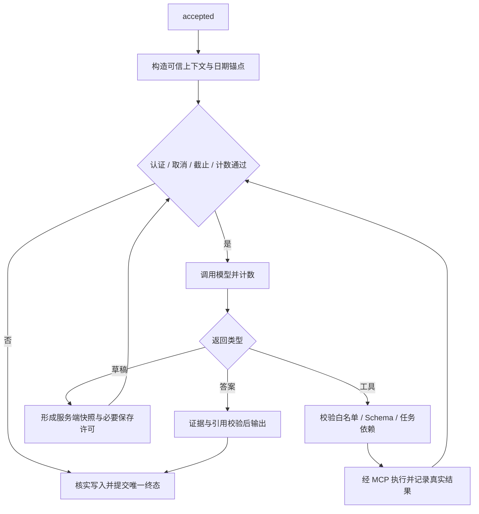
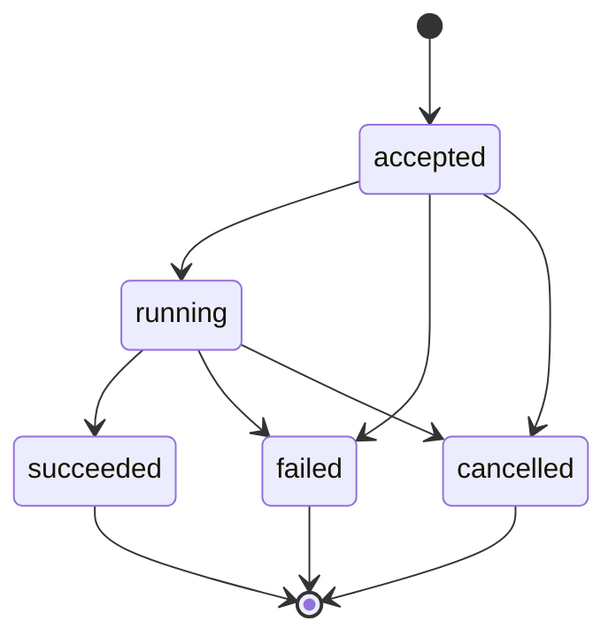

# 校园课程智能助手后端详细设计

文档编号：CCA-BE-LLD-001  
版本：v0.1｜日期：2026-10-21｜状态：待评审  
适用范围：单组织封闭试点 MVP（P0）  
输入：[PRD](校园课程智能助手_PRD_v0.1.md)、[SRS](校园课程智能助手_SRS_v0.1.md)、[HLD](校园课程智能助手_HLD_v0.1.md)

> 本文将 HLD 细化为可实施的后端契约、数据结构和执行算法。工作区尚无后端代码；本文及附件均为设计稿，未实际连接 MySQL、模型、Embedding 或向量服务。需求语义沿用 SRS，设计新增默认值和待验证项明确列出，不宣称已开发、已压测或已通过安全验收。

## 1. 设计产物与技术基线

### 1.1 产物清单

| 文件 | 用途 |
| --- | --- |
| 本文 | 模块 Interface、事务、并发、状态、恢复及验证规则 |
| [数据库 DDL](backend/cca_schema_v0.1.sql) | MySQL 建表、关键外键、索引及 CHECK 约束草案 |
| [OpenAPI](backend/openapi_v0.1.json) | 公共 HTTP Interface、内部工具 Interface 和请求响应 Schema |
| [MCP 工具契约](backend/mcp_tools_v0.1.json) | 三工具的 inputSchema/outputSchema，不包含模型可伪造的身份或许可 |
| [SSE 事件 Schema](backend/sse_events_v0.1.schema.json) | 六类事件的 data 校验与终态约束 |

这些文件共同构成 v0.1 设计包，正文解释跨字段、跨表、权限、幂等和顺序规则；Schema 不能表达的约束不得因生成客户端代码而省略。未来由后端模型生成 OpenAPI 时，应与此契约做差异检查。

### 1.2 技术选择

| 项目 | 本稿设计基线 | 冻结规则 |
| --- | --- | --- |
| HTTP / 校验 | Python、FastAPI、Pydantic；严格字段白名单 | Python 及依赖精确补丁版本在实现前写入锁文件 |
| 数据访问 | SQLAlchemy 异步访问、Alembic 迁移、MySQL InnoDB | DDL 以 MySQL 8.4 为验证目标；不声称最新版本 |
| 会话 / 密码 | 不透明 Bearer、SHA-256 令牌摘要、Argon2id 口令摘要 | Argon2id 参数与密码政策仍属 TBD-03 |
| AI | 模型、Embedding、向量存储各有受控 Interface | 供应商、模型标识、维度和精确依赖由 TBD-04/07 冻结 |
| MCP | 独立进程、私有 Streamable HTTP、固定三工具 | 协议协商与 SDK 兼容性实测后锁定，不开放动态外部服务发现 |
| 文件 / 任务 | 本地持久卷、MySQL 任务与租约 | 跨主机扩容前更换 FileStore Adapter |

SQLAlchemy 文档要求并发任务分别使用 AsyncSession；本设计每个短事务独立获取会话，禁止在并行工具、心跳和事件写出器之间共享会话。[依据：SQLAlchemy asyncio](https://docs.sqlalchemy.org/en/20/orm/extensions/asyncio.html#using-asyncsession-with-concurrent-tasks)

### 1.3 对 HLD 的细化

| 编号 | 细化规则 |
| --- | --- |
| BE-D01 | 外部资源 ID 使用带类型前缀的随机不透明字符串，内部也以该 ID 关联，不暴露自增序号 |
| BE-D02 | 除业务唯一键外，用 User 行锁串行化同用户敏感写入；多用户操作按 ID 升序锁定 |
| BE-D03 | 将草稿头与不可变草稿版本分表；每版预分配唯一 operation_id，首次保存才建立 WriteOperation |
| BE-D04 | 助手保存同时约束草稿来源轮和当前授权轮，防止通过后续指令或换键绕过任一轮的一份上限 |
| BE-D05 | pending 写入不由后台重放正文；恢复只核实已提交结果，确认未提交后允许当前用户以原键重试 |
| BE-D06 | AI 容量采用持久槽位，避免多 API 进程各自放出 5 个请求；文档任务使用独立额度 |
| BE-D07 | 文件 / 向量写入按任务执行代次隔离，清理须确认写入已停止和未知外部写入已收敛 |
| BE-D08 | API→MCP 与 MCP→内部 API 使用不同 audience 的服务认证；用户原始 Bearer 不透传 |

## 2. 工程组织与模块 Interface

### 2.1 目标目录

```text
backend/
  app/
    entrypoints/             # public_api、internal_api、mcp_server、worker
    modules/
      identity/              # 身份与角色
      academics/             # 课程与课表
      planning/              # 草稿、授权、计划及幂等事务
      assistant/             # 请求、预算、编排和 SSE
      knowledge/             # 批次、版本、检索及引用
      operations/            # 任务、审计、Outbox 与恢复
    adapters/                # MySQL、模型、Embedding、向量、文件、MCP
    shared/                  # ID、Clock、错误与配置；不放跨模块业务规则
  migrations/
  tests/                     # 契约、数据库集成、故障注入、端到端
```

每个 Module 在 `interface.py` 暴露有限的命令、查询和结果；Implementation 包含状态、事务与校验。调用方及测试跨同一 Interface，不能先读取 ORM 对象再自行决定是否授权。外部可变依赖以 Adapter 注入，避免为每个普通函数建立一层没有行为的转发接口。

### 2.2 主要方法

下列类型为设计记法，`ctx` 由认证依赖构造，`uow` 在方法内部管理；调用方不负责预先执行隐藏的锁或提交。

| Module | Interface | 行为、错误与调用约束 |
| --- | --- | --- |
| Identity | `login(command) -> SessionView` | 验证口令与状态，限时令牌只返回一次；失败统一文案 |
| Identity | `authenticate(raw_token) -> ActorContext` | 校验摘要、到期、撤销、auth_version 与 enabled |
| Identity | `change_student(ctx, id, command)` | 仅管理员，版本控制；禁用与会话撤销同事务 |
| Academics | `list_my_schedule(ctx, range, page)` | 身份固定；空结果和存储异常分离 |
| Academics | `mutate_schedule(ctx, command)` | 管理权限、学生锁、课程启停、重复与重叠、版本、审计 |
| Planning | `revise_draft(ctx, id, command) -> DraftView` | 生成新快照、撤销旧许可；不写 StudyPlan |
| Planning | `save(ctx, SaveCommand) -> SaveResult` | 包含许可签发、原键核实、同轮上限与唯一保存事务 |
| Planning | `mutate_plan(ctx, command) -> PlanView/DeleteView` | 本人管理、版本、正文清除与墓碑 |
| Assistant | `accept(ctx, ChatCommand) -> RunHandle` | 请求去重、活动槽、容量、预算与日期锚点；不重复执行 |
| Assistant | `cancel(ctx, request_id) -> RequestState` | 幂等取消，终态不改写，写入结果独立 |
| Knowledge | `accept_batch(ctx, files, options) -> BatchView` | 受控暂存、持久任务、整批不可见 |
| Knowledge | `search(ctx, query) -> EvidenceSet` | 语义候选、权威过滤、版本复查、可信引用 |
| Knowledge | `mutate_document(ctx, command) -> TaskView` | 重建 / 删除互斥，先不可见后清理 |
| Operations | `claim(kind, owner) -> TaskLease` | 短事务领取；返回任务代次，不长期持锁 |

ModelGateway、EmbeddingGateway、VectorStore、FileStore 是变化发生的 Seam。测试使用可注入失败、超时和不确定提交的 Adapter；权限与计划事务测试仍用真实 MySQL，而非仅模拟 Repository。

### 2.3 请求上下文

```python
ActorContext(user_id, session_id, auth_version, role, trace_request_id)
ExecutionContext(actor, chat_request_id, conversation_id, accepted_at,
                 school_timezone, deadline_at, execution_fence)
SaveCommand(source, operation_id, draft_id, draft_version,
            authorization_kind, authorization_chat_request_id, manual_fields)
```

这些类型不直接作为公共请求体。source、用户、角色、许可和 chat_request_id 由服务器映射；模型与客户端提交同名保留字段按 422 拒绝。时间与随机 ID 通过 Clock/IdGenerator 注入，便于冻结日期和重现竞态。

## 3. 通用契约与校验

### 3.1 HTTP 规则

公共基路径 `/api/v1`；内部独立监听器基路径 `/internal/v1`，不经公网代理暴露。普通结果为 `{request_id,data}`，失败为 `{request_id,error:{code,message,field_errors?,details?}}`；details 只含白名单元数据，例如本人的原请求 ID、冲突课表摘要或已确认保存状态。

所有 JSON 请求对象拒绝额外字段；未知查询参数同样拒绝。布尔、整数和日期不做宽松字符串强转，查询字符串及 multipart 字段按声明类型解析。响应禁止输出 password_hash、token_digest、存储键、委派凭据和供应商错误原文。

字符串按 Unicode 码点计数，不截断。账号与课程代码先 trim，再按 Unicode casefold 产生唯一规范值；不额外做音调折叠或合并不同名称。规范值用二进制排序语义存储，并对 casefold 展开后的最大长度校验。显示名、课程名、标题等保留有意义正文；标题 trim 后非空，正文不得全为空白。

### 3.2 字段规则

| 对象 | 校验 |
| --- | --- |
| 账号 / 显示名 | account 3–64；display_name 1–50；创建学生时服务端固定 role=student |
| 课程 | code 1–32、name 1–100、description≤2,000；code 创建后不可改 |
| 课表 | 日期 YYYY-MM-DD、时间 HH:mm；start<end，不能跨日；地点≤200；重叠 reason 1–500 |
| 计划 | title 1–100、goal≤500、content 1–10,000；日期同空或同时有值且有序 |
| 助手 | 当前 message trim 后 1–2,000；history≤40 条且为至多20个完整问答对；仅 user/assistant |
| 查询 | 个人课表跨度≤31自然日；page≥1，page_size 1–100；筛选长度按 OpenAPI |
| 上传 | 1–10 文件；单份20 MiB、整批50 MiB；实际字节、后缀与内容签名一致 |
| 版本 / 幂等 | expected_version≥1；Idempotency-Key 为1–96字符，限定可打印 ASCII 安全集合 |

PATCH 区分“字段缺失”和“显式 null”：缺失表示不改，null 仅允许清空可空字段。计划日期修改按合并后的完整记录校验。删除的 expected_version 放查询参数，避免依赖 DELETE 请求体兼容性；上传使用 multipart，其他变更使用 JSON。

### 3.3 错误映射

沿用 SRS IF-010，禁止返回原始数据库错误。唯一键名称映射 DUPLICATE_ACCOUNT/COURSE/SCHEDULE 或 IDEMPOTENCY_CONFLICT；乐观锁失败映射 VERSION_CONFLICT；未授权保存为 SAVE_NOT_AUTHORIZED；同轮重复为 SAVE_LIMIT_REACHED；文档并发为 DOCUMENT_BUSY。

只读依赖异常按能力映射 STORAGE_UNAVAILABLE、RETRIEVAL_UNAVAILABLE、MODEL_UNAVAILABLE 或 MCP_UNAVAILABLE。客户端只在明确可重试时重试；写入未知返回操作元数据与 pending，不归类为“确定未保存”。新增内部状态码须保持外部错误语义，不能用200空数据掩盖异常。

## 4. 关系数据详细设计

### 4.1 类型与约束原则

附件 DDL 使用 InnoDB、utf8mb4、UTC `DATETIME(6)`、`DATE`、分钟精度 `TIME`；ID 和幂等键采用 ASCII 二进制比较。使用应用生成的前缀+随机 ID，最长64字符。时间由数据库或统一 Clock 生成；单个事务使用同一当前时刻。

事务隔离建议 READ COMMITTED，关键决策使用明确行锁，不依赖范围空读自动阻止并发。业务外键默认 RESTRICT，不通过级联抹掉墓碑；自引用的活动版本等循环关联以建表后外键及事务校验建立。MySQL CHECK 用于局部合法性，跨表归属、当前版本和许可消费仍由事务保证。[依据：MySQL CHECK](https://dev.mysql.com/doc/refman/8.4/en/create-table-check-constraints.html)

### 4.2 表分组与关键读取

| 表 | 主要内容 / 读取约束 |
| --- | --- |
| users、auth_sessions | 账号规范值、口令摘要、enabled/auth_version；会话摘要、到期与撤销；无用户删除入口 |
| courses、schedules | 课程与日期课表；精确重复唯一键；课表按 user/date/start/id 查 |
| conversation_states、chat_requests | 用户与会话绑定、活动轮、请求摘要、终态、取消、租约、计数；无问答正文 |
| ai_capacity_slots | 固定容量槽、持有人、租约、fence；跨进程保护5个初始AI并发 |
| plan_drafts、plan_draft_versions | 草稿归属、来源轮、当前版本、到期；不可变payload、摘要、预分配操作键 |
| write_operations、save_grants | 原键、摘要、计划结果、恢复状态；许可绑定及消费状态 |
| assistant_save_slots、study_plans | 请求级唯一创建结果；个人计划与删除标记，删除正文置空 |
| corpus_control | 单组织检索代次、active_vector_space、发布冻结标记；切版与删除递增 revision |
| document_batches、documents、document_versions | 批次发布、文档可见性、活动版本、互斥变更、内部版本与索引代次 |
| chunks、citation_references | 片段位置与内部文本引用；不透明引用映射与失效墓碑，不对外给文件键 |
| background_tasks、storage_attempts | 任务租约、重试、执行代次；每代文件前缀、向量命名空间与外部写入收敛状态 |
| audit_events、outbox_events | 事务元数据审计、待输出事件；无正文、口令、令牌或完整工具参数 |

完整字段、空值、索引、外键及单行约束见 DDL。业务层额外保证复合归属一致：draft/version/grant/operation 的 user_id、session_id、请求与摘要必须相互对应；不能只因外键存在就认为有权访问。

### 4.3 重要查询

```sql
-- 私有计划先限定归属，再判断版本和删除状态。
SELECT id, version, title, content
FROM study_plans
WHERE user_id = :actor_id AND id = :plan_id AND deleted_at IS NULL;

-- [start,end) 半开区间，首尾相接不算重叠；需先持有学生行锁。
SELECT id, course_id, start_time, end_time
FROM schedules
WHERE user_id = :student_id AND class_date = :class_date
  AND start_time < :new_end AND end_time > :new_start
  AND id <> :excluded_id;

-- 版本更新必须检验影响行数；不省略归属条件。
UPDATE study_plans
SET title=:title, content=:content, version=version+1, updated_at=:now
WHERE id=:id AND user_id=:actor_id AND version=:expected
  AND deleted_at IS NULL;
```

计划标题筛选为受限子串匹配，转义通配符，不宣称普通 B-tree 可加速任意包含搜索；试点按实际记录量压测。分页排序保持更新时间与 ID 稳定次序。课程表名称关联用于当前课表展示，计划正文与依据为保存时快照。

### 4.4 规范化摘要与保留

PlanPayload 定义为 title、goal、start_date、end_date、content、basis_types、references。使用明确字段集合、UTF-8、键排序、无额外空白的 JSON 序列化，集合字段先去重并稳定排序，保留正文和换行，不隐式改写。摘要为 SHA-256；schema_version 同时参与摘要。

ChatRequest 的请求摘要覆盖当前问题、保留前原始合法历史、conversation_id 和接口版本，采用服务器密钥 HMAC-SHA-256，避免把低熵问题的普通摘要作为可枚举日志；只保存在受保护状态表，不写遥测。

草稿版本过期后清除 payload，保留必要ID、摘要与已保存映射；StudyPlan 删除后清除标题、目标、日期、正文、依据快照。WriteOperation、AssistantSaveSlot、文档不可见标记及引用墓碑按 TBD-06 保留，不能跟随30天日志清理直接删除。

## 5. 事务与锁协议

### 5.1 统一原则

一个应用方法管理一个或少量显式短事务；不得在事务内等待模型、Embedding、MCP、文件解析或向量网络请求。数据库死锁可在确认事务回滚后以原业务标识有限重试；COMMIT 连接异常必须先核实，不能视作回滚。

为阻止禁用与业务写入穿透，所有敏感写入先锁定当前操作者 User；涉及目标学生时一并按 ID 升序锁定，验证双方角色与启用状态。AuthSession 在 User 后锁定。普通只读与流输出复查权限，但不长时间持锁。

### 5.2 全局锁顺序

| 顺序 | 锁对象 | 适用路径 |
| --- | --- | --- |
| 1 | users，涉及多用户按 ID 升序 | 所有受保护写入、禁用、登录建立会话 |
| 2 | auth_sessions，按 ID 升序 | 登出、写入权限复核 |
| 3 | courses；conversation_states；chat_requests；ai_capacity_slots | 按固定表顺序，每表按ID；路径只锁需要的子集 |
| 4 | plan_drafts → plan_draft_versions → write_operations → save_grants → assistant_save_slots → study_plans | 草稿、保存、删除及结果核实 |
| 5 | corpus_control → document_batches → documents → document_versions → storage_attempts → background_tasks | 发布、重建、删除和任务收尾 |
| 6 | audit_events、outbox_events 插入 | 与业务结果同事务 |

任务领取在独立事务只锁 background_tasks 并提交；后续执行先从顺序5重新获取业务锁，最后校验任务代次，不得拿着已锁任务反向请求文档锁。结果恢复通过非锁定读取取得关联ID，再按统一顺序锁定并重新验证，不能相信第一次读取的归属、版本或状态。

### 5.3 并发规则

同用户写入串行化适用于试点规模，代价是单用户同时编辑会短暂等待；不将此锁持有至模型返回。课程停用与排课按 User/Session→Course 顺序协调。管理员课表变更锁目标学生，即使无现有课表行也能阻止两个事务同时通过空范围检查。

取消与助手保存都锁 ChatRequest，保存同时锁来源轮和当前授权轮（按ID排序）。先提交取消的事务使后续工具保存失败；先提交保存的事务保留计划，取消不能撤销。用户稍后主动点击草稿保存是新的直接操作，不被先前已完成或已取消的生成轮永久禁止，但仍受来源轮保存槽约束。

## 6. 身份与基础业务实现

### 6.1 登录与失效

1. 检查登录频率和输入；按 account_norm 查询，账号不存在时执行等效成本的虚拟摘要校验，避免明显时间差；对外统一认证失败。
2. Argon2id 验证在受限线程池执行，不阻塞异步事件循环；进入短事务锁 User 后复核 enabled、password_hash 未变化及 auth_version。
3. 生成32字节密码学随机令牌，base64url 编码；只持久化SHA-256摘要。建立2小时会话，原令牌仅登录响应返回一次。
4. API 认证每次查询 User 与 AuthSession 的当前状态；不以长时间进程缓存代替撤销检查。登出撤销当前会话；禁用学生递增 auth_version、撤销全部会话、撤销未消费许可并写审计。
5. 令牌过期或撤销后活动流只发通用认证失败，停止新私有输出；已发送网络数据不可撤回。

首次管理员由受控部署命令创建，参数经秘密输入，不使用默认演示口令；重复执行不得重置现有管理员。学生重置口令仍为受控运维流程，正式推广前按 TBD-03 完善。

### 6.2 用户、课程与课表

学生维护请求只能改 display_name/enabled；账号与角色不可改。课程维护只能改 name/description/enabled；代码不可改。所有 PATCH 带 expected_version，业务和审计一并提交。

排课算法：锁操作者与学生 → 验证目标为启用学生 → 锁课程并验证可用 → 检查精确重复 → 检查时间重叠 → 若未确认则返回409及允许查看的重叠摘要 → 若确认则要求非空原因并重查 → 插入或条件更新 → 写审计并提交。精确重复始终拒绝，不能以重叠确认放行。更新不得改变归属学生。

查询日期只传一端视为单日，两端不传为今天；相对日期按请求 accepted_at 和 Asia/Shanghai 解析，周一起算。查询本人工具不接受 student_id。明确要求他人私人课表时说明查询范围，不将本人结果冒充目标结果。

## 7. 计划草稿、许可与保存算法

### 7.1 草稿与授权关系

草稿头保存 user_id、session_id、conversation_id、origin_chat_request_id、current_version、expires_at；每个版本保存不可变payload、摘要和预分配 operation_id。编辑创建新版本，更新头指针，撤销旧版未消费许可。旧版本不得首次保存，但旧版本已经成功的操作仍可按原键查结果。

自然语言保存识别输出 `none / explicit / ambiguous / denied`；必须证明是当前直接指令而非引用、否定或历史转述。肯定规则的允许集合经过评测冻结；无法可靠确定时只形成草稿。模型判断只能作为候选，不能将其布尔结果直接变为 SaveGrant。

授权类型为 manual_form、draft_button、direct_instruction。手动表单可无草稿，但许可仍绑定用户、会话、操作和内容摘要；按钮绑定指定版本；自然语言明确生成并保存，待必要依据和草稿完成后签发许可，无额外强制确认。

BE-D04 具体处理：保存来源草稿时，占用 origin_chat_request_id 对应槽；若本次自然语言保存属于另一轮，也占用 authorization_chat_request_id 对应槽。同一ID只占一次；这两个请求均不能成功创建第二份。按钮请求的 HTTP trace_request_id 不伪装成 ChatRequest。重复保存同一草稿版本总是复用原 operation_id。

### 7.2 创建与提交

```python
async def save(actor, command):
    # 先查归属及关联ID，再在事务中按统一顺序重查。
    binding = await resolve_owned_save_binding(actor, command)
    existing = await read_operation(actor.user_id, binding.operation_id)
    if existing and existing.is_final:
        return verify_digest_and_return(existing, binding.digest)

    await ensure_pending_intent(actor, binding)  # 唯一键；不保存手动正文
    async with new_uow() as tx:
        await tx.lock_and_validate_actor(actor)
        await tx.lock_conversation_and_requests(binding.request_ids)
        await tx.lock_draft_head_and_version_if_any(binding)
        operation = await tx.lock_operation(binding.operation_id)
        if operation.is_final:
            return verify_digest_and_return(operation, binding.digest)
        await tx.validate_direct_authorization(command, binding)
        await tx.validate_draft_current_and_not_expired(binding)
        await tx.check_cancel_for_current_tool_execution(binding)
        grant = await tx.issue_or_lock_matching_grant(binding)
        await tx.validate_grant_digest_session_and_expiry(grant, binding)
        await tx.check_assistant_slots_available(binding.request_ids)
        plan = await tx.insert_plan_from_trusted_payload(binding)
        await tx.insert_assistant_slots(binding.request_ids, plan.id)
        await tx.consume_grant_and_succeed_operation(grant, operation, plan)
        await tx.attach_plan_to_chat_metadata(binding.request_ids, plan)
        await tx.append_audit_and_outbox("plan_saved", plan.id)
        await tx.commit()
    return created(plan.id, binding.operation_id)
```

伪代码只表达算法；退出事务前提交失败时不能返回 created。整个保存方法不调用模型、MCP或外部文件服务。ensure_pending_intent 同样遵循身份→草稿→操作锁顺序，与最终事务分离；并发调用在最终 WriteOperation 行锁处串行收敛。

### 7.3 结果与重试

| 持久状态 / 条件 | 返回 / 后续动作 |
| --- | --- |
| 无记录 | 不代表可越过许可；验证新直接操作后建立 pending |
| pending 且执行事务仍持锁 | 返回处理中或等待短时；不能抢占并再次创建 |
| succeeded 且摘要相同 | 200，status=existing，同一plan_id；不再计新建 |
| deleted | 200，status=deleted，原plan_id墓碑；不返回正文、不创建 |
| 同键异摘要 | 409 IDEMPOTENCY_CONFLICT，不覆盖 |
| 同轮槽已由其他操作占用 | 409 SAVE_LIMIT_REACHED；保留原结果 |
| 确认回滚且可重试 | failed/retryable=true；当前有效直接操作可用原键再试 |
| COMMIT 结果未知 | pending，resolution=recovering；新连接核实，禁止发确定失败 |
| 草稿过期、会话不匹配或旧版首次保存 | 410 DRAFT_EXPIRED 或422 SAVE_NOT_AUTHORIZED；零新增 |

原键复用还需核实source、草稿版本及请求绑定属于同一逻辑动作，不能仅因正文摘要碰巧相同就把其他来源当作同一保存。手动入口不得占用草稿预分配的服务器操作键；检查预留绑定和首次写入均受当前用户锁保护。

恢复进程按§5顺序锁定身份与原操作并查计划、许可消费与保存槽；取得操作行锁意味着前一数据库事务已结束，若锁等待超时则仍不能下“未提交”结论。发现成功结果则补齐可验证元数据；确认无创建结果才转为可重试失败。后台没有长期完整正文，不重新授予保存许可或自动保存。

跨会话重试先认证当前用户：已成功/已删除操作可按归属查询；旧会话草稿不可重新首次保存。手动表单在新有效会话再次明确提交原键同内容时，可重新授予匹配许可。接口不能仅因旧许可过期而隐藏已经完成的写入。

### 7.4 删除计划

按统一顺序锁用户、关联写入操作、保存槽和计划，再校验 expected_version；清空计划正文及依据快照，标记 deleted_at、递增版本，将创建操作状态置 deleted并保留槽和审计。个人列表/详情排除已删记录，原键只返回墓碑。界面删除对话、清空会话、用户取消均不调用此流程。

## 8. 助手执行与 SSE

### 8.1 接受与执行权

接受事务顺序为：认证用户与会话 → 获取/创建 ConversationState 并核实绑定 → 检查 client_request_id 唯一及摘要 → 检查同会话活动请求 → 锁定一个未占用AI容量槽 → 插入 accepted ChatRequest → 绑定容量槽request_id与会话active_request_id → 提交。新建请求的INSERT语句在容量槽关联更新之前完成，避免引用尚不存在的请求。

重复ID返回409 REQUEST_ALREADY_EXISTS及本人原请求状态入口；同会话运行返回 CHAT_IN_PROGRESS。无AI容量回滚接受事务并返回429。槽位按数据库时间判租约，初始5槽；增减需显式运维配置，不随 API 进程数量翻倍。

提交后在应用生命周期管理的独立任务中运行，不把执行任务绑定到 HTTP 响应生成器的销毁。runner 持有正文内存和有界事件队列；连接断开后仍在剩余预算内收尾。状态表只保存元数据，进程丢失不恢复完整生成。

### 8.2 调度算法



模型最多6次决策、工具最多10次、接受后60秒截止；每次重试和实际工具执行分别计数。先检查预算再分配调用，计数写 ChatRequest；运行代次 fence 防旧runner继续提交。多步依赖状态为 satisfied/empty/failed/ambiguous，必需依据非 satisfied 时阻断自动保存，不以模型声称“已查询”覆盖。

日期解析使用 accepted_at，转学校时区后确定今天、明天和下周一。同轮跨午夜不变。历史保留最近完整问答对，token预算不足则删最早整对并发 CONTEXT_TRUNCATED；引用解析不得使用已删历史。对合法但不成完整配对的history返回422，不允许伪造system/tool或信任历史assistant的业务事实。

### 8.3 生命周期与容量回收



更新终态时用 `state IN ('accepted','running') AND fence=:fence` 条件，成功仅一个更新者；同时释放活动会话槽和本runner持有的AI槽，记录回答终止Outbox。保存事务已独立登记plan_id，终态更新不能将其清空。

认证失效后的终结和系统恢复使用受限系统上下文：仍按锁顺序处理，但允许仅结束执行、回收槽位和记录错误，不要求旧会话继续有效，也不能读取或向用户输出私有正文。普通写入路径不得复用此例外授予许可。

runner 初始租约30秒、每10秒续租，均为BE新增可调默认值；截止仍为60秒。超过租约且旧进程不可恢复时，恢复器按锁协议确认后标failed/SERVICE_RESTARTED，递增fence，释放槽，不重跑模型。被回收的旧runner在下一执行/输出边界检查fence失败即退出；外部已发请求可能继续计费，不能保证物理并发立即归零。

### 8.4 SSE 写出规则

六类data结构见附件：status、tool_start、tool_end、token、done、error。统一写出器分配seq并检查身份、运行代次和证据状态；任何模块不能直接写 socket。首次status包含conversation_id，正文包含answer_block_id；tool_start/end按tool_call_id配对。

同连接最多一个终态，持久终态先提交再发done/error。发送失败不回滚状态。客户端按request_id+seq去重；不提供事件正文持久化和Last-Event-ID工具重放。心跳为SSE注释，不是业务事件。

事件队列建议64块、单块文本≤4,096码点、最多等待客户端背压2秒，均为设计默认值；超过则关闭慢连接，runner继续在预算内收尾并暴露状态查询，避免无限内存。正常正文可合并为约100毫秒一块以降低权限复查成本，非已验证阈值。来源强校验段落先有限缓冲再输出，延迟计入首段有效回答。

认证失效只输出通用error，不附plan_id、operation_id或引用。其他失败若已有确认计划则可携带本人结果。单纯断线不执行cancel；停止接口按持久取消标记作用于后续可中止边界。

## 9. MCP 与内部 Interface

### 9.1 协议选择

使用私有 `/mcp` Streamable HTTP 端点；JSON-RPC 与浏览器业务SSE为不同协议。GET按SDK支持提供服务器流或标准不支持响应；POST处理初始化及调用，校验协商协议版本和Origin。只监听回环或私网，浏览器不能直接连接。[依据：MCP Transports](https://modelcontextprotocol.io/specification/2025-11-25/basic/transports)

服务端只发布固定三工具，禁用通用管理工具、远程URL工具、动态安装和自动发现。MCP inputSchema/outputSchema见附件；协议版本与SDK具体版本仍需TBD-07联调验证。

### 9.2 双跳委派

```text
浏览器 Bearer → API认证 → 签发aud=cca-mcp的短期委派
API → MCP：服务身份 + 委派上下文（不进入工具arguments）
MCP校验 → 向内部委派兑换端点提交已验上下文
内部模块核实会话、scope、request/fence → 签发aud=cca-internal的受限凭据
MCP → 内部三工具端点：MCP服务身份 + 新audience凭据
```

委派声明至少包含iss、aud、sub、session_id、auth_version、request_id、conversation_id、scope、fence、iat、exp、jti。有效期取30秒与用户会话/本轮剩余时限较小者；中间服务不能放宽scope或延长原截止。采用受维护JOSE实现和独立签名密钥，固定算法与audience，不自行实现密码协议；具体算法、轮换和中间件归TBD-03/07。

MCP收到面向自身的凭据后不直接作为内部Bearer透传，而兑换成受众限定凭据。用户原Bearer、模型密钥均不离开所属模块。内部接口每次仍核实当前会话、enabled、auth_version、执行fence和操作权限，保存另外核实数据库许可。该设计落实MCP对受众校验和禁止token passthrough的要求；封闭服务认证不宣称已实现面向外部客户端的完整OAuth接入。[依据：MCP Security Best Practices](https://modelcontextprotocol.io/docs/2025-11-25/tutorials/security/security_best_practices)

### 9.3 工具结果

get_my_schedule为ok/empty及日期、时区、items；search_course_docs为ok/empty及权威chunks、references；save_study_plan为created/existing或已删墓碑。已删结果按工具错误语义返回受控错误，不把deleted伪装为新保存成功；外部HTTP状态查询仍可返回deleted。

课表工具读取完整查询日期范围，不能直接复用页面默认20条后声称是完整课表；若输出超过模型预算，应提示缩小范围或明确结果不完整，不静默丢弃安排。资料片段单项最多20,000码点且仍受总token预算约束，历史单条20,000码点是本稿新增传输保护值，不替代模型上下文校验。

MCP协议结构错误与工具业务失败分开：协议错误由JSON-RPC/SDK处理；业务失败返回isError=true及统一code/message/request_id；技术故障不能返回empty。审计只记录工具名、对象标识、结果、耗时，不记录完整arguments或返回正文。

## 10. 文档 Worker 与持久任务

### 10.1 接受与存储布局

上传时完成管理员认证、字节流计量、文件数、实际类型和同名策略；文件键为内部随机ID，拒绝路径分隔符影响存储。原件先在隔离上传区写临时文件，完成后标记sealed，事务建立批次、文档初版、任务和审计，再返回202。

数据库事务失败则补偿暂存；进程在两者之间崩溃的孤立对象由基于内部引用的巡检清理。accepted后发生无文字、损坏或向量化失败属于异步任务失败，不以HTTP202当作入库成功。同名继续标记只允许创建独立文档，不覆盖。

```text
uploads/{upload_id}/sealed-original
documents/{document_id}/original
attempts/{task_id}/{fence}/{version_id}/extracted-text
attempts/{task_id}/{fence}/{version_id}/chunk-manifest
向量namespace = vector_space / document_id / version_id / task_id / fence
```

该布局为内部约定，不返回客户端。解析子进程只读输入、输出受限临时文件，无向量/数据库写凭据、无不必要外网；只有Worker协调器写受控存储。

### 10.2 领取、心跳与重试

```sql
START TRANSACTION;
SELECT id FROM background_tasks
WHERE state IN ('pending','retry_wait') AND next_run_at <= UTC_TIMESTAMP(6)
ORDER BY priority DESC, next_run_at, id
LIMIT 1 FOR UPDATE SKIP LOCKED;
-- 对选中记录更新 running、owner、lease_until、attempt和fence后提交。
COMMIT;
```

SKIP LOCKED只用于队列式领取，不用于计划、权限或资料可见性查询，因为它会跳过锁定行而产生不完整视图。[依据：MySQL Locking Reads](https://dev.mysql.com/doc/refman/8.4/en/innodb-locking-reads.html)

BE初始值：任务租约30秒、10秒续租、轮询1秒、自动最多5次、退避2/4/8/16秒并加抖动；阶段超时取文件处理预算。服务启动60秒内扫描过期租约；正常依赖下5分钟清理目标优先于普通入库队列。值需在真实样本和故障测试后冻结。

领取提交后再执行任务；每次状态提交比较owner/fence/lease。外部操作前后检查代次；丢失租约不发布。解析失败不重试格式错误，外部暂时故障可有限重试；超出自动次数进入failed/需人工重试，补偿仍保持compensating或删除失败，不隐瞒残留。

### 10.3 入库与发布事务

每个版本依次抽取、校验非空、分块、Embedding、幂等upsert、索引可检索验证，写入storage_attempts清单。文件任务完成不等于批次发布；最后一个就绪者提交批次发布命令，事务锁corpus_control、batch、按ID排序的documents/versions与当前任务。

发布事务验证：批次仍processing、文档数=期望数、全部版本ready、所有attempt无未知写入、命名空间满足读写屏障、没有removed或并发变更、当前vector_space匹配。一次更新全部active指针、visibility=shared、版本active和batch=published，递增corpus revision，写审计与Outbox。发布失败可按同任务重试，不能部分发布。

### 10.4 重建与删除

重建入口使用Idempotency-Key与expected_version，锁Document检查mutation_task_id，创建新内部版本和任务；旧active继续可用。新版就绪后事务切指针、旧版retired并递增revision，再清理旧产物。失败保留旧active，解除互斥前登记完整错误。

删除事务先置removed、deleted_at、递增revision并创建清理任务；新检索及引用立即不可用。重建和删除不同操作并发为DOCUMENT_BUSY；相同键查原任务。清理重试只推进原删除范围，不能恢复visibility。

清理收尾先撤销引用并确认外部产物删除，再清空Document的active_version_id/原件键、各版本文本键并删除Chunk正文；版本和attempt可以保留不含正文的必要墓碑及清理结果，防止循环外键阻止恢复核实。若未来物理删除这些元数据，须先断开selected_attempt等循环指针并遵守TBD-06；保留墓碑不代表允许保留原件或可读取文本。

### 10.5 失败补偿与迟到写入

批次任一文件失败，将批次置compensating，阻止所有发布任务，撤销相关执行代次，再清理本批原件、文本、chunks、引用和全部attempt命名空间；其他批次不受影响。

租约失效不意味着外部写入已经停止。storage_attempts记录active/quiescing/unknown/cleaned：协调器先停止或终止本代解析/写入者，等待已发写操作得到确认；供应商响应丢失时标unknown，必须用Adapter的收敛查询/写入屏障证明不会再出现迟到写入，之后才删并验证为空。不能证明时保留清理未完成并告警。

FileStore/VectorStore Adapter必须提供幂等写、按attempt范围列举和删除、写入收敛屏障；若选定产品不具备该能力，需改变写入协调方案并验证，不能仅靠fence字段宣称完成跨存储隔离。这属于TBD-07的阻断性技术验证。

## 11. 检索、引用与版本一致性

### 11.1 检索步骤

1. 认证当前用户，读取corpus_control的vector_space和revision，查询是否存在有效共享资料；全库为空是明确状态，不依据向量返回空猜测。
2. 受控查询Embedding后取候选chunk_id/version_id，禁止模型传过滤user或数据库表达式。
3. 关系库批量复核batch=published、visibility=shared、deleted_at为空、active_version相同、版本active及vector_space一致；读取权威片段，不直接信任向量返回正文。
4. 每个document固定一个版本；过滤后不足可在剩余预算内扩大候选数，不混新旧版本。参数Top-K、重叠、阈值按TBD-04评测冻结，不以相似度直接证明规定成立。
5. 构建EvidenceSet，包含片段、reference_id、文件名、片段序号及可用页码；模型仅可引用本次清单。无页码则省略，不能猜。
6. 交给模型前复查revision；有变化则重新核实涉及资料。答案的规定类结论逐项关联依据，证据不足降级说明；普通学习建议另标。

### 11.2 引用与输出复查

引用reference_id在有效版本内稳定，不含存储路径；引用展开先认证，再核实当前共享和active状态。已删、切版或清理后的旧引用返回410，未知格式标识不透露内部信息。引用表可保留不含正文的失效墓碑。

流式输出以有限正文块为单位复查涉及文档；资料已变更则停止输出依赖旧片段的新内容，移除失效引用并说明变化，必要时重新检索。模型自造reference_id、文件名或URL不进入可信来源；清单外标记不渲染为有效引用。

不将corpus_control锁跨网络发送持有。权限和版本检查以写出边界的权威读取作为线性化点；已经进入网络或已对外模型发送的内容不能撤回。固定评测验证语义与引用，不能以机械存在来源替代结论正确性。

### 11.3 向量空间迁移

使用新vector_space重建派生向量并评测，发布冻结期间核对所有当前有效版本；通过一致恢复点下的映射表切换检索配置和有效版本命名空间。冻结只阻止新资料发布，不阻止删除；删除继续以关系库过滤。迁移失败保留旧空间，成功后后台清理旧空间。详细Adapter尚未选定前不生成假定可运行的迁移命令。

## 12. HTTP Interface 目录与响应

### 12.1 端点目录

所有字段、必填、响应及认证见附件OpenAPI。下表用于与SRS核对；`{id}`等均为不透明字符串。

| 方法 | 公共路径（省略/api/v1） | 关键行为 |
| --- | --- | --- |
| POST | /auth/login、/auth/logout | 登录无会话；退出撤销当前会话 |
| GET | /me | 当前用户、时区、能力与会话到期 |
| GET / POST | /admin/students、/admin/courses | 列表 / 创建；不提供管理员授权 |
| PATCH | /admin/students/{id}、/admin/courses/{id} | 白名单修改及expected_version |
| GET | /me/schedules、/admin/schedules | 本人 / 专用管理查询，不共用可替换用户参数 |
| POST / PATCH / DELETE | /admin/schedules、/admin/schedules/{id} | 重叠确认、版本、审计 |
| GET / POST | /me/plans | 本人列表 / 手动幂等创建 |
| GET / PATCH / DELETE | /me/plans/{id} | 本人详情 / 更新 / 删除 |
| GET / PATCH | /me/drafts/{draft_id} | 有效草稿 / 新版本 |
| POST | /me/drafts/{draft_id}/save | 指定版本授予许可，执行统一事务 |
| GET | /me/write-operations/{operation_id} | pending/succeeded/failed/deleted及resolution |
| POST | /admin/document-batches | multipart批量接受，202 |
| GET | /admin/document-batches/{id}、/admin/documents | 批次详情 / 文档分页 |
| GET | /admin/documents/{id}/text | 管理员抽取文本预览，偏移分页与长度限制 |
| POST / DELETE / POST | /admin/documents/{id}/rebuild、/admin/documents/{id}、/admin/documents/{id}/cleanup-retry | 重建 / 先不可见删除 / 清理重试 |
| GET | /citations/{reference_id} | 仍有效的共享片段 |
| POST | /chat/stream | 认证POST SSE，重复请求不重放 |
| GET / POST | /chat/requests/{request_id}、/chat/requests/{request_id}/cancel | 本人状态 / 取消 |

内部路径为POST `/internal/v1/delegations/exchange`、`/internal/v1/tools/get-my-schedule`、`/internal/v1/tools/search-course-docs`、`/internal/v1/tools/save-study-plan`。私有健康检查与指标不作为业务API开放，接口名称在部署实现时统一。

### 12.2 保存与状态示例

```json
{
  "request_id": "req_example",
  "data": {
    "status": "created",
    "operation_id": "op_example",
    "plan_id": "plan_example"
  }
}
```

```json
{
  "request_id": "req_status_example",
  "data": {
    "operation_id": "op_example",
    "state": "pending",
    "resolution": "recovering",
    "retryable": false
  }
}
```

当数据库不可用且不能核实操作时返回503及原operation_id安全提示，客户端仍显示待确认，不将其转换为failed。重试入口保留原键。写入已完成但计划后来被删除，状态为deleted且不含正文。

### 12.3 跨字段约束

OpenAPI通过严格对象、枚举、字符串界限表达结构；以下规则由Module执行：计划两日期同空或同填且有序、课表分钟精度和同日起止、查询31天、PATCH至少一个可变字段、历史完整问答对、幂等摘要相同、归属一致、同轮次数、draft当前版、批次全部ready与向量屏障。

设计选择OpenAPI 3.1.0文档格式，以便使用JSON Schema约束；这不是对最新规范版本的声明。[依据：OpenAPI 3.1.0](https://spec.openapis.org/oas/v3.1.0.html)

## 13. 配置、运维与恢复

### 13.1 配置分层

| 配置组 | 初始值 / 要求 |
| --- | --- |
| 学校与业务 | Asia/Shanghai；课表31日；分页20/100；字段长度按SRS |
| 会话与草稿 | 会话7200秒；草稿1800秒；无自动续期 |
| Agent | 5容量槽、6模型决策、10工具调用、60秒截止；token预算必须按模型填写 |
| 上传 | 10文件、20/50 MiB；具体解析内存/时间/展开上限未冻结前禁止试点资料上线 |
| 任务与恢复 | 30秒租约、10秒续租、1秒轮询、5次自动尝试；启动60秒内扫描；清理300秒目标 |
| 流式输出 | 64块队列、单块4096码点、2秒背压限值；正式阈值经压测冻结 |
| 外部依赖 | 固定供应商地址、模型、向量维度、检索空间、超时和额度；地址不从用户请求动态获取 |
| 审计保留 | 运行30天、审计180天，待TBD-06批准；墓碑独立策略 |
| 秘密 | 数据库、模型、Embedding、MCP服务凭据和签名私钥只在服务端秘密配置 |

启动校验超时与总预算关系、向量维度、必要秘密、文件目录权限和已迁移版本。模型或解析配置未冻结时可以运行普通业务开发环境；相应能力标记不可用，不能偷偷使用演示默认密钥或未审核资料。

### 13.2 生命周期

启动：验证配置 → 建立独立连接池和客户端 → 验证迁移版本 → 扫描过期请求/任务 → 注册当前进程instance_id → 开放接流量。公共API、内部API、Worker分别预算连接，内部回调不重新申请AI容量。

停止：停止接受新轮次与新任务 → 通知运行器在预算内收尾 → 对无法完成的请求写可恢复状态 → 释放确认归属的租约与连接。不能仅为快速退出将未知保存标failed或将processing批次强行published。

健康检查区分进程存活、核心数据库就绪和可降级依赖诊断。模型不可用不重启整个业务；数据库不可用时依赖身份的业务不可放行。

### 13.3 审计与Outbox

每次管理变更、计划提交、工具结束写元数据审计；计划创建的plan_saved仅与真实提交同事务产生。Outbox消费按event_id去重，发送失败不回滚已提交业务；重复消费不重复计新计划。错误日志不采集完整请求体、Authorization、内部凭据、SQL参数或文档正文。

指标覆盖empty/failed/cancelled/timeout/succeeded、写入unknown与幂等命中、任务积压、过期租约、清理超过300秒、备份失败。对外呼叫跟踪使用request_id和provider_call_id，供应商正文不记录。日志与Outbox不是业务备份。

### 13.4 迁移与恢复

DDL附件仅用于评审和新空库验证，不自动在已有库执行，不含DROP或默认账号。实际实现用版本化迁移逐步升级，兼容扩展优先；具体备份频率、RPO/RTO与责任人为TBD-02。

恢复顺序沿用HLD：隔离入口 → 恢复关系库及文件并重放到同一恢复点 → 恢复有效删除与幂等墓碑 → 校验资料active版本 → 验证/重建向量 → 收敛未完成请求与任务 → 运行隔离及旧键测试 → 开放。回退应用版本不得复活已删除计划或资料。

## 14. 验证方案与需求追踪

### 14.1 实现验证层次

| 层次 | 必须验证的行为 |
| --- | --- |
| 静态契约 | OpenAPI全部本地引用可解、operationId唯一、严格请求对象；DDL表和约束无重名；MCP与SSE Schema可解析 |
| Module Interface | 固定Clock的相对日期、长度码点、摘要、允许/拒绝保存示例、无效引用过滤 |
| MySQL集成 | 真正唯一键、行锁、乐观锁、并发课表重叠、保存/取消/禁用/删除竞态；不用SQLite替代锁验证 |
| 故障注入 | COMMIT确认丢失、模型超时、MCP不可用、索引延迟、部分写入、清理未知、进程重启与迟到Worker |
| 端到端 | 页面与工具数据一致、仅规划零持久计划、明确保存一份、断线后原结果、引用删除失效 |
| 质量与容量 | 至少50条固定AI评测；SRS性能样本量、正常负载完成率及5并发；记录配置和原始证据 |

### 14.2 高风险竞态用例

1. 同键同内容并发10次，仅一份计划、一个plan_saved；同键异内容冲突。
2. 同轮更换operation_id、两份不同草稿、后续“保存刚才这份”与按钮并发，来源轮与授权轮均不超一份。
3. COMMIT已落库但响应丢失、数据库暂不可读，先pending后核实原plan_id；不能创建第二份。
4. 禁用与保存并发、取消与保存并发，提交顺序可解释；已提交不撤回，新工具不穿透。
5. 计划已删后旧键、草稿旧版本、旧许可重放，不恢复正文、不复活计划。
6. 两个管理员同时向同学生空日期创建重叠课表，只有明确确认的重叠可以提交。
7. 同批一份正常一份扫描PDF、半批向量成功、发布点前后崩溃，批次始终全可见或全不可见。
8. 重建切版与检索并发、删除与模型输出并发、过期Worker迟到写入，旧引用不可用，未知清理不报完成。
9. 同会话多API进程接受、5容量槽并发、进程租约回收，既不重复执行也不把其他活进程误终结。
10. 伪造system/tool历史、user_id、role、上下文audience、凭据和资料内指令，均无法取得权限或保存许可。

### 14.3 SRS—详细设计—验收

| 需求 | 本文 / 附件 | 验收 |
| --- | --- | --- |
| FR-AUTH-001—004 | §3/5/6/9；身份表与认证Schema | AT-01—04 |
| FR-COURSE-001/002、FR-SCH-001—004 | §4/5/6；课程课表DDL与接口 | AT-05—09 |
| FR-DOC-001—007 | §10/11；资料任务DDL与管理接口 | AT-10—15 |
| FR-CHAT-001—006 | §7/8/9；ChatRequest、容量槽、SSE Schema | AT-16—21 |
| FR-QA-001—004 | §11；EvidenceSet、引用接口与MCP | AT-22/23 |
| FR-PLAN-001—005 | §4/5/7；计划、草稿、许可、操作与保存槽 | AT-20/24—27 |
| FR-GUARD-001/002 | §3/6/8/9/11；严格Schema与委派 | AT-28/31 |
| FR-OPS-001/002 | §13；审计与Outbox | AT-29 |
| DR-001—005、IF-001—010 | §3/4/12；DDL、OpenAPI、MCP、SSE | 契约检查与 AT-04/08/09/18/20/24/28 |
| NFR-PERF-001—005、NFR-REL-001—003 | §5/8/10/13/14；限额、恢复和独立业务路径 | AT-15/30/33 |
| NFR-SEC-001—003、NFR-PRIV-001、NFR-OBS-001 | §3/6/9/10/11/13 | AT-29/31与安全专测 |
| NFR-AI-001、NFR-UX-001、NFR-COMP-001 | §3/8/11/14；状态与可核实结果支持前端 | AT-31/32 |

INV-01—07的实施点分别为：归属限定与委派；操作及请求唯一槽；应用层许可；权威发布过滤；提交后成功语义；不可信内容不得授权；条件终态与独立写入状态。上述测试需逐项留证，不以平均问答满意度代替关键正确性。

### 14.4 本次设计包检查

已完成JSON解析、本地Schema引用解析、operationId与路径参数检查、请求字段白名单检查、文档链接和编号检查、DDL外键目标结构检查、三工具白名单和六类SSE事件核对。设计包包含23张表、38个HTTP操作和56个OpenAPI Schema；追踪映射覆盖SRS的57个显式功能/数据/非功能需求编号及33项AT编号。

上述是文档与契约静态检查，不是完整规范验证器或MySQL执行结果。本机Docker未运行，未实际执行DDL；数据库锁、适配器屏障、MCP联调、性能和AI效果仍需按§14.1验证。

## 15. 待定项与实现入口条件

| SRS待定项 | 本设计已给出 | 仍需冻结 |
| --- | --- | --- |
| TBD-01 | 管理员开户、具体日期课表、单组织 | 业务责任人、真实试点与资料来源签认 |
| TBD-02 | 数据范围、恢复顺序与验证场景 | 主机规格、RPO/RTO、周期、备份位置和演练 |
| TBD-03 | 不透明会话、摘要、撤销和双跳委派 | 口令政策、Argon2id参数、签名算法与库、重置、密钥轮换 |
| TBD-04 | 预算检查、依据校验、保存策略输出 | 模型、token、检索参数、语义许可示例集与评测结果 |
| TBD-05 | 文件格式、隔离与外发最小范围 | CPU/内存/展开量/解析时限、资料准入及安全样本 |
| TBD-06 | 删除正文、引用和操作墓碑独立保留 | 最终保留期限、标识重试窗口、备份删除政策 |
| TBD-07 | 端点、DDL、Schema、任务和存储Interface | 精确版本、驱动、MCP中间件、向量产品及收敛屏障实证 |

设计评审应重点确认BE-D01—08、事务锁顺序、两轮保存槽、未知提交处理、迟到写入屏障和Schema一致性。可以先实现不依赖外部AI的业务、表与事务；阻断性待定项未冻结前，不宣称相应功能达到试点发布条件。
